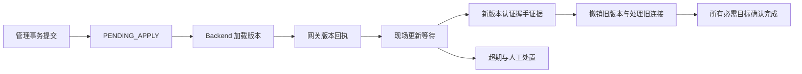

# OCMS 详细开发计划书

> 文档版本：1.0 · 2026-10-18
>
> 适用范围：首期阶段 0–3，接入、监控、告警及工单闭环。
>
> 文档状态：可用于开发分工、契约细化和验收准备；软件尚未实现，本文件不代表环境、性能或生产发布已经验证通过。

**目标：**将 OCMS 从设计文档落实为独立部署的云端业务系统，完成“租户建站 → 设备登记 → 接入确认 → 实时与历史监控 → 告警通知 → 工单验收”。

**架构：**OCMS 直接读写 OpenEMS 侧公共 PostgreSQL，并通过 B2B API 获取运行数据；公共租户、资产和授权只有一套主数据，OCMS 业务库独立。Metadata.Tenant 和必要的 Backend/网关适配承担接入鉴权、运行事件及生效确认。

**技术方向：**Java 21、Spring Boot、Vue 3、TypeScript、ECharts、PostgreSQL、InfluxDB；具体依赖版本在 M0 兼容性测试后冻结，不将 latest/develop 作为生产锁定版本。

**执行方式：**使用 executing-plans 按工作包实施，每个工作包先固定契约和失败用例，再开发、验证、评审和提交。本文是详细交付计划，不要求一次性生成全部工程。

## 1. 文档依据与阅读方式

### 1.1 基线与当前事实

| 依据 | 用途 |
| --- | --- |
| [OCMS 协同设计 v2.2](openems_cloud_management_design.md) | 架构、领域边界、现有接口约束 |
| [首期实施计划 v1.2](docs/superpowers/plans/2026-10-17-ocms-phase1-development-plan.md) | 当前实施任务、准确文件路径、共享类型、测试和提交步骤 |
| [现有 OpenEMS 与 Odoo 接口](OPENEMS_EXTERNAL_AND_ODOO_INTERFACES.md) | 存量接入方式及迁移来源 |
| [模块与部署盘点](OPENEMS_ARCHITECTURE_AND_UNINSTALLED_MODULES.md) | 目标环境核验输入 |
| [储能监控功能报告](储能管理系统监控侧功能全景报告_2026-10-14.md) | 点表、页面能力及业务验收对照 |

编写时本地仓库以文档、Odoo 扩展及演示脚本为主，尚无完整 OCMS 工程。文档所述服务器部署及源码 commit `01083d6` 是待核验输入，本次编写没有连接生产服务器验证。

本文件基于首期计划 v1.1 编写，推送整合时远程实施计划已更新为 v1.2。本文保留 T01–T12 作为估算与交付工作包；v1.2 的 15 个实施任务中，T03A/T03B 汇入本文 T03，T04A/T04B 汇入 T04，T09A/T09B 汇入 T09，其余编号一一对应，不能将两份文档的工作量重复相加。

实施文件路径、精确 Java 类型和构建步骤以 v1.2 为准；本文补充人员估算、业务验收和发布细节。本文新增的密钥领取不可重放、状态对账和通知切换等行为要求，应在 M0 同步到对应实施任务与契约测试。新增字段、接口、测试入口、人员与工期均为计划，不表示它们已经存在。功能范围以已确认首期边界为准；迁移验收拆为“只读试点前”和“正式切换前”两个门禁，避免要求试点前完成只有切换阶段才执行的演练。

### 1.2 读者与使用责任

- 项目负责人使用里程碑、资源和风险表组织交付，不按代码行数核算进度。
- 开发人员使用工作包、接口、数据契约与失败用例拆分 PR。
- 测试人员使用验收编号建立用例，保存版本、输入、输出与故障注入证据。
- 运维与现场人员使用环境、密钥迁移、切换和回滚步骤准备演练。
- 产品/业务负责人确认权限、规则、工单流转和指标口径，签收试点结果。

## 2. 首期范围与成功标准

### 2.1 交付能力

| 业务域 | 首期能力 | 可观察完成结果 |
| --- | --- | --- |
| 公共管理 | 登录、租户、成员、站点、资产、设备授权、密钥 | 可登记设备并查询 Backend/网关应用进度 |
| OpenEMS 适配 | Metadata.Tenant、B2B 认证、事件挂点、网关回执 | 配置版本与接入凭据状态有真实回执 |
| 监控 | 站点列表、单站概览、能量流、状态、只读配置 | 值、时间、单位、质量一致展示 |
| 历史 | 曲线、固定口径聚合、异步报表 | 按授权查询，直查与 API 样本对照通过 |
| 告警 | 原生状态、离线、阈值、质量、规则版本、确认 | 可重放持久事件，未知区间明确可见 |
| 运维 | 派单、接单、处理、附件、验收、退回与关闭 | 同租户关联和审计完整，规则修改不误关工单 |
| 通知 | 站内通知、SMTP 邮件、重试和失败记录 | 告警落库后可靠产生发送任务 |
| 迁移交付 | 导入、差异、试点、最终同步、反向同步 | 撤销凭据不因回滚恢复有效 |

### 2.2 明确排除

首期不开放远程组件写配置、通道写入、调度、收益结算、远程系统日志、跨租户/跨集群资产转移，以及多活/跨区域部署。原生工程工具可以作为受控维护入口保留；OCMS 不提供任意 `edgeRpc` 或 `componentJsonApi` 透传。

后续开放控制必须补齐执行前重新授权、嵌套方法白名单、执行端并发保护、命令有效期与 UNKNOWN 核对。本期不提前建设空的控制/结算业务表和页面。

### 2.3 固定工程选择

- 同一运营主体、受控内网；浏览器只访问 OCMS，数据库凭据只在服务端。
- 两个逻辑数据库、独立账号；元数据管理和运行观测拆表，双方不得整行覆盖同一资产。
- 首期生产一个区域、一个集群、一个活动 Backend、一个活动 OCMS；部署租约用于阻止重叠运行，不作为多活能力承诺。
- 每集群独立 Influx bucket；测试覆盖两个集群同名 edge0。存量数字标签保持，新增数字在同一实例/组织/bucket/measurement 内唯一。
- PostgreSQL 持久事件处理管理变化和重要运行变化；首期不引入 Kafka、Redis 或自建磁盘 WAL。
- 原始遥测默认只读；高频数值不逐点写 PostgreSQL 事件表。阈值补算受历史精度约束。
- 公共库和业务库 RLS 与应用授权共同执行；父子租户不隐式继承访问权。

## 3. 项目组织、工作量与里程碑

### 3.1 资源假设

以下为估算所用配置，并非用户已经配备这些人员。角色可由同一人兼任，但相应任务不能按多人并行排期。

| 角色 | 投入假设 | 主要职责 |
| --- | --- | --- |
| 平台后端 A | 1 人全时 | 公共模型、身份、租户、资产、业务库和迁移工具 |
| 集成后端 B | 1 人全时 | OSGi、B2B、网关、事件、历史适配与运行故障 |
| 前端 C | 1 人全时 | 门户、管理、曲线、告警工单及交互验收 |
| 测试 D | 1 人全时 | 自动化、契约、故障注入、隔离、性能和验收报告 |
| 运维 E | 约 0.5 人 | 环境、CI、制品、备份恢复、发布和现场协作 |
| 产品/技术负责人 F | 约 0.3 人 | 规则口径、方案决策、评审、风险与试点签收 |

A/B 的关键适配与领域任务不可完全互换；估算工期受集成后端这条依赖链影响，不能将总人日简单除以团队人数。

### 3.2 工作量区间

人日包含该包的开发、针对性测试、评审修订和技术说明；T12 仅计算系统级集成与发布演练，避免再次计入各模块单元测试。培训、采购等待、外部认证和大规模存量清洗不在基础区间。

| 工作包 | 主责任 | 参与 | 估算人日 | 主要前置 |
| --- | --- | --- | --- | --- |
| T01 环境与契约 | B | A、D、E、F | 8–12 | 测试环境及源材料可用 |
| T02 工程与 CI | A | C、D、E | 8–12 | T01 初步契约 |
| T03 迁移工具 | A | B、D、E | 15–22 | T01，分阶段依赖 T04/T05 |
| T04 身份与资产 | A | C、D | 20–28 | T02 |
| T05 Metadata | B | A、D | 18–26 | T04 领域契约 |
| T06 网关与轮换 | B | C、D、E | 15–22 | T05、现场测试设备 |
| T07 实时监控 | B | C、D | 18–25 | T04，联调依赖 T05 |
| T08 历史报表 | B | A、C、D | 12–18 | T04、时序映射 |
| T09 运行事件 | B | A、D | 15–22 | T05 |
| T10 告警通知 | A | B、C、D | 20–28 | T07/T09 |
| T11 工单 | A | C、D | 15–22 | T10 契约 |
| T12 集成发布 | E | 全体 | 12–18 | 全部功能门禁 |
| 合计 | — | — | **176–255** | 不含风险预留 |

风险预留按基础人日的 20%–30% 计算，约 **212–332 人日**（端点向上取整）。这只是初始估算；M0 后用真实接口差异、有效投入和试点规模重新估算，记录基线变更。若不能取得目标源码、网关确认需重构、现场点表需新增驱动，单独增项而非隐藏在普通缓冲中。

### 3.3 相对排期

在上述投入、环境可及时提供的假设下，以 **18–22 个工作周**作为初始排期区间，含集成缓冲，不指定未经确认的开始/上线日期。

| 周期参考 | 目标 | 并行安排 | 退出门禁 |
| --- | --- | --- | --- |
| W1–W2 | M0 契约基线 | T01、T02 基础环境、T03 盘点 | G0：版本/点表/验收参数冻结 |
| W3–W6 | 公共管理可用 | T04、T03 导入、T05；前端按契约开发 | G1a：双库隔离及管理事务通过 |
| W7–W10 | M1 接入与轮换 | T06，T07/T08 适配；B 按网关→监控顺序投入 | G1：登记、握手、撤销闭环 |
| W11–W13 | M2 监控与可靠输入 | T07/T08 联调、T09；A 开发规则基础 | G2：实时/历史隔离与事件恢复通过 |
| W14–W17 | M3 告警工单 | T10/T11、迁移反向同步、系统回归 | G3：故障到工单闭环 |
| W18–W22 | 试点及发布准备 | T12、容量/恢复、缺陷修复和缓冲 | G4：试点与切换演练签收 |

这不是所有工作包同时启动的承诺。技术负责人每周按 A/B 实际负载排定下一批子任务；前端可模拟开发，里程碑通过必须连接真实服务。未满足门禁，后续不依赖它的工作可继续，依赖它的发布不能开始。

## 4. 工程结构与开发规范

### 4.1 逻辑模块划分

下图用于说明模块责任，不作为另一套实施文件清单。实际目录按首期实施计划 v1.2 §1 创建：契约文件放 `docs/ocms/`，部署文件放 `deploy/ocms/`，迁移工具位于实施计划指定的 migration 模块；下图的独立 CLI 表示工具责任，不要求额外拆 Maven 模块。

```text
ocms/
  pom.xml / .mvn/ / mvnw
  platform-contracts/       标识、事件、质量、版本和 DTO
  tenant-domain/            身份、租户、资产和授权事务规则
  tenant-jdbc/              公共库仓储与版本化 SQL
  ocms-server/              身份入口、业务、B2B、时序、事件消费
  ocms-migration-cli/       导入、对账、切换及反向同步
  ocms-web/                 Vue 门户与前端测试
  contracts/               OpenAPI、事件 JSON Schema、报文样本
  tests/                   契约、场景与故障注入夹具
  deploy/                  配置模板、服务定义和演练脚本
openems-adapters/
  upstream.lock            上游完整 commit、校验与构建说明
  metadata-tenant/          OSGi 插件
  patches/                 Backend 挂点及必要兼容修复
  gateway-apply-adapter/    版本回执、撤销与握手证据
```

这些路径是未来实现位置，当前交付只有本文。统一将 Maven Wrapper 放在 `ocms/`，验收使用 `./ocms/mvnw -f ocms/pom.xml verify`；此前计划中的根目录 Wrapper 命令在实际建工程时统一为这一入口。

### 4.2 每个子任务的完成定义

1. 输入/输出、权限、状态和失败行为已有契约，任务关联本文件 T 编号与验收 AC 编号。
2. 先编写有意义的失败用例，确认失败原因；实现最小行为并验证转绿。
3. 运行模块检查，再运行受影响集成测试；前端完成类型检查、组件测试及构建。
4. 提交中包含必要迁移、测试与说明；代码评审检查线程/事务边界和日志秘密泄漏。
5. 验收报告附 commit、环境、命令、断言与结果；不以“代码写完”代替功能通过。

每个 PR 尽量交付一个可验证行为。数据库采用先扩展、兼容读写、迁移后收缩；OCMS/Metadata 声明支持的 schema 区间，版本不兼容时拒绝启动相应功能而不是带病运行。

## 5. 数据库与协议开发契约

### 5.1 公共元数据库

表名为本项目新增契约；T01 产出准确 DDL，T02 创建迁移脚本，T04/T05/T09 实现写入行为。没有跨两个数据库的外键。

| 表组 | 必需字段/约束 | 写入责任 |
| --- | --- | --- |
| tenant.tenant、tenant_closure | UUID、parent、状态、revision；层级无环 | 公共管理 |
| app_user、user_session、tenant_membership | 用户、租户、角色、状态；会话令牌仅存摘要、期限与撤销时间 | 身份/公共管理 |
| site、edge、storage_locator | tenant/site 一致；asset UUID；cluster+remote ID 唯一；数字存储标签唯一 | 公共管理 |
| openems_cluster、service_identity、edge_grant | 集群定位、凭据引用、按资产角色；无客户端自选服务账号 | 平台管理 |
| edge_credential、credential_rotation | 密文、摘要、版本、状态、截止时间、领取/现场迁移状态 | 公共管理 |
| audit_log、operation、operation_target | 操作者、摘要、请求、对象版本、目标消费者及应用结果 | 公共管理/确认组件 |
| runtime.edge_registry | 同库事务更新的接入投影，无明文秘密 | 公共管理 |
| edge_status、edge_config_snapshot/history | asset、epoch/sequence、观测时间、哈希、配置 | Backend |
| integration.change_event/change_delivery | event ID、对象 revision、目标、租约、尝试、确认；event+consumer 唯一 | 管理事务/投递器 |
| runtime_event/runtime_delivery/runtime_gap | 运行事件、逐消费者确认、缺口范围；event ID 与资产代次序号去重 | Backend/消费者 |
| consumer_state、producer_checkpoint | 启动代次、完整覆盖边界、对账时间、生命周期 | 运行适配器 |

新设备命名采用 `edge<数字>`；导入保留存量名称，但解析出的数字冲突使导入验证失败。storage_locator 同时保存实例/组织，避免不同 Influx 实例名称相同造成误判。

### 5.2 OCMS 业务数据库

| 表组 | 核心约束 |
| --- | --- |
| alarm_rule、alarm_rule_version | 稳定 rule_id；不可变版本；有效区间不重叠；保存阈值、迟滞、触发和恢复窗口 |
| alarm_occurrence、alarm_transition、rule_evaluation_state | asset/rule/version/channel 唯一活动评估；信号与处置分离；持久化防抖和证据 |
| event_inbox、notification_outbox、notification_attempt | event ID 唯一；告警和 outbox 同事务；尝试与逻辑通知分别记录 |
| work_order、work_order_alarm、work_order_log | revision；关联同租户；工单流转留历史 |
| attachment、export_job、business_audit | tenant、所有者/资产范围、存储引用、保留期、状态；文件下载重新授权 |
| migration_run、migration_mapping | run ID、源 ID→UUID、清单与差异；明文秘密不进入报告 |

面向租户的数据及从属记录均有 tenant_id；租户关联使用复合唯一键/外键防止跨租户串接。跨库的资产存在性和权限在服务端核验，业务库存储的 tenant_id 不能由浏览器任意设置。

### 5.3 数据访问与身份默认值

- 公共库使用 manager、reader、backend_runtime 和 migration_owner；业务库使用独立业务读写与 worker 账号。运行账号非表所有者、非超级用户、无 BYPASSRLS。
- 每个请求事务使用验证后的主体与租户上下文，缺失上下文拒绝；后台 worker 按其授权租户逐批工作，不设置通配租户。
- 首期门户使用服务端不透明会话，令牌放 Secure/HttpOnly/SameSite Cookie，写请求校验 CSRF；默认空闲 30 分钟、绝对期限 12 小时，可配置。B2B 按目标版本使用 Basic 服务身份，与门户会话分离。
- 新密码使用 Spring Security 的 Argon2id 实现并保存算法标识，M0 在目标机器校准参数；旧哈希仅在认证兼容测试通过后启用迁移验证器，否则强制重置。密码、数据库连接密码、设备密钥都不写日志。
- 查询、列表、导出、订阅、附件和异步任务执行均执行资产权限检查。权限变化令活动门户订阅失效；公共权限源不可用时不以旧允许结果放行新的敏感操作。

### 5.4 内部接口

以下为业务接口的语义示意，不另外定义与 v1.2 同名异构的 Java 类型。实施时使用首期实施计划 v1.2 的共享类型和签名，并将本文新增行为纳入对应契约；方法不直接暴露 JDBC/HTTP 类型。

```java
AssetLocator resolveAuthorizedAsset(ActorContext actor, UUID assetId, Permission permission);
OperationRef registerEdge(ActorContext actor, RegisterEdgeCommand command, String idempotencyKey);
ApplyReceipt applyMetadataVersion(ChangeEvent event, ConsumerIdentity consumer);
OfferResult offerRuntimeEvent(RuntimeObservation observation); // 非阻塞，ACCEPTED/GAP_RECORDED
TelemetrySample evaluateQuality(ChannelContract contract, RawSample sample, Instant now);
HistoryResult queryHistory(ActorContext actor, HistoryQuery query);
ConsumeResult consumeRuntimeEvent(RuntimeEvent event); // 业务事务提交后才可 ACK
AlarmTransition evaluateRule(RuleVersion rule, EvaluationState state, QualifiedObservation input);
WorkOrder transitionWorkOrder(ActorContext actor, UUID id, long expectedRevision, WorkOrderAction action);
```

RuntimeEvent 必须包含 event_id、asset_id、producer_epoch、asset_sequence、observed_at、可空 occurred_at、类型、配置版本和载荷。通知幂等键绑定 occurrence 与通知类型；不把传输重试编号当成新的业务通知。

## 6. 北向 API 与前端交付

### 6.1 API 清单

所有路径位于 `/api/v1`；响应中的 UUID 用字符串、时间用 UTC ISO 8601，站点时区另外传递。以下写请求均需鉴权和适用的幂等键，更新已有资源需预期 revision。

| 方法/路径 | 用途 | 关键响应/限制 | 工作包 |
| --- | --- | --- | --- |
| POST /auth/login、/auth/logout；GET /me | 会话与有效权限 | 认证失败统一错误，不回传密码摘要 | T04 |
| GET/POST /tenants；GET/POST /tenants/{id}/members | 组织与人员 | 限定可管理范围，平台操作单独审计 | T04 |
| GET/POST /sites；GET/POST /edges；PATCH /edges/{id} | 站点和登记信息 | asset_id、revision、operation_id | T04 |
| PUT /edges/{id}/grants | 授权变更 | operation_id；原生 UI 同步约束 | T04/T05 |
| POST /edges/{id}/credentials/rotations | 正常轮换 | rotation_id、截止时间、应用进度 | T06 |
| POST /credential-rotations/{id}/claim | 安全领取 | 重新认证、Cache-Control: no-store、脱敏审计 | T06 |
| POST /edges/{id}/credentials/{version}/revoke | 撤销版本 | operation_id 和各目标结果 | T06 |
| GET /operations/{id} | 管理生效状态 | 提交状态、每消费者版本、握手/断开证据 | T05/T06 |
| GET /edges/{id}/history；POST /exports | 曲线和报表 | [start,end)、质量、任务 ID | T08 |
| GET /exports/{id}；GET /exports/{id}/download | 任务状态与文件 | 下载时再次授权；文件不公开直链 | T08 |
| GET/POST /alarm-rules；POST /alarm-rules/{id}/versions | 规则与新版本 | 生效时间、版本、被替代版本 | T10 |
| GET /alarms；POST /alarms/{id}/acknowledge | 查看和确认 | 信号、处置、版本、证据 | T10 |
| GET/POST /work-orders；POST /work-orders/{id}/actions | 工单 | revision、流转日志、告警关联 | T11 |
| POST /work-orders/{id}/attachments；GET /attachments/{id} | 附件 | 服务端存储名、租户检查 | T11 |
| WebSocket /stream | 门户实时推送 | 同源会话鉴权；服务端验证每个 asset_id | T07 |

默认分页 20、最大 100；历史单请求最多 20 通道、31 天、总计 100,000 个返回点，超限返回明确错误并引导缩小范围或异步报表。每租户首期最多 2 个并行导出，阈值通过 M0 负载校验后冻结。限制在后端执行，前端仅用于提示。

普通写请求的幂等记录在对应数据库与领域写入同事务保存，键范围为主体+租户+路由+幂等键，并存请求摘要和脱敏原结果；保留至少 7 天。密钥 claim 是例外：只记录领取凭证已消费、主体和版本，不保存或重放含秘密的响应。领取状态在发送首次响应前提交；响应丢失或提交后进程退出，重试返回 409 `CLAIM_RESULT_UNAVAILABLE` 和受控处理指引，不能再次返回原密钥。过期重复请求仍受领域唯一约束；凭据轮换额外限制每资产一个未终结正常轮换。返回 401/403、409、422、429、503 分别表达认证/授权、版本/幂等冲突、语义错误、额度和依赖不可用，响应带 request_id。

### 6.2 页面与验收重点

| 页面组 | 必备状态 | 验收 |
| --- | --- | --- |
| 登录/租户切换 | 会话失效、禁止访问、空租户 | 切换租户清理旧缓存和订阅 |
| 站点/设备管理 | 创建、重复 ID、版本冲突、生效中/失败 | 数据已提交不能显示成网关已应用 |
| 轮换操作 | 网关等待、现场等待、新版本握手、超期 | 不展示列表密钥；人工确认不能替代握手 |
| 概览/能量流 | 加载、无点位、UNKNOWN、STALE、离线 | null 不变零，方向/单位取点表 |
| 历史/导出 | 无数据、缺口、查询超限、任务失败 | 时间范围与站点时区可见 |
| 告警中心 | 活动、恢复、未知、规则替换、延迟发现 | 信号与人工处置分别展示 |
| 工单 | 权限不足、并发冲突、退回/取消、附件失败 | 未知状态禁止自动恢复验收 |

前端组件测试覆盖数据质量和权限状态，端到端测试覆盖完整用户流程。颜色不是唯一状态表达方式，状态同时提供文本、时间和原因。

## 7. 分项开发工作包

每行子任务可转为开发任务卡；主责按第 3 节，估算按工作包整体计，不重复累加子任务。下文“测试”都是待实现验收，不代表已经运行。

### T01：版本、环境与契约核验

**输入：**源码/JAR、配置、存量 schema、测试账号、点表。**输出：**版本锁、能力矩阵、准确接口/DDL 草案、验收配置与兼容补丁清单。

| 子任务 | 实施内容 | 通过证据 |
| --- | --- | --- |
| T01.1 | 记录完整 commit、JAR 校验、构建工具及本地补丁差异 | 在干净源码上能重建；差异有清单 |
| T01.2 | 准备双租户双集群 edge0；端口、bucket、账号隔离 | 接入、订阅、历史查询各一次可重复 |
| T01.3 | 核验角色、订阅 count、快照、null、导出、队列满 | 脱敏请求响应和契约测试 |
| T01.4 | 确定通道挂点、源时间旁路接口、网关版本回执位置 | 类/方法/事件来源与适配测试明确 |
| T01.5 | 冻结点表、数据库/API 契约和验收参数 | 无关键 TBD；来源和默认值区分 |

M0 不要求先实现整个 Metadata 插件；它要求证明适配入口存在且形成准确任务。遇到无法挂接或目标源码不可得，登记阻塞条件，不虚构接口签名。

### T02：工程、迁移与 CI

**输入：**T01 契约。**输出：**可构建骨架和验证入口。

- [ ] T02.1 创建第 4 节模块和 wrapper/锁文件，配置双数据源与契约序列化测试。
- [ ] T02.2 Flyway 分别管理两库；验证空库、重复执行、schema 版本不兼容及非 DDL 应用权限。
- [ ] T02.3 建立单元、数据库集成、前端组件与契约测试；真实数据库执行 RLS 用例，不能用内存数据库替代。
- [ ] T02.4 CI 构建 Java、Vue、上游补丁，产出 commit 与依赖清单、迁移包和测试报告。

测试：`ContractRoundTripTest`、`MigrationRepeatabilityIT`、`TenantContextPoolReuseIT`；断言类型兼容、迁移可重复、连接复用不继承前一租户。退出以全部构建和基础测试通过为准。

### T03：迁移和旧源授权适配

**输入：**旧源 schema/权限、UUID 映射规则。**输出：**迁移 CLI、差异报告、旧源授权适配器和回滚转换器。

| 子任务 | 开发内容 | 验证 |
| --- | --- | --- |
| T03.1 | extract/import/diff：一致性快照、稳定映射、删除/撤权检测 | 连续导入两次不新增 UUID；删除与授权缩减可识别 |
| T03.2 | 角色和哈希兼容验证；不兼容密码强制重置 | 普通旧管理员不自动升级平台管理员 |
| T03.3 | 试点用当前 Odoo 权限复核，失败拒绝；旧源只读 | 已撤权用户不能因镜像滞后继续访问 |
| T03.4 | finalize：冻结期间最终差异、引用及凭据校验 | 冻结前最后一次修改可见；非法记录阻断切换 |
| T03.5 | reverse/verify：新变更转换、独立撤销清单对账 | 不可反向表达则失败停留维护态，不静默丢字段 |

所有子命令支持 run_id、结构化报告、明确非零失败码；写命令支持 dry-run。源提取含秘密时只能经受控加密传输和临时加密存储，面向人工的报告无明文秘密。只读试点门禁要求 T03.1–T03.3；正式切换前必须完成 T03.4–T03.5 演练。

### T04：身份、租户、资产与审计

**输入：**契约与迁移工具骨架。**输出：**公共管理 API/页面及授权服务。

- [ ] T04.1 会话、成员、角色、显式代管；所有写入口生成审计主体。
- [ ] T04.2 站点与资产事务，校验归属及数字标签；创建操作返回 UUID/revision/operation_id。
- [ ] T04.3 管理修改、registry、审计、change_event、change_delivery 同事务提交；幂等结果也在该库提交。
- [ ] T04.4 业务库 tenant_id 和同租户关联约束；reader/runtime/worker 权限最小化。
- [ ] T04.5 完成平台操作审计、密码重置和旧 UI 写入口的禁止清单。

测试：`CrossTenantAccessIT` 覆盖列表、详情、导出、附件和订阅；`AssetRegistrationIT` 覆盖 site/tenant 错配、数字冲突、重复幂等和 revision 冲突。数据已提交但未投递时必须返回 PENDING_APPLY。

### T05：Metadata 与应用确认

**输入：**管理领域与事件表。**输出：**可安装 OSGi 插件、逐消费者应用状态、重启恢复。

- [ ] T05.1 实现目标 Metadata/B2B 密码认证接口、按 Edge 角色、冷启动加载与 registry 限定。
- [ ] T05.2 消费者注册、全量快照与增量衔接，投递租约/重试、对象 revision 与 tombstone。
- [ ] T05.3 逐目标回执和操作聚合状态；停用消费者不能删除未确认记录来伪造成功。
- [ ] T05.4 每次启动分配持久代次，运行写入检验代次；新旧进程交叠时旧写入拒绝。

测试：`SnapshotConcurrentWriteIT`、`ApplyThenCrashIT`、`RevocationTombstoneIT`、`OldProducerRejectedIT`。仅支持“版本不回退、事件不漏投”，不以全局最大 ID 证明事务全部消费。

### T06：网关、密钥交付与撤销

**输入：**插件、凭据领域、现场测试设备。**输出：**版本握手证据、轮换页面、网关确认和断开机制。

1. T06.1 生成并加密保存新版本，网关确认双版本可接受；每资产限制一个正常轮换。
2. T06.2 授权安装人员重新认证后领取；首次响应丢失时按 §6.1 返回结果不可重放，先核对版本握手和现场交付情况。已使用新版本则继续验证；确需替代时由授权人员显式确认作废待交付版本并签发替代版本，不能因网络重试自动撤销可能已使用的版本，也不能在通用查询中再次暴露密钥。
3. T06.3 现场更新后，以认证层实际匹配的 credential_version 记录 NEW_KEY_OBSERVED；不能信任客户端自报版本。
4. T06.4 新版本验证后撤销旧版本、处理旧连接，聚合所有目标回执；普通轮换默认 24 小时窗口。
5. T06.5 超期进入 MIGRATION_OVERDUE，按已宣布截止时间撤销旧版本；需要延期须截止前显式审计，已撤销版本不复活。紧急撤销不等待现场迁移。
6. T06.6 实现 5 分钟网关缓存期限及数据库不可用时冷启动拒绝旧凭据回退。

测试：`RotationFieldPendingIT`、`CredentialVersionEvidenceIT`、`RotationDeadlineRestartIT`、`EmergencyRevokeIT`、`ClaimResponseLostIT`。最后一项检查领取记录/日志无秘密、重试无秘密响应且不自动撤销凭据。操作结果必须区分“旧版本已撤销”和“现场已完成新版本迁移”；前者单独成功不能把整体轮换标为完成。

### T07：实时数据与门户

**输入：**AssetLocator、B2B 服务身份、ChannelContract。**输出：**客户端、质量缓存、WebSocket 和监控页面。

- [ ] T07.1 连接按集群×服务身份×分片建立；订阅增减发送完整集合，独立递增 count。
- [ ] T07.2 单活动实例持有订阅；续租失败停止发布/评估，消息和写结果带代次，数据库拒绝旧代次业务写。
- [ ] T07.3 对齐源样本与时间证据，按第 8 节判定质量；撤权关闭门户订阅。
- [ ] T07.4 Vue 实现列表、概览、能量流、只读配置；点位缺失时明确降级。

源时间优先使用原始载荷可验证时间。原生 B2B 无时间证据的通道，通过项目新增只读“样本证据接口”返回同一份 Backend 缓存的值、样本序号、实际接收时间和连接代次；不得将不同请求中的值与最新时间戳盲目拼接。准确 JSON-RPC 方法及字段在 T01 冻结，T07 实现，按同等资产权限校验。

测试：`RepeatedSnapshotFreshnessTest`、`HeartbeatWithoutChannelUpdateTest`、`ReconnectEpochIT`、门户租户切换 E2E；相同缓存重复推送不能持续保持 GOOD。

### T08：历史与报表

**输入：**时序定位、点表和授权。**输出：**直查适配器、API 对照、异步导出。

- [ ] T08.1 固定查询模板、UTC 区间与站点时区转换；累计量重置/缺口/降采样使用统一测试样本。
- [ ] T08.2 查询配额与独立线程池；任务入库后处理，下载重新授权。
- [ ] T08.3 复现目标版本 REST 队列饱和；确认缺陷时实现被拒绝 future 异常完成和服务端等待上限，保存上游补丁。
- [ ] T08.4 客户端连接超时默认 3 秒、总期限 15 秒，服务端历史等待上限默认 10 秒；只读失败可退避重试最多 2 次。业务写请求不套用该重试策略。

测试：`HistoryParityIT`、`HistoricCounterResetTest`、`HistoryDstBoundaryTest`、`RejectedQueryFutureIT`、`ExportAuthorizationIT`。服务端缺陷未修复通过时，生产 REST 历史对照保持关闭，不能仅用客户端超时宣称服务端线程已恢复。

### T09：可靠运行事件

**输入：**Backend 通道挂点、事件契约。**输出：**非阻塞生产者、持久记录、缺口和跨库消费。

- [ ] T09.1 连接、汇总和选定具体状态变化规范化；资产内分配序号，变化检测不只看汇总等级。
- [ ] T09.2 有界队列、独立 worker/连接池、批量事务及幂等重试；接入线程不等待数据库。
- [ ] T09.3 队列溢出、异常关闭、来源中断产生 gap；完整覆盖检查点只能在事件/缺口均已持久化后推进。
- [ ] T09.4 OCMS inbox+告警+通知任务同业务事务提交，随后确认公共库；已确认不代表业务可不持久化。
- [ ] T09.5 30 天默认保留，未确认不静默清理；强制清理须落缺口和消费对账状态。
- [ ] T09.6 OCMS 启动、重新连接及默认每 30 秒执行当前连接状态对账：读取带生产者代次/资产序号的运行摘要，并在过期或有缺口时请求活动 Backend 刷新。不可取得新鲜证据则 UNKNOWN，不沿用旧 online。重放和快照按代次/序号合并，旧事件不能覆盖新连接。

测试：`RuntimeQueueBoundsTest`、`RuntimeDbOutageIT`、`CommitResponseLostIT`、`ConsumerCommitBeforeAckIT`、`RestartGapIT`、`OfflineStartupReconciliationIT`；断言第 8 节默认上限及数据库恢复后的行为。离线对账测试覆盖“离线变化没落库，OCMS 恢复后设备仍离线”和“快照先到、旧离线事件后到”。有可靠离线事件沿用其时间；只有当前离线证据则从本次有效观测开始计时并标注起点不确定，不虚构停机期间持续离线时长。

### T10：规则、告警与通知

**输入：**可信运行事件、合格遥测样本、不可变规则版本。**输出：**发生周期、通知、确认及规则页面。

- [ ] T10.1 实现四类规则和持久防抖；仅 GOOD 推进阈值触发/恢复。
- [ ] T10.2 修改/禁用产生显式评估终止记录，保留 last_known_signal，不设置假 recovered_at；新版本从新窗口开始。
- [ ] T10.3 以事件时刻选有效规则，按资产顺序重放；迟到修订记录原因，旧事件不覆盖较新当前状态。
- [ ] T10.4 历史已恢复周期只补建；仍活动周期发送一次延迟发现通知。站内/邮件 outbox 独立重试。
- [ ] T10.5 交付规则版本、告警检索、确认与通知记录页面；人工结案原因与信号恢复分开。

测试：`SameSeverityNewFaultTest`、`RuleReplacementDoesNotRecoverTest`、`ReplayAcrossRuleVersionsIT`、`UnknownBreaksDebounceTest`、`NotificationRetryIT`。SMTP 接受响应丢失时允许标注可能重复，不承诺邮件 exactly-once。

### T11：工单、附件与指标

**输入：**告警周期和权限。**输出：**工单 API/页面、受保护附件、业务指标。

- [ ] T11.1 OPEN→ASSIGNED→IN_PROGRESS→VERIFYING→CLOSED，另设 CANCELLED，退回有明确目标状态和理由。
- [ ] T11.2 派单/接单/处理/验收动作校验角色和 revision；同工单只能关联同租户告警。
- [ ] T11.3 附件使用服务端随机存储名、默认单文件 20 MiB；只接受 PNG/JPEG/PDF/TXT，经类型校验后下载采用 attachment，不直接执行或嵌入活动内容。
- [ ] T11.4 规则替换不移除旧工单；UNKNOWN 禁止自动恢复验收，人工结案必须记录证据与理由。
- [ ] T11.5 MTTA=首次确认−首次发生，MTTR=有证据恢复−首次发生；规则终止/缺口周期单列，工单关闭耗时另算。

测试：`WorkOrderRevisionConflictIT`、`CrossTenantAlarmLinkIT`、`AttachmentAuthorizationIT`、`UnknownVerificationRejectedTest`、`RuleSupersededWorkOrderRetainedTest`。

### T12：发布、试点与交付

**输入：**通过模块门禁的制品、迁移工具和报告。**输出：**部署包、运维手册、试点和切换/回滚演练证据。

- [ ] T12.1 在预发布执行完整自动化及故障矩阵；记录版本、硬件和负载，不复用没有版本信息的截图。
- [ ] T12.2 只读试点先完成 T03.1–T03.3；旧源管理继续，访问按当前旧源授权复核。
- [ ] T12.3 正式切换前完成 T03.4–T03.5、备份恢复和现场撤销演练；安排维护窗口及负责人。
- [ ] T12.4 分别验证管理开放、告警通知、工单；提供每阶段退出与恢复动作。
- [ ] T12.4a 建立规则/渠道的通知归属清单；影子运行 OCMS 仅记录通知不外发。正式启用前停用对应旧 Backend/Odoo 邮件规则并记录切换时刻；保留的工程通知标明独立用途，不能与同一业务告警重复外发。回滚时按清单恢复旧通知并停用对应 OCMS 外发。
- [ ] T12.5 交付版本、配置、迁移、回滚、监控及培训资料；对剩余限制逐条签收。

## 8. 关键状态和故障处理

### 8.1 管理生效与密钥轮换



普通元数据不走现场更新步骤；APPLIED 由操作类型的必需目标集合决定。轮换的现场状态单独保存，不将 FIELD_UPDATE_PENDING 混作所有管理操作的统一状态。回执绑定 consumer_epoch，重启后重新核验其实际版本。

### 8.2 事件生产与缺口

| 参数/行为 | 首期测试默认 |
| --- | --- |
| 队列容量 | 10,000 条或 32 MiB，任一先达即满；单条最大 16 KiB |
| 写入 | 每 Backend 一个 FIFO worker；独立池 2 连接；批次最多 200 条/等待 100 ms |
| 超时/重试 | 获取连接/语句默认 2 秒；退避 1、2、4、8、16、30 秒加抖动；未知提交复用 event_id |
| 溢出 | 拒绝新入队，不阻塞、不丢弃旧队列；固定大小按集群 gap 累加器扩大未知区间 |
| 检查点 | 默认 5 秒尝试推进，只有此前事件与缺口全部落库才可推进 |
| 异常启动 | 从最后完整检查点到新启动结束建立保守 gap；不恢复内存中未落库事件 |

32 MiB 指缓冲计量，不是 JVM 总内存承诺；事件大小使用规范化序列化字节数，测试同时检查对象数量及进程内存稳定。超大配置只写引用/哈希，完整配置单独存储。

gap 比较使用生产者代次/序号与时间边界。旧事件补到后可完善历史，但只有覆盖边界完整对账后才能缩小未知范围，不能收到一个恢复值就宣布整段历史完整。

### 8.3 数据质量与阈值

| 情形 | 判定 | 规则动作 |
| --- | --- | --- |
| 周期通道有可信样本时间/Backend 实收时间 | 有效期内 GOOD | 至少两个有序观测，间隔受限，覆盖防抖才触发 |
| 重复 B2B 缓存快照 | 不延长源有效期 | 不累计同一源样本的防抖时间 |
| 已有可靠样本超过有效期 | STALE | 清空未完成窗口，活动告警转 UNKNOWN 保留未恢复事实 |
| 无源证据、缺口、换连接代次 | UNKNOWN | 不作恢复依据，重新获取 GOOD 后重建窗口 |
| null、非数值、非法范围/单位 | UNKNOWN 或 INVALID，按点表明确区分 | 不转换成零、不参与能量统计 |
| 仅变化上报通道 | 需验证采集有效性或主动读取真实当前值 | 连接心跳和缓存查询不能替代证据 |

周期通道新鲜度上限默认 `max(3 × 上报间隔, 10 秒)`；点表可在 M0 依据实际模式调整。此阈值解释为离散采样覆盖下的持续超限，不承诺捕获采样间未上报的物理瞬态。

### 8.4 规则替换与告警处置

旧版本替换/禁用时结束评估、记录 SUPERSEDED/DISABLED、信号置 UNKNOWN、保留 last_known_signal；不写 recovered_at，不自动关闭工单。新版本重新防抖后若触发，创建独立 occurrence 并关联 supersedes_occurrence_id，每周期只发一次“规则变更后触发”通知。

人工可以按规则终止原因结束处置，但不计设备恢复。历史重放使用有效区间，迟到证据修订需审计；设备来源时间异常时采用观测依据并标质量问题，不能用负时间计算 MTTA/MTTR。

## 9. 测试计划与验收指标

### 9.1 测试分层与执行入口

| 层级 | 内容 | 执行时机/入口 |
| --- | --- | --- |
| 单元 | 质量、版本、状态机、权限计算、幂等 | 每 PR；`./ocms/mvnw -f ocms/pom.xml test` |
| 数据库集成 | RLS、事务、迁移、事件确认 | 每相关 PR；`./ocms/mvnw -f ocms/pom.xml verify` |
| 前端 | 类型、组件、构建、业务流程 | 分别运行 `pnpm --dir ocms/ocms-web typecheck`、`pnpm --dir ocms/ocms-web test`、`pnpm --dir ocms/ocms-web build`；E2E 脚本在 T02 建立 |
| 契约/适配 | 真实 OpenEMS/B2B/网关和 Influx | 上游版本或协议变化必跑；测试配置引用版本锁 |
| 系统 | 故障、迁移、权限全链路 | 每里程碑及发布候选 |
| 性能/恢复 | 固定负载、服务端饱和、备份恢复 | M0 基线、M2/M3 和最终候选 |

命令是工程建成后的预期入口。T02 需将测试配置、启动依赖和报告目录写成脚本；禁止以目前命令不可运行来省略该交付物。

### 9.2 场景矩阵

| 编号 | 输入/故障 | 预期结果 | 责任 |
| --- | --- | --- | --- |
| AC01 | 管理提交后立即退出 | 事件仍在，操作可查询，重复请求同结果 | T04/T05 |
| AC02 | Backend 应用后确认前退出 | 重试无副作用，旧版本不覆盖 | T05 |
| AC03 | 全量加载期间连续增删授权 | 快照与投递衔接完整，无越权窗口 | T05 |
| AC04 | 部分网关未确认、现场未更新、领取响应丢失 | 不伪报完成；领取不可重放，不自动撤销已交付版本 | T06 |
| AC05 | 撤销断网/重启/恢复旧库 | 缺少可信最新撤销状态则拒绝新接入 | T06/T12 |
| AC06 | 跨租户列表、详情、导出、订阅和附件 | 全路径拒绝；后台任务不越权 | T04/T07/T11 |
| AC07 | 连接池复用、缺少 tenant 上下文 | 不继承旧事务，不默认放行 | T02/T04 |
| AC08 | 两个 edge0、数字标签冲突 | 集群历史不混用；非法定位创建失败 | T04/T08 |
| AC09 | null、旧缓存重推、通道停更、乱序 | 正确质量，不假零，不假恢复 | T07/T10 |
| AC10 | 累计量重置、跨日、夏令时和稀疏点 | 固定样本对照相符、质量可见 | T08 |
| AC11 | REST 队列满、请求超时、压力解除 | 客户端退避；服务端有界等待并恢复 | T08 |
| AC12 | DB 失联 10 分钟、满队列、强杀 | 采集继续、内存有界、恢复有 gap | T09 |
| AC13 | 事件提交响应丢失、业务提交后 ACK 丢失 | 数据不重复产生告警/通知任务 | T09/T10 |
| AC14 | 停机期间故障发生再恢复，或离线事件丢失且仍离线 | 持久事件补建历史；启动/周期对账修正当前态，不虚构未知起点 | T09/T10 |
| AC15 | 汇总等级不变而具体故障变化 | 具体周期仍产生或恢复 | T09/T10 |
| AC16 | 活动故障期间改规则、禁用或跨版本重放 | 无伪恢复，工单保留，版本可追溯 | T10/T11 |
| AC17 | 邮件接受响应丢失、发送失败、旧新系统通知切换 | 重试和可能重复有记录；告警不回滚；每规则/渠道归属明确 | T10/T12 |
| AC18 | 并发工单流转、UNKNOWN 验收 | revision 冲突，自动验收拒绝 | T11 |
| AC19 | 旧源删除/撤权、冻结前最后变更 | 差异可检出，试点权限及时拒绝 | T03 |
| AC20 | 开放新写后回滚、有不兼容记录 | 完整反向同步或阻断回滚；不复活撤销 | T03/T12 |

### 9.3 容量与时延门槛

沿用首期计划的初始测试默认值：100 模拟资产、每资产 50 通道、每 2 秒样本、20 门户连接，连续 60 分钟；历史 5 并发，每请求 1 资产/10 通道/7 天/5 分钟聚合。T01 固定硬件/资源额度，测试报告必须包含资源规格。

| 指标 | 初始通过条件 | 测量边界 |
| --- | --- | --- |
| 门户实时延迟 | p95 ≤ 5 秒 | 可信源观测至门户收到；缺源时间时单列 Backend 至门户 |
| 历史查询 | p95 ≤ 5 秒 | 客户端发起至响应完整，使用固定负载 |
| 告警附加延迟 | p95 ≤ 5 秒 | 满足规则条件的最后观测至业务落库，不含配置防抖 |
| 元数据生效 | p95 ≤ 10 秒 | 健康环境提交至所有必需运行目标确认；不含现场人工换钥 |
| DB 故障恢复 | 60 秒内恢复提交/缺口可见 | 数据库可用并可成功提交时起算 |
| 固定积压排空 | 10,000 条 ≤ 5 分钟 | 正常负载继续，确认不产生重复业务周期 |
| 查询过载恢复 | 解除压力后 60 秒内可用 | 包含服务端线程和队列指标 |
| 测试备份恢复 | 30 分钟内可查询与鉴权 | 完整演练，且撤销清单核验通过 |

不满足则定位并修复或在重新评审后调整目标；不能删除失败样本来计算通过值。生产 RTO/RPO 由实测备份体积、撤销日志可恢复性和业务要求在 G4 前确定并签收，不能直接将测试恢复目标用作生产承诺。

## 10. 环境、迁移与发布运行手册要求

### 10.1 环境和制品

开发环境使用本地/容器依赖与模拟 Edge；集成环境运行锁定上游源码和两个隔离测试集群；预发布使用生产同版组件与脱敏迁移样本。首期部署交付 Java 服务制品、Vue 静态资源、OSGi bundle/补丁、SQL、配置模板与服务管理定义；现有 Linux systemd/Nginx 部署按环境清单适配。

数据库、B2B 内部端口不直接开放给浏览器，TLS 终止及代理超时写入配置清单。密钥从独立受控配置注入，数据库备份与加密主密钥分开管理；恢复演练需要两者可用性证据。

### 10.2 迁移执行顺序

| 步骤 | 执行者 | 检查/失败处理 |
| --- | --- | --- |
| 1. 盘点与导出 | A/E | 固定源版本和映射；缺少关键字段阻断导入 |
| 2. 幂等导入/差异 | A/D | 数量、引用、角色、标签与凭据摘要一致 |
| 3. 只读试点 | C/D/F | T03.1–T03.3 已通过；旧源权限失败则拒绝访问 |
| 4. 切换前演练 | 全体 | 反向同步、备份恢复、撤销和现场沟通完成 |
| 5. 管理写冻结 | E/F | 停止旧源管理写入口，现场采集继续 |
| 6. 最终差异与备份 | A/E/D | 差异为已解释集合；未解释权限差异阻断切换 |
| 7. 切 Metadata/网关 | B/E | 凭据、角色、Edge 连接和当前配置验证 |
| 8. 放开管理 | F/E | 启用新唯一管理源并关闭旧写路径 |
| 9. 分批开业务 | F/C/D | 告警影子比对；按归属清单停旧通知、开新通知，再开放工单 |

### 10.3 回滚及撤销日志保护

放开新写入前，可恢复旧 Metadata 与对应一致性快照；之后必须冻结新管理写，执行 reverse/verify，再恢复旧入口。反向无法表达的数据必须列明并阻止自动回滚，选择维护态修复前进。

凭据撤销使用独立备份的版本化审计日志。故障恢复时，只有证实恢复后的凭据状态覆盖最新已确认撤销，才允许新握手；无法证明时保持接入关闭并重新核对/轮换。独立日志也可能滞后，因此它的存在不自动证明零丢失；G4 必须演练“主库和审计备份时间点不同”的恢复行为。

### 10.4 日常监控

面板至少显示元数据各目标应用延迟、事件队列/拒绝/gap、未确认积压及最老年龄、陈旧通道、B2B 重连、数据库等待、历史拒绝、通知失败、现场轮换超期和备份状态。租户业务告警与平台运行告警分开路由，系统故障不能依赖同一故障链路才能被发现。

所有管理与业务操作关联 request_id/operation_id/event_id/occurrence_id；日志只保留脱敏对象引用。值班手册必须给出排查入口、可恢复步骤和禁止操作，例如不能通过删未确认投递记录消除积压。

## 11. 风险、变更和阶段评审

| 风险 | 触发信号 | 处理及责任 |
| --- | --- | --- |
| 部署 JAR 与文档源码不一致 | 反编译/构建/契约结果不同 | B 在 M0 重建基线，更新补丁与估算 |
| 网关不支持版本和连接处置 | 只有缓存更新无真实回执 | B 开发必要适配，G1 不以握手一次代替所有目标确认 |
| 状态点位或源时间缺失 | null 或只能取得旧快照 | B/F 确定点表和采集适配；限制相关规则能力 |
| 事件突增/数据库慢 | 队列积压和拒绝 | B/E 按背压策略保采集，标 gap，测瓶颈后调参 |
| 存量权限或标签冲突 | diff 报告异常 | A/D 修正映射并人工复核，禁止自动猜测归属 |
| 上游 REST 挂起缺陷 | 队列拒绝后线程不释放 | B 修补并测试，未通过时关闭生产对照入口 |
| 团队投入不足 | 关键任务持续排队 | F 重排关键链及交付日期，保持验收条件 |
| 现场换钥窗口超期 | 无新版本握手 | E/F 提前提醒与现场安排；延期须截止前审计 |

每周审查已验收工作、阻塞、风险和下一周容量；每里程碑输出需求覆盖矩阵。新增功能需记录收益、接口/迁移影响、工作量和验收变化，再纳入下一版计划。缺陷以影响用户与数据的严重程度排序，不用文档修改数量代替进展。

G0 由技术负责人/测试冻结契约；G1/G2 由技术负责人和集成测试签收；G3 由业务/测试签收闭环；G4 由业务、技术和运维签收试点与发布条件。生产切换须单独安排授权，本文件的编写不执行部署。

## 12. 交付清单与首次启动工作

### 12.1 最终交付

- [ ] 可重建源码、版本锁、依赖锁、上游补丁和制品校验。
- [ ] 公共库/业务库 DDL、权限/RLS、迁移与回滚转换工具。
- [ ] OCMS 服务、门户、Metadata.Tenant、网关和事件适配制品。
- [ ] OpenAPI、事件 schema、点表、角色与状态机说明。
- [ ] 自动化测试及 AC01–AC20 证据、固定负载与故障恢复报告。
- [ ] Odoo 迁移映射、权限复核、现场密钥迁移及撤销核验记录。
- [ ] 配置模板、监控面板、备份恢复、切换回滚、运维和用户操作手册。
- [ ] 已知限制、未实现二期功能和试点签收记录。

### 12.2 首批可分派任务

启动时先分派 T01.1–T01.3、T03.1 盘点和 T02 环境准备，不立即把所有业务模块并行铺开。首个评审必须能回答：使用哪个确切上游版本、数据来自哪个点位、哪些接口需适配、权限怎样核验、事件何时算持久化，以及通过什么测试证明结果。

本计划输出完成后，下一步执行对象是 M0 工作包；尚未获得的生产事实以 M0 核验结果补入版本化制品，不在文档中虚构为已经具备。
