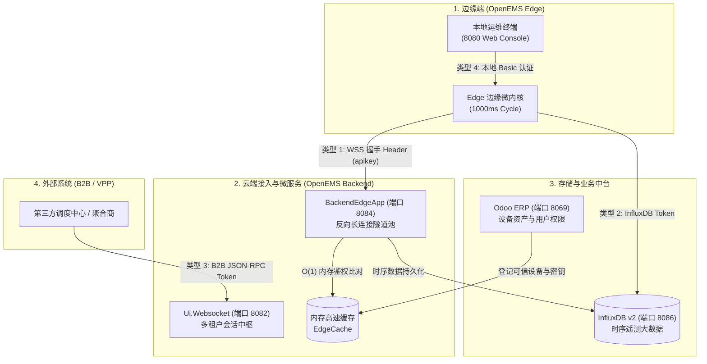
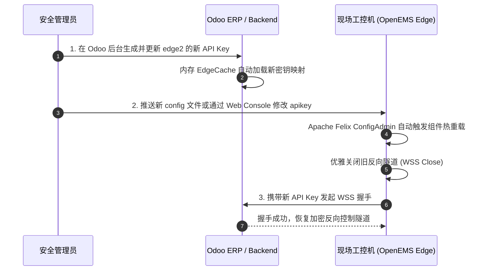

# OpenEMS API Key 与接入密钥安全管理规范

在分布式光储充微电网、虚拟电厂（VPP）以及工商业储能资产数字化运营体系中，**API Key（应用接口密钥）** 是贯穿边缘物理网关、云端微服务、时序大数据引擎及企业中台的**第一道安全防线**。

一旦 API Key 泄露或被伪造，攻击者可能建立非法反向隧道、篡改电网充放电调度指令、伪造计量电能量测、甚至窃取工业用电隐私数据。

本文档基于 OpenEMS 官方底层源码与生产实践，提供一份涵盖 **API Key 分类矩阵**、**全生命周期管控（生成、分发、存储、轮换）**、**时序数据库安全治理**、**入侵审计与应急响应** 的企业级安全管理规范。

---

## 一、 OpenEMS API Key 分类与鉴权矩阵

在 OpenEMS 生态系统中，存在四种不同层级与安全边界的 API Key / Token：



### 四大密钥类型横向对比

| 密钥类型 | 通信链路 | 载体形式 | 核心作用 | 风险等级 |
| :--- | :--- | :--- | :--- | :---: |
| **1. 边缘反向隧道密钥 (Edge API Key)** | Edge $\rightarrow$ Backend (8084/8085) | WSS 握手请求头：`apikey: <key>` | 验证边缘电站身份，决定是否允许其加入云端长连接反向控制隧道。 | **【最高】** |
| **2. 时序数据库访问令牌 (InfluxDB v2 Token)** | Edge / Backend $\rightarrow$ InfluxDB (8086) | HTTP Header：`Authorization: Token <token>` | 控制对 InfluxDB 高频时序数据（功率、SOC、电量）的读写权限。 | **【极高】** |
| **3. 云端北向业务接口令牌 (B2B API Token)** | 第三方 VPP / ERP $\rightarrow$ Backend (8082) | JSON-RPC 消息体参数：`token: <uuid>` | 外部电力交易机构或聚合商下发调度指令、调用多租户资产接口的凭证。 | **【高】** |
| **4. 边缘本地调试管理凭证 (Local Basic Auth)** | 工程师终端 $\rightarrow$ Edge Console (8080) | HTTP Basic 认证头：`admin:password` | 局域网登录 Apache Felix Web Console 执行驱动重载与组件热配置的凭证。 | **【高】** |

---

## 二、 边缘反向隧道接入密钥（Edge API Key）全生命周期管理

边缘反向隧道密钥是整个多电站车队管理的安全核心。生产环境中必须实行严格的全生命周期闭环管理：

### 1. 密钥生成规范（严禁弱口令与可预测规律）
- ❌ **严重反模式**：直接使用电站名称（如 `apikey="edge0"`）、设备序列号或纯数字（如 `123456`），此类密钥极易被局域网嗅探或公网字典爆破。
- ✅ **推荐标准规范**：使用密码学安全伪随机数生成器（CSPRNG），生成长度不低于 32 字节（256 位）的高熵 Hex 或 Base64 随机串：
  ```bash
  # 在 Linux 生产主机生成 256-bit 高熵安全密钥
  openssl rand -hex 24
  # 输出示例：b8f3e29a4c107d6e529a1d48c0839e24a5f71e83dc912a4b
  ```

---

### 2. 云端登记与可信源绑定（Odoo ERP 模式）
所有上线的 API Key 必须在云端元数据中心建立唯一档案，杜绝边缘电站擅自接入：

1. 登录 Odoo 运营管理后台（`http://172.16.100.234:8069`）；
2. 进入 `OpenEMS` 导航菜单 $\rightarrow$ `Devices` $\rightarrow$ 打开或新建电站资产（如 `edge2`）；
3. 将生成的随机安全密钥填入 **API-Key** 字段：
   ```text
   b8f3e29a4c107d6e529a1d48c0839e24a5f71e83dc912a4b
   ```
4. 保存后，OpenEMS Backend 的 [`EdgeCache`](io.openems.backend.metadata.odoo/src/io/openems/backend/metadata/odoo/EdgeCache.java) 自动在 JVM 堆内存中同步建立 `apikey -> edgeId` 的高速映射。

---

### 3. 边缘端部署与主机文件权限加固
在现场工控机上配置该密钥，并实行严格的 Linux 最小权限原则：

1. **写入边缘配置**：
   编辑 `/etc/openems.d/Controller/Api/Backend/ctrlBackend0.config`：
   ```properties
   service.pid="Controller.Api.Backend.ctrlBackend0"
   service.factoryPid="Controller.Api.Backend"
   id="ctrlBackend0"
   enabled=B"true"
   uri="wss://cloud.openems-vpp.com:8084"
   apikey="b8f3e29a4c107d6e529a1d48c0839e24a5f71e83dc912a4b"
   proxy=""
   ```

2. **锁定文件属主与访问权限（防本地提权窃取）**：
   ```bash
   # 仅允许 root 与 openems 服务运行专属用户读取
   sudo chown -R root:openems /etc/openems.d/Controller/Api/Backend/
   sudo chmod 640 /etc/openems.d/Controller/Api/Backend/ctrlBackend0.config
   ```

3. **代码仓库防泄露保护 (`.gitignore`)**：
   在所有 Git 代码仓库的根目录必须加入防泄露规则：
   ```gitignore
   # 忽略包含敏感密钥的运行时配置
   *.config
   *.key
   credentials.*
   secrets.*
   ```

---

### 4. 传输通道强制启用 TLS 传输加密 (WSS)
在底层驱动 [`ControllerApiBackendImpl.java`](io.openems.edge.controller.api.backend/src/io/openems/edge/controller/api/backend/ControllerApiBackendImpl.java#L150-L156) 中，若检测到未加密的明文通道，内核会发出严重安全警告：

```java
final var uriScheme = uri.getScheme();
if (!("https".equalsIgnoreCase(uriScheme) || "wss".equalsIgnoreCase(uriScheme))) {
    this.log.warn("Insecure or missing URI scheme detected: [{}]. "
            + "This may lead to credential exposure. "
            + "Do not use this configuration in production!", 
            uriScheme == null ? "N/A" : uriScheme);
}
```

- **安全红线**：生产环境绝对禁止使用明文 `ws://`！必须使用 `wss://`（WebSocket over TLS），在传输层对包含 API Key 的 HTTP 握手头进行非对称加密，彻底消除 4G 蜂窝网和公共互联网环境下的中间人（MITM）嗅探威胁。

---

### 5. 零停机平滑轮换与紧急吊销机制 (Key Rotation)
当发生现场维保交接、人员异动或疑似密钥泄露时，按以下时序进行**热轮换（无需重启边缘 Java 进程）**：



---

## 三、 InfluxDB v2 时序令牌安全治理

现场边缘控制器配置的时序写入通道（`/etc/openems.d/Timedata/InfluxDB/influx0.config`）必须严格遵守**最小权限原则（Least Privilege）**：

### 1. 严禁下发超级管理员 Operator Token
- **危险操作**：直接将 InfluxDB 初始化时生成的全权限超级 Token 配置到现场边缘工控机。一旦工控机失窃或遭物理入侵，攻击者将拥有删除整座数据库的灾难性权限。

### 2. 创建受限写入令牌（Scoped Token）
在 InfluxDB Web 界面（`:8086`）或 CLI 中为边缘电站生成专用 Token：
```bash
# 使用 influx CLI 创建仅允许写入 openems bucket 的专用令牌
influx auth create \
  --org openems \
  --description "Edge Stations Scoped Write Token" \
  --write-bucket <openems_bucket_id>
```

- **权限约束**：
  - ✅ 允许：`write-buckets`（写入遥测点位）；
  - ❌ 禁止：`read-buckets`（禁止边缘反查云端全量数据）；
  - ❌ 禁止：`delete-buckets`（禁止删除历史数据）；
  - ❌ 禁止：`admin` 组织管理权限。

### 3. 底层多租户标签物理分区与 Flux 安全注入
- 边缘电站上报的数据无论携带何种参数，云端底层的 [`FluxProxy.java`](io.openems.shared.influxdb/src/io/openems/shared/influxdb/proxy/FluxProxy.java) 均会根据经过鉴权的身份强制注入：
  ```flux
  filter(fn: (r) => r.edge == "<authorized_edge_id>")
  ```
- 从而杜绝了任何多租户环境下的跨电站越权数据访问。

---

## 四、 北向 B2B 接口与第三方 VPP 调度凭证管理

针对外部聚合商、电力交易调度中心或企业上游 ERP 对接：

1. **会话令牌隔离（Session Token）**：
   - 外部调用者通过 `/web/session/authenticate` 获取时效性 `session_id`；
   - 每次 JSON-RPC 调用必须携带经过签名的有效 Token，有效时长推荐设置为 24 小时，超期自动失效强制重登。
2. **细粒度 RBAC 权限四级守卫**：
   - 核心网关严格调用 [`Metadata.assertRoleIsAtLeast`](io.openems.backend.common/src/io/openems/backend/common/metadata/Metadata.java)；
   - 外部 VPP 调度角色通常仅授予 `OWNER`（可下发有功功率定值但禁止重配底层驱动）；第三方监管大屏仅授予 `GUEST`（只读权限，阻断任何写操作）。

---

## 五、 安全审计、入侵检测与应急响应

### 1. 实时入侵检测监控
在云端网关建立自动化日志审计流，实时捕获非法的 API Key 探测行为：

```bash
# 实时监控非法 API Key 拒绝连接日志
journalctl -u openems-backend -f | grep -i "Handshake rejected. Invalid Apikey"
```

*典型攻击告警日志：*
```text
ERROR [WebsocketServer] Handshake rejected. Invalid Apikey [InstanceID=N/A, Remote=/198.51.100.23:54321]
```

### 2. 自动化封禁防御（Fail2ban 联动）
在云端主机配置 Fail2ban 规则 `/etc/fail2ban/filter.d/openems-backend.conf`：
```ini
[Definition]
failregex = .*Handshake rejected\. Invalid Apikey.*Remote=<HOST>.*
ignoreregex =
```
- **防护策略**：单 IP 在 5 分钟内出现 3 次非法 API Key 握手失败，自动通过 `iptables` 封禁该源 IP 24 小时，有效遏制分布式字典爆破。

### 3. 密钥泄露紧急阻断 5 步流程（SOP）
一旦发现现场设备失窃或密钥异常泄露，立即启动以下应急响应：

1. **云端即刻吊销**：在 Odoo 后台直接删除或重置该电站的 `API-Key`（耗时 < 30 秒，内存缓存即时生效）；
2. **强制熔断活动长连接**：在云端重启 `openems-backend` 或通过 Web Console 踢掉非法长连接，非法设备将被直接拒于 WSS 握手之外；
3. **时序令牌轮换**：在 InfluxDB 中删除被泄露的 Scoped Token，生成新 Token；
4. **日志取证排查**：分析 InfluxDB 与 Backend 访问日志，确认泄露期间是否有异常控制指令（如恶意放电定值）下发；
5. **现场密钥重置**：现场技术人员到达物理机房，现场重新刷入新密钥并恢复通信。
