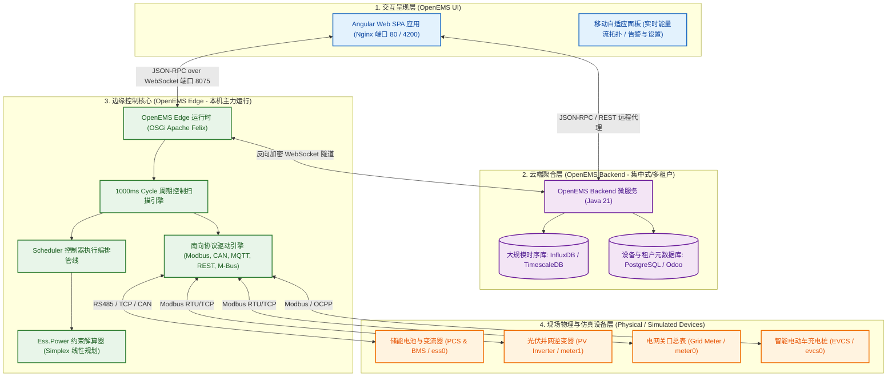
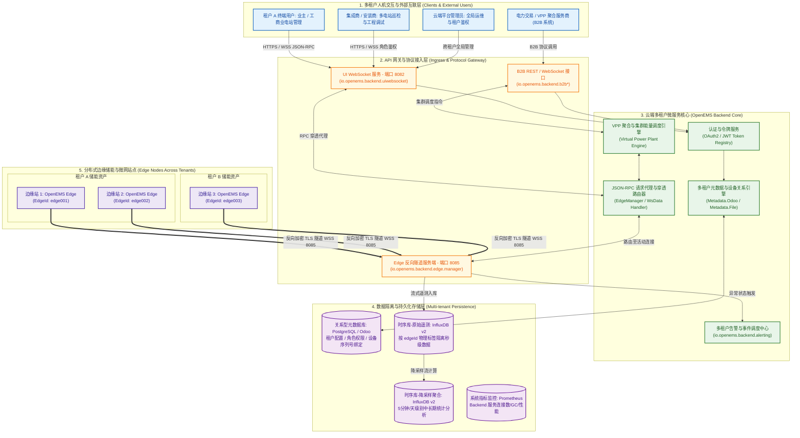

# OpenEMS 架构与功能深度分析报告 (Open Energy Management System)

> **目标系统**：`172.16.100.234` (`openems`)  
> **操作系统**：Ubuntu 26.04 LTS (x86_64, Linux 7.0.0-14-generic)  
> **基础运行时**：OpenJDK 21 (`21.0.12.1`) | Nginx 1.28.3 | InfluxDB v2  
> **OpenEMS 版本**：v2026.10.0 (含 Edge 微内核、Angular Web UI 与本地化定制补丁)  

---

## 目录
- [一、OpenEMS 概述与行业定位](#一openems-概述与行业定位)
- [二、宏观三层体系架构](#二宏观三层体系架构)
- [三、OpenEMS Edge 边缘内核微观架构](#三openems-edge-边缘内核微观架构)
  - [3.1 OSGi 动态模块化与 Apache Felix 容器](#31-osgi-动态模块化与-apache-felix-容器)
  - [3.2 Declarative Services (DS) 动态依赖注入](#32-declarative-services-ds-动态依赖注入)
  - [3.3 Configuration Admin 持久化与文件热重载](#33-configuration-admin-持久化与文件热重载)
  - [3.4 1000ms Cycle 周期性确定性控制循环](#34-1000ms-cycle-周期性确定性控制循环)
  - [3.5 Nature（特性）与 Channel（通道）抽象模型](#35-nature特性与-channel通道抽象模型)
  - [3.6 Ess.Power 约束解算器（单纯形法线性规划）](#36-esspower-约束解算器单纯形法线性规划)
  - [3.7 Scheduler 编排器与 Controller 控制器流水线](#37-scheduler-编排器与-controller-控制器流水线)
  - [3.8 南向智能总线桥（Modbus 寄存器合并机制）](#38-南向智能总线桥modbus-寄存器合并机制)
  - [3.9 北向多协议互联接口](#39-北向多协议互联接口)
- [四、本机部署实态与拓扑复盘](#四本机部署实态与拓扑复盘)
  - [4.1 核心服务与端口矩阵](#41-核心服务与端口矩阵)
  - [4.2 目录与源码文件布局](#42-目录与源码文件布局)
  - [4.3 现行配置与仿真微电网拓扑](#43-现行配置与仿真微电网拓扑)
  - [4.4 本地化增强与离线自治补丁深度剖析](#44-本地化增强与离线自治补丁深度剖析)
- [五、时序数据双引擎架构 (RRD4J + InfluxDB v2)](#五时序数据双引擎架构-rrd4j--influxdb-v2)
- [六、架构综合评估与工程选型分析](#六架构综合评估与工程选型分析)
- [七、二次开发与扩展指引](#七二次开发与扩展指引)

---

## 一、OpenEMS 概述与行业定位

**OpenEMS**（Open Energy Management System）是由德国储能系统集成商 FENECON 发起，并由 Linux 基金会旗下 LF Energy 托管维护的工业级开源微电网与综合能源管理框架。

### 核心业务场景
1. **工商业与户用储能（C&I / Residential ESS）**：微秒/毫秒级安全边界防护、功率平衡控制与防逆流控制。
2. **光储充一体化微电网（PV + Storage + EVCS）**：新能源汽车与光伏超发智能联动充电、自发自用最大化。
3. **需量管理与峰谷套利（Peak Shaving & TOU Arbitrage）**：结合动态分时电价或契约变压器容量限制实施调峰平谷。
4. **虚拟电厂边缘接入（VPP Gateway）**：作为分布式能源聚合控制终端，响应电网秒级需求侧调度响应。

---

## 二、宏观三层体系架构

OpenEMS 顶层划分为三大层级：**边缘控制（Edge）**、**云端聚合（Backend）** 与 **人机交互（UI）**。



### 核心设计原则
- **边缘离线绝对自治（Edge Autonomous）**：Edge 运行完整的控制闭环和本地轻量时序库，在脱离云端时控制算法与安全逻辑 100% 独立不间断运行。
- **协议解耦与统一通信**：内部各层统一采用规范的 **JSON-RPC 2.0** 协议通信，兼顾高内聚与低耦合。

### 2.2 云端多租户微服务架构深度剖析 (OpenEMS Backend Multi-Tenant Architecture)

当系统从单个独立边缘电站扩展至集团级海量分布式储能电站网络时，**OpenEMS Backend** 作为云端多租户集中管理中枢，承担着设备接入、租户数据隔离、反向隧道穿透、时序分析与 VPP 虚拟电厂调度的核心职责。



#### 云端多租户关键技术机制：
1. **多租户权限模型 (RBAC)**：通过 `Admin`、`Installer`、`Owner`、`Guest` 四级角色划分。元数据服务维护租户与其所拥有 `edgeId` 列表的映射。
2. **边缘反向 WebSocket 隧道 (NAT 穿透)**：各边缘电站无需公网固定 IP，主动连接云端 8085 端口建立加密长连接通道，云端反向随时下发控制指令。
3. **透明 JSON-RPC 路由代理**：云端 UIWebSocket 收到前端请求后，Router 模块查找该设备当前活动的 WebSocket 连接并精准转发，实现云端“直连”边缘的操作体验。
4. **多租户时序存储物理隔离**：InfluxDB 以 `edgeId` 作为一级索引 Tag 隔离各租户数据，并提供秒级原始流与长周期降采样归档。

---

## 三、OpenEMS Edge 边缘内核微观架构

本机运行的核心服务是 `openems-edge.jar`。其微内核体现了高标准的工业级架构设计：

### 3.1 OSGi 动态模块化与 Apache Felix 容器
- **Bundle 容器隔离**：每个南向驱动（如 Modbus 电表、PCS 逆变器）、控制器算法、上层接口均编译为独立的 OSGi Bundle（JAR 包）。
- **动态生命周期**：各模块具备独立的 `Installed -> Resolved -> Active -> Stopped` 运行时生命周期，支持在不停止系统主进程的情况下**热插拔、热升级与热卸载**。

### 3.2 Declarative Services (DS) 动态依赖注入
- 通过 `@Component`、`@Reference` 标准注解声明服务组件与动态依赖注入。
- 支持动态集合依赖注入（如控制器动态发现接入的电表和电池组件），结合生命周期钩子（`@Activate`、`@Modified`、`@Deactivate`）实现无缝热加载。

### 3.3 Configuration Admin 持久化与文件热重载
- 系统的所有设备参数与控制策略以标准文本格式持久化存储于 `/etc/openems.d/` 目录中。
- 集成 Apache Felix FileInstall 监视机制：运维人员或自动化脚本直接编辑磁盘中的 `.config` 文件，运行时即可毫秒级热重载生效，无需重启 JVM。

### 3.4 1000ms Cycle 周期性确定性控制循环
OpenEMS 摒弃了多线程竞态与不可控的异步事件流，引入了仿照工业 PLC 扫描周期的 **1000ms 确定性时序控制循环**：

```text
+-----------------------------------------------------------------------------------------+
|                                1000ms Cycle 周期性控制循环                                |
+-----------------------------------------------------------------------------------------+
| 阶段 1: BEFORE_PROCESS_IMAGE   | 周期准备：检查系统状态与看门狗计数器                     |
| 阶段 2: TOP_PROCESS_IMAGE      | 【输入采集】从南向 Modbus/CAN 批量读取物理寄存器，更新    |
|                                | 全局过程映像 (Process Image)                             |
| 阶段 3: BEFORE_CONTROLLERS     | 状态聚合：Core.Sum 引擎计算并汇总全站总电网/光伏/储能功率 |
| 阶段 4: CONTROLLERS            | 【算法决策】Scheduler 按设定顺序执行控制器（如防逆流、   |
|                                | 充电桩联动、调峰），各控制器提出功率申请                 |
| 阶段 5: ESS_POWER              | 【约束解算】Ess.Power 解算器调用单纯形法求解，保证功率   |
|                                | 严格落在硬件上下限、电池 SoC 安全线与电网配电容量之内    |
| 阶段 6: AFTER_CONTROLLERS      | 控制执行收尾与指令合法性二次校验                         |
| 阶段 7: BOTTOM_PROCESS_IMAGE   | 【输出下发】将求解出的最终控制量通过 Modbus 写指令下发   |
|                                | 至 PCS 变流器、断路器、继电器等执行机构                  |
| 阶段 8: AFTER_PROCESS_IMAGE    | 【归档推送】时序库归档 (RRD4J/InfluxDB)，WebSocket 向前端  |
|                                | 推送增量遥测数据快照                                     |
+-----------------------------------------------------------------------------------------+
```

### 3.5 Nature（特性）与 Channel（通道）抽象模型
- **Nature 接口抽象**：
  - `SymmetricEss` / `AsymmetricEss`：三相对称 / 分相储能系统。
  - `ManagedSymmetricEss`：支持外部功率主动调度的储能设备。
  - `ElectricityMeter`：电表模型（分为 Grid、Production、Consumption）。
  - `Evcs`：电动汽车智能充电桩。
- **Channel 强类型测点通道**：
  - 每个数据测点均封装为强类型的 `Channel<T>`。
  - 区分 `ReadChannel`（只读采样）、`WriteChannel`（控制写命令）、`StateChannel`（告警与状态字）。
  - 内置物理量纲单位（`Unit.WATT`, `Unit.VOLT`, `Unit.PERCENT`）与防抖过滤。

### 3.6 Ess.Power 约束解算器（单纯形法线性规划）
微电网储能控制存在多维物理冲突：
- 电池充放电功率红线（根据当前 SoC、SOH 与电芯温度动态变化）。
- PCS 视在功率限制（$S = \sqrt{P^2 + Q^2}$）。
- 变压器容量限制与电网防逆流零馈入硬约束。
- 功率因数校正与三相不平衡补偿。

OpenEMS 引入线性规划层（位于 `io.openems.edge.ess.core.power`）：
- 采用 Apache Commons Math 的 **Simplex Solver（单纯形法求解器）**。
- 将硬件安全、电网限制和各控制器申请转化为线性不等式组约束。
- 求解出唯一最优且安全合规的目标功率值，从数学理论上杜绝过载跳闸与逆流罚款。

### 3.7 Scheduler 编排器与 Controller 控制器流水线
- **Scheduler**：决定各控制器在 Cycle 循环中的调用顺序。支持字典序（`AllAlphabetically`）、手动固定序（`FixedOrder`）、日计划（`Daily`）。
- **常用核心控制器**：
  - `Controller.Symmetric.Balancing`：自发自用与防逆流平衡控制。
  - `Controller.Symmetric.PeakShaving`：变压器需量削峰填谷。
  - `Controller.Evcs`：光伏盈余电量智能充车控制。
  - `Controller.Ess.TimeOfUseTariff`：分时电价智能套利策略。

### 3.8 南向智能总线桥（Modbus 寄存器合并机制）
现场 RS485 总线带宽低且易冲突。OpenEMS 的 `Bridge.Modbus` 实现了：
- **Register Compaction（连续寄存器自动合并）**：将相邻的多笔单寄存器读取请求智能合并为一条批量多寄存器读取报文，通信效率提升 300% 以上。
- 优先级队列管理与链路故障自动重试。

### 3.9 北向多协议互联接口
- **WebSocket (端口 8075)**：全双工长连接，承载 JSON-RPC 数据推送与前端交互。
- **Modbus/TCP Server (端口 502)**：将整站综合状态映射为标准 Modbus 寄存器，供上位机 DCS/SCADA 系统读取。
- **Apache Felix Web Console (端口 8080)**：OSGi 底层组件监控与运维管理。

---

## 四、本机部署实态与拓扑复盘

### 4.1 核心服务与端口矩阵

| 监听端口 | 协议 | 运行服务 / 进程 | 职责与功能说明 |
| :--- | :--- | :--- | :--- |
| **80** | TCP | Nginx 1.28.3 | OpenEMS Edge 前端单站 UI 入口（HTTP 反代） |
| **8081** | TCP | Nginx 1.28.3 | **OpenEMS Backend 前端云端多租户 UI 入口**（多电站总览与登录大屏） |
| **4200** | TCP | Nginx 1.28.3 | OpenEMS Edge 前端备用访问端口 |
| **8075** | TCP | Java (`openems-edge.jar`) | **JSON-RPC over WebSocket**（Web UI 与 Edge 主交互通道） |
| **502** | TCP | Java (`openems-edge.jar`) | **Modbus/TCP 从站接口**（工业上位机标准测点映射） |
| **8080** | TCP | Java (`openems-edge.jar`) | **Apache Felix Web Console**（OSGi 运行时运维控制台） |
| **8086** | TCP | InfluxDB (`influxd`) | **时序数据库 v2**（长周期高精度遥测数据持久化） |

### 4.2 目录与源码文件布局

```text
/opt/openems/
├── openems-edge.jar            # OpenEMS Edge 核心二进制可执行包 (v2026.10.0)
├── openems-backend.jar         # OpenEMS Backend 多边缘云端聚合包 (备用)
├── ui/                         # OpenEMS Edge 前端 Web UI (Angular 编译产物，80端口)
├── backend-ui/                 # OpenEMS Backend 云端多租户 Web UI (Angular 编译产物，8081端口)
└── source/                     # 完整 OpenEMS 源代码仓库 (含所有 Bundle 源码及定制补丁)

/etc/openems.d/                 # OpenEMS Edge 持久化配置目录 (OSGi ConfigAdmin)
├── Controller/                 # 控制器配置 (Balancing, Evcs, Websocket, ModbusTcp 等)
├── Core/                       # 核心微内核配置 (Cycle, Sum, Host, Meta 等)
├── Simulator/                  # 仿真微电网设备配置 (GridMeter, PvInverter, Ess, Evcs)
├── Timedata/                   # 时序存储配置 (Rrd4j, InfluxDB)
└── Scheduler/                  # 控制器调度器配置 (AllAlphabetically)
```

### 4.3 现行配置与仿真微电网拓扑

本机当前激活了一套完整的**微电网仿真与控制闭环**：
- **`ctrlBalancing0`（自发自用平衡控制器）**：
  - 目标网表功率设定值：`targetGridSetpoint = 0 W`（防逆流控制）。
- **`meter0`（模拟电网关口表 - GridMeter）**：
  - 动态计算并反馈微电网净注入/抽取功率。
- **`meter1`（模拟光伏并网逆变器 - PvInverter）**：
  - 模拟光伏输出功率（基准约 2.5 kW）。
- **`ess0`（模拟储能系统 - EssSymmetric）**：
  - 额定容量与充放功率 10 kW，毫秒级响应 `ctrlBalancing0` 指令平衡光伏与负荷波动。
- **`evcs0` & `ctrlEvcs0`（模拟智能充电桩与联动控制器）**：
  - 实现光伏富余发电优先充入新能源车。

### 4.4 本地化增强与离线自治补丁深度剖析

在本机源码 `/opt/openems/source` 中，针对离线独立运行进行了定制优化：
1. **脱水式 AppCenter 离线 Mock (`UserRequestHandler.java`)**：
   - 原版 OpenEMS 前端依赖向德国 FENECON 官方云端校验 App 授权与应用中心列表。
   - 本机扩展了 `getUserInformation`、`isAppFree`、`getPossibleApps` 等 JSON-RPC 处理通道，本地直接返回合法就绪状态，使 Web UI 可以在完全断网的环境下流畅使用全部配置功能。
2. **离线系统升级自适应 (`SystemUpdateHandler.java`)**：
   - 改进了版本检测逻辑，在无官方 Deb 源或离线私有化部署时自动优雅降级，防止前端抛出异常。
3. **前端适配**：
   - 适配了本地 WebSocket 鉴权与断线自动重连。

---

## 五、时序数据双引擎架构 (RRD4J + InfluxDB v2)

本机同时启用了两种时序数据存储引擎，优势互补：

| 维度 | 轻量本地引擎 (RRD4J) | 高性能时序引擎 (InfluxDB v2) |
| :--- | :--- | :--- |
| **存储介质** | 本地固定大小单文件 (`.rrd`) | InfluxDB 引擎文件（TSM / TSI） |
| **内存与磁盘消耗** | 极低（环形覆盖，磁盘占用恒定） | 中等（按保留策略动态压缩） |
| **数据分辨率** | 历史数据逐步分级降采样归档 | 秒级高精度原始时序保留 |
| **本机配置** | `Timedata.Rrd4j`（默认启用） | `Timedata.InfluxDB`（端口 8086，组织 `openems`） |
| **主要应用** | 现场离线断网历史曲线渲染 | 大数据报表分析、能效审计与故障诊断 |

---

## 六、架构综合评估与工程选型分析

### 突出优势
1. **确定性控制与安全高可靠**：通过 PLC 周期扫描 + 线性规划约束求解器，在复杂多设备场景下保障系统永不发生功率超调越界。
2. **真正的微内核热插拔**：基于 OSGi 容器，单个驱动的崩溃或启停不会波及核心运行时，具备电信级可用性。
3. **极致的硬件生态覆盖**：内置主流品牌 PCS、BMS、逆变器、电表、充电桩驱动，极大地缩减系统集成周期。
4. **完全的断网边缘自治**：不依赖任何第三方云服务即可独立执行防逆流、调峰与安全保护。

### 潜在挑战
1. **技术门槛较高**：采用 Java 21 + OSGi + Bnd + Declarative Services 架构，相较常规轻量微服务对开发人员技能要求更高。
2. **极高频控制适配**：默认 1000ms 周期适用于能量管理级（EMS），若需做毫秒级一次调频（10ms 级），需优化 Cycle 周期或下沉至 DSP/PLC 侧执行。

---

## 七、二次开发与扩展指引

在本地工程开发接入新业务时，标准规范路径如下：

1. **开发新型 Modbus 硬件驱动**：
   - 在源码工程创建 `io.openems.edge.meter.custom` Bundle。
   - 继承 `AbstractOpenemsModbusComponent` 并实现对应 Nature（如 `ElectricityMeter`）。
   - 在 `defineModbusProtocol()` 中映射物理寄存器至系统 Channel。
2. **编写自定义协同控制算法**：
   - 实现 `Controller` 接口与 `run()` 周期调度方法。
   - 通过 `@Reference` 动态注入目标设备 Channel。
   - 将目标有功/无功设定值写入 `ManagedSymmetricEss.ChannelId.SET_ACTIVE_POWER_EQUALS`，由 `Ess.Power` 统一解算仲裁。
3. **配置持久化**：
   - 在 `/etc/openems.d/` 放置对应 `.config` 文件，运行时自动无缝加载生效。
