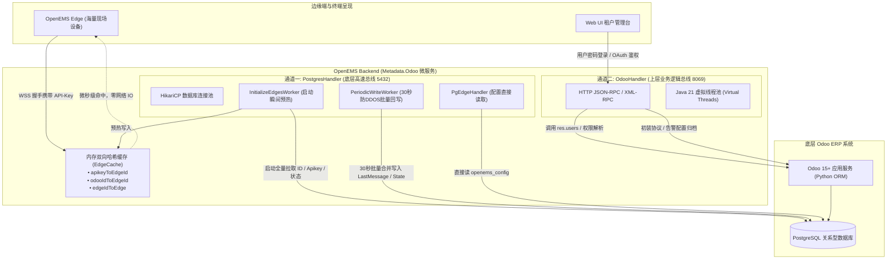
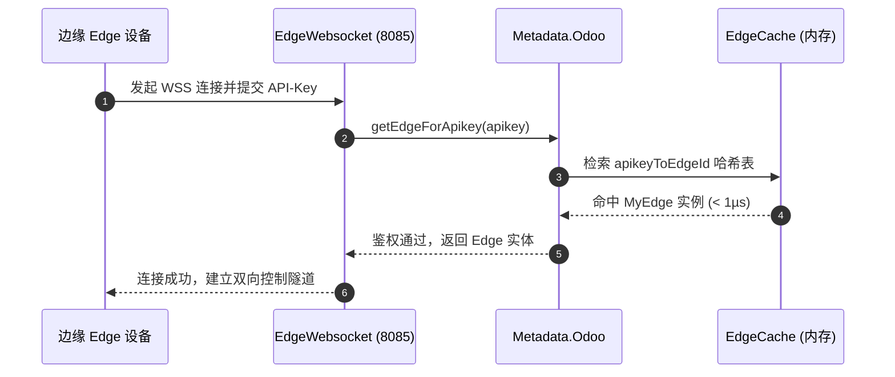
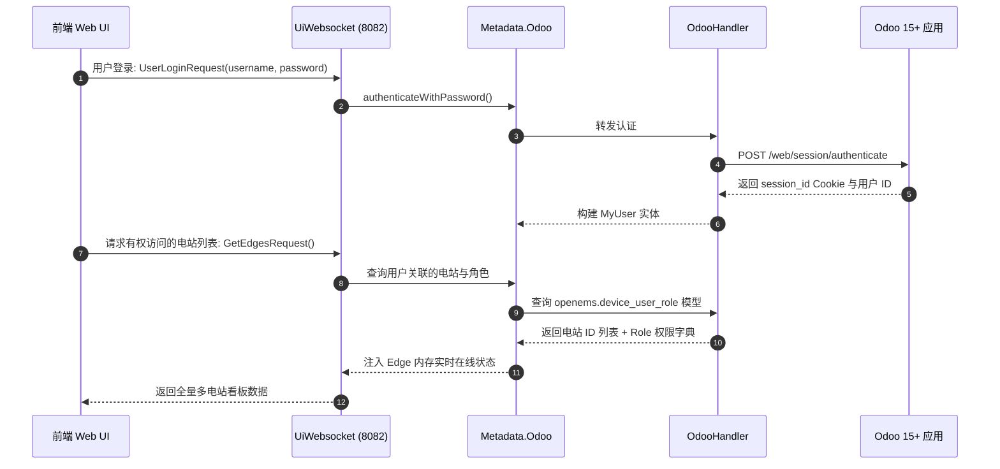
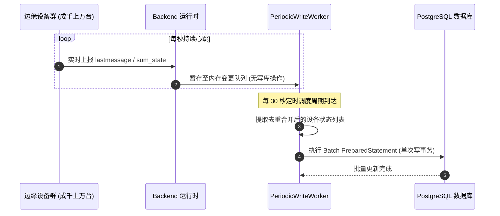

# OpenEMS Backend 元数据核心服务：Metadata.Odoo 深度架构与源码解析指南

> **文档版本**：v1.0  
> **编制日期**：2026-10-20  
> **适用范围**：OpenEMS Backend 云端管理内核、多租户微服务架构、Odoo ERP 资产管理对接、生产环境数据库高并发调优。

---

## 目录
1. [执行摘要与技术背景](#一执行摘要与技术背景)
2. [为什么是 Odoo？元数据服务的设计使命](#二为什么是-odoo元数据服务的设计使命)
3. [双通道异构读写架构（Dual-Engine Architecture）](#三双通道异构读写架构dual-engine-architecture)
   - [3.1 架构设计图](#31-架构设计图)
   - [3.2 通道一：PostgresHandler（底层高速数据总线）](#32-通道一postgreshandler底层高速数据总线)
   - [3.3 通道二：OdooHandler（上层业务逻辑总线）](#33-通道二odoohandler上层业务逻辑总线)
4. [核心数据模型与 Odoo ERP 映射关系（`Field.java`）](#四核心数据模型与-odoo-erp-映射关系fieldjava)
5. [高并发核心引擎：Java 21 虚拟线程（Virtual Threads）加持](#五高并发核心引擎java-21-虚拟线程virtual-threads加持)
6. [端到端业务生命周期时序图](#六端到端业务生命周期时序图)
   - [6.1 场景一：边缘端 Edge WSS 极速握手与鉴权](#61-场景一边缘端-edge-wss-极速握手与鉴权)
   - [6.2 场景二：用户登录与电站 RBAC 列表加载](#62-场景二用户登录与电站-rbac-列表加载)
   - [6.3 场景三：30秒防 DDOS 批量状态回写](#63-场景三30秒防-ddos-批量状态回写)
7. [生产配置属性与性能调优指南（`Config.java`）](#七生产配置属性与性能调优指南configjava)

---

## 一、执行摘要与技术背景

在 OpenEMS 的“端-边-云”整体拓扑中，**OpenEMS Backend** 作为云端多租户微服务中枢，负责聚合数以万计的边缘微电网系统（Edge）。在多租户运行环境下，云端必须具备强大的**元数据（Metadata）管理能力**。

在官方代码库中，提供了三种 Metadata 实现：
1. `Metadata.Dummy`：内存 Mock 实现，专供单元测试与独立演练；
2. `Metadata.File`：静态 JSON 文件驱动，供无数据库的小型试验场景；
3. **`Metadata.Odoo`**（源码位于 [`io.openems.backend.metadata.odoo`](file:///opt/openems/source/io.openems.backend.metadata.odoo)）：**官方唯一面向商业化交付、支撑万级设备并发的生产级核心实现**。

`Metadata.Odoo` 创新性地构建了**直接访问 PostgreSQL 数据库的高速通道**与**通过 HTTP JSON-RPC 走 Odoo 应用层的业务通道**相互协同的双引擎架构，在保障百万级心跳与秒级鉴权的同时，深度复用了 Odoo ERP 在多租户组织、权限角色、工单巡检及初装协议领域的工业级能力。

---

## 二、为什么是 Odoo？元数据服务的设计使命

分布式能源云端系统必须应对以下复杂的业务与资产管理诉求：
1. **身份认证与握手鉴权**：验证现场边缘系统上报的 API-Key 是否合法并准入。
2. **细粒度 RBAC 权限控制**：支持系统管理员（Admin）、安装商（Installer）、电站业主（Owner）、访客（Guest）四级权限模型，且同一个用户在不同电站中可扮演不同角色。
3. **电站全生命周期资产档案**：包括电站初装验收单（Setup Protocol）、硬件产品批次（Lot/Serial）、保修周期、电网接入批文及现场施工记录。
4. **工单与运维流转**：当电站触发重大故障（`Level.FAULT`）或长久离线时，自动触发派单巡检或邮件告警。

OpenEMS 官方没有从零开发一套粗糙的后台管理系统，而是直接与世界著名的开源企业级系统 **Odoo ERP**（基于 Python / PostgreSQL）深度绑定，由开源社区维护专用的 [odoo-openems](https://github.com/OpenEMS/odoo-openems) 模块，使能源物联系统与企业资产管理（EAM/CRM）无缝合体。

---

## 三、双通道异构读写架构（Dual-Engine Architecture）

如果数千台边缘设备频繁的状态上报（每 10 秒心跳、在线状态）和并发握手都向 Python 开发的 Odoo Web 接口发起 HTTP 请求，Odoo 的 Python 全局解释器锁（GIL）和 ORM 序列化开销会瞬间导致接口严重堵塞。

为此，OpenEMS 创造性地采用了**双通道异构读写架构**：

### 3.1 架构设计图



---

### 3.2 通道一：PostgresHandler（底层高速数据总线）
源码位于 [`io.openems.backend.metadata.odoo.postgres.PostgresHandler`](file:///opt/openems/source/io.openems.backend.metadata.odoo/src/io/openems/backend/metadata/odoo/postgres/PostgresHandler.java)。

该通道直接通过 **HikariCP 高性能连接池** 直连 Odoo 底层的 PostgreSQL 数据库（端口 5432），承担所有高频、大数据量的核心任务：

#### 1. 启动瞬态预热机制（`InitializeEdgesWorker`）
- 在 Backend 启动的一瞬间，执行单条 SQL 将所有设备标记为离线：
  ```sql
  UPDATE openems_device SET openems_is_connected = false;
  ```
- 随后执行快速全量 SQL，将全站所有电站的元数据（`id`、`name`、`apikey`、`comment`、`openems_version`、`producttype`、`lastmessage`）拉取出来，注入 JVM 内部的 [`EdgeCache`](file:///opt/openems/source/io.openems.backend.metadata.odoo/src/io/openems/backend/metadata/odoo/EdgeCache.java)。
- **核心价值**：`EdgeCache` 维护了三张双向哈希表：
  - `Map<String, MyEdge> edgeIdToEdge`
  - `Map<Integer, String> odooIdToEdgeId`
  - `Map<String, String> apikeyToEdgeId`
  当 Edge 携带 API-Key 发起 WSS 连接时，鉴权耗时小于 **1 微秒**（纯内存哈希比对），完全无任何网络 IO 或数据库查询。

#### 2. 防 DDOS 批量合并回写器（`PeriodicWriteWorker`）
- 源码明确标注其设计目的：`"to avoid DDOSing Odoo/Postgres by writing too often"`。
- 成千上万台 Edge 持续上报 `lastmessage`、`openems_is_connected`、`openems_sum_state_level`。如果每次都执行数据库写操作，会导致严重的锁表与事务拥堵。
- `PeriodicWriteWorker` 每隔 **30 秒** 触发一次合并（Batch Write），将内存中所有发生变动的设备状态统一组装成批量 SQL 提交，将数据库写压力降低了 99% 以上。

---

### 3.3 通道二：OdooHandler（上层业务逻辑总线）
源码位于 [`io.openems.backend.metadata.odoo.odoo.OdooHandler`](file:///opt/openems/source/io.openems.backend.metadata.odoo/src/io/openems/backend/metadata/odoo/odoo/OdooHandler.java)。

该通道通过 HTTP JSON-RPC 走 Odoo 应用层（端口 8069），负责调用 Odoo 的原生业务模型：
1. **用户身份认证与令牌维护**：
   - 调用 Odoo 的 `/web/session/authenticate` 接口验证用户名密码。
   - 提取 Session ID（Cookie）并维持心跳会话。
2. **多租户 RBAC 权限判定**：
   - 查询 `openems.device_user_role` 模型，动态计算用户在每一个电站名下的角色权限（`ADMIN`、`INSTALLER`、`OWNER`、`GUEST`）。
3. **电站初装验收单（Setup Protocol）**：
   - 安装商在现场调测完毕后，通过此通道提交电站验收凭证，写入 `openems.device.setupprotocol`，关联设备保修档案。
4. **邮件告警分发（Mailer 接口）**：
   - 当设备离线或触发三级告警时，调用 Odoo 的邮件系统代发通知邮件。

---

## 四、核心数据模型与 Odoo ERP 映射关系（`Field.java`）

在 [`Field.java`](file:///opt/openems/source/io.openems.backend.metadata.odoo/src/io/openems/backend/metadata/odoo/Field.java) 中，OpenEMS 将 Java 强类型与 Odoo 数据库表结构建立了映射：

| Java 枚举模型 | Odoo ERP 模型 | PostgreSQL 物理表 | 核心字段说明与业务功能 |
| :--- | :--- | :--- | :--- |
| **`EdgeDevice`** | `openems.device` | `openems_device` | **电站资产主表**。<br/>- `id` / `name`（如 edge0）<br/>- `apikey`（接入凭证）<br/>- `openems_config`（组件配置快照 JSON）<br/>- `openems_is_connected`（在线状态布尔值）<br/>- `openems_sum_state_level`（整站告警等级）<br/>- `lastmessage`（最新心跳时间戳） |
| **`User`** | `res.users` | `res_users` | **系统用户表**。<br/>- `login` / `password`<br/>- `global_role`（系统级全局管理员标志）<br/>- `openems_language`（UI 语言偏好，如 `ZH`）<br/>- `oauth_uid`（第三方单点登录绑定） |
| **`EdgeDeviceUserRole`** | `openems.device_user_role` | `openems_device_user_role` | **多租户 RBAC 授权表**。<br/>建立 `user_id` 与 `device_id` 的关联，并指派细粒度角色（`role`）。 |
| **`SetupProtocol`** | `openems.device.setupprotocol` | `openems_device_setupprotocol` | **初装与验收单归档**。<br/>记录现场施工人员、初装时间戳、关键部件（光伏、储能、电表）序列号及验收照片。 |
| **`EdgeConfigUpdate`** | `openems.openemsconfigupdate` | `openems_openemsconfigupdate` | **配置热重载与审计日志**。<br/>存储电站配置更新的历史 Diff（包含变更摘要 Teaser 与详细参数 Details）。 |

---

## 五、高并发核心引擎：Java 21 虚拟线程（Virtual Threads）加持

在 [`MetadataOdoo.java`](file:///opt/openems/source/io.openems.backend.metadata.odoo/src/io/openems/backend/metadata/odoo/MetadataOdoo.java#L165-L173) 的线程池构建逻辑中，OpenEMS 全面引入了现代 Java 的高并发特性：

```java
this.requestExecutor = new DebugExecutor(MetadataOdoo.ID,
    (ThreadPoolExecutor) Executors.newFixedThreadPool(
        config.requestPoolSize(),
        Thread.ofVirtual().name("Metadata.Odoo.Request-", 0).factory()
    )
);
```

### 虚拟线程的性能优势：
1. **解决传统阻塞 I/O 线程饥饿**：
   在向 Odoo 发起 HTTP JSON-RPC 请求时，连接等待与数据传输会阻塞工作线程。如果使用传统的平台线程（Platform Thread），每个线程占用约 1MB 内存，并发数千请求时线程池极易耗尽。
2. **极轻量开销**：
   Java 21 虚拟线程由 JVM 在用户态调度，单个虚拟线程仅占用几百字节内存。当线程在等待 Odoo 的网络响应时，底层载体线程（Carrier Thread）会自动挂载去执行其他任务，从而以极低资源消耗支撑高吞吐量业务调用。

---

## 六、端到端业务生命周期时序图

### 6.1 场景一：边缘端 Edge WSS 极速握手与鉴权


### 6.2 场景二：用户登录与电站 RBAC 列表加载


### 6.3 场景三：30秒防 DDOS 批量状态回写


---

## 七、生产配置属性与性能调优指南（`Config.java`）

源码位于 [`io.openems.backend.metadata.odoo.Config`](file:///opt/openems/source/io.openems.backend.metadata.odoo/src/io/openems/backend/metadata/odoo/Config.java)：

| 配置属性项 | 默认值 | 推荐生产设定 | 核心调优说明 |
| :--- | :--- | :--- | :--- |
| **`pgHost` / `pgPort`** | `localhost:5432` | 独立集群内网 IP | PostgreSQL 数据库连接地址。强烈建议与 Backend 处于同一高带宽局域网内。 |
| **`pgConnectionPoolSize`**| `40` | `50 ~ 100` | HikariCP 连接池最大连接数。对于管理超过 10,000 台 Edge 的集群，建议调至 80 以上。 |
| **`odooHost` / `odooPort`**| `localhost:8069`| 负载均衡 VIP / 域名 | Odoo Web 服务通信地址。大集群下建议部署 Odoo Gunicorn 多 Worker 模式。 |
| **`requestPoolSize`** | `30` | `50 ~ 100` | 请求线程池大小（底层基于 Java 21 虚拟线程），用于并发处理向 Odoo 发起的业务请求。 |
| **`eventPoolSize`** | `5` | `10 ~ 20` | OSGi EventAdmin 事件分发线程池大小。 |
| **`enablePasswordAuthentication`** | `true` | `true` | 是否启用 Odoo 密码鉴权服务（如果不启用，则通常通过外部 OAuth2 单点登录）。 |
| **`debugMode`** | `OFF` | `OFF`（生产） | 调试模式开关。开启后会输出详细的批处理与 SQL 跟踪日志。 |

---

## 八、总结与架构精要

`Metadata.Odoo` 的架构精髓可以用八个字概括：**“动静分流，软硬兼施”**：
- **动静分流**：对高频动态心跳和在线握手，采用底层数据库连接池 + 内存双向哈希索引，做到微秒级极速响应与 30 秒批处理回写，免受应用层损耗；
- **软硬兼施**：对复杂的组织架构、权限金字塔、初装协议与资产维保等静态/长流程业务，完全交由成体系的 Odoo ERP 应用层规范打理，实现了储能数字化基础设施与企业商业系统的无缝融合。
