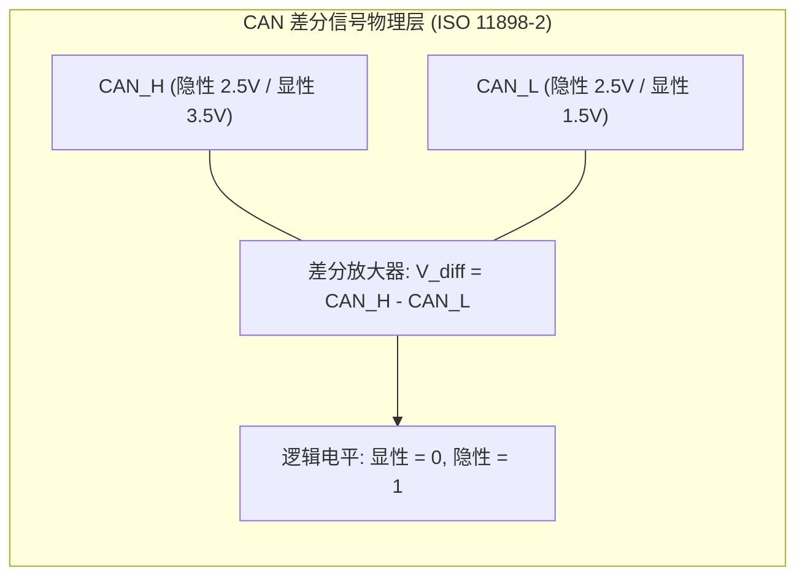
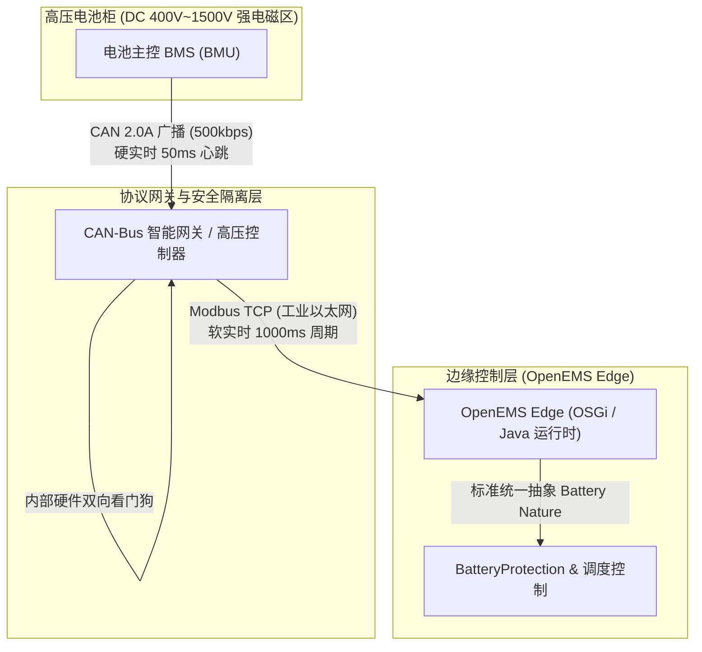
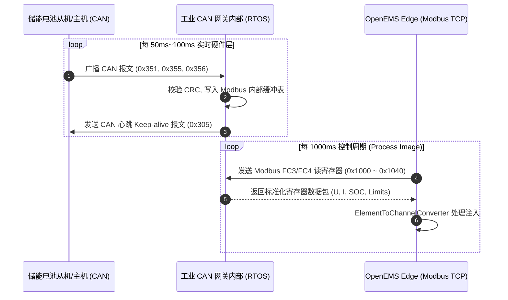
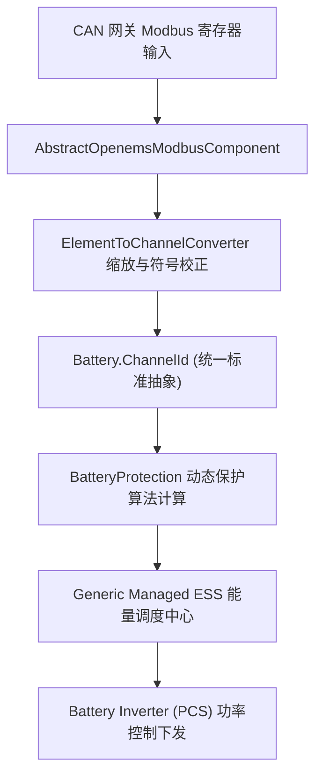

# OpenEMS Edge 与储能 BMS：CAN-Bus 网关协议深度解析技术指南

> **文档版本**：v1.0  
> **编制日期**：2026-10-20  
> **适用范围**：OpenEMS Edge 边缘控制内核、工商业/户用储能系统（BESS）、电池管理系统（BMS）、动力电池梯次利用（BMW/CATL 等）及工业现场总线协议栈开发。

---

## 目录
1. [执行摘要与技术背景](#一执行摘要与技术背景)
2. [底层原理：为什么储能电芯侧垄断性采用 CAN-Bus？](#二底层原理为什么储能电芯侧垄断性采用-can-bus)
3. [架构本质：为什么工业 EMS 不采用 SocketCAN 直连而必须采用网关？](#三架构本质为什么工业-ems-不采用-socketcan-直连而必须采用网关)
4. [储能行业标准 CAN BMS 报文协议详解（Pylontech / Victron 规范）](#四储能行业标准-can-bms-报文协议详解pylontech--victron-规范)
5. [CAN 网关在储能系统中的两种典型工程形态](#五can-网关在储能系统中的两种典型工程形态)
6. [OpenEMS Edge 源码映射与安全闭环调度流程](#六openems-edge-源码映射与安全闭环调度流程)
7. [CAN 网关协议设计与选型避坑指南（工业级实战）](#七can-网关协议设计与选型避坑指南工业级实战)

---

## 一、执行摘要与技术背景

在电化学储能系统（BESS）的实际工程落地中，**电池管理系统（BMS）**负责电芯级生命体征监测（单体电压、温度、均衡、SOC/SOH）与物理断路器控制；而**能量管理系统（EMS，如 OpenEMS Edge）**则负责全站能源调度、防逆流、削峰填谷与构网/跟网控制。

储能系统的现场通信面临一个显著的**协议割裂**：
- **微观/电芯层（南向硬件端）**：几乎 100% 采用 **CAN-Bus 2.0A/B（ISO 11898）** 物理总线，具备极强的抗共模干扰能力与毫秒级广播机制。
- **宏观/调度层（北向应用端）**：OpenEMS Edge 等主流工控软件基于工业以太网（Modbus TCP、REST、WSS、MQTT），依赖结构化轮询与网络抽象。

连接这两种异构世界的纽带即为 **CAN-Bus 网关（CAN-to-Modbus / 智能高压域控制器）**。本规范深入剖析 CAN-Bus 网关协议的报文结构、转换拓扑、实时性解耦以及 OpenEMS 内部从底层寄存器到标准 `Battery` Channel 与 `BatteryProtection` 算法的端到端调度闭环。

---

## 二、底层原理：为什么储能电芯侧垄断性采用 CAN-Bus？

在工业现场，虽然 RS-485（Modbus RTU）在电表和环境仪中普及，但在电池包（Pack）与电池架（Rack）内部通信中，CAN-Bus 占据绝对统治地位：



1. **出色的抗共模干扰（EMI/EMC）特性**
   储能系统运行在变流器（PCS）IGBT 超高频（数十 kHz）高压大电流开关环境下，空间电磁辐射与地线杂散电流极其恶劣。CAN 采用双绞线差分电压传输：
   - **隐性（Recessive，逻辑 1）**：$CAN\_H \approx 2.5V, CAN\_L \approx 2.5V, V_{diff} \approx 0V$
   - **显性（Dominant，逻辑 0）**：$CAN\_H \approx 3.5V, CAN\_L \approx 1.5V, V_{diff} \approx 2.0V$
   当外部共模噪声注入线缆时，两线噪声同相相消，差分接收器完全免疫。

2. **硬件级非破坏性逐位仲裁与 CRC 校验**
   RS-485 在主从冲突或总线碰撞时报文直接损毁且无法重发。CAN-Bus 依托**线与逻辑（显性电平覆盖隐性电平）**，当多个节点同时发送时，标识符 ID 较小的报文优先级更高且不会出现数据损坏，底层硬件 MAC 芯片自动执行重发，确保了告警帧的绝对优先权。

3. **天生适配高频状态广播（Push 模式）**
   BMS 主控（BMU）与从控（CSC）需要每 10ms~100ms 连续广播数十个电芯温度和电压。CAN 的无主发布/订阅广播机制省去了主站逐个从站轮询（Poll）的通信开销，带宽利用率高。

---

## 三、架构本质：为什么工业 EMS 不采用 SocketCAN 直连而必须采用网关？

部分开发者曾尝试在 OpenEMS 宿主机（如工控机或树莓派）上插上 USB-CAN 或 PCIe-CAN 卡，直接在 Linux 内核中使用 SocketCAN 驱动，并在 Java 运行时中通过 JNI/JNA 调用 C 库。但在中大型工商业与电网级储能中，**这种直连方式几乎从未被作为主流工程选型**。

采用独立 **CAN-Bus 网关中继架构** 的核心动因如下：



### 1. 硬实时（Hard Real-Time）与软实时（Soft Real-Time）的绝对解耦
- **BMS 通信时序严苛**：电池主控的看门狗要求极高，若 100ms~500ms 内未收到合法的 Keep-alive 心跳帧，BMS 会判定通信中断，立即跳开主接触器（直流断路器），强行停机。
- **JVM 垃圾回收抖动**：OpenEMS 运行在 Java 虚拟机（OSGi 微内核）之上，GC 暂停（STW）、系统多任务调度或时序写入阻塞可能偶发 200ms~1000ms 的延迟。若由 Java 负责下发 CAN 心跳，GC 抖动将直接导致电池包跳闸损坏开关触点。
- **网关担当实时防火墙**：硬件网关运行轻量级嵌入式 RTOS 或裸机固件，微秒级维持底层 CAN 心跳，向上层提供松耦合的 Modbus 寄存器缓存池。

### 2. 电气安全与高压物理隔离
储能电池系统直流侧电压已全面迈向 1000V~1500V 高压体系。一旦电池内部发生绝缘击穿或 PCS 反馈高压尖峰，直连工控机主板将导致整套 EMS 硬件损毁甚至引发火灾。工业级 CAN 网关内置专用磁耦/光耦芯片（如 ADuM1201、ISO1050），提供高达 **2.5kV~5kV 的双向高压隔离**。

### 3. 跨硬件平台兼容性（Cross-Platform Independence）
OpenEMS Edge 运行在极其多样的硬件设备上（树莓派、西门子 IOT2050、KUNBUS Revolution Pi、研华工控机、Debian/Ubuntu x86 工业服务器）。如果依赖 SocketCAN，每个平台都需要编译特定架构的 native C-so 库；而依托 Modbus TCP 网关，OpenEMS 只需纯 Java 实现的 TCP Socket 通信，达到“一次编写，到处部署”。

### 4. 多簇（Multi-Rack）拓扑汇聚与计算
在一个由 10 个电池簇构成的 1MWh 储能集装箱中，各簇 BMS 均广播各自的 `0x351`、`0x355` 等报文，无法共用单一 CAN 绞线。智能多口 CAN 网关统一汇聚 10 路 CAN 链路，负责：
- 动态汇总计算全站总可用容量与总充放电安全电流（$I_{max\_total} = \sum I_{max\_rack\_i}$）。
- 对外抽象为唯一的 Modbus 寄存器映射表，极大减轻了 EMS 的处理复杂度。

---

## 四、储能行业标准 CAN BMS 报文协议详解（Pylontech / Victron 规范）

在工业与户用储能中，**Pylontech / Victron / SMA CAN 协议规范**是事实上的世界通用行业标准。其报文基于 **CAN 2.0A 标准帧（11-bit ID）**，通信波特率为 **500 kbps**（数据周期通常为 1000ms，报警为突发广播）。

CAN 网关内部固件按照如下标准报文定义执行解包与字段格式化：

### 1. `0x351` 充放电控制边界参数帧（Charge / Discharge Limits）
由 BMS 广播给逆变器与网关，**决定系统充放电的绝对安全边界**。

| 字节偏移 | 字段定义 | 数据类型 | 比例换算（Scale） | 物理单位 | 实际物理含义 |
| :--- | :--- | :--- | :--- | :--- | :--- |
| **Byte 0~1** | Battery Charge Voltage Limit (CVL) | uint16 | 0.1 | V | 允许的最大充电截止电压（如 53.5V） |
| **Byte 2~3** | Max Charge Current Limit (CCL) | int16 | 0.1 | A | 允许的最大持续充电电流上限（如 50.0A） |
| **Byte 4~5** | Max Discharge Current Limit (DCL) | int16 | 0.1 | A | 允许的最大持续放电电流上限（如 100.0A） |
| **Byte 6~7** | Discharge Cut-off Voltage | uint16 | 0.1 | V | 允许的放电截止下限电压（如 44.0V） |

### 2. `0x355` 荷电状态与健康度帧（SOC & SOH）
用于电量计量、防过放切断与电池全寿命周期健康度监测。

| 字节偏移 | 字段定义 | 数据类型 | 比例换算（Scale） | 物理单位 | 实际物理含义 |
| :--- | :--- | :--- | :--- | :--- | :--- |
| **Byte 0~1** | State of Charge (SOC) | uint16 | 1 或 0.1 | % | 当前电池剩余电量百分比（0~100%） |
| **Byte 2~3** | State of Health (SOH) | uint16 | 1 或 0.1 | % | 当前电池健康状态百分比（通常出厂 100%） |
| **Byte 4~5** | High-Resolution SOC | uint16 | 0.01 | % | 高精度 SOC 估算（部分厂商扩展使用） |
| **Byte 6~7** | Reserved | - | - | - | 保留字节 |

### 3. `0x356` 实时电气测量值帧（Actual Metrics）
电池簇总物理量的高频采样数据。

| 字节偏移 | 字段定义 | 数据类型 | 比例换算（Scale） | 物理单位 | 实际物理含义与符号规范 |
| :--- | :--- | :--- | :--- | :--- | :--- |
| **Byte 0~1** | Battery Voltage | int16 | 0.01 | V | 电池端总直流电压（如 5120 $\rightarrow$ 51.20V） |
| **Byte 2~3** | Battery Current | int16 | 0.1 | A | 实际实时电流。大部分标准规定：**充电为正，放电为负**（需网关或 EMS 转换） |
| **Byte 4~5** | Battery Temperature | int16 | 0.1 | °C | 电池内部平均温度或最高电芯温度 |
| **Byte 6~7** | Reserved | - | - | - | 保留字节 |

### 4. `0x359` / `0x35A` 报警与故障位掩码帧（Alarms & Protection Flags）
按位（Bit-Mask）编码的高优先级保护状态。网关解析为 Modbus 离散输入或寄存器 Bit 位：

| 字节位置 | Bit 偏移 | 故障代码 / 告警定义 | 触发级别 | 动作要求 |
| :--- | :--- | :--- | :--- | :--- |
| **Byte 0** | Bit 0 | Over-voltage fault（电芯过压故障） | FAULT（严重） | 立即停止充电，断开接触器 |
| **Byte 0** | Bit 1 | Under-voltage fault（电芯欠压故障） | FAULT（严重） | 立即停止放电，进入保护睡眠 |
| **Byte 0** | Bit 2 | Over-temperature fault（过温故障） | FAULT（严重） | PCS 降额停机，开启风机/液冷 |
| **Byte 0** | Bit 3 | Under-temperature fault（低温故障） | FAULT（严重） | 禁止大电流充电，启动加热膜 |
| **Byte 1** | Bit 0 | Discharge Over-current（放电过流） | FAULT（严重） | 毫秒级封锁 PCS PWM 脉冲 |
| **Byte 1** | Bit 1 | Charge Over-current（充电过流） | FAULT（严重） | 限制输入功率 |
| **Byte 2** | Bit 4 | Insulation Error（绝缘阻抗过低） | FAULT（高压） | 存在母线漏电，禁止高压使能 |
| **Byte 3** | Bit 0 | Contactor Error（接触器粘连/反馈异常）| FAULT（硬件） | 硬件闭锁，上报人工巡检 |

### 5. `0x35E` / `0x35F` 厂商标识符帧
- **ID `0x35E`**：前 8 个字节为厂商 ASCII 编码字符串，例如 ASCII 值十六进制序列：`50 59 4C 4F 4E 20 20 20`（代表 `"PYLON   "`）。
- **ID `0x35F`**：包含电芯化学类型（LiFePO4/NMC）、固件版本号与并联模组总数量。

---

## 五、CAN 网关在储能系统中的两种典型工程形态

### 形态 A：协议透明转换型网关（CAN-to-Modbus TCP Gateway）
- **典型硬件**：钡铼技术、研华 ADAM 系列、中嵌科技、ICP DAS 等导轨式工业网关。
- **工作架构**：



- **映射机制**：网关在配置工具中设定映射规则，将 CAN-ID `0x356` 的 Byte 0~1（电压）映射为 Modbus 寄存器 `30001`，Byte 2~3（电流）映射为 `30002`。上层 OpenEMS 只需将其视作标准的 Modbus 从机。

### 形态 B：智能高压域控制器网关（以 OpenEMS 官方 BMW i3 为例）
- **源码对应**：[`io.openems.edge.battery.bmw`](file:///opt/openems/source/io.openems.edge.battery.bmw)
- **工程背景**：
  将乘用车动力电池（如宝马 i3 动力电池包）梯次利用（2nd-life）至储能系统时，其底层为宝马专有的车规级 PT-CAN。由于汽车动力电池具备严格的安全自检与高压上电时序，普通的透明转换网关无法满足控制需求，必须配备专用**高压域控制器网关（BMW High-Voltage Gateway）**。
- **架构亮点**：
  1. **混合安全通道**：
     在 [`BatteryBmwImpl.java`](file:///opt/openems/source/io.openems.edge.battery.bmw/src/io/openems/edge/battery/bmw/BatteryBmwImpl.java#L145-L165) 中，OpenEMS Edge 先通过 HTTP Bridge 向网关发起 Token 登录认证（`/login` 接口），获取高权限操作凭证。
  2. **Modbus 控制状态字**：
     通过寄存器 `1400`（`BATTERY_STATE_COMMAND`）写入启动与停机指令，网关硬件微控制器自动接管车规级预充回路控制与高压接触器闭合：
     ```java
     new FC16WriteRegistersTask(1400,
         m(BatteryBmw.ChannelId.BATTERY_STATE_COMMAND, new UnsignedWordElement(1400))
     )
     ```
  3. **内部 CAN 链路健康追踪**：
     网关在寄存器 `1001`（`ErrBits1`）的第 15 位主动反馈底层汽车 CAN 的通信状态：
     ```java
     m(new BitsWordElement(1001, this)
         .bit(15, BatteryBmw.ChannelId.COMMUNICATION_ERROR) // 对应描述: "Communication Error - Batcom Error (Timeout), Master-Slave Can Error (Timeout)"
     )
     ```
     一旦网关与宝马电池包的 CAN 通信超时，OpenEMS 立即触发 `COMMUNICATION_ERROR` 故障，切入安全停机状态机。

---

## 六、OpenEMS Edge 源码映射与安全闭环调度流程

OpenEMS Edge 构建了极其优雅的储能抽象层次，CAN 网关送达的数据在此完成生命周期的闭环：



### 1. 通道标准化注入与单位换算
在 [`BatteryBmwImpl.java`](file:///opt/openems/source/io.openems.edge.battery.bmw/src/io/openems/edge/battery/bmw/BatteryBmwImpl.java#L240-L270) 与 [`PylontechPowercubeM2BatteryImpl.java`](file:///opt/openems/source/io.openems.edge.battery.pylontech/src/io/openems/edge/battery/pylontech/powercubem2/PylontechPowercubeM2BatteryImpl.java#L130-L200) 中，底层 Modbus 任务直接绑定标准 Channel：

```java
// 1. 读取最大允许充电电压 (Scale: 10^-1 = 0.1 V)
m(Battery.ChannelId.CHARGE_MAX_VOLTAGE, new SignedWordElement(1008), SCALE_FACTOR_MINUS_1),

// 2. 读取实际充放电电流 (Scale: 10^-1 = 0.1 A)
m(Battery.ChannelId.CURRENT, new SignedWordElement(1029), SCALE_FACTOR_MINUS_1),

// 3. 读取单体极值电压与温度 (直接 1:1 映射至毫伏与 0.1 度)
m(Battery.ChannelId.MIN_CELL_VOLTAGE, new SignedWordElement(1033), DIRECT_1_TO_1),
m(Battery.ChannelId.MAX_CELL_VOLTAGE, new SignedWordElement(1034), DIRECT_1_TO_1),
m(Battery.ChannelId.MAX_CELL_TEMPERATURE, new SignedWordElement(1032), SCALE_FACTOR_MINUS_1),
```

### 2. 储能系统的电流正负符号标定（Sign Convention）
- **CAN BMS 惯例**：很多工业 BMS 定义**充电为正（流入电池），放电为负（流出电池）**。
- **OpenEMS 核心规范**：OpenEMS 全系统遵循**电网/负载视角**，统一规定：
  - **放电（Discharge）为正（+）**：电池向系统输出功率。
  - **充电（Charge）为负（-）**：电池从系统吸收功率。
- **驱动层矫正**：OpenEMS 提供了 `INVERT` 或 `KEEP_NEGATIVE_AND_INVERT` 转换算子：
  ```java
  m(BatteryProtection.ChannelId.BP_CHARGE_BMS, new SignedWordElement(1011), INVERT)
  ```
  在协议适配层消除了物理量方向歧义。

### 3. `BatteryProtection` 算法的安全包络控制
OpenEMS 不仅被动接收 BMS 极限，还通过 [`BatteryProtection.java`](file:///opt/openems/source/io.openems.edge.battery.api/src/io/openems/edge/battery/protection/BatteryProtection.java) 算法在应用层形成双重防护：
- 即使网关反馈的最大允许充电电流为 `100A`，当单体最高电压接近设定上限（如磷酸铁锂 $3.60V$）时，`BatteryProtection` 会通过其内置的斜率降额曲线（Ramp-Down Curve）提前压降允许电流（如线性衰减为 $50A \rightarrow 20A \rightarrow 5A$）。
- 这避免了电流突变导致的“过压直接跳闸”，使得电池能够平滑进入微电流浮充状态。

---

## 七、CAN 网关协议设计与选型避坑指南（工业级实战）

在储能集成和 CAN 网关固件选型中，以下四大工程陷阱需重点规避：

### 1. 字节序（Endianness）错位陷阱
- **CAN 总线报文**：常见有两种排列格式：
  - **Intel 格式（Little-Endian）**：低位字节在前，高位字节在后。
  - **Motorola 格式（Big-Endian）**：高位字节在前，低位字节在后。
- **Modbus 协议**：标准定义为 Big-Endian（大端传输）。
- **避坑实践**：配置网关解析字典时，务必核对十六进制数据流。若格式配置颠倒，将导致诸如 $25.0℃$（`0x00FA`）被解析成 $6400℃$（`0xFA00`），直接引发系统误告警停机。

### 2. 双向硬件看门狗（Bidirectional Watchdog）
网关必须具备双向断联感知能力：
1. **下行断联保护（网关 $\rightarrow$ BMS）**：若网关超过 500ms 未捕获到 BMS 广播帧，必须在 Modbus 状态字中将通信健康位置 `0`，并触发内部继电器动作。
2. **上行断联保护（OpenEMS $\rightarrow$ 网关）**：若网关超过 3000ms 未收到 OpenEMS 的 Modbus 读写报文，网关固件应触发保护，下发 CAN 报文强制要求 BMS 将最大充放电电流归零，防止上位机挂起后系统处于“无监控裸奔”状态。

### 3. 120 欧姆终端匹配电阻（Terminal Resistor）规范
CAN-Bus 属于高频差分传输线，必须在物理总线的最远两端分别并联一个 **120Ω / 0.25W 金属膜终端电阻**，使总线等效阻抗为 $60\Omega$。
- **漏接终端电阻**：总线高频信号在末端产生反射波，导致逻辑电平重叠，出现大量 CRC 错误与 Bus-Off 错误。
- **错接多个终端电阻**：总线阻抗低于 $40\Omega$，驱动电流超载，导致显性差分电平幅度不足。

### 4. 多簇并联时的 CAN-ID 冲突处理
很多从控 BMS 出厂硬编码只广播固定 ID（如 `0x351`、`0x356`）。在多簇并联系统中，严禁将多路相同 ID 的 CAN 线直接绞合在一起，否则将产生严重的显性电平冲突破坏总线。
- **推荐方案**：采用多端口物理隔离 CAN 网关（如 4 口或 8 口网关），各端口独立运行 CAN 控制器与接收缓冲区，由网关 CPU 完成数据汇总后统一输出。

---

## 八、总结与架构全景一览

CAN-Bus 网关协议是储能系统走向高度标准化与工业化可靠性的关键基石。它通过：
1. **硬件解耦**：将 BMS 电芯级毫秒级严苛时序与 EMS 复杂优化算法隔离；
2. **电气安全**：以数千伏电气隔离抵御现场强电磁浪涌冲击；
3. **语义统一**：将各大电芯厂商百花齐放的 CAN 广播报文统一翻译为标准 Modbus/Ethernet 语义，驱动 OpenEMS Edge 稳定高效地调度电池能源资产。
