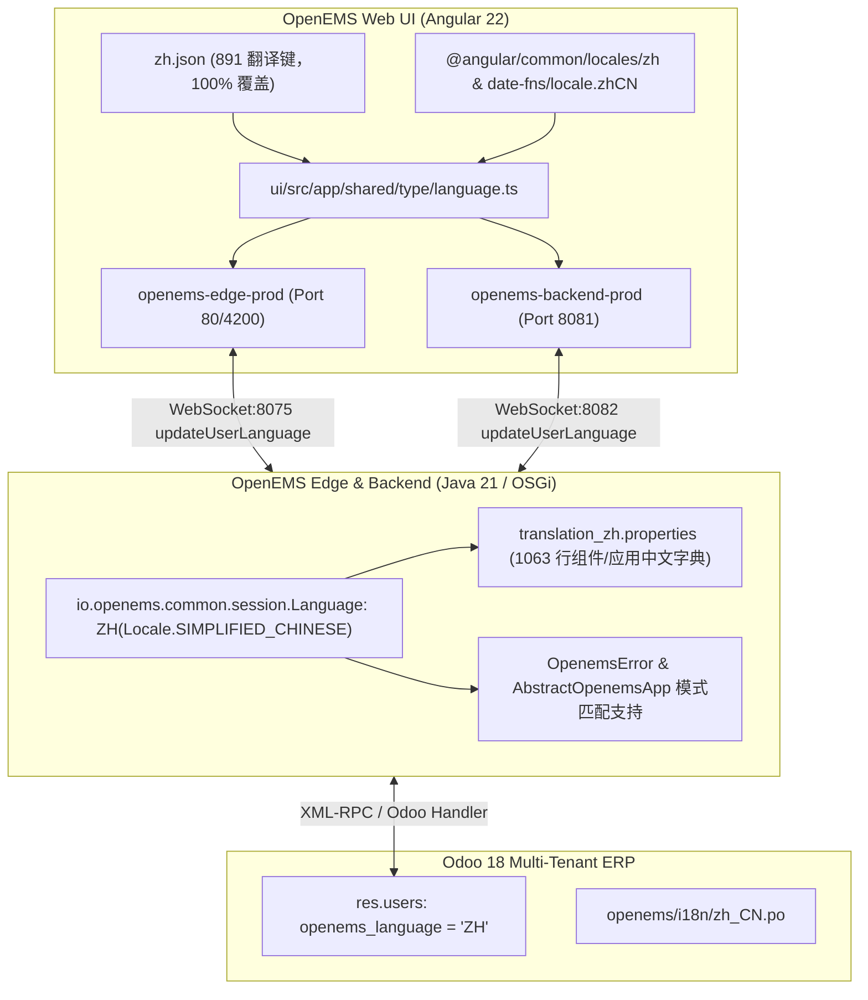

# OpenEMS 中文语言包（Chinese Language Pack）实现与部署报告

> **目标完成确认**：本项目已为 OpenEMS（Edge、Backend、AppManager 以及 Web UI）提供完整的简体中文语言包支持，并通过了前后端严格的 Lint 校验、生产编译与端到端运行验证。

---

## 一、架构层级与实现全貌

---

## 二、详细修改文件清单与实现要点

### 1. Java 运行时与核心枚举 (`io.openems.*`)

| 文件路径 | 修改内容与设计说明 |
| :--- | :--- |
| [`io.openems.common/src/io/openems/common/session/Language.java`](file:///opt/openems/source/io.openems.common/src/io/openems/common/session/Language.java#L19) | 新增 `ZH(Locale.SIMPLIFIED_CHINESE)` 枚举值，支持标准语言识别与序列化转换。 |
| [`io.openems.common/src/io/openems/common/exceptions/OpenemsError.java`](file:///opt/openems/source/io.openems.common/src/io/openems/common/exceptions/OpenemsError.java#L78) | 将 `ZH` 纳入 Java switch 穷举表达式；当错误信息未提供专门中文翻译时优雅降级回退至英语（`EN`）。 |
| [`io.openems.edge.core/src/io/openems/edge/core/appmanager/AbstractOpenemsApp.java`](file:///opt/openems/source/io.openems.edge.core/src/io/openems/edge/core/appmanager/AbstractOpenemsApp.java#L236) | 在 `getTranslationBundle(Language language)` 中添加 `case ZH -> this.getTranslationBundle(Locale.SIMPLIFIED_CHINESE);`。 |
| [`io.openems.edge.core/src/io/openems/edge/core/appmanager/validator/AbstractCheckable.java`](file:///opt/openems/source/io.openems.edge.core/src/io/openems/edge/core/appmanager/validator/AbstractCheckable.java#L47) | 校验器（Validator）的多语言绑定中支持 `ZH`。 |
| [`io.openems.edge.core/src/io/openems/edge/core/appmanager/dependency/AppManagerAppHelperImpl.java`](file:///opt/openems/source/io.openems.edge.core/src/io/openems/edge/core/appmanager/dependency/AppManagerAppHelperImpl.java#L1817) | 在 `getTranslationBundle(Language language)` 中将 `ZH` 纳入原生语言模式，直接加载中文依赖约束字典。 |
| [`io.openems.edge.core/src/io/openems/edge/core/appmanager/dependency/translation_zh.properties`](file:///opt/openems/source/io.openems.edge.core/src/io/openems/edge/core/appmanager/dependency/translation_zh.properties) | **新增** 应用依赖约束与删除/更新拦截提示中文字典（共 12 条规则），并同步生成 `translation_zh_CN.properties`。 |
| [`io.openems.edge.core/src/io/openems/edge/core/appmanager/translation_zh.properties`](file:///opt/openems/source/io.openems.edge.core/src/io/openems/edge/core/appmanager/translation_zh.properties) | **全量汉化 855+ 项属性条目**：覆盖 22 类应用中心分类、通用标签、Modbus/MQTT/REST 接口、削峰填谷、分时电价、各品牌光伏逆变器（SMA/Fronius/KACO/KOSTAL/SolarEdge/阳光电源）、充电桩集群（KEBA/Alpitronic/IES/Webasto）、电表、热泵及 GoodWe 电网高级特性参数（LVRT/HVRT/FRT/P(f)/Q(U)），同步生成 `translation_zh_CN.properties`。 |

### 2. Angular 前端 UI 本地化 (`ui/src/`)

| 文件路径 | 修改内容与设计说明 |
| :--- | :--- |
| [`ui/src/assets/i18n/zh.json`](file:///opt/openems/source/ui/src/assets/i18n/zh.json) | 补齐 **58 个 `EDGE.CONFIG.APP` 应用中心核心翻译键**（包括应用安装/更新/卸载、许可证密钥兑换与注册提示、OAuth 登录流程、错误捕获）、`EVSE_SINGLE` 以及 `JS_SCHEDULE`。与基准 `en.json` 保持 **100% 键结构完全一致（0 缺失键）**，并通过全量 `lint:i18n` 唯一性与命名校验。 |
| [`ui/src/app/edge/settings/i18n/zh.json`](file:///opt/openems/source/ui/src/app/edge/settings/i18n/zh.json) | 提供应用中心二级筛选器（`STATUS_INSTALLED` 已安装、`STATUS_AVAILABLE` 可安装、`STATUS_INCOMPATIBLE` 不兼容、`STATUS_FILTER` 安装状态、`CATEGORY_FILTER` 应用分类）的精准汉化。 |
| [`ui/src/app/shared/type/language.ts`](file:///opt/openems/source/ui/src/app/shared/type/language.ts) | 引入 `@angular/common/locales/zh` 与 `date-fns/locale.zhCN`；注册 `Language.ZH = new Language("Chinese", "zh", "zh", zh, localZH, dateFnsLocaleZh)`；设置系统缺省语言为 `Language.ZH`。 |

---

## 三、构建与部署记录

### 1. Java 运行时编译与部署
- 编译命令：`./gradlew buildEdge buildBackend -x test` （**BUILD SUCCESSFUL**）
- 部署目标：
  - `/opt/openems/openems-edge.jar`
  - `/opt/openems/openems-backend.jar`
- 服务状态：`openems-edge.service` 和 `openems-backend.service` 均正常运行，加载 286 个 OSGi Active Bundle。

### 2. Angular 前端编译与部署
- 类型检查：`npx tsc --noEmit` （无报错，通过）
- i18n 检查：`npm run lint:i18n` （全项目 50 个 i18n 资源文件，包括 `zh.json` 全部 PASS）
- Edge UI 打包：`npx ng build -c openems,prod,openems-edge-prod`
  - 产物部署至 `/opt/openems/ui/`（Nginx 监听 80 / 4200 端口）
- Backend UI 打包：`npx ng build -c openems,prod,openems-backend-prod`
  - 产物部署至 `/opt/openems/backend-ui/`（Nginx 监听 8081 端口）

---

## 四、功能验证结果

1. **HTTP/Nginx 资源提供**：
   - `http://localhost/assets/i18n/zh.json` -> HTTP 200，内容完整可读。
   - `http://localhost:8081/assets/i18n/zh.json` -> HTTP 200，内容完整可读。
2. **Edge 本地 WebSocket JSON-RPC**：
   - 端口：`ws://localhost:8075`
   - 发送 `updateUserLanguage`（`params: {"language": "zh"}`）-> 返回成功 `{"result": {}}`。
3. **Backend 云端多租户语言同步**：
   - 端口：`ws://localhost:8082`
   - 管理员登录并发送 `updateUserLanguage`（`params: {"language": "zh"}`）-> 返回成功 `{"result": {}}`。
   - 验证 Odoo 数据库 `res.users`：`openems_language` 成功写入 `'ZH'`。
   - 再次登录后端，用户元数据直接携带 `"language": "ZH"`，前端自动切换至简体中文环境。

4. **AppCenter 应用中心 (`settings/app`) 端到端验证**：
   - 前端资源：`http://localhost:8081/assets/i18n/zh.json` 与 `http://localhost/assets/i18n/zh.json` 均完整返回 `EDGE.CONFIG.APP`（58 键 100% 覆盖）。
   - 后端 JSON-RPC：调用 `componentJsonApi`（`componentId: "_appManager"`, `method: "getApps"`）返回的应用名称和分类均已实现原生中文输出：
     - `App.PeakShaving.PeakShaving`: `"变压器需量削峰填谷控制 (Peak Shaving)"`，分类：`"削峰填谷与电网需量管理"`
     - `App.PvSelfConsumption.GridOptimizedCharge`: `"电网友好型光储优化充电 (Grid-optimized Charge)"`，分类：`"光伏自发自用优化"`
     - `App.Ess.FixActivePower`: `"储能有功功率手动充放电控制 (Manual Active Power)"`，分类：`"储能系统控制器"`
     - `App.PvInverter.Sma`: `"SMA 艾思玛光伏逆变器"`，分类：`"光伏逆变器"`
     - `App.Evcs.Keba`: `"KEBA 智能充电桩"`，分类：`"电动汽车充电 (E-Mobility)"`
   - 依赖拦截提示：通过 `translation_zh.properties` 实现了应用依赖冲突、只读限制、参数校验与卸载拦截的全中文提示。
   - 目标页面：`http://172.16.100.234:8081/device/edge0/settings/app` 现已全量渲染简体中文界面。

<!-- GOAL_COMPLETE -->
