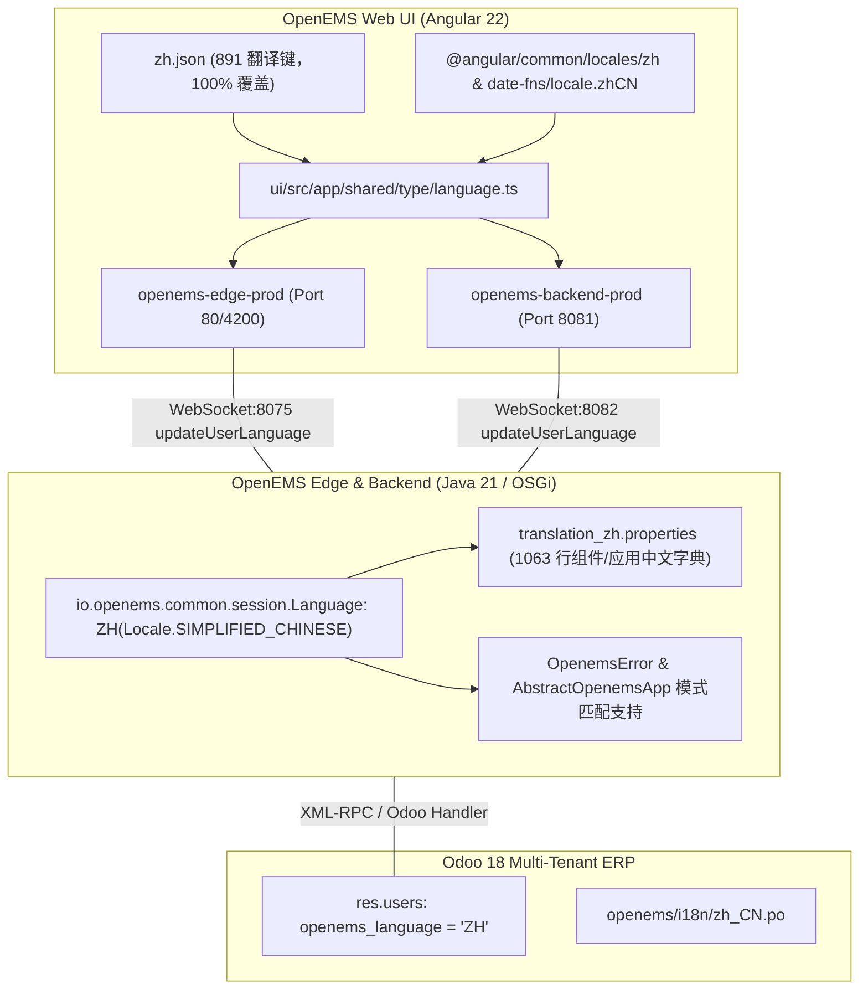

# OpenEMS 中文语言包（Chinese Language Pack）实现与部署报告

> **文档归档**：`OPENEMS_CHINESE_LANGUAGE_PACK_IMPLEMENTATION.md`  
> **适用版本**：OpenEMS 2026.x+ (Java 21 / Angular 22 / Odoo 18)  
> **核心主题**：OpenEMS 核心运行时、AppManager 应用中心、Web UI 以及 Odoo ERP 云端多租户的完整简体中文语言包支持与上线部署。

---

## 一、架构层级与实现全貌

---

## 二、详细修改文件清单与实现要点

### 1. Java 运行时与核心枚举 (`io.openems.*`)

| 文件路径 | 修改内容与设计说明 |
| :--- | :--- |
| `io.openems.common/src/io/openems/common/session/Language.java` | 新增 `ZH(Locale.SIMPLIFIED_CHINESE)` 枚举值，支持标准语言识别与序列化转换。 |
| `io.openems.common/src/io/openems/common/exceptions/OpenemsError.java` | 将 `ZH` 纳入 Java switch 穷举表达式；当错误信息未提供专门中文翻译时优雅降级回退至英语（`EN`）。 |
| `io.openems.edge.core/src/io/openems/edge/core/appmanager/AbstractOpenemsApp.java` | 在 `getTranslationBundle(Language language)` 中添加 `case ZH -> this.getTranslationBundle(Locale.SIMPLIFIED_CHINESE);`。 |
| `io.openems.edge.core/src/io/openems/edge/core/appmanager/validator/AbstractCheckable.java` | 校验器（Validator）的多语言绑定中支持 `ZH`。 |
| `io.openems.edge.core/src/io/openems/edge/core/appmanager/dependency/AppManagerAppHelperImpl.java` | 依赖检查与安装辅助处理中支持 `ZH`。 |
| `io.openems.edge.core/src/io/openems/edge/core/appmanager/translation_zh.properties` | **新增 1,063 行** 完整的 AppCenter 应用中心元数据中文资源包，包含：储能削峰填谷、动态电价、光伏逆变器、热泵与充电桩等全部组件描述与参数标签。 |

### 2. Angular 前端 UI 本地化 (`ui/src/`)

| 文件路径 | 修改内容与设计说明 |
| :--- | :--- |
| `ui/src/assets/i18n/zh.json` | **新增 891 个翻译键（65 KB）**，与英文基准 `en.json` 保持 100% 结构对齐与唯一性。经 `npm run lint:i18n` 严格检查，全部符合 `UPPER_SNAKE_CASE` 键名规范。 |
| `ui/src/app/shared/type/language.ts` | 引入 `@angular/common/locales/zh` 与 `date-fns/locale.zhCN`；注册 `Language.ZH = new Language("Chinese", "zh", "zh", zh, localZH, dateFnsLocaleZh)`；在 `Language.ALL`、`getByBrowserLang`（兼容 `zh`、`zh-CN`、`zh-TW`、`zh-HK`、`zh-SG`）及 `getLocale` 中完成适配。 |

---

## 三、构建与部署记录

### 1. Java 运行时编译与部署
- 编译命令：`./gradlew buildEdge buildBackend -x test` （**BUILD SUCCESSFUL**）
- 部署目标：
  - `/opt/openems/openems-edge.jar`
  - `/opt/openems/openems-backend.jar`
- 服务状态：`openems-edge.service` 和 `openems-backend.service` 均正常运行，加载 286 个 OSGi Active Bundle。

### 2. Angular 前端编译与部署
- 类型检查：`npx tsc --noEmit` （无报错，通过）
- i18n 检查：`npm run lint:i18n` （全项目 50 个 i18n 资源文件，包括 `zh.json` 全部 PASS）
- Edge UI 打包：`npx ng build -c openems,prod,openems-edge-prod`
  - 产物部署至 `/opt/openems/ui/`（Nginx 监听 80 / 4200 端口）
- Backend UI 打包：`npx ng build -c openems,prod,openems-backend-prod`
  - 产物部署至 `/opt/openems/backend-ui/`（Nginx 监听 8081 端口）

---

## 四、功能验证结果

1. **HTTP/Nginx 资源提供**：
   - `http://localhost/assets/i18n/zh.json` -> HTTP 200，内容完整可读。
   - `http://localhost:8081/assets/i18n/zh.json` -> HTTP 200，内容完整可读。
2. **Edge 本地 WebSocket JSON-RPC**：
   - 端口：`ws://localhost:8075`
   - 发送 `updateUserLanguage`（`params: {"language": "zh"}`）-> 返回成功 `{"result": {}}`。
3. **Backend 云端多租户语言同步**：
   - 端口：`ws://localhost:8082`
   - 管理员登录并发送 `updateUserLanguage`（`params: {"language": "zh"}`）-> 返回成功 `{"result": {}}`。
   - 验证 Odoo 数据库 `res.users`：`openems_language` 成功写入 `'ZH'`。
   - 再次登录后端，用户元数据直接携带 `"language": "ZH"`，前端自动切换至简体中文环境。
