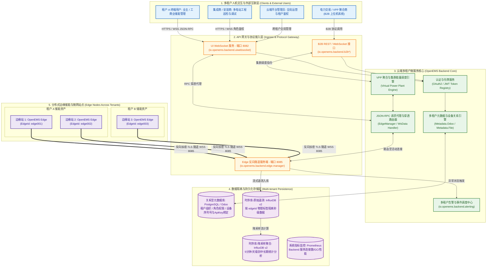
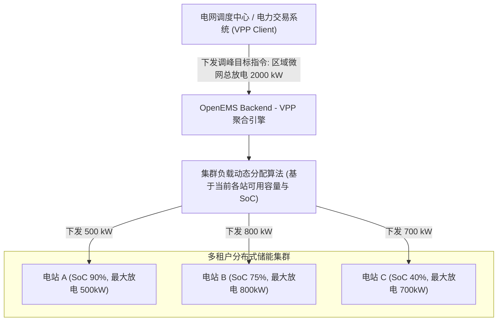
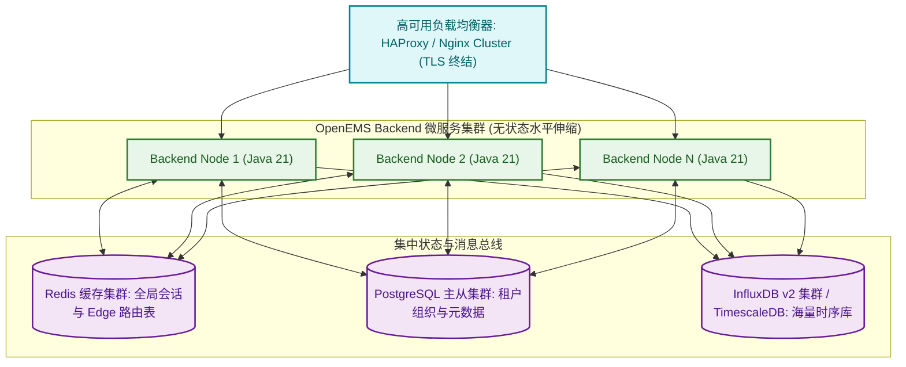

# OpenEMS 云端多租户微服务与虚拟电厂架构技术规范 (OpenEMS Backend)

> **版本**：v2026.10.0 (Linux Foundation LF Energy OpenEMS 架构标准)  
> **核心服务**：`io.openems.backend.*` 微服务体系  
> **适用场景**：集团化储能电站集中运维、多租户客户门户、虚拟电厂 (VPP) 聚合调度、第三方电力交易 (B2B)  

---

## 目录
- [一、背景与定位：从单站边缘走向云端集群](#一背景与定位从单站边缘走向云端集群)
- [二、云端多租户总体五层架构](#二云端多租户总体五层架构)
- [三、多租户组织模型与 RBAC 权限隔离体系](#三多租户组织模型与-rbac-权限隔离体系)
  - [3.1 四级用户角色模型](#31-四级用户角色模型)
  - [3.2 租户-用户-设备元数据关联树](#32-租户-用户-设备元数据关联树)
  - [3.3 租户级数据鉴权与隔离机制](#33-租户级数据鉴权与隔离机制)
- [四、边缘反向加密隧道与 NAT/防火墙穿透机制](#四边缘反向加密隧道与-nat防火墙穿透机制)
  - [4.1 边缘主动拨号与双向保活](#41-边缘主动拨号与双向保活)
  - [4.2 透明 JSON-RPC 路由代理 (RPC Proxy Router)](#42-透明-json-rpc-路由代理-rpc-proxy-router)
- [五、OpenEMS Backend 核心微服务模块矩阵](#五openems-backend-核心微服务模块矩阵)
- [六、多租户海量时序存储流水线 (InfluxDB v2)](#六多租户海量时序存储流水线-influxdb-v2)
  - [6.1 按 edgeId 物理 Tag 分区模型](#61-按-edgeid-物理-tag-分区模型)
  - [6.2 原始秒级流与降采样聚合流双轨机制](#62-原始秒级流与降采样聚合流双轨机制)
- [七、虚拟电厂 (VPP) 聚合调度与 B2B 互联](#七虚拟电厂-vpp-聚合调度与-b2b-互联)
  - [7.1 B2B 规约与标准化接口](#71-b2b-规约与标准化接口)
  - [7.2 分布式微网集群功率分配引擎](#72-分布式微网集群功率分配引擎)
- [八、多租户告警与事件调度中心](#八多租户告警与事件调度中心)
- [九、生产环境部署与水平扩展架构](#九生产环境部署与水平扩展架构)

---

## 一、背景与定位：从单站边缘走向云端集群

在现代新型电力系统中，储能与微电网设备呈现**高度离散、地理分布广、归属权多元**的特征。单个站点的边缘微内核（`OpenEMS Edge`）虽然具备独立的防逆流与毫秒级保护能力，但面临以下全局化挑战：
1. **多租户数据隔离与集中管控**：不同投资方、不同工业业主、不同安装商只能访问各自名下的储能资产。
2. **内网 NAT 穿透困境**：大部分现场设备部署在工厂内网或 4G 工业路由器之后，无固定公网 IP，传统云端主动轮询方式无法直达。
3. **电网级集群聚合响应 (VPP)**：单站几十千瓦的容量无法参与电力现货交易或电网辅助服务，亟需在云端聚合成百上千个微网站点形成数百兆瓦级的虚拟电厂统一对外响应。

**OpenEMS Backend** 作为 OpenEMS 生态的云端微服务聚合核心，通过反向长连接隧道、RBAC 租户鉴权、分布式时序管道与 VPP 调度引擎，完美解决了以上工业痛点。

---

## 二、云端多租户总体五层架构

OpenEMS 云端多租户系统分为五大层级：



---

## 三、多租户组织模型与 RBAC 权限隔离体系

OpenEMS Backend 采用严格的基于角色的访问控制（RBAC）与多租户数据隔离机制：

### 3.1 四级用户角色模型 (`io.openems.common.session.Role`)

| 角色级别 | 角色名称 (`Role`) | 权限定义与业务场景 |
| :--- | :--- | :--- |
| **Level 0** | **`ADMIN`** | **系统超级管理员**：拥有云端最高权限。可执行跨租户设备划拨、系统全局参数重载、固件集中推送、审计日志审查。 |
| **Level 1** | **`INSTALLER`** | **集成商 / 安装运维商**：管理其经手的所有微网电站。拥有设备底层寄存器读写、控制器热参数变更、固件升级及故障录波下载权限。 |
| **Level 2** | **`OWNER`** | **电站业主 / 最终租户客户**：仅能查看和操作其自身名下的电站。可设定运行工作模式（如防逆流或峰谷套利）、查看账单收益与历史电量。 |
| **Level 3** | **`GUEST`** | **访客 / 临时观察员**：仅具备所属电站指定测点的只读监控权限，不可修改任何控制参数。 |

### 3.2 租户-用户-设备元数据关联树

在 Backend 的关系数据库（PostgreSQL / Odoo）中维护着高度正规化的组织关系模型：

```text
+-----------------------+           +-----------------------+           +-----------------------+
|  租户企业 (Company)   | 1       N |   租户用户 (User)     | 1       N |  设备用户映射 (EdgeUser)|
|-----------------------|-----------|-----------------------|-----------|-----------------------|
| id: int               |           | id: string            |           | id: int               |
| name: string          |           | email: string         |           | userId: string (外键) |
| parent_id: int        |           | token: string         |           | edgeId: string (外键) |
| plan_type: string     |           | globalRole: Role      |           | role: Role            |
+-----------------------+           +-----------------------+           +-----------------------+
                                                                                    | N
                                                                                    |
                                                                                    | 1
                                                                        +-----------------------+
                                                                        |  边缘设备实体 (Edge)  |
                                                                        |-----------------------|
                                                                        | edgeId: string (唯一) |
                                                                        | apikey: string (凭证) |
                                                                        | producttype: string   |
                                                                        | lastmessage: timestamp|
                                                                        +-----------------------+
```

### 3.3 租户级数据鉴权与隔离机制
1. **认证拦截**：用户登录时由 `io.openems.backend.authentication.oauth2` 生成 JWT Token，并包含其 `userId` 及拥有的租户权限上下文。
2. **边缘查询隔离**：用户打开 UI 发起 `getEdges` 请求时，Backend 的 `MetadataService` 仅返回当前用户的 `EdgeUser` 列表中关联的 `edgeId` 集合。
3. **RPC 访问判权**：当请求携带 `edgeId` 访问特定电站时，Router 在分发前校验当前 Session 是否对该 `edgeId` 拥有至少该操作所需的角色权限，杜绝越权访问。

---

## 四、边缘反向加密隧道与 NAT/防火墙穿透机制

微电网电站大多处于工业现场封闭网络内，传统云端主动轮询方式面临无法穿透 NAT 的困境。OpenEMS 采用**反向长连接隧道（Reverse WebSocket Tunnel）**架构解决该问题。

### 4.1 边缘主动拨号与双向保活
1. **边缘主动向上握手**：各 `OpenEMS Edge` 启动后，读取配置的云端 URI（如 `wss://backend.openems.io:8085`），主动发起 TLS/WSS 连接。
2. **强鉴权握手**：Edge 在握手报文头部携带 `EdgeId` 与预共享 `ApiKey`，由云端 `EdgeManager` 校验通过后记录连接。
3. **双向心跳与重连**：
   - 边缘端保持每 30 秒发送 Ping 心跳包；
   - 一旦现场网络中断，Edge 自动按指数退避算法无限重连，网络恢复后在秒级内重建会话。

### 4.2 透明 JSON-RPC 路由代理 (RPC Proxy Router)

```text
[用户浏览器 UI]                       [OpenEMS Backend]                      [现场 OpenEMS Edge]
       |                                      |                                      |
       | 1. POST JSON-RPC Request             |                                      |
       |    params: { edgeId: "edge001",      |                                      |
       |              method: "setPower" }    |                                      |
       |------------------------------------->|                                      |
       |                                      | 2. 鉴权: User 是否有权操作 edge001   |
       |                                      | 3. 查表: 查找 edge001 对应的活动连接   |
       |                                      |                                      |
       |                                      | 4. 原样透传 JSON-RPC Request         |
       |                                      |    (复用已建立的反向 WebSocket 隧道) |
       |                                      |------------------------------------->|
       |                                      |                                      | 5. 边缘执行控制算法
       |                                      | 6. 响应 JSON-RPC Response            |
       |                                      |<-------------------------------------|
       | 7. 推送结果回用户浏览器               |                                      |
       |<-------------------------------------|                                      |
```

由于该机制，开发人员编写的任何前端组件无需关心“当前是现场直连还是云端远程”，调用同一套 JSON-RPC API 即可实现完全透明的端到端控制。

---

## 五、OpenEMS Backend 核心微服务模块矩阵

在代码工程中，OpenEMS Backend 由多个高内聚、松耦合的 OSGi Bundle 协同组成：

| Bundle 名称 | 模块定位 | 核心职责与关键类说明 |
| :--- | :--- | :--- |
| **`io.openems.backend.uiwebsocket`** | 用户入口网关 | 监听客户端 WebSocket 请求（默认端口 8082），维护用户长连接会话，订阅增量数据推送。 |
| **`io.openems.backend.edge.manager`** | 边缘连接中枢 | 监听边缘反向连接（默认端口 8085），维护全局在线 Edge 的 `WsData` 句柄池，处理上下线生命周期。 |
| **`io.openems.backend.b2bwebsocket`** | 企业互联通道 | 为电网调度中心、能源交易平台提供高并发双向数据交换协议。 |
| **`io.openems.backend.b2brest`** | REST 开放 API | 为外部 ERP、SCADA 或第三方监控系统提供标准化 HTTP/REST 查询端点。 |
| **`io.openems.backend.authentication`** | 认证鉴权中心 | 集成 OAuth2、JWT 验证，处理用户登录、密码重置与 Token 生命周期管理。 |
| **`io.openems.backend.metadata.odoo`** | 多租户主数据 | 连接 PostgreSQL/Odoo ERP，读取租户公司、组织架构、设备授权关联数据。 |
| **`io.openems.backend.timedata.influx`** | 原始时序流管道 | 批量高效接收 Edge 上报的秒级通道数据并写入 InfluxDB v2 时序库。 |
| **`io.openems.backend.timedata.aggregatedinflux`**| 降采样聚合引擎 | 定时执行流式计算，将秒级原始数据聚合压缩为 5分钟、小时、天级归档。 |
| **`io.openems.backend.alerting`** | 告警事件中心 | 监听设备通信断开、电池故障等高危事件，根据租户订阅配置触发邮件或短信告警。 |
| **`io.openems.backend.metrics.prometheus`** | 系统可观测性 | 暴露 Backend 自身性能指标（在线连接数、RPC 吞吐量、JVM 堆内存）供 Prometheus 采集。 |

---

## 六、多租户海量时序存储流水线 (InfluxDB v2)

### 6.1 按 edgeId 物理 Tag 分区模型

OpenEMS Backend 采用 InfluxDB v2 作为底层时序存储核心。在写入数据点时，采用严格的标签索引设计：

```text
Measurement: "data"
Tags:
  - edge: "101"         <-- 边缘设备整型 ID (核心索引键，实现多租户物理隔离)
Fields:
  - _sum/GridActivePower: 12500
  - _sum/EssSoc: 85
  - _sum/ProductionActivePower: 8300
  - ess0/ActivePower: -4200
Timestamp: 1792069280000000000 (纳秒级时间戳)
```

通过将 `edge` 作为索引 Tag，查询引擎在根据租户拥有的设备 ID 过滤时，能够利用倒排索引（Inverted Index）实现毫秒级快速剪枝定位，从存储底层隔离不同租户的数据。

### 6.2 原始秒级流与降采样聚合流双轨机制

```text
[边缘 Edge] --(每 1~5 秒增量上报)--> [Timedata.Influx]
                                          |
                                          v
                    +--------------------------------------------+
                    | InfluxDB Bucket: "openems" (原始高频库)   |
                    | 保留策略 (Retention Policy): 30 天        |
                    +--------------------------------------------+
                                          |
                        (流式窗口降采样计算 FLUX Task)
                                          |
                                          v
                    +--------------------------------------------+
                    | InfluxDB Bucket: "openems_historical"     |
                    | 分辨率: 5分钟均值 / 1小时峰谷值 / 1天电量  |
                    | 保留策略: 永久保留 (用于多年能耗与收益分析)|
                    +--------------------------------------------+
```

---

## 七、虚拟电厂 (VPP) 聚合调度与 B2B 互联

### 7.1 B2B 规约与标准化接口
云端提供 `io.openems.backend.b2bwebsocket` 开放接口。电网调度员或负荷聚合服务商可通过标准 JSON-RPC 命令批量执行：
- 批量读取指定变压器台区下所有电站的实时总出力；
- 批量下发调峰调度策略（如 `setGridActivePowerLimit`）。

### 7.2 分布式微网集群功率分配引擎



算法按**当前电荷状态（SoC）优先度**与**电芯健康状态（SOH）**动态加权拆分，最大化保护电池健康，同时精准达成电网级功率响应目标。

---

## 八、多租户告警与事件调度中心

OpenEMS Backend 的 `io.openems.backend.alerting` 模块负责全生命周期异常检测：
1. **心跳超时熔断**：若某 `edgeId` 超过预设心跳时间（如 5 分钟）未上报数据，系统触发 `EdgeOfflineEvent`。
2. **租户事件路由**：系统依据事件的 `edgeId`，在元数据库中检索该电站所属租户绑定的运维工程师及业主联系人。
3. **多渠道分发**：支持 SMTP 邮件服务、Webhook（对接钉钉、企业微信、Slack、PagerDuty）多渠道告警实时触达。

---

## 九、生产环境部署与水平扩展架构

在面对 10,000+ 分布式边缘储能站的高并发生产场景中，推荐采用以下高可用集群架构：



### 关键扩展考量：
1. **无状态路由与会话共享**：各 Backend 节点通过 Redis 集中存储各 `edgeId` 当前连接在哪个物理 Pod/Node 上，实现跨节点透明 RPC 路由转发。
2. **TLS 卸载**：由前置 Nginx/HAProxy 集群处理高并发 TLS 加解密握手，减轻后端 Java 运行时的 CPU 负载。
3. **分库分表与时序分片**：时序数据量庞大时，可按照租户企业 ID 或地理行政区划分片存储至不同的 InfluxDB 实例。
