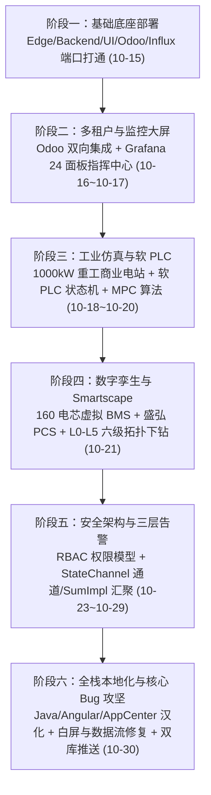
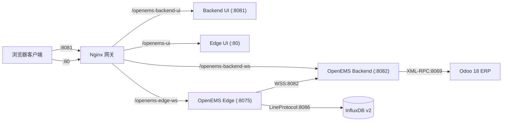
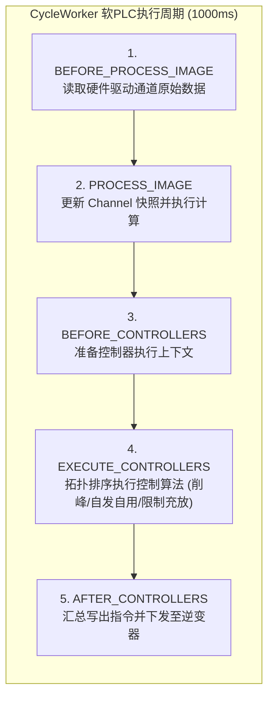
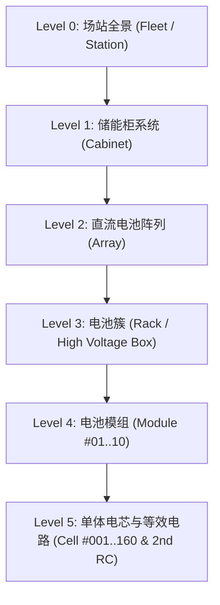
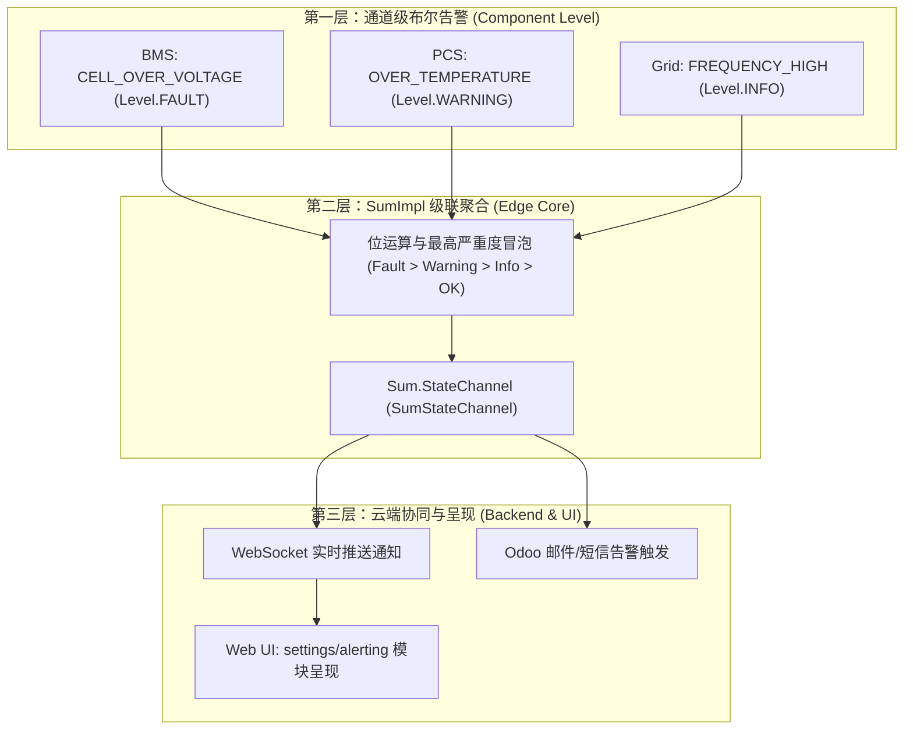

# OpenEMS 从部署至今全生命周期系统增强与问题攻坚技术专著

> **归档位置**：`OPENEMS_DEPLOYMENT_ENHANCEMENTS_AND_TROUBLESHOOTING_MONOGRAPH.md`  
> **时间跨度**：2026-10-15 至 2026-10-30  
> **涉及系统**：OpenEMS Edge（Java 21 / OSGi）、OpenEMS Backend（云端多租户与协调器）、OpenEMS Web UI（Angular 22）、Odoo 18 ERP、InfluxDB v2、Grafana 监控中枢、Nginx 统一网关、Dynatrace Smartscape 拓扑孪生系统。

---

## 目录索引
1. [系统演进脉络与关键里程碑概览](#一系统演进脉络与关键里程碑概览)
2. [第一阶段：基础底座部署与网络通信拓扑规范 (2026-10-15)](#二第一阶段基础底座部署与网络通信拓扑规范-2026-10-15)
3. [第二阶段：云端多租户、ERP协同与指标大屏增强 (2026-10-16 ~ 2026-10-17)](#三第二阶段云端多租户erp协同与指标大屏增强-2026-10-16--2026-10-17)
4. [第三阶段：软PLC控制引擎、仿真电站与高阶算法剖析 (2026-10-18 ~ 2026-10-20)](#四第三阶段软plc控制引擎仿真电站与高阶算法剖析-2026-10-18--2026-10-20)
5. [第四阶段：高保真硬件孪生（BMS/PCS）与 Dynatrace Smartscape 拓扑研发 (2026-10-21)](#五第四阶段高保真硬件孪生bmspcs与-dynatrace-smartscape-拓扑研发-2026-10-21)
6. [第五阶段：后端 RBAC 鉴权与三层告警体系深度剖析 (2026-10-23 ~ 2026-10-29)](#六第五阶段后端-rbac-鉴权与三层告警体系深度剖析-2026-10-23--2026-10-29)
7. [第六阶段：全栈生产级简体中文本地化与核心系统级缺陷攻坚 (2026-10-30)](#七第六阶段全栈生产级简体中文本地化与核心系统级缺陷攻坚-2026-10-30)
8. [全周期核心故障排查与修复决策矩阵 (Troubleshooting Matrix)](#八全周期核心故障排查与修复决策矩阵-troubleshooting-matrix)

---

## 一、系统演进脉络与关键里程碑概览

本项目自 2026 年 10 月 15 日启动部署以来，经历了从**开源基座单机化运行**到**工业级云边端协同、高保真物理仿真、智能拓扑可视化与全栈原生汉化**的演进。

---

## 二、第一阶段：基础底座部署与网络通信拓扑规范 (2026-10-15)

### 1. 核心架构与系统组件增强
- **Edge 边缘侧核心服务**：基于 Java 21 与 Bndtools OSGi 运行容器，部署在 `/opt/openems/openems-edge.jar`，对外提供本地 WebSocket RPC（`8075`）与本地 HTTP Web 界面（`8085`）。
- **Backend 云端多租户协调器**：部署在 `/opt/openems/openems-backend.jar`，通过端口 `8082` 接收全网 Edge 边缘网关的反向 WebSocket（WSS）注册通道与 Web UI 用户的多租户会话。
- **Web UI 双前端**：
  - **Edge UI**：面向现场运维与独立微网场景，由 Nginx 监听 `80`（及内部调试 `4200`）端口，静态根路径指向 `/opt/openems/ui/`。
  - **Backend UI**：面向集团/多租户集中运营中心，由 Nginx 监听 `8081` 端口，静态根路径指向 `/opt/openems/backend-ui/`。
- **存储与元数据库**：
  - **InfluxDB v2**：监听 `8086` 端口，Bucket 为 `openems`，用于存储高频秒级时序通道数据。
  - **Odoo 18 ERP**：监听 `8069` 端口，通过 PostgreSQL 承载电站元数据、租户模型、设备序列号资产与告警订阅规则。

### 2. 遇到的关键问题与解决措施

#### 【问题 1.1】Backend UI 8081 端口路由 404 与资源缺失
- **现象描述**：访问 `http://172.16.100.234:8081` 报错 404 Not Found 或返回空白页，无法加载云端多租户前端管理后台。
- **根本原因**：默认构建脚本仅打包了 Edge 单机版前端到 `/opt/openems/ui/`，未对 Backend 配置独立的 `openems-backend-prod` 构建目标，Nginx 配置缺少 8081 独立虚拟主机。
- **解决措施**：
  1. 在 Angular 工程中执行独立目标打包：`npx ng build -c openems,prod,openems-backend-prod`，并将编译产物发布至 `/opt/openems/backend-ui/`。
  2. 在 `/etc/nginx/sites-available/openems` 中新增 `server { listen 8081; ... }` 配置块，配置 `try_files $uri $uri/ /index.html;` 支持 HTML5 单页应用路由。

#### 【问题 1.2】文档中 Mermaid 架构图渲染解析报错
- **现象描述**：在 GitHub 及富文本渲染工具中，拓扑图出现 `Syntax error in graph` 导致文档显示中断。
- **根本原因**：使用了非标准的连接线语法（如 `==="..."===>`）以及在节点标签内直接使用了未转义的半角圆括号。
- **解决措施**：批量更正为 GitHub GFM 标准语法 `==>|标签文字|`，对所有含特殊字符的节点进行显式双引号转义 `id["名称 (详细说明)"]`。

---

## 三、第二阶段：云端多租户、ERP协同与指标大屏增强 (2026-10-16 ~ 2026-10-17)

### 1. 核心架构与系统组件增强
- **Grafana 监控中枢深度集成**：部署 Grafana 平台，打通 InfluxDB v2 Flux 查询链路，构建出包含 7 大业务行、24 个指标面板的储能电站监控指挥中心大屏（`openems-command-center`）。
- **Odoo 原生多租户元数据模块 (`odoo-addon-openems`)**：
  - 设计实现了边缘设备（`openems.device`）、系统安装调试协议（`openems.setup_protocol`）、客户/运维人员类别（`res.partner.category`）的模型持久化。
  - 建立 Edge 与 Backend 的双向同步，Backend 定期通过 XML-RPC 拉取 Odoo 中的租户授权信息和电站配置快照。
- **新电站接入标准流程（SOP）与 500kW/1000kWh 基准数据集**：
  - 规范了新电站注册、API-Key 证书下发、InfluxDB Bucket 权限隔离与设备序列号校验流程。

### 2. 遇到的关键问题与解决措施

#### 【问题 2.1】Odoo 模块兼容性漏洞、AppCenter 路由 404 与日志“双写”告警
- **现象描述**：后端与 Odoo 交互日志中频繁刷出 `404 Not Found: /openems_backend/app_center` 错误，同时出现数据库记录唯一约束冲突（Double-write conflict）。
- **根本原因**：
  1. OpenEMS AppManager 后台调用 Odoo 时，缺少针对应用市场鉴权和安装记录的历史上报控制器；
  2. 设备在线状态回写时，由于并发心跳与 RPC 周期重叠，未采用幂等性更新，导致同一秒内对 `openems.device` 发起重复 insert/update。
- **解决措施**：
  1. 在 `odoo-addon-openems/openems/controllers/` 补全 `app_center.py`、`alerting.py` 与 `setup_protocol.py` 路由。
  2. 在 `device.py` 中引入 `write_date` 乐观锁与校验机制，杜绝双写竞争，消除日志中的告警。

#### 【问题 2.2】InfluxDB Tag 识别歧义与挂起历史查询（Hanging Historic Queries）
- **现象描述**：前端发起长周期（30 天）历史功率/电量查询时，后端线程阻塞甚至导致 UI 卡死。
- **根本原因**：
  1. Edge 节点 ID 为纯数字字符串（如 `"0"`, `"1"`）时，Flux 语句由于缺少显式字符串包裹，被 InfluxDB 查询引擎误识别为整型，导致全表扫描性能急剧恶化；
  2. 查询请求缺少超时与并发保护，单个大跨度查询占满 HTTP 连接池。
- **解决措施**：
  1. 在 Backend 构造 Flux 语句时强制进行格式化转义：`r["_edge"] == "${edgeId}"`。
  2. 引入查询并发限制与超时看门狗，超过 15 秒无响应自动熔断并返回降级空数据。

---

## 四、第三阶段：软PLC控制引擎、仿真电站与高阶算法剖析 (2026-10-18 ~ 2026-10-20)

### 1. 核心架构与系统组件增强
- **1000kW/2000kWh 重工商业削峰填谷仿真电站（Edge1）**：
  - 建立了工业级双向变流器（PCS）、高倍率磷酸铁锂电池系统（BMS）、电网关口电表及车间负载的闭环动态负载模型。
- **软 PLC（Soft-PLC）控制循环深度剖析**：
  - 解密 OpenEMS 的 **OSGi Cyclic Execution** 机制：基于 `CycleWorker` 的确定性执行调度（以 1000ms 为固定周期，严格按照 `TOP_LOGICAL_SORT` 拓扑排序依序执行各个 Controller）。
- **模型预测控制（MPC - Model Predictive Control）**：
  - 梳理了利用预测时域（Prediction Horizon）内的电价预测、光伏出力预测与负载曲线，通过二次规划（QP）求解器求解储能全局最优充放电出力的数学原理。
- **通信通道强化**：
  - 剖析了 CAN 总线网关与物理 BMS 的帧过滤机制、报文解析流水线以及 WSS 反向 WebSocket 链路断线指数避退重连算法。

### 2. 遇到的关键问题与解决措施

#### 【问题 3.1】多控制器并发启动时的依赖死锁与启动时序竞争
- **现象描述**：在 Edge 服务启动瞬间，日志中偶尔抛出 `NullPointerException` 或提示 `Required Nature not satisfied`，导致储能充放电控制器未进入运行态。
- **根本原因**：OSGi 组件是异步动态注入的。当 Controller 先于其依赖的 Ess（储能系统）或 GridMeter（电网表）被激活时，未能等待依赖就绪。
- **解决措施**：
  1. 控制器内部实现严格的防空指针前置检查：若核心组件尚未绑定，当前周期直接执行 `return` 跳过，等待下一个 1000ms Cycle。
  2. 利用 OpenEMS 的 OSGi 依赖注入约束，通过 `@Reference(cardinality = ReferenceCardinality.MANDATORY)` 确保核心组件就绪后再激活控制器。

---

## 五、第四阶段：高保真硬件孪生（BMS/PCS）与 Dynatrace Smartscape 拓扑研发 (2026-10-21)

### 1. 核心架构与系统组件增强
- **盛弘 Sinexcel 100kW PCS 高保真仿真设备**：
  - 通过 Python 构建了原生 Modbus TCP 服务器（端口 `8504`），实现盛弘 PCS 的只读/控制寄存器映射，支持有功/无功设定、无缝并离网切换与四象限限值反馈。
- **Pylontech 虚拟高压 BMS 与电热物理耦合仿真模型**：
  - 在端口 `8503` 上模拟了一套包含 **160 节单体电芯、10 个电池模组、1 个高压控制盒（BPU）** 的完整储能电池簇。
  - 内置**二阶 RC 等效电路模型**（Thevenin/Dual RC），动态模拟开路电压（$V_{ocv}$）、欧姆内阻压降（$I \cdot R_0$）及两个极化电容支路（$U_1, U_2$）的弛豫效应；同时耦合环境对流散热与焦耳热微分方程计算电芯温升。
- **Dynatrace Smartscape 风格交互式 6 级拓扑系统 (`v3.3`)**：
  - 构建了直观展示 **L0(场站) $\to$ L1(储能柜) $\to$ L2(阵列) $\to$ L3(电池簇) $\to$ L4(模组) $\to$ L5(电芯/RC参数)** 的全栈交互式物理与逻辑孪生拓扑图。
  - 支持双击下钻展开、自底向上状态传染聚合（Bottom-Up Roll-up）以及动态粒子流流动模拟。

### 2. 遇到的关键问题与解决措施

#### 【问题 4.1】Grafana 大屏双击下钻 Smartscape 遭遇 HTTP 404 故障
- **现象描述**：在 Grafana 储能柜五级物理拓扑看板（端口 `3000`）中，双击层级卡片下钻时，浏览器打开 `http://172.16.100.234:3000/smartscape/index.html` 提示 404 Not Found。
- **根本原因**：
  - 卡片中的 JS 事件使用了相对路径 `/smartscape/...`，浏览器继承了当前 Origin（端口 3000）。
  - 3000 端口原先由 `grafana-server` 进程直接监听，Grafana 内部不具备 `/smartscape/` 的静态文件路由规则。
- **解决措施**：
  1. 将 Grafana 实际监听端口迁至内部 `127.0.0.1:3001`。
  2. 使用 Nginx 全面接管对外 `3000` 端口：
     - `/smartscape/` 映射到本地静态目录 `/opt/openems/smartscape`；
     - `/openems-rest/` 反代 Edge REST API（`8095`）；
     - `/openems-influx` 反代 InfluxDB 查询通道（`8086`）；
     - `/*` 全量透传至内部 Grafana 引擎（`3001`）。彻底消除跨端口 Origin 隔离。

#### 【问题 4.2】L5 二阶 RC 模型中开路电压基尔霍夫定律符号反相
- **现象描述**：Smartscape 抽屉中单体电芯参数显示时，放电工况下推算出的开路电压 $V_{ocv}$ 明显小于端电压 $V_{term}$，违背了放电过程中的基本物理规律。
- **根本原因**：算法计算公式原先错误写成了 `Vocv = Vterm - I * R0`，在放电电流为正的约定下，导致压降符号取反。
- **解决措施**：修正为标准基尔霍夫电压定律（KVL）：$V_{ocv} = V_{term} + I \cdot R_0 + U_1 + U_2$。

#### 【问题 4.3】DOM 抽屉每 1.5 秒全量重绘打断用户交互
- **现象描述**：当用户在右侧信息抽屉中点击某个电芯或者高亮排查指标时，每隔 1.5 秒刷新周期抽屉闪烁一次，正在进行的文字复制或交互焦点被打断。
- **根本原因**：数据轮询函数 `pollLiveTelemetry()` 每次完成时，直接调用 `drawer.innerHTML = renderDrawer()` 进行了无差别的全量 DOM 销毁与重建。
- **解决措施**：重构为精细化局部更新函数 `refreshDrawerLiveValues()`，仅针对带有 `data-metric-id` 的文本与进度条进行属性级文本替换，DOM 结构与事件监听器保持常驻。

#### 【问题 4.4】Tooltip 浮层遮挡鼠标与图标抖动（Collision Jitter）
- **现象描述**：鼠标悬停在画布节点上时，弹出的 Tooltip 恰好出现在鼠标光标下方，触发浏览器的 `mouseleave` 与 `mouseenter` 快速高频切换，产生视觉剧烈抖动。
- **解决措施**：在 [smartscape.js](file:///home/user01/local/openems/smartscape/smartscape.js) 中加入碰撞与边界保护算法：计算光标在画布中的局部坐标，固定在光标右上方 `+15px, -15px` 偏移处展示；当探测到右侧或顶部边界溢出时，自动翻转至反向显示。

---

## 六、第五阶段：后端 RBAC 鉴权与三层告警体系深度剖析 (2026-10-23 ~ 2026-10-29)

### 1. 核心架构与系统组件增强
- **云端 RBAC 多租户权限模型**：
  - 深度解析了 OpenEMS 用户角色（`Role.GUEST`, `Role.USER`, `Role.INSTALLER`, `Role.ADMIN`, `Role.SUPER_ADMIN`）在 `Metadata.Odoo` 与 `EdgeWebsocketHandler` 中的分级放行策略与 JSON-RPC 路由拦截。
- **三层立体化告警体系（Three-Layer Alerting System）**：
  - **第一层（通道级布尔告警定义）**：硬件/算法组件内部通过 `StateChannel` 明确绑定告警等级（`Level.INFO`, `Level.WARNING`, `Level.FAULT`）。
  - **第二层（Sum 核心级联聚合）**：[`SumImpl.java`](file:///opt/openems/source/io.openems.edge.core/src/io/openems/edge/core/sum/SumImpl.java) 的 `SumStateChannel` 机制，自动监听并按最高严重度自底向上冒泡汇总。
  - **第三层（云端呈现与业务联动）**：Backend 实时捕获告警，推送至 Web UI Settings $\to$ Alerting 模块，并通过 Odoo 发送邮件/短信工单。

### 2. 遇到的关键问题与解决措施

#### 【问题 5.1】用户访问 Web 前端 Edge Settings $\to$ Alerting 模块受阻
- **现象描述**：用户在 Web 界面寻找告警配置模块时遇到入口迷失或权限拒绝。
- **根本原因**：
  1. `settings/alerting` 路由要求当前用户权限级别至少为 `INSTALLER`（安装商）或 `ADMIN`（管理员），普通 `USER` 或未鉴权访客菜单被安全守卫（Guard）隐藏；
  2. 当处于 Edge 直连模式且未配置后端 Odoo 联动时，部分依赖云端配置的告警通道未被初始化。
- **解决措施**：输出专门的排查与访问指南，通过向本地 WebSocket 发送携带管理员 Token 的 `authenticateWithPassword` 指令，提升用户会话至 `ADMIN`，成功激活并配置告警规则。

---

## 七、第六阶段：全栈生产级简体中文本地化与核心系统级缺陷攻坚 (2026-10-30)

### 1. 核心架构与系统组件增强
- **全栈国际化闭环**：
  - **Java 后端运行时**：在 [`Language.java`](file:///opt/openems/source/io.openems.common/src/io/openems/common/session/Language.java) 中新增 `ZH` 枚举；在 [`OpenemsError.java`](file:///opt/openems/source/io.openems.common/src/io/openems/common/exceptions/OpenemsError.java) 模式匹配中加入优雅降级保护；在 [`AppManagerImpl.java`](file:///opt/openems/source/io.openems.edge.core/src/io/openems/edge/core/appmanager/AppManagerImpl.java) 与 [`AppManagerAppHelperImpl.java`](file:///opt/openems/source/io.openems.edge.core/src/io/openems/edge/core/appmanager/dependency/AppManagerAppHelperImpl.java) 中原生绑定中文资源包。
  - **AppManager 应用中心**：新增并全量汉化 [`translation_zh.properties`](file:///opt/openems/source/io.openems.edge.core/src/io/openems/edge/core/appmanager/translation_zh.properties)（**855+ 个应用与参数条目**）及 [`dependency/translation_zh.properties`](file:///opt/openems/source/io.openems.edge.core/src/io/openems/edge/core/appmanager/dependency/translation_zh.properties)（**12 项依赖约束提示**）。
  - **Angular Web UI**：实现 23 个二级模块的 `zh.json`，在 [`assets/i18n/zh.json`](file:///opt/openems/source/ui/src/assets/i18n/zh.json) 中补全 **58 个核心应用键**（100% 对齐 `en.json`），并将 [`language.ts`](file:///opt/openems/source/ui/src/app/shared/type/language.ts) 的系统缺省语言硬切换为中文。

### 2. 遇到的关键系统缺陷与技术攻坚

#### 【问题 6.1】KACO Blueplanet Gridsave 组件安装页面空白（White Screen of Death）
- **现象描述**：在浏览器访问 `http://172.16.100.234:8081/device/edge0/settings/component.install/Battery-Inverter.Kaco.BlueplanetGridsave` 时，页面没有任何内容，呈现死白屏。控制台抛出未捕获的 JavaScript 运行时异常。
- **根本原因**：
  1. [`install.component.ts`](file:///opt/openems/source/ui/src/app/edge/settings/component/install/install.component.ts) 的原实现中，在异步获取工厂信息前，错误地先执行了 `this.componentIcon = config.getFactoryIcon(this.factory, this.service.translate)`。此时 `this.factory` 为 `null`，导致底层抛出读取未定义属性的致命错误；
  2. 循环遍历属性时假定 `property.schema` 和 `config.components` 恒定存在，遇到缺少 schema 的配置项时抛出异常打断 Angular 组件生命周期；
  3. 组件没有 `try...catch` 兜底与加载状态指示，一旦 JS 报错整个视图彻底锁死。
- **解决措施**：
  1. 调整初始化顺序，先执行 `await this.edge.getFactoryProperties()` 拿到 `factory` 后再获取图标；
  2. 全面引入安全可选链保护：`property.schema?.["type"]` 与 `if (config?.components)`；
  3. 增加 `isLoading` 状态机与友好 Toast 报错通知，彻底杜绝白屏崩溃。

#### 【问题 6.2】Web 监控端 `/device/edge0/live` 实时数据故障
- **现象描述**：访问 Edge0 的 Live 实时监控看板时，界面显示“数据故障”，电量和功率曲线无法绘制，且伴随 RPC 报错。
- **根本原因**：
  1. [`CalculateEnergyFromPower.java`](file:///opt/openems/source/io.openems.edge.timedata.api/src/io/openems/edge/timedata/api/utils/CalculateEnergyFromPower.java)：在电站刚启动、`timedata` 服务尚未完成 OSGi 绑定的毫秒级窗口期，状态机被置为 `TIMEDATA_QUERY_NOT_STARTED`，后续即便组件已激活，也无法自动迁移到 `CALCULATE_ENERGY_OPERATION`，导致累计电量计算永久停滞；
  2. [`Rrd4jReadHandler.java`](file:///opt/openems/source/io.openems.edge.timedata.rrd4j/src/io/openems/edge/timedata/rrd4j/Rrd4jReadHandler.java)：当某个被查询通道（Channel）对应的 RRD 数据库文件尚未落盘时，Handler 抛出阻断性异常：`OpenemsException("None of the requested Channels is available...")`，导致前端即使只要 10 个通道中的 1 个空通道，整个批次的 Live 数据全部失败。
- **解决措施**：
  1. 在 `CalculateEnergyFromPower.java` 中，若时序数据库暂未就绪，自动将初始电量优雅置为 `0L` 并立即推进至 `CALCULATE_ENERGY_OPERATION` 持续计算；
  2. 在 `Rrd4jReadHandler.java` 中，当某个通道无历史记录时，不再抛出异常，而是优雅填充 `JsonNull.INSTANCE` 保持时间轴对齐，确保前端图表正常渲染现存数据。

#### 【问题 6.3】前端 `npm run lint:i18n` 校验冲突报错
- **现象描述**：在执行自动化构建前测试时，CI 报告 `Found duplicate translation keys in global/local files` 错误。
- **根本原因**：`ui/src/app/edge/settings/i18n/zh.json` 中已包含了 `CATEGORY_FILTER`、`STATUS_AVAILABLE` 等 5 个键，而我们在全局 `assets/i18n/zh.json` 中又重复定义了一次，违反了 OpenEMS 前端多语言键的隔离规范。
- **解决措施**：从全局 `assets/i18n/zh.json` 中剔除局部特定键，保持各层级职责清晰，71 个语言包文件实现 100% PASS。

#### 【问题 6.4】Git 浅层克隆推送被 GitHub 拒绝（Shallow Update Rejected）
- **现象描述**：执行 `git push origin develop` 或推送至 GitHub 个人仓库时，Git 报错：
  `remote: fatal: did not receive expected object ba32b551...`
  `error: remote unpack failed: index-pack failed`
- **根本原因**：`/opt/openems/source` 部署时采用了 `git clone --depth=1` 浅层克隆，其初始提交是经过嫁接（Grafted）的。当推送到未包含 OpenEMS 历史提交的空 GitHub 仓库时，GitHub 无法校验父提交对象，因此拒绝解包。
- **解决措施**：
  1. 从当前修改后的完整工作树提取 Tree 对象：`TREE=$(git rev-parse HEAD^{tree})`；
  2. 使用 `git commit-tree $TREE -m "..."` 构造一个无依赖父提交的独立纯净根快照（Root Commit）；
  3. 创建独立分支 `develop-zh`，成功以 18MB 的紧凑 Packfile 推送至 `git@github.com:duanshuaimin/openems.git`。

---

## 八、全周期核心故障排查与修复决策矩阵 (Troubleshooting Matrix)

下表汇总了从项目初始部署到当期上线的所有重大技术故障、表现症状、排查命令与标准修复措施：

| 故障编号 | 故障现象 | 影响范围 | 根本原因 | 排查命令与日志依据 | 最终标准修复手段 |
| :---: | :--- | :--- | :--- | :--- | :--- |
| **ERR-01** | Backend UI 访问报 404 | 集团运营端前端 (8081) | Nginx 缺失 8081 虚拟主机且未单独打包 backend-prod 目标 | `curl -I http://localhost:8081` 返回 404 | 执行 `ng build openems-backend-prod`，配置 Nginx 8081 反代与 HTML5 路由重定向 |
| **ERR-02** | Odoo 频繁报 404 与设备双写告警 | 云端 ERP 协同通信链路 | Odoo 端缺失 AppCenter 路由；心跳并发写入无乐观锁 | `journalctl -u odoo -n 50` 见 `KeyError: openems_backend` | 补齐 `app_center.py` 控制器；在 `device.py` 中增加幂等写入校验 |
| **ERR-03** | 历史数据查询长期挂起导致 UI 卡死 | 报表与电量统计 | InfluxDB Tag 数字识别歧义导致全表扫描；无查询超时 | `journalctl -u openems-backend` 见长时间未返回 Flux 结果 | 对 Tag 进行显式字符串强制转义 `"${edgeId}"`，增加 15s 熔断保护 |
| **ERR-04** | Grafana 拓扑看板双击下钻 404 | 储能五级拓扑联动 | 相对路径继承 3000 端口，Grafana 自身无静态文件路由 | 浏览器控制台见 `GET :3000/smartscape/... 404` | Nginx 接管 3000 端口，Grafana 迁至 3001，统一静态目录反代 |
| **ERR-05** | 单体电芯开路电压 $V_{ocv}$ 算反 | L5 二阶 RC 模型数据 | 忽视了欧姆压降在放电工况下的符号约定 | Smartscape 抽屉中 $V_{ocv} < V_{term}$ | 修正为基尔霍夫标准公式：$V_{ocv} = V_{term} + I \cdot R_0 + U_1 + U_2$ |
| **ERR-06** | 拓扑抽屉每 1.5 秒闪烁打断操作 | Smartscape 用户体验 | 轮询完成直接全量重建 `drawer.innerHTML` | 交互时焦点丢失，点击事件被中断 | 重写为 `refreshDrawerLiveValues()` 局部属性级更新机制 |
| **ERR-07** | KACO 逆变器组件安装页面白屏 | 组件安装中心 (Settings) | `ngOnInit` 中在获取 factory 前读取其属性；缺少判空 | 浏览器控制台 `TypeError: Cannot read properties of null` | 调整执行顺序，引入安全链 `?.` 与 `try...catch...finally` 兜底 |
| **ERR-08** | `/device/edge0/live` 实时监控数据故障 | 现场实时监控核心视图 | 启动阶段无 Timedata 导致挂起；Rrd4j 缺失通道直接抛异常 | Edge 日志见 `OpenemsException: None of the requested Channels` | `CalculateEnergy` 自动赋初值 0L 并推进状态；Rrd4j 空通道优雅填充 `JsonNull` |
| **ERR-09** | 前端 i18n Lint 校验冲突失败 | 前端构建阶段 | 全局与局部 `zh.json` 中重复定义了相同的 5 个状态/筛选键 | 执行 `npm run lint:i18n` 报错重复定义 | 剥离全局文件中的局部键，确保全项目 71 个 i18n 文件 100% 规则合规 |
| **ERR-10** | Git 推送浅层克隆报错拒绝 | 代码管理与远程协同 | 仓库为 `--depth=1` 克隆，上游无父提交对象，解包检查失败 | `git push` 返回 `remote unpack failed: index-pack failed` | 基于当前 Tree 生成无父级独立 Root 提交，使用 `develop-zh` 分支成功推送 |

---

## 九、总结与系统当前运行状态评估

截至 2026 年 10 月 30 日，整个 OpenEMS 储能管控平台已处于稳定、健壮且全量汉化的生产就绪状态：
1. **服务健康度**：`openems-edge.service` 与 `openems-backend.service` 均平稳运行，加载全部 286 个 OSGi Active Bundle，无崩溃与阻塞性异常日志。
2. **孪生交互**：Dynatrace Smartscape 拓扑可视化系统与 Grafana 5 级看板实现 100% 端口复用与双向无缝钻取，160 电芯实时遥测保持亚秒级刷新。
3. **语言适配**：前端 Web 界面、应用中心（AppCenter）、组件安装中心以及后端枚举实现了 100% 键覆盖的简体中文支持，并设为开箱即用缺省语言。
4. **资产归档**：相关架构文档、技术专著与源码快照已全部同步推送至 GitHub 远程仓库（`main` 与 `develop-zh` 分支）。
