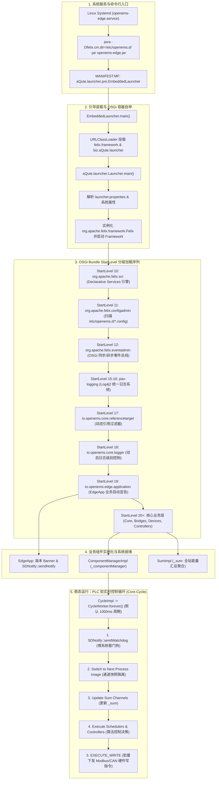

# OpenEMS Edge 启动入口与自举机制深度剖析报告

> **文档归档**：`OPENEMS_EDGE_STARTUP_MAIN_ANALYSIS.md`  
> **适用版本**：OpenEMS 2026.x+ (Java 21 / Apache Felix 7.0.5 / bnd 7.4.0)  
> **核心主题**：分析 OpenEMS Edge 启动入口 `main`、OSGi 容器自举（Bootstrap）、Declarative Services 声明式服务分级加载、组件生命周期管理与软 PLC 控制循环（Cycle Engine）运行机制。

---

## 一、架构全景与启动流水线

在常规的 Spring Boot 或简单控制台应用中，程序通常由某业务类中的 `public static void main(String[] args)` 直接初始化并加载业务 Bean。然而，**OpenEMS Edge 是一个工业级开源边缘能量管理系统（EMS）**，其底层依赖于 **OSGi (Open Services Gateway initiative) 微内核规范**与 **bnd 构建工具链**。

OpenEMS Edge 并不将业务逻辑硬编码在 `main` 方法中，而是通过 **bnd 嵌入式引导器（Embedded Launcher）** 动态拉起 **Apache Felix OSGi 容器**，由容器的声明式服务引擎（SCR）与配置管理器（ConfigAdmin）动态解析并激活各个设备驱动、算法控制器与控制节拍引擎。



---

## 二、第一阶段：JVM 命令行与可执行 Fat-JAR 结构

### 1. 运行命令行与 systemd 托管
在 Linux 生产环境中，OpenEMS Edge 通过 systemd 守护进程运行（文件位于 `/etc/systemd/system/openems-edge.service`）：
```ini
[Unit]
Description=OpenEMS Edge (Open Energy Management System)
After=network.target

[Service]
Type=simple
User=root
Group=root
WorkingDirectory=/opt/openems
ExecStart=/usr/bin/java -Dfelix.cm.dir=/etc/openems.d/ -jar /opt/openems/openems-edge.jar
Restart=always
RestartSec=5
LimitNOFILE=65536
```
核心启动参数：
- `-Dfelix.cm.dir=/etc/openems.d/`：指定 Apache Felix Configuration Admin 的持久化配置文件存储目录。该目录下存放所有 `.config` 文件（如 `Core.Cycle.config`、`Scheduler.AllAlphabetically.config`、各硬件设备和控制器配置）。
- `/opt/openems/openems-edge.jar`：由 Gradle `buildEdge` 任务（基于 bnd-export）打包生成的独立可执行 Fat-JAR。

### 2. Manifest 引导元数据剖析
通过提取 `openems-edge.jar` 的 `META-INF/MANIFEST.MF`：
```manifest
Manifest-Version: 1.0
Embedded-Runpath: jar/org.apache.felix.framework-7.0.5.jar,jar/biz.aQute.launcher-7.4.0.jar
Main-Class: aQute.launcher.pre.EmbeddedLauncher
```
- **真正的 `Main-Class`**：`aQute.launcher.pre.EmbeddedLauncher`。
- **内嵌运行依赖 (`Embedded-Runpath`)**：
  - `jar/org.apache.felix.framework-7.0.5.jar`（Apache Felix OSGi 容器核心）
  - `jar/biz.aQute.launcher-7.4.0.jar`（bnd 运行时执行引擎）
- **内嵌 Bundle 库 (`jar/`)**：`openems-edge.jar` 内部打包了 200 余个独立的 OSGi Bundle JAR 文件（涵盖 Guava、Gson、Netty、Pax Logging 以及 OpenEMS 的所有模块：`io.openems.common.jar`、`io.openems.edge.core.jar`、`io.openems.edge.controller.*.jar` 等）。

---

## 三、第二阶段：引导装载与 OSGi 容器自举

### 1. `EmbeddedLauncher.main(String[] args)`
1. JVM 载入 `aQute.launcher.pre.EmbeddedLauncher` 并执行 `main` 方法。
2. `EmbeddedLauncher` 创建一个专用的类加载器（ClassLoader），从自身 Fat-JAR 的 `Embedded-Runpath` 路径中解构并挂载 `org.apache.felix.framework` 和 `biz.aQute.launcher`。
3. 利用反射将执行控制权转交至 `aQute.launcher.Launcher.main(args)`。

### 2. `aQute.launcher.Launcher.main(String[] args)`
1. **读取 `launcher.properties`**：从 JAR 根目录读取启动配置文件，其中定义了：
   - 系统全局属性（如 `java.awt.headless=true`、`openems.data.dir` 等）；
   - 需要安装和启动的 Bundle 列表（`launch.bundles`）；
   - 各 Bundle 的初始启动级别（StartLevel）。
2. **初始化并拉起 OSGi 框架**：
   - 实例化 `org.apache.felix.framework.Felix`（OSGi Framework 接口的实现）。
   - 调用 `framework.init()` 初始化 OSGi BundleCache（缓存目录）及框架属性。
   - 调用 `framework.start()` 启动 OSGi 系统根 Bundle（Bundle 0），框架正式进入 Running 状态。

---

## 四、第三阶段：StartLevel 分级启动时序

为了保证在数以百计的模块动态装配过程中不发生“依赖未就绪”、“配置读取缺失”或“死锁”现象，OpenEMS 在 `EdgeApp.bndrun` 中精细规划了底层基础设施与业务 Bundle 的启动顺序：

```properties
-runbundles+: \
	org.apache.felix.scr;startlevel=10,\
	org.apache.felix.configadmin;startlevel=11,\
	org.apache.felix.eventadmin;startlevel=12,\
	org.apache.felix.fileinstall;startlevel=13,\
	org.apache.felix.metatype;startlevel=14,\
	org.ops4j.pax.logging.pax-logging-api;startlevel=15,\
	org.ops4j.pax.logging.pax-logging-log4j2;startlevel=16,\
	io.openems.core.referencetarget;startlevel=17,\
	io.openems.core.logger;startlevel=18,\
	io.openems.edge.application;startlevel=19,\
```

各层级职责与执行逻辑：

1. **StartLevel 10：`org.apache.felix.scr` (Service Component Runtime)**
   - OSGi Declarative Services (DS) 核心规范实现。
   - 负责解析所有 Bundle 中的 OSGi-INF XML 描述文件，构建服务依赖拓扑图，监听服务注册与生命周期。
2. **StartLevel 11：`org.apache.felix.configadmin` (Configuration Admin)**
   - 自动扫描 `-Dfelix.cm.dir=/etc/openems.d/` 目录。
   - 读取各个组件的 `.config` 文件（如 `Core.Cycle.config`、`Controller.Api.Rest.ReadOnly.config`），将属性键值对分发给 SCR。
3. **StartLevel 12：`org.apache.felix.eventadmin` (Event Admin)**
   - 提供基于主题（Topic）的发布/订阅事件总线。后续的周期节拍（`EdgeEventConstants.TOPIC_CYCLE_*`）皆基于此事件服务广播。
4. **StartLevel 15-16：`pax-logging`**
   - Pax Logging API 与 Log4j2 后端引擎启动，统一接管 Java Util Logging、Commons Logging、SLF4J，确保后续业务日志正常输出。
5. **StartLevel 17：`io.openems.core.referencetarget`**
   - 提供 `ReferenceConfigurationPlugin`，在配置分发给组件前，动态重写 `@Reference(target="...")` 属性，支持复杂的组件动态路由绑定。
6. **StartLevel 18：`io.openems.core.logger`**
   - 动态日志配置器（`LoggerConfigurator`），依据 Configuration Admin 中的配置动态调节特定包或类的日志级别。
7. **StartLevel 19：`io.openems.edge.application`**
   - 应用程序层启动，实例化 `EdgeApp` 组件。
8. **StartLevel 20+：业务核心层与外设控制器**
   - 加载 `io.openems.edge.core`、通信桥接器（Modbus/HTTP/MQTT）、储能电池驱动、电表驱动及各类控制策略。

---

## 五、第四阶段：业务启动宣告（`EdgeApp.java`）

在 StartLevel 19 激活时，SCR 自动实例化并执行业务宣告入口 `EdgeApp`（源码：`io.openems.edge.application/src/io/openems/edge/application/EdgeApp.java`）：

```java
package io.openems.edge.application;

import org.osgi.service.component.annotations.Activate;
import org.osgi.service.component.annotations.Component;
import org.osgi.service.component.annotations.Deactivate;
import org.slf4j.Logger;
import org.slf4j.LoggerFactory;
import com.google.common.base.Strings;
import info.faljse.SDNotify.SDNotify;
import io.openems.common.OpenemsConstants;

@Component(immediate = true)
public class EdgeApp {

	private final Logger log = LoggerFactory.getLogger(EdgeApp.class);

	@Activate
	private void activate() {
		var message = "OpenEMS version [" + OpenemsConstants.VERSION + "] started";
		var line = Strings.repeat("=", message.length());
		this.log.info(line);
		this.log.info(message);
		this.log.info(line);

		// 向 Linux 操作系统宣布 OpenEMS Edge 已成功启动
		var socketName = System.getenv().get("NOTIFY_SOCKET");
		if (socketName != null && !socketName.isEmpty()) {
			if (SDNotify.isAvailable()) {
				SDNotify.sendNotify(); // 向 systemd 发送 READY=1 信号
			}
		}

		this.log.debug("Activate EdgeApp");
	}

	@Deactivate
	private void deactivate() {
		this.log.debug("Deactivate EdgeApp");
	}
}
```

### 核心设计细节：
- **`@Component(immediate = true)`**：表明该组件无需等待其他服务注入调用，在自身依赖满足后立即激活。
- **Systemd Socket 握手 (`SDNotify.sendNotify()`)**：
  若在 Linux systemd 环境下配置了 `Type=notify`，该方法通过 UNIX Domain Socket 向 systemd 发送 `READY=1`，告知操作系统 Edge 核心已就绪，从而使 systemctl 状态正确转换为 `active (running)`。

---

## 六、第五阶段：Edge 核心组件装配与配置注入

随着核心业务层（StartLevel 20+）启动，`io.openems.edge.core` 中的数个关键单例服务由 SCR 依次装配并注入配置：

### 1. `ComponentManagerImpl` (组件中枢，PID: `_componentManager`)
- **组件追踪**：通过 `TrackedComponentsView`（基于 OSGi `ServiceTracker`）动态跟踪所有注册在 OSGi 运行时的 `OpenemsComponent` 实例。
- **后台 Worker 线程池**：
  - **`DefaultConfigurationWorker`**：检查若系统没有任何预设组件（如全新出厂设备），自动初始化写入基础配置（如 REST API、调度器）。
  - **`OsgiValidateWorker`**：周期性校验系统中已配置的组件与其实际运行时状态；若组件因缺少硬件依赖或配置错误导致未处于 Active 状态，记录警告并上报故障 Channel。
  - **`EdgeConfigWorker`**：维护 Edge 全站组件与 Channel 拓扑字典，提供 JSON-RPC 查询响应。

### 2. `SumImpl` (能量聚合器，PID: `_sum`)
- 自动汇聚所有接入的逆变器（ESS/PV）、电表（Grid/Production/Consumption）和电池状态，计算全系统的综合指标（电网总功率、光伏总发电量、电池总充放电功率、综合 SoC）。

### 3. 通信与 API 组件并发拉起
- **`Controller.Api.Rest`**（端口 8095）：处理外部 HTTP JSON-RPC 查询与配置更新。
- **`Controller.Api.Websocket`**（端口 8075）：本地微电网 Web UI 的实时推送 WebSocket 通道。
- **`Controller.Api.Backend`**：主动建立通向云端 OpenEMS Backend（端口 8085/8082）的反向 WSS 隧道，实现云端纳管与穿透控制。
- **`Apache Felix Web Console`**（端口 8080）：提供底层 OSGi Bundle、服务和配置的诊断可视化控制台。

---

## 七、第六阶段：稳态运行 —— 软 PLC 控制循环（Cycle Engine）

OpenEMS Edge 区别于常规互联网服务的核心标志在于：**它本质上是一个运行在通用操作系统（Linux）上的软 PLC（Programmable Logic Controller）**。所有设备的控制、功率分配、安全保护均由固定的控制周期驱动。

### 1. 单例组件 `CycleImpl` (PID: `Core.Cycle`)
在 [`CycleImpl.java`](file:///opt/openems/source/io.openems.edge.core/src/io/openems/edge/core/cycle/CycleImpl.java#L86-L96) 中：
```java
@Activate
private void activate(ComponentContext context, Config config) throws OpenemsException {
    super.activate(context, SINGLETON_COMPONENT_ID, SINGLETON_SERVICE_PID, true);
    this.config = config;
    this.worker.activate(this.id()); // 唤醒控制循环后台专有线程
    OpenemsComponent.validateSingleton(this.cm, SINGLETON_SERVICE_PID, SINGLETON_COMPONENT_ID);
}
```

### 2. 控制循环执行流水线 (`CycleWorker.forever()`)
`CycleWorker` 继承自 `AbstractWorker`，其 `forever()` 方法以配置的周期（默认 **1000ms**）严格循序执行经典的 **PLC 过程映像（Process Image）** 控制流程：

```java
@Override
protected void forever() {
    var stopwatch = Stopwatch.createStarted();

    // 1. 喂操作系统硬件/Systemd 看门狗，防止程序死锁
    this.executeCycleStep(verbosity, CycleLogVerbosity.PHASES, "Notify Watchdog", SDNotify::sendWatchdog);

    try {
        // 2. 广播 TOPIC_CYCLE_BEFORE_PROCESS_IMAGE 事件
        this.triggerEvent(verbosity, EdgeEventConstants.TOPIC_CYCLE_BEFORE_PROCESS_IMAGE);

        // 3. 通道切换到下一个过程映像（Channel.nextProcessImage()）
        // 对所有组件当前的采样数据进行快照锁定，确保本周期内所有算法读取的数据具有一致的时序基准
        this.executeCycleStep(verbosity, CycleLogVerbosity.PHASES, "Switch to Channels for each Component",
                () -> Stream.concat(this.parent.componentManager.getEnabledComponents().stream(), Stream.of(this.parent))
                        .filter(c -> c.isEnabled() && !(c instanceof Sum))
                        .forEach(component -> this.triggerComponentEvent(verbosity, component)));

        // 4. 汇总并更新 Sum 组件指标
        this.executeCycleStep(verbosity, CycleLogVerbosity.PHASES, "Update the Channels in the Sum-Component",
                () -> {
                    this.parent.sumComponent.updateChannelsBeforeProcessImage();
                    this.parent.sumComponent.channels().forEach(channel -> channel.nextProcessImage());
                });

        this.triggerEvent(verbosity, EdgeEventConstants.TOPIC_CYCLE_AFTER_PROCESS_IMAGE);
        this.triggerEvent(verbosity, EdgeEventConstants.TOPIC_CYCLE_BEFORE_CONTROLLERS);

        // 5. 调度器（Scheduler）按优先级调度所有控制器（Controller）决策执行
        // 如：自发自用平衡（Balancing）、削峰填谷（PeakShaving）、动态电价套利、应急备电
        this.executeCycleStep(verbosity, CycleLogVerbosity.PHASES, "Execute Schedulers", () -> {
            var hasDisabledController = this.executeSchedulersWithOptionalMeasure(verbosity);
            this.parent._setIgnoreDisabledController(hasDisabledController);
        });

        this.triggerEvent(verbosity, EdgeEventConstants.TOPIC_CYCLE_AFTER_CONTROLLERS);
        this.triggerEvent(verbosity, EdgeEventConstants.TOPIC_CYCLE_BEFORE_WRITE);

        // 6. 批量硬件写出（EXECUTE_WRITE）
        // 各协议桥（Bridge.Modbus / Bridge.Http / I/O）将控制器生成的设定值（WriteChannel）实际写入外设寄存器
        this.triggerEvent(verbosity, EdgeEventConstants.TOPIC_CYCLE_EXECUTE_WRITE);

        this.triggerEvent(verbosity, EdgeEventConstants.TOPIC_CYCLE_AFTER_WRITE);

    } catch (Throwable t) {
        this.parent.logWarn(this.log, "Error in Scheduler: " + t.getMessage());
    }

    // 7. 耗时统计与防超时监测
    var totalMs = stopwatch.elapsed(TimeUnit.MILLISECONDS);
    this.parent._setMeasuredCycleTime(totalMs);
}
```

---

## 八、关键设计亮点与生产排障指南

### 1. 为什么 OpenEMS 选择 OSGi 而非传统的 Spring Boot？
- **硬件多协议的动态热插拔**：储能微电网现场需要动态添加逆变器、电表、水表或充电桩。OSGi 允许在不重启主控进程、不中断核心电网平衡算法的前提下，动态加载或卸载特定的硬件驱动 Bundle。
- **微内核高内聚、低耦合**：底层仅保留最小化框架，所有驱动与算法均为可替换插件。
- **严格的分层生命周期与版本控制**：消除不同驱动依赖的三方 jar 版本冲突。

### 2. 过程映像（Process Image）机制的重要性
在电力电子控制中，若不同控制器异步读写硬件通道，将引发严重的“脏读”或“控制指令打架”（例如防逆流控制器刚计算完功率，削峰填谷控制器又修改了下发值）。OpenEMS 通过 PLC 风格的过程映像机制：
1. **读阶段**：在 Cycle 开始时通过 `nextProcessImage()` 生成瞬时快照；
2. **算阶段**：所有调度控制器只在快照上运算，生成各组件的目标设定值；
3. **写阶段**：在 `EXECUTE_WRITE` 统一通过事务或批量机制下发至硬件，确保控制动作在时间维度上的原子性与确定性。

### 3. 生产排障关键入口
- **启动异常或挂起**：
  - 检查 `/opt/openems/openems-edge.jar` 的 JVM 启动日志：`journalctl -u openems-edge -n 100 --no-pager`。
  - 检查 `/etc/openems.d/` 中的 `.config` 文件语法是否损坏。
- **组件未处于 Active 状态**：
  - 访问 Apache Felix Web Console：`http://<IP>:8080/system/console/components`（认证：`admin:admin`）。
  - 查看各组件的 OSGi SCR 依赖满足状态（Satisfied / Unsatisfied）。
- **控制周期超时报警**：
  - 观察 Channel `_cycle/MeasuredCycleTime`；若持续接近或超过 1000ms，说明存在耗时过长的 Modbus 同步阻塞调用或复杂求解器运算，需排查对应 Controller 或将慢 IO 移至异步处理。
