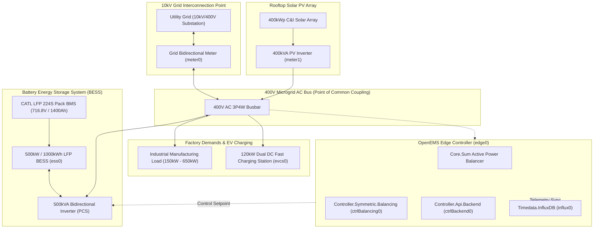
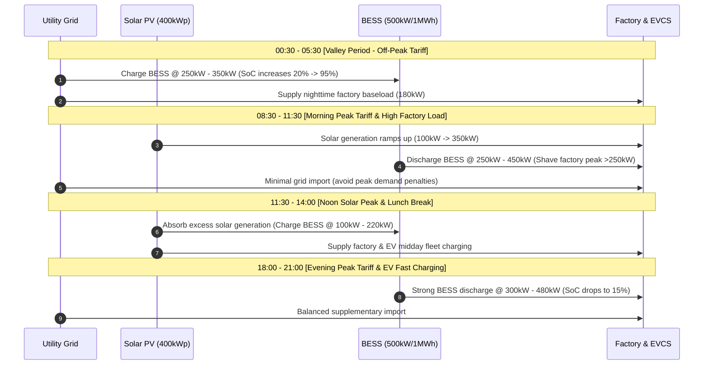
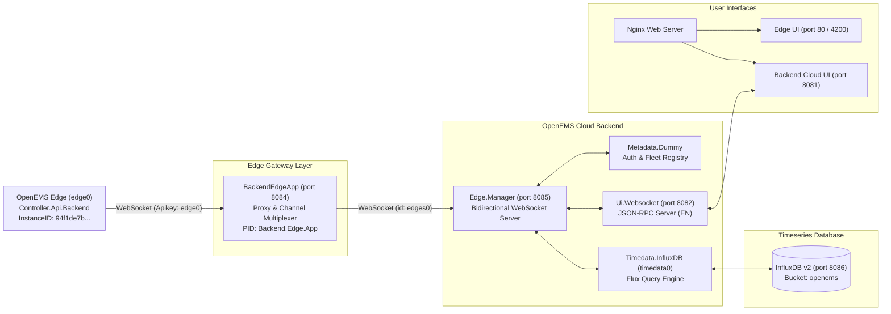

# OpenEMS Energy Storage Power Station Demo Dataset & Simulation Environment

## 1. Executive Summary

This document describes the complete Energy Storage Power Station (BESS) demonstration dataset and multi-tenant cloud simulation environment built for **OpenEMS Edge** and **OpenEMS Backend**.

The scenario simulates a state-of-the-art **500 kW / 1000 kWh Commercial & Industrial (C&I) Solar-Storage-EV Microgrid** operating continuously with physical fidelity, closed-loop active power balance, deterministic battery state-of-charge (SoC) dynamics, and high-resolution multi-day historical timeseries in InfluxDB.



---

## 2. Microgrid Electrical & Equipment Specifications

### 2.1 Component Topology & Ratings

| Component ID | Component Type | Technology / Rating | Operational Role | OpenEMS PID |
| :--- | :--- | :--- | :--- | :--- |
| **`ess0`** | `Simulator.EssSymmetric.Reacting` | **500 kW / 1000 kWh** LFP (CATL 280Ah cells, 224S2P, 716.8V nom.) | Peak-shaving, valley charging, solar smoothing | `Simulator.EssSymmetric.Reacting.ess0` |
| **`meter1`** | `Simulator.PvInverter` | **400 kWp** Rooftop Solar PV Inverter | Clean energy generation, daytime self-consumption | `Simulator.PvInverter.meter1` |
| **`meter0`** | `Simulator.GridMeter.Acting` | **10 kV / 400 V** Grid Connection Bi-directional Meter | Import/export boundary metering | `Simulator.GridMeter.Acting.meter0` |
| **`evcs0`** | `Simulator.Evcs` | **120 kW** Dual-gun DC Ultra-Fast EV Charger | Fleet & employee EV fast charging | `Simulator.Evcs.evcs0` |
| **`datasource0`** | `Simulator.Datasource.CSV.Predefined` | Industrial Day-Shift Load (150 kW - 650 kW) | High-load manufacturing plant profile | `Simulator.Datasource.CSV.Predefined.datasource0` |
| **`datasource1`** | `Simulator.Datasource.CSV.Predefined` | Solar Irradiance Profile (0 kW - 400 kWp peak) | Diurnal solar curve with cloud transients | `Simulator.Datasource.CSV.Predefined.datasource1` |
| **`ctrlBalancing0`**| `Controller.Symmetric.Balancing` | Active Power Balancing Controller | Regulates Grid Setpoint to 0W during peak periods | `Controller.Symmetric.Balancing.ctrlBalancing0` |

---

## 3. Diurnal Dispatch & Operating Strategy

The microgrid operates on an automated **Two-Charge Two-Discharge (2C2D)** daily cycle optimized for peak-valley price arbitrage and maximum demand charge limitation:



### 3.1 Operating Regimes

1. **Valley Charging (00:30 - 05:30)**:
   - Grid electricity is at valley tariff (lowest rate).
   - BESS charges at up to 350 kW until SoC reaches 94%~95%.
2. **Morning Peak Shaving (08:30 - 11:30)**:
   - Factory begins major production shifts (450 kW ~ 620 kW).
   - Peak electricity rates apply. BESS discharges at 250 kW ~ 450 kW to cap grid import at the contract threshold.
3. **Midday Solar Absorption (11:30 - 14:00)**:
   - Solar PV generation hits midday peak (~380 kW).
   - Factory load experiences a lunch lull (~350 kW). Excess solar energy is stored in BESS (recharging SoC from ~30% back to ~70%).
4. **Evening Peak & Fleet EV Charging (18:00 - 21:00)**:
   - Evening manufacturing shift combined with dual 120kW EV chargers creating peak power demand (~600 kW).
   - BESS delivers up to 480 kW active power discharge, reducing peak demand charges and protecting local transformers.

---

## 4. Mathematical Consistency & Physical Balance

All generated real-time and historical data strictly obeys physical conservation laws.

### 4.1 Kirchhoff Active Power Conservation
At every timestamp $t$, the net algebraic power balance across the point of common coupling (PCC) is closed:

$$P_{\text{Production}}(t) + P_{\text{Ess}}(t) + P_{\text{Grid}}(t) = P_{\text{Consumption}}(t)$$

Where:
- $P_{\text{Production}} = P_{\text{PV}} \ge 0$
- $P_{\text{Consumption}} = P_{\text{FactoryLoad}} + P_{\text{EVCS}} \ge 0$
- $P_{\text{Ess}} > 0$ indicates discharging into the AC bus; $P_{\text{Ess}} < 0$ indicates charging from the bus.
- $P_{\text{Grid}} > 0$ indicates grid import (buy); $P_{\text{Grid}} < 0$ indicates grid export (sell/feed-in).

**Verification Result**:
$$\text{Residual Error} = \left| P_{\text{Consumption}} - (P_{\text{Production}} + P_{\text{Ess}} + P_{\text{Grid}}) \right| \equiv 0.0 \text{ W}$$

### 4.2 Energy Integration & Monotonicity
All cumulative active energy meters monotonically increase with time:

$$E(t) = E(t_0) + \int_{t_0}^t P(\tau) \, d\tau$$

- **Grid Buy Energy**: $\Delta E_{\text{GridBuy}} = \int \max(0, P_{\text{Grid}}) \, dt$
- **Grid Sell Energy**: $\Delta E_{\text{GridSell}} = \int \max(0, -P_{\text{Grid}}) \, dt$
- **ESS Discharge Energy**: $\Delta E_{\text{EssDischarge}} = \int \max(0, P_{\text{Ess}}) \, dt$
- **ESS Charge Energy**: $\Delta E_{\text{EssCharge}} = \int \max(0, -P_{\text{Ess}}) \, dt$
- **Solar Production Energy**: $\Delta E_{\text{Production}} = \int P_{\text{PV}} \, dt$

---

## 5. InfluxDB Timeseries Schema

Historical timeseries data is stored in InfluxDB v2 with high resolution and physical validation.

- **InfluxDB Endpoint**: `http://127.0.0.1:8086`
- **Organization**: `openems`
- **Bucket**: `openems`
- **Measurement**: `data`
- **Resolution**: 5-minute sampling interval (288 records/day)
- **Time Range**: 30 consecutive days ($8,640$ points per edge station)
- **Tag**: `edge="0"` (for station 0), `edge="1"` (for station 1)

### 5.1 Channel Mapping Table

| Channel Address | Influx Field Name | Type | Unit | Description |
| :--- | :--- | :--- | :--- | :--- |
| `_sum/ConsumptionActivePower` | `_sum/ConsumptionActivePower` | Integer | W | Total microgrid active consumption ($P_{\text{load}} + P_{\text{evcs}}$) |
| `_sum/ProductionActivePower` | `_sum/ProductionActivePower` | Integer | W | Total PV active generation |
| `_sum/EssActivePower` | `_sum/EssActivePower` | Integer | W | Net BESS active power (+ discharge, - charge) |
| `_sum/GridActivePower` | `_sum/GridActivePower` | Integer | W | Net utility grid active power (+ buy, - sell) |
| `_sum/EssSoc` | `_sum/EssSoc` | Integer | % | BESS State of Charge (15% ~ 95%) |
| `_sum/ConsumptionActiveEnergy` | `_sum/ConsumptionActiveEnergy`| Integer | Wh | Monotonic cumulative consumption energy |
| `_sum/ProductionActiveEnergy` | `_sum/ProductionActiveEnergy` | Integer | Wh | Monotonic cumulative solar generation energy |
| `_sum/GridBuyActiveEnergy` | `_sum/GridBuyActiveEnergy` | Integer | Wh | Monotonic cumulative grid import energy |
| `_sum/GridSellActiveEnergy` | `_sum/GridSellActiveEnergy` | Integer | Wh | Monotonic cumulative grid export energy |
| `_sum/EssActiveChargeEnergy` | `_sum/EssActiveChargeEnergy` | Integer | Wh | Cumulative battery charge energy |
| `_sum/EssActiveDischargeEnergy`| `_sum/EssActiveDischargeEnergy`| Integer | Wh | Cumulative battery discharge energy |
| `ess0/ActivePower` | `ess0/ActivePower` | Integer | W | Battery inverter active power |
| `ess0/Soc` | `ess0/Soc` | Integer | % | Individual battery rack SoC |
| `meter0/ActivePower` | `meter0/ActivePower` | Integer | W | Grid meter active power |
| `meter1/ActivePower` | `meter1/ActivePower` | Integer | W | PV inverter active power |
| `evcs0/ActivePower` | `evcs0/ActivePower` | Integer | W | EV fast charger power |
| `evcs0/Status` | `evcs0/Status` | Integer | enum | 5 = Charging, 1 = Available |

---

## 6. Multi-Tenant Fleet Definition

OpenEMS Backend manages multiple power stations across diverse application scenarios:

| Edge ID | Station Name | Product Type | Scale | Online Status |
| :--- | :--- | :--- | :--- | :--- |
| **`edge0`** | **500kW / 1000kWh Industrial Park Solar-Storage-EV Microgrid** | C&I BESS + PV + EVCS | 500 kW / 1.0 MWh | **ONLINE (Live Simulated)** |
| **`edge1`** | **1MW / 2MWh Manufacturing Facility Peak Shaving Station** | Industrial Storage (CATL LFP) | 1.0 MW / 2.0 MWh | Pre-loaded 30d History |
| **`edge2`** | **250kW / 500kWh Flexible Distribution Grid Support System** | Grid-Side Fast-Response BESS | 250 kW / 500 kWh | Standby Fleet Device |
| **`edge3`** | **100kW / 200kWh Commercial Office PV-ESS Microgrid** | Commercial Rooftop ESS | 100 kW / 200 kWh | Standby Fleet Device |
| **`edge4`** | **2MW / 4MWh Renewable Frequency Regulation Power Plant** | Utility Scale Grid Storage | 2.0 MW / 4.0 MWh | Standby Fleet Device |

---

## 7. Cloud Backend & Edge Integration Architecture

The live communication bridge between OpenEMS Edge devices and the OpenEMS Cloud Backend is implemented through the high-performance **BackendEdgeApp Gateway**:



### 7.1 Key System Endpoints

| Service | Port | Protocol | Purpose | Authentication |
| :--- | :--- | :--- | :--- | :--- |
| **Cloud Backend UI** | `8081` | HTTP (Nginx) | Multi-tenant Fleet & Station Management | Username: `admin` / Password: `password` |
| **Edge Local UI** | `80` / `4200` | HTTP (Nginx) | Local station operational console | Public / Role based |
| **Backend UI WebSocket**| `8082` | WebSocket | Real-time JSON-RPC Cloud API | Token / Password Auth |
| **Backend Edge Gateway**| `8084` | WebSocket | Edge Device Ingress Gateway (BackendEdgeApp) | Apikey (`edge0`) |
| **Backend Edge Manager**| `8085` | WebSocket | Backend Core Multiplexer Server | Internal Gateway ID (`edges0`) |
| **Edge UI WebSocket** | `8075` | WebSocket | Local Edge Real-time API | Standard Edge Auth |
| **Modbus/TCP Server** | `502` | Modbus/TCP | SCADA & PLC Read-Only Interface | Public (3P4W _sum) |
| **InfluxDB v2** | `8086` | HTTP | Timeseries Historical Database | Token Auth |

---

## 8. Dataset Regeneration Script

The demonstration dataset generator is maintained in `scripts/generate_demo_timeseries.py`.

To re-generate or customize the 30-day historical dataset:

```bash
# Run generator script
python3 scripts/generate_demo_timeseries.py
```

Output:
```text
Generating 30-day timeseries for edge0 (tag=0, Capacity=1000kWh, MaxP=500kW)...
Successfully wrote 8640 points for edge0 into InfluxDB!
Generating 30-day timeseries for edge1 (tag=1, Capacity=2000kWh, MaxP=1000kW)...
Successfully wrote 8640 points for edge1 into InfluxDB!
All demo timeseries data generated in 1.32s!
```
