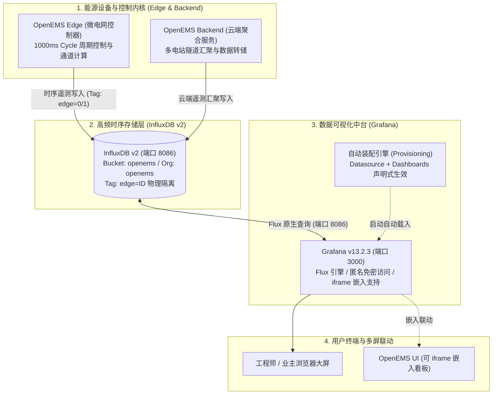

# OpenEMS 与 Grafana 时序监控平台集成规范

本项目在物理节点（`172.16.100.234`）上完成了 **Grafana v13.2.3** 的原生部署，并与 OpenEMS 核心时序数据库 **InfluxDB v2** 完成了无缝打通。

系统内置了开箱即用的 **“工商业储能与微电网实时运行监控中心”** 专业仪表盘，实现了多电站动态切换、微电网四象限功率物理平衡、电池 SOC/充放电特征分析及累计电能量测的实时全景可视化。

---

## 一、 服务访问入口与快速导航

| 服务类型 | 访问地址 | 默认端口 | 认证方式与说明 |
| :--- | :--- | :--- | :--- |
| **Grafana 监控中台** | [http://172.16.100.234:3000](http://172.16.100.234:3000) | `3000` | **免密匿名直达**（已设为默认 Home 看板） |
| **储能大屏直达链接** | [http://172.16.100.234:3000/d/openems-ess-analytics](http://172.16.100.234:3000/d/openems-ess-analytics) | `3000` | 完整指标、多源平衡与电气特性监控 |
| **管理员后台登录** | [http://172.16.100.234:3000/login](http://172.16.100.234:3000/login) | `3000` | 账号：`admin` / 密码：`admin` |
| **OpenEMS 边缘 UI** | [http://172.16.100.234](http://172.16.100.234) | `80 / 4200` | 边缘本地控制台（模拟器与控制回路） |
| **OpenEMS 云端 UI** | [http://172.16.100.234:8081](http://172.16.100.234:8081) | `8081` | 云端多租户中台大屏 |
| **InfluxDB 时序库** | [http://172.16.100.234:8086](http://172.16.100.234:8086) | `8086` | 底层时序数据库服务 |

---

## 二、 三位一体监控架构



---

## 三、 智慧微电网与储能电站调度大屏深度解析

仪表板名称：`OpenEMS 智慧微电网与储能电站智能运维调度中心 (Microgrid & ESS Command Center)`  
仪表板 UID：`openems-ess-analytics`  
刷新频率：默认 `5s` 自动高频刷新（支持 `10s`、`30s`、`1m` 快速切换）。  
大屏布局涵盖 **7 大业务专题 Row**、共计 **24 个专业监控面板**：

### 1. 🌟 全景态势与核心工况概览 (Row 1)
- 🟢 **系统运行工况 (System State)**：基于 `_sum/State`，直观标识 `正常运行 (NORMAL)` / `警告 (WARNING)` / `故障 (FAULT)`。
- ⚡ **储能运行工况 (ESS State)**：基于实时功率方向智能判定 `⚡ 削峰放电中` / `🔌 填谷充电中` / `💤 浮充待机中`。
- 🔋 **电池荷电状态 (Battery SOC Gauge)**：环形大刻度仪表盘（0% ~ 100%），内嵌四段安全裕度着色（红/黄/绿/蓝）。
- 🌐 **并网/孤岛工作模式 (Grid Mode)**：动态监测 `并网运行 (ON-GRID)` 与 `孤岛离网 (OFF-GRID)`。
- ⚖️ **微电网物理残差闭环校验 (Residual Power)**：实时解算 $P_{\text{Residual}} = P_{\text{Load}} - (P_{\text{PV}} + P_{\text{ESS}} + P_{\text{Grid}})$，高精度验证物理功率守恒（绝对残差稳定保持在 $\pm 0\text{ W}$ 极佳精度）。
- 📦 **储能系统额定物理总容量 (EssCapacity)**：动态读取当前电站硬件设计容量（kWh/MWh）。

### 2. ⚡ 核心节点实时功率流卡片 (Row 2)
- 🔴 **电网交互功率 (Grid Power)**：实时从电网取电（红色高亮，按需量门限着色）或防逆流反送。
- 🔵 **储能实时功率 (ESS Power)**：正向放电出力、负向充电吸收。
- 🟩 **光伏出力功率 (PV Production)**：微电网绿色能源出力（kW）。
- 🟧 **负荷用电总功率 (Load Consumption)**：园区用电负载。
- 🟪 **智能充电桩功率 (EVCS)**：电动车充电负载实时功率。

### 3. 📈 微电网四象限物理平衡大屏时序曲线 (Row 3)
- **全宽（24 格）高分辨率综合平衡图**：同图呈现光伏发电、负荷用电、储能充放与电网交互 4 组时序曲线，以平滑渐变面积图衬托，0 瓦水平基准线贯穿，支持多线交叉悬停对齐，直观印证“光伏自发自用、储能削峰填谷、电网兜底平衡”的物理运行法则。

### 4. 🔋 储能电池深度分析与充放电调度 (Row 4)
- **电池 SOC 连续充放电轨迹曲线**：完整呈现 24 小时两充两放调度循环轨迹与阶梯平滑充放电斜率。
- **储能充放功率限额与实际功率对照**：同图对比控制器下发的最大允许充电门限（`AllowedChargePower`）、最大允许放电门限（`AllowedDischargePower`）与实际有功出力（`ActivePower`），直观监测有无限功率或超限违规。

### 5. 🔌 三相电能质量与平衡度监测 (Row 5)
- **电网三相功率平衡分布 (Grid L1 / L2 / L3)**：监测电网取电三相不平衡度。
- **负荷三相用电平衡分布 (Load L1 / L2 / L3)**：监测厂区三相负载均衡性，辅助配电房平衡调相。

### 6. 📊 累计电能量测与资产运行统计 (Row 6)
- **储能系统累计充电总量 (kWh)** 与 **累计放电总量 (kWh)**：反映全生命周期充放电电量吞吐与等效满充满放循环次数（EFC）。
- **电网总购入电量 (kWh)** 与 **光储上网总售电量 (kWh)**：精准核算削峰填谷峰谷价差节电收益。

### 7. 🚨 核心控制算法与长连接链路监控 (Row 7)
- **防逆流目标功率设定值 (Target Grid Setpoint)**：监控控制器当前的防逆流调度目标值。
- **云端 UI 与边缘 WSS 隧道连接池统计**：实时监测 `UiWebsocket` 与 `EdgeWebsocket` 活动句柄数与已完成 JSON-RPC 事务总数。

---

## 四、 自动化装配与配置规范 (Provisioning)

Grafana 完全基于声明式配置管理，重启即自动恢复，无需手动在 Web 页面重复创建数据源与看板：

### 1. InfluxDB v2 数据源配置
文件路径：`/etc/grafana/provisioning/datasources/openems-influxdb.yaml`
```yaml
apiVersion: 1

datasources:
  - name: InfluxDB-OpenEMS
    type: influxdb
    access: proxy
    url: http://127.0.0.1:8086
    isDefault: true
    editable: true
    jsonData:
      version: Flux
      organization: openems
      defaultBucket: openems
      tlsSkipVerify: true
    secureJsonData:
      token: OpenEmsInfluxSecretToken2026!
```

### 2. 看板自动发现与装配
文件路径：`/etc/grafana/provisioning/dashboards/openems.yaml`
```yaml
apiVersion: 1

providers:
  - name: "OpenEMS Dashboards"
    orgId: 1
    folder: "OpenEMS"
    type: file
    disableDeletion: false
    updateIntervalSeconds: 10
    allowUiUpdates: true
    options:
      path: /var/lib/grafana/dashboards
      foldersFromFilesStructure: true
```
看板 JSON 文件保存在：`/var/lib/grafana/dashboards/openems_ess_dashboard.json`。

### 3. 全局参数调优 (`/etc/grafana/grafana.ini`)
- **开启免密访问**：
  ```ini
  [auth.anonymous]
  enabled = true
  org_role = Editor
  ```
- **允许 iframe 跨域嵌入**：
  ```ini
  [security]
  allow_embedding = true
  ```
- **配置默认首页重定向**：
  ```ini
  [dashboards]
  default_home_dashboard_path = /var/lib/grafana/dashboards/openems_ess_dashboard.json
  ```

---

## 五、 服务运维与状态管理

Grafana 已注册为系统标准 Systemd 服务并设为开机自启：

```bash
# 查看服务状态
systemctl status grafana-server

# 重启 Grafana 服务（配置修改后生效）
sudo systemctl restart grafana-server

# 实时查看日志
journalctl -u grafana-server -f

# 验证健康状态
curl http://127.0.0.1:3000/api/health
```
