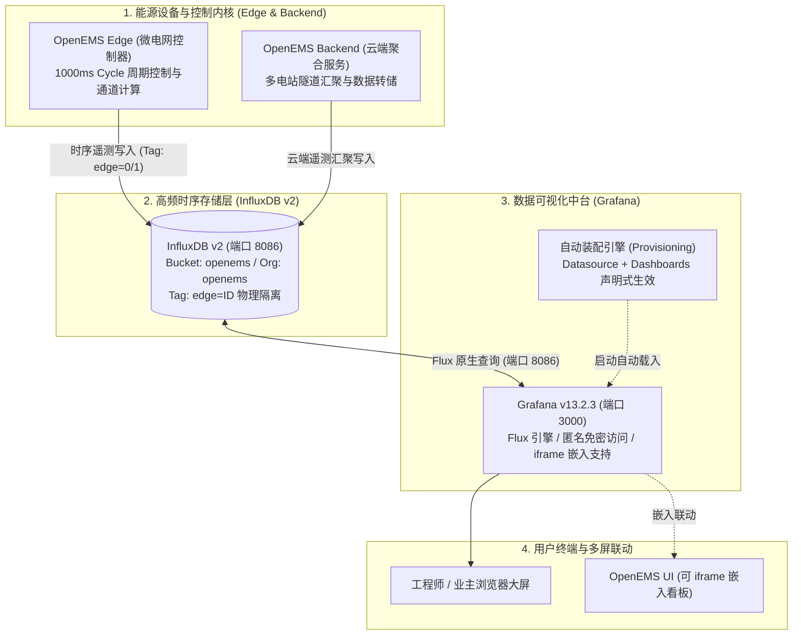

# OpenEMS 与 Grafana 时序监控平台集成规范

本项目在物理节点（`172.16.100.234`）上完成了 **Grafana v13.2.3** 的原生部署，并与 OpenEMS 核心时序数据库 **InfluxDB v2** 完成了无缝打通。

系统内置了开箱即用的 **“工商业储能与微电网实时运行监控中心”** 专业仪表盘，实现了多电站动态切换、微电网四象限功率物理平衡、电池 SOC/充放电特征分析及累计电能量测的实时全景可视化。

---

## 一、 服务访问入口与快速导航

| 服务类型 | 访问地址 | 默认端口 | 认证方式与说明 |
| :--- | :--- | :--- | :--- |
| **Grafana 监控中台** | [http://172.16.100.234:3000](http://172.16.100.234:3000) | `3000` | **免密匿名直达**（已设为默认 Home 看板） |
| **储能大屏直达链接** | [http://172.16.100.234:3000/d/openems-ess-analytics](http://172.16.100.234:3000/d/openems-ess-analytics) | `3000` | 完整指标、多源平衡与电气特性监控 |
| **管理员后台登录** | [http://172.16.100.234:3000/login](http://172.16.100.234:3000/login) | `3000` | 账号：`admin` / 密码：`admin` |
| **OpenEMS 边缘 UI** | [http://172.16.100.234](http://172.16.100.234) | `80 / 4200` | 边缘本地控制台（模拟器与控制回路） |
| **OpenEMS 云端 UI** | [http://172.16.100.234:8081](http://172.16.100.234:8081) | `8081` | 云端多租户中台大屏 |
| **InfluxDB 时序库** | [http://172.16.100.234:8086](http://172.16.100.234:8086) | `8086` | 底层时序数据库服务 |

---

## 二、 三位一体监控架构



---

## 三、 内置储能与微电网专业看板解析

仪表板 UID：`openems-ess-analytics`
刷新频率：默认 `5s` 自动刷新，支持 `10s`、`30s`、`1m` 切换。

### 1. 多电站车队动态切换器（Template Variable）
- 顶部提供 **选择电站 (Edge ID)** 下拉菜单，通过 InfluxDB 标签元数据自动发现：
  ```flux
  import "influxdata/influxdb/schema"
  schema.tagValues(bucket: "openems", tag: "edge")
  ```
- 切换 `0`（500kW/1000kWh 标杆电站）或 `1`（工业车间储能站），所有看板指标毫秒级联动刷新。

### 2. 核心实时指标卡片（Real-Time Energy KPIs）
- 🔴 **电网交互功率 (Grid Power)**：实时从电网下地取电（红色警示，按需量门限着色）或防逆流反送电网。
- 🔵 **储能充放功率 (ESS Power)**：放电为正（蓝色）、充电为负（橙色），实时呈现削峰填谷状态。
- 🟢 **电池荷电状态 (Battery SOC)**：半圆仪表盘显示（0% ~ 100%），设置低电量（<20% 红色）与健康电量（>50% 绿色）阈值。
- 🟩 **光伏发电功率 (PV Production)**：微电网绿色能源出力（kW）。
- 🟧 **负荷总用电 (Load Consumption)**：厂区整体有功功率消耗。
- 🟪 **智能充电桩功率 (EVCS)**：电动车充电负荷实时功率。

### 3. 微电网四象限物理平衡时序曲线（Microgrid Power Balance）
- 依据微电网第一物理定律构建：
  $$\text{Consumption} = \text{PV Production} + \text{ESS Discharge} + \text{Grid Power}$$
- 同图对比负荷、光伏、储能、电网四条曲线，支持 Hover 交叉对比与表格均值、极值统计。

### 4. 储能电池健康度与电气特征
- **SOC 充放电时序曲线**：完整呈现“两充两放”调度轨迹与平稳充放电斜率。
- **直流母线电气特征**：
  - 左轴：直流母线电压（`ess0/Voltage`，700V ~ 850V 典型三元/铁锂平台）；
  - 右轴：充放电电流（`ess0/Current`，充电负电流，放电正电流）。

### 5. 累计电能量测与财务收益统计
- **储能累计充电量 vs 累计放电量 (kWh)**：反映储能系统循环充放次数与全生命周期吞吐量。
- **电网总购电量 vs 上网售电量 (kWh)**：精确量化微电网绿电自发自用率与削峰填谷节电收益。

---

## 四、 自动化装配与配置规范 (Provisioning)

Grafana 完全基于声明式配置管理，重启即自动恢复，无需手动在 Web 页面重复创建数据源与看板：

### 1. InfluxDB v2 数据源配置
文件路径：`/etc/grafana/provisioning/datasources/openems-influxdb.yaml`
```yaml
apiVersion: 1

datasources:
  - name: InfluxDB-OpenEMS
    type: influxdb
    access: proxy
    url: http://127.0.0.1:8086
    isDefault: true
    editable: true
    jsonData:
      version: Flux
      organization: openems
      defaultBucket: openems
      tlsSkipVerify: true
    secureJsonData:
      token: OpenEmsInfluxSecretToken2026!
```

### 2. 看板自动发现与装配
文件路径：`/etc/grafana/provisioning/dashboards/openems.yaml`
```yaml
apiVersion: 1

providers:
  - name: "OpenEMS Dashboards"
    orgId: 1
    folder: "OpenEMS"
    type: file
    disableDeletion: false
    updateIntervalSeconds: 10
    allowUiUpdates: true
    options:
      path: /var/lib/grafana/dashboards
      foldersFromFilesStructure: true
```
看板 JSON 文件保存在：`/var/lib/grafana/dashboards/openems_ess_dashboard.json`。

### 3. 全局参数调优 (`/etc/grafana/grafana.ini`)
- **开启免密访问**：
  ```ini
  [auth.anonymous]
  enabled = true
  org_role = Editor
  ```
- **允许 iframe 跨域嵌入**：
  ```ini
  [security]
  allow_embedding = true
  ```
- **配置默认首页重定向**：
  ```ini
  [dashboards]
  default_home_dashboard_path = /var/lib/grafana/dashboards/openems_ess_dashboard.json
  ```

---

## 五、 服务运维与状态管理

Grafana 已注册为系统标准 Systemd 服务并设为开机自启：

```bash
# 查看服务状态
systemctl status grafana-server

# 重启 Grafana 服务（配置修改后生效）
sudo systemctl restart grafana-server

# 实时查看日志
journalctl -u grafana-server -f

# 验证健康状态
curl http://127.0.0.1:3000/api/health
```
