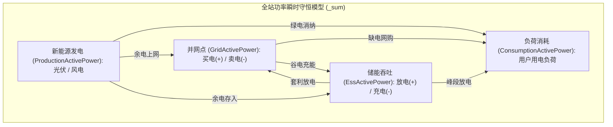
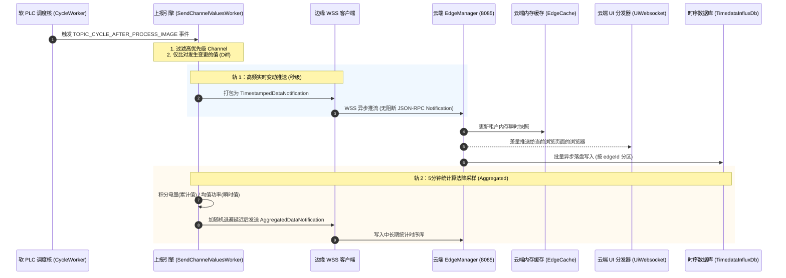
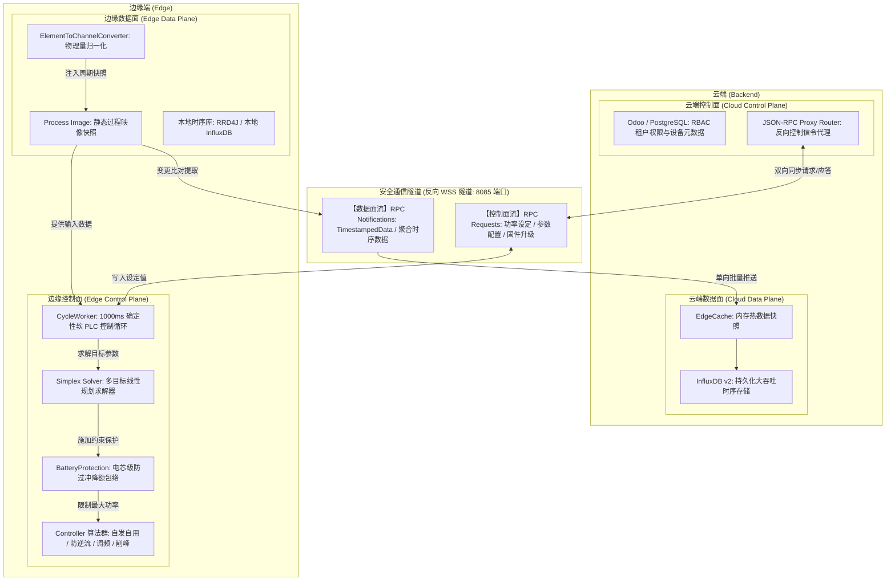

# OpenEMS 全站监控指标体系、数据上报机制与控制面/数据面深度架构指南

> **文档版本**：v1.0  
> **编制日期**：2026-10-20  
> **适用范围**：OpenEMS Edge 边缘运行时、OpenEMS Backend 云端系统、分布式微电网监控、时序数据上报与调度决策架构。

---

## 目录
1. [执行摘要与全景架构](#一执行摘要与全景架构)
2. [OpenEMS 全站监控指标全景体系（Channel 架构）](#二openems-全站监控指标全景体系channel-架构)
   - [2.1 全局微电网综合指标（`_sum` 核心 64 个聚合看板）](#21-全局微电网综合指标_sum-核心-64-个聚合看板)
   - [2.2 储能系统（ESS）与电芯级 BMS 监控指标](#22-储能系统ess与电芯级-bms-监控指标)
   - [2.3 电网与智能电表（Electricity Meter）指标](#23-电网与智能电表electricity-meter指标)
   - [2.4 光伏发电与充电器（PV & DC Charger）指标](#24-光伏发电与充电器pv--dc-charger指标)
   - [2.5 新能源汽车充电桩（EVCS）指标](#25-新能源汽车充电桩evcs指标)
   - [2.6 暖通热泵与柔性负载（Heat Pump & I/O）指标](#26-暖通热泵与柔性负载heat-pump--io指标)
   - [2.7 现货电力市场、电价与功率预测指标](#27-现货电力市场电价与功率预测指标)
   - [2.8 边缘宿主机基础设施与分级故障诊断指标](#28-边缘宿主机基础设施与分级故障诊断指标)
3. [OpenEMS 后端数据上报全流程（Telemetry Ingestion Pipeline）](#三openems-后端数据上报全流程telemetry-ingestion-pipeline)
   - [3.1 过程映像触发与双轨流式驱动架构](#31-过程映像触发与双轨流式驱动架构)
   - [3.2 增量变动检测（Changed-Values Only）与全量对齐](#32-增量变动检测changed-values-only与全量对齐)
   - [3.3 5分钟统计降采样与随机退避防雪崩机制](#33-5分钟统计降采样与随机退避防雪崩机制)
   - [3.4 断网重传机制（ResendHistoricDataWorker）](#34-断网重传机制resendhistoricdataworker)
   - [3.5 云端三级分流：内存快照、Websocket 广播与时序落盘](#35-云端三级分流内存快照websocket-广播与时序落盘)
4. [控制面（Control Plane）与数据面（Data Plane）深度解耦剖析](#四控制面control-plane与数据面data-plane深度解耦剖析)
   - [4.1 控制面与数据面的经典定义与职责划分](#41-控制面与数据面的经典定义与职责划分)
   - [4.2 端到端架构交互拓扑图](#42-端到端架构交互拓扑图)
   - [4.3 边缘侧与云端侧的双面映射矩阵](#43-边缘侧与云端侧的双面映射矩阵)
   - [4.4 控制面 vs 数据面 深度对比表](#44-控制面-vs-数据面-深度对比表)
5. [架构解耦的核心价值：边缘自治（Edge Autonomy）](#五架构解耦的核心价值边缘自治edge-autonomy)

---

## 一、执行摘要与全景架构

在现代分布式智慧能源系统（BESS、光储充微电网、虚拟电厂 VPP）中，OpenEMS 创新性地将系统划分为三层抽象模型：
1. **数据通道（Channel）**：底层物理世界在软件世界的唯一投影，包含强类型定义、读写权限（AccessMode）、持久化优先级（PersistencePriority）与物理量纲（Unit）。
2. **能力标准接口（Nature）**：对硬件设备的工业级能力归一化抽象（如 `SymmetricEss`、`Battery`、`ElectricityMeter`、`Evcs` 等）。
3. **全站聚合虚拟中枢（`_sum`）**：全站能源微电网的“单一事实源（Single Source of Truth）”，以拓扑守恒矩阵实时解算全站功率与电量流向。

与传统物联网（IoT）粗暴的“定时发送整个大 JSON”不同，OpenEMS 在底层将**高频流式遥测的数据面**与**低延迟安全决策的控制面**彻底解耦，保障了即使在云端完全失联的情况下，本地毫秒级闭环（防逆流、调频、电池保护）依然毫厘不差，网络恢复后数据无缝自愈。

---

## 二、OpenEMS 全站监控指标全景体系（Channel 架构）

### 2.1 全局微电网综合指标（`_sum` 核心 64 个聚合看板）
在 [`io.openems.edge.common.sum.Sum`](file:///opt/openems/source/io.openems.edge.common/src/io/openems/edge/common/sum/Sum.java) 中，OpenEMS 内置了 64 个全局聚合指标，构成微电网全景看板：

| 指标大类 | 核心通道（Channel ID） | 单位 | 监控物理含义与典型应用 |
| :--- | :--- | :--- | :--- |
| **电网总指标** | `GridActivePower` `GridActivePowerL1/L2/L3` `GridMinActivePower` / `MaxActivePower` `GridBuyActiveEnergy` / `GridSellActiveEnergy` | W W W Wh | **并网点瞬时有功与电量**。 区分三相不平衡度；正值代表从电网买电（进口），负值代表向电网卖电（反送）。 |
| **发电总指标** | `ProductionActivePower` `ProductionAcActivePowerL1/L2/L3` `ProductionDcActualPower` `ProductionActiveEnergy` | W W W Wh | **全站新能源总功率**。 聚合全站交流组串光伏逆变器（AC-PV）与混合逆变器直流侧光伏（DC-PV）。 |
| **用电总指标** | `ConsumptionActivePower` `ConsumptionActivePowerL1/L2/L3` `ConsumptionActiveEnergy` `UnmanagedConsumptionActivePower` | W W Wh W | **全站负荷总功率与用电量**。 区分受控柔性负荷（如充电桩、热泵）与不可控刚性负荷（Unmanaged）。 |
| **能量流拓扑分解** (Energy Flow Matrix) | `ProductionToConsumptionPower / Energy` `ProductionToGridPower / Energy` `ProductionToEssPower / Energy` `GridToConsumptionPower / Energy` `GridToEssPower / Energy` `EssToConsumptionPower / Energy` `EssToGridEnergy` | W / Wh (全矩阵) | **动态拓扑电量穿透追踪**。 精确计算每度电的来龙去脉（如：光伏自发自用率、储能自给率、谷电充能比例等）。 |
| **离网与微网状态** | `GridMode` `GridModeOffGridTime` `GridGensetActivePower` | Enum 秒 W | **电网状态与备电支撑**。 监控当前处于并网（`ON_GRID`）还是离网孤岛（`OFF_GRID`）、累计离网运行时间、柴油发电机输出功率。 |

---

### 2.2 储能系统（ESS）与电芯级 BMS 监控指标
基于 [`io.openems.edge.ess.api`](file:///opt/openems/source/io.openems.edge.ess.api) 与 [`io.openems.edge.battery.api`](file:///opt/openems/source/io.openems.edge.battery.api)：

#### 1. 储能变流器（PCS / AC 侧）
- **实时荷电状态**：`Soc`（0~100%）、实际可用容量 `Capacity`（Wh）。
- **交流电气特性**：
  - 总有功功率 `ActivePower`、分相有功 `ActivePowerL1/L2/L3`（充电为负，放电为正）。
  - 总无功功率 `ReactivePower`、分相无功 `ReactivePowerL1/L2/L3`（var）、最大视在功率 `MaxApparentPower`（VA）。
- **动态安全充放电包络（Power Limits）**：
  - `AllowedChargePower`（允许最大充电功率上限，W）。
  - `AllowedDischargePower`（允许最大放电功率上限，W）。
- **累计吞吐量**：`ActiveChargeEnergy`（累计充电量 Wh）、`ActiveDischargeEnergy`（累计放电量 Wh）。

#### 2. 电池簇与电芯级指标（BMS / DC 侧）
- **宏观电气参数**：
  - 电池端总电压 `Voltage`（0.01V/0.1V 级）、电池实时总电流 `Current`（0.1A 级）。
  - 电池健康状态 `Soh`（State of Health，%）、充放电循环总次数 `FullCycleCount`。
- **保护边界参数（BMS Limits）**：
  - 充电截止上限电压 `ChargeMaxVoltage`、放电截止下限电压 `DischargeMinVoltage`。
  - 最大允许充电电流 `ChargeMaxCurrent`、最大允许放电电流 `DischargeMaxCurrent`。
- **电芯极限一致性（安全热失控防线）**：
  - 单体最高电压 `MaxCellVoltage`、单体最低电压 `MinCellVoltage`（**mV 级**，用于压差预警与均衡监控）。
  - 单体最高温度 `MaxCellTemperature`、单体最低温度 `MinCellTemperature`（**0.1℃ 级**，用于热失控防护与温控启闭）。
- **物理与绝缘健康**：
  - 内部等效内阻 `InnerResistance`（$m\Omega$）。
  - 绝缘对地阻抗 `InsulationResistance`（$k\Omega / M\Omega$）。
  - 高压主正/主负/预充接触器状态（`ContactorState`）。

---

### 2.3 电网与智能电表（Electricity Meter）指标
基于 [`io.openems.edge.meter.api`](file:///opt/openems/source/io.openems.edge.meter.api)：

| 监控维度 | 核心通道（Channel ID） | 单位 | 精度与物理意义 |
| :--- | :--- | :--- | :--- |
| **电网电压** | `Voltage` `VoltageL1`, `VoltageL2`, `VoltageL3` | mV / V | 相电压与线电压，监测电网过压/欠压及电能质量。 |
| **电网电流** | `Current` `CurrentL1`, `CurrentL2`, `CurrentL3` | mA / A | 各相交流电流有效值，防变压器或进线开关过流跳闸。 |
| **电网频率** | `Frequency` | mHz / Hz | **电网频率高精微变监测**（如 49.85Hz~50.15Hz），用于一次调频（FCR）动作判定。 |
| **功率因数** | `PowerFactor` / `CosPhi` | 0.001 | 监控电网无功惩罚与功率因数合格率。 |
| **四象限电能量** | `ActiveProductionEnergy`（反向有功/绿电上网） `ActiveConsumptionEnergy`（正向有功/网购电量） `ReactiveProductionEnergy`（感性无功） `ReactiveConsumptionEnergy`（容性无功） | Wh / kWh varh / kvarh | **计费级四象限电能量指标**，精确按分相（L1/L2/L3）独立累加。 |

---

### 2.4 光伏发电与充电器（PV & DC Charger）指标
基于 [`io.openems.edge.pvinverter.api`](file:///opt/openems/source/io.openems.edge.pvinverter.api)：
- **交流逆变输出**：瞬时交流输出功率 `ActivePower`（W）、额定最大能力 `MaxActualPower`、累计发电量 `ActiveProductionEnergy`（Wh）。
- **直流 MPPT 组串级**：各组串直流电压 `String1Voltage`、电流 `String1Current` 等。
- **设备运行状态**：逆变器内部温度、IGBT 散热器温度、绝缘阻抗、并网告警代码。

---

### 2.5 新能源汽车充电桩（EVCS）指标
基于 [`io.openems.edge.evcs.api`](file:///opt/openems/source/io.openems.edge.evcs.api) 与 OCPP 协议栈：
- **桩体状态**：充电状态 `Status`（未连接、已就绪、充电中、通风充电、故障停用）。
- **功率与相位**：实时充电功率 `ChargePower`（W）、供电相位 `Phases`（1 相 230V / 3 相 400V 动态切换）。
- **硬件安全限额**：硬件最小/最大允许功率（`MinimumHardwarePower`、`MaximumHardwarePower`）。
- **计量与车端状态**：本次充电会话电量 `EnergySession`（Wh）、车辆端 `Soc`（基于 ISO 15118 或 OCPP 2.0.1）。
- **动态调控设定**：EMS 实时动态限流设定 `SetChargePowerLimit`。

---

### 2.6 暖通热泵与柔性负载（Heat Pump & I/O）指标
基于 [`io.openems.edge.heat.api`](file:///opt/openems/source/io.openems.edge.heat.api) 与 [`io.openems.edge.thermometer.api`](file:///opt/openems/source/io.openems.edge.thermometer.api)：
- **多点管温监测**：供水管温（`FlowTemperature`）、回水管温（`ReturnTemperature`）、蓄热水箱温度（`StorageTemperature`）、室外环境温度。
- **SG-Ready 状态**：热泵 4 级运行模式（`Lock` 闭锁、`Normal` 标准、`Boost` 推荐光伏消纳增开、`Force-On` 满载强制加热）。
- **数字量 I/O**：消防急停干接点、防雷器跳闸状态、断路器辅助触点（开/合）。

---

### 2.7 现货电力市场、电价与功率预测指标
基于 [`io.openems.edge.timeofusetariff.api`](file:///opt/openems/source/io.openems.edge.timeofusetariff.api) 与 [`io.openems.edge.predictor.api`](file:///opt/openems/source/io.openems.edge.predictor.api)：
- **分时与现货电价**：15 分钟/60 分钟现货电价曲线 `QuarterlyPrices`（元/kWh 或 欧元/MWh）、日前现货市场预测电价。
- **碳减排指标**：实时电网碳排放因子（Carbon Intensity，$gCO_2/kWh$）。
- **预测通道**：未来 24/48 小时光伏发电预测曲线（PV Prediction）、负荷用电预测曲线（Consumption Prediction）。

---

### 2.8 边缘宿主机基础设施与分级故障诊断指标
- **宿主机健康度**：CPU 负载、RAM 内存占用、磁盘空间、核心温度、Systemd 看门狗计数、JVM GC 停顿时间。
- **总线通信健康度**：Modbus TCP/RTU 丢包超时计数、WSS 云端反向长连接隧道往返延迟（RTT）。
- **组件三级分级告警**：每个组件均内置标准状态通道：
  - `Level.INFO`（通知信息，如“已进入吸收浮充状态”）。
  - `Level.WARNING`（轻度告警，如“电芯温差大于 5℃”、“电网轻度过压”）。
  - `Level.FAULT`（严重故障，如“绝缘失效”、“急停按下”、“接触器粘连”，触发系统级急停保护）。

---

## 三、OpenEMS 后端数据上报全流程（Telemetry Ingestion Pipeline）

### 3.1 过程映像触发与双轨流式驱动架构
OpenEMS 采用**双轨流式驱动**架构完成端到端数据上报：

### 3.2 增量变动检测（Changed-Values Only）与全量对齐
源码位于 [`SendChannelValuesWorker.java`](file:///opt/openems/source/io.openems.edge.controller.api.backend/src/io/openems/edge/controller/api/backend/SendChannelValuesWorker.java)：
1. **增量 Diff 计算**：在每个控制循环的 `AFTER_PROCESS_IMAGE` 阶段，遍历所有组件的 Channel，通过哈希比对提取与 `lastAllValues` 不一致的变更项，封装为 `TimestampedDataNotification`。
2. **5分钟全量保活防漂移**：系统维持定时器，每 300 秒强制发送一次全量 Channel 快照，消除了由网络抖动导致的端云数据状态不一致。

### 3.3 5分钟统计降采样与随机退避防雪崩机制
- **降采样算法**：系统按 5 分钟为一个时间桶（Bucket），累计型通道（如电量）计算区间积分差值，瞬时型通道（如功率、电压）计算时间加权均值。
- **随机退避打散（Random Wait Jitter）**：为防止在成千上万台 Edge 部署场景下整点同时上报引发云端请求雪崩，系统内置 `randomWaitSeconds`（在 5 分钟周期的 90% 内随机生成延迟秒数），平滑削峰云端入库压力。

### 3.4 断网重传机制（ResendHistoricDataWorker）
当 WSS 隧道因现场网络波动断开时，数据流自动沉淀在 Edge 本地环形存储中（RRD4J 或本地 InfluxDB）。长连接恢复并重新鉴权后，[`ResendHistoricDataWorker`](file:///opt/openems/source/io.openems.edge.controller.api.backend/src/io/openems/edge/controller/api/backend/ResendHistoricDataWorker.java) 自动分批补发断点数据，保证云端历史报表无缺口。

### 3.5 云端三级分流：内存快照、Websocket 广播与时序落盘
源码位于 [`OnNotification.java`](file:///opt/openems/source/io.openems.backend.edge.manager/src/io/openems/backend/edge/manager/OnNotification.java)：
1. **写内存快照**：更新 [`EdgeCache`](file:///opt/openems/source/io.openems.backend.common/src/io/openems/backend/common/edge/EdgeCache.java)，维护租户当前最新状态；
2. **分发前端 UI**：通过 `UiWebsocket` 向正在浏览该电站的用户浏览器广播变更通道值，无需前端轮询刷库；
3. **时序落盘入库**：通过 [`TimedataInfluxDb`](file:///opt/openems/source/io.openems.backend.timedata.influx/src/io/openems/backend/timedata/influx/TimedataInfluxDb.java) 批量插入 InfluxDB v2，按 `edgeId` 物理索引分区存储。

---

## 四、控制面（Control Plane）与数据面（Data Plane）深度解耦剖析

### 4.1 控制面与数据面的经典定义与职责划分
- **控制面（Control Plane）**：系统的**决策与策略中心**。负责目标参数计算、多约束数学求解、设备状态机切换、身份鉴权与安全闭锁。
- **数据面（Data Plane）**：系统的**状态与搬运通道**。负责底层硬件高频采样、单位换算、过程映像生成、时序存储与流式上报。

### 4.2 端到端架构交互拓扑图

### 4.3 边缘侧与云端侧的双面映射矩阵

#### 边缘侧（Edge）：
- **边缘控制面**：
  - `CycleWorker.forever()`：1000ms 确定性控制时钟与 9 步过程映像流水线。
  - `Controller` 逻辑：防逆流调节、峰谷套利、自发自用、无功功率调节。
  - `Simplex Solver`：利用 Apache Commons Math 线性规划求解满足所有储能/光伏逆变器边界的最优设定值。
  - `BatteryProtection`：毫秒级电芯防过充/过温降额包络算法。
- **边缘数据面**：
  - Modbus / CAN 总线驱动：高频硬件寄存器读取。
  - `ElementToChannelConverter`：换算与符号规整。
  - `SendChannelValuesWorker`：变动比对与推送。
  - 本地缓存：RRD4J 环形缓冲。

#### 云端侧（Backend）：
- **云端控制面**：
  - `io.openems.backend.metadata.odoo`：基于 Odoo/PostgreSQL 的 API Key 鉴权与 RBAC 四级角色继承（Admin / Installer / Owner / Guest）。
  - `EdgeRpcRequestHandler`：反向 RPC 路由代理，下发 `SetChannelValueRequest`、`UpdateComponentConfigRequest`。
- **云端数据面**：
  - `EdgeCache`：全量设备最新状态驻留内存。
  - `TimedataInfluxDb`：时序持久化落盘与降采样查询。

---

### 4.4 控制面 vs 数据面 深度对比表

| 维度 | 数据面（Data Plane） | 控制面（Control Plane） |
| :--- | :--- | :--- |
| **核心职责** | 状态采样、电量计量、遥测上报、时序持久化 | 能源调度决策、约束优化求解、设备启停、远程运维与鉴权 |
| **通信机制** | **单向异步流式通知（Notification）** 无需对端每包回复 ACK，追求高吞吐量与低网络开销 | **双向强一致性请求-应答（Request-Response）** 包含严格的 JSON-RPC Message ID，超时重试，强状态校验 |
| **容错与可靠性** | **可容忍短时丢包与抖动** 利用边缘端环形缓冲、降采样与断网补传机制修复断点 | **零容忍丢包与乱序** 指令必须精确下达，配备心跳看门狗（如 `ApiWorker` 10s 看门狗），失联即闭锁 |
| **典型报文载荷** | `TimestampedDataNotification` `AggregatedDataNotification` | `SetChannelValueRequest` `UpdateComponentConfigRequest` `SystemUpdate` / `ExecuteSystemCommand` |

---

## 五、架构解耦的核心价值：边缘自治（Edge Autonomy）

OpenEMS 将控制面与数据面完全分离的最大工程优势在于：**实现了绝对的“边缘自治”**。

1. **云端失联，控制不崩**：
   当外网光纤被切断或云端微服务维护时，仅有**数据面的远程上报通道**与**控制面的远程运维代理**中断。边缘端的控制面（`CycleWorker` + `Simplex` + `Controller`）完全在本地 Linux/JVM 闭环运行，防逆流保护、电网频率响应（FCR）、电池安全温控毫秒不差，绝不会因“断网”导致电网倒灌被罚款或电池跳闸。
2. **网络恢复，数据自愈**：
   当通信链路恢复后，数据面的断网重传机制（`ResendHistoricDataWorker`）自动将离线时段积压的本地数据推入云端，时序曲线自动补齐，实现了工业现场最高等级的鲁棒性。
