# OpenEMS 各模块网络端口全景分析与通信架构规范

本文档全面梳理了 **OpenEMS (Open Energy Management System)** 架构下所有核心子系统、功能模块、通信协议与周边支撑微服务的**网络端口使用规范与拓扑映射**。涵盖代码默认声明端口、生产运行配置端口、协议类型、通信方向、安全隔离策略及现场避坑指南，旨在为工商业储能、分布式微电网及虚拟电厂（VPP）的现场部署与网络规划提供工业级标准化依据。

---

## 一、OpenEMS 全域通信架构与网络拓扑

OpenEMS 采用典型的**端-边-云-网-协同**分布式物联网架构。边缘端（Edge）与云端（Backend）通过反向安全加密长连接穿透现场防火墙与 NAT，前端（UI）通过 Nginx 反向代理与 WebSocket 实时刷新，下层通过现场总线与工业以太网对齐硬件设施。

```mermaid
graph TD
    subgraph Users["用户与外部交互层 (Clients)"]
        BrowserEdge["本地运维浏览器 (Local Browser)"]
        BrowserCloud["云端大屏/多租户用户 (Cloud Web/App)"]
        ThirdPartyVPP["第三方虚拟电厂/调度聚合商 (VPP / AGC)"]
        Prometheus["Prometheus / 运维监控系统"]
    end

    subgraph IngressLayer["反向代理与网关接入层 (Nginx & Proxies)"]
        NginxEdge["Nginx (Edge UI) :80, :4200"]
        NginxCloud["Nginx (Cloud UI) :8081"]
    end

    subgraph OpenEMSEdgeNode["OpenEMS Edge (边缘端设备与微网控制器)"]
        EdgeFelix["OSGi Felix Console :8080"]
        EdgeWS["Controller.Api.Websocket :8075 (默认:8085)"]
        EdgeRestRO["Controller.Api.Rest.ReadOnly :8094 (默认:8084)"]
        EdgeRestRW["Controller.Api.Rest.ReadWrite :8095 (默认:8084)"]
        EdgeModbusRO["Controller.Api.ModbusTcp.ReadOnly :502"]
        EdgeModbusRW["Controller.Api.ModbusTcp.ReadWrite :1502 (默认:502)"]
        EdgeOcpp["Evcs.Ocpp.Server :8887 (按需)"]
        EdgeMDNS["mDNS JmDNS :5353 UDP"]
        EdgeBackendClient["Controller.Api.Backend (WSS Client)"]
        EdgeModbusMaster["Bridge.Modbus.Tcp (Master Client)"]
        EdgeHttpClient["Bridge.Http (Polling Client)"]
    end

    subgraph OpenEMSBackendCluster["OpenEMS Backend (云端核心聚合平台)"]
        BackendEdgeGateway["Backend.Edge.App :8084 (默认:8081)"]
        BackendEdgeManager["Edge.Manager :8085 (默认:8083)"]
        BackendUiWS["Ui.Websocket :8082"]
        BackendB2BWS["Backend2Backend.Websocket :8076 (按需)"]
        BackendB2BRest["Backend2Backend.Rest :8075 (按需)"]
        BackendProm["Metrics.Prometheus :9400 (按需)"]
        BackendFelix["Backend Felix Console :8079"]
        BackendEdgeFelix["Backend-Edge Felix Console :8078"]
        BackendOdooClient["Metadata.Odoo (HTTP & JDBC Client)"]
        BackendInfluxClient["Timedata.InfluxDB (HTTP Client)"]
    end

    subgraph SupportingServices["支撑微服务与生态系统 (Ecosystem)"]
        InfluxDB["InfluxDB 2.x 时序库 :8086"]
        Grafana["Grafana 智能监控看板 :3000"]
        OdooERP["Odoo ERP 资产与元数据 :8069"]
        Postgres["PostgreSQL 数据库 :5432"]
        ModbusHIL["Modbus TCP HIL 仿真器 :8502"]
        WeatherTariff["气象与电力现货市场 API :18090"]
        EvcsMock["充电桩 HTTP 仿真接口 :18080"]
    end

    %% 交互连线
    BrowserEdge -->|HTTP :80 / :4200| NginxEdge
    NginxEdge -->|WebSocket 代理 :8075| EdgeWS
    NginxEdge -->|Console 代理 :8080| EdgeFelix

    BrowserCloud -->|HTTP :8081| NginxCloud
    NginxCloud -->|WebSocket 代理 :8082| BackendUiWS

    ThirdPartyVPP -->|WebSocket :8076| BackendB2BWS
    ThirdPartyVPP -->|REST :8075| BackendB2BRest
    ThirdPartyVPP -->|Modbus TCP :502 / :1502| EdgeModbusRO
    ThirdPartyVPP -->|Modbus TCP :1502| EdgeModbusRW

    Prometheus -->|HTTP GET :9400| BackendProm

    %% 边云通道
    EdgeBackendClient -->|反向长连接 WSS :8084| BackendEdgeGateway
    BackendEdgeGateway -->|聚合转发 WSS :8085| BackendEdgeManager

    %% 边缘设备采集
    EdgeModbusMaster -->|Modbus TCP 采集 :8502| ModbusHIL
    EdgeHttpClient -->|HTTP 轮询 :18080| EvcsMock
    EdgeHttpClient -->|HTTP 轮询 :18090| WeatherTariff

    %% 云端持久化与元数据
    BackendOdooClient -->|HTTP JSON-RPC :8069| OdooERP
    BackendOdooClient -->|JDBC :5432| Postgres
    BackendInfluxClient -->|HTTP 批量落库 :8086| InfluxDB
    EdgeBackendClient -.->|可选边缘直写 :8086| InfluxDB

    %% 可视化
    Grafana -->|Flux/InfluxQL :8086| InfluxDB
```



---

## 二、OpenEMS Edge (边缘端) 端口深度分析

OpenEMS Edge 是部署在工控机（如 Raspberry Pi, IPC, 嵌入式 Linux）上的微内核控制系统。其端口主要分为两类：**入站监听端口（服务端）** 和 **出站主动连接端口（客户端）**。

### 1. 边缘端入站监听端口 (Listening Ports)

| 端口号 | 协议 | 组件工厂 PID (service.factoryPid) | 代码默认端口 | 本机配置端口 | 详细功能说明与接口规范 |
| :--- | :--- | :--- | :--- | :--- | :--- |
| **8080** | TCP / HTTP | `org.apache.felix.http` (OSGi) | `8080` | **`8080`** | **Apache Felix Web Console 管理控制台**<br>提供 OSGi 容器级运行状态监控、Bundle 生命周期启停、配置热更新（ConfigAdmin）与运行时日志诊断。生产中建议仅绑定 `127.0.0.1` 或通过 VPN 访问。 |
| **8075** | TCP / WS | `Controller.Api.Websocket` | `8085` | **`8075`** | **Edge 本地 WebSocket JSON-RPC 服务端**<br>面向现场局域网或本地调试 UI 的全双工通信服务。支持 `authenticateWithPassword`、`subscribeChannels`、`getEdgeConfig`、`setChannelValue` 等全量边缘 RPC 协议。*(注：源码默认 8085，本机配置为 8075 以免与云端 Manager 冲突)*。 |
| **8094** | TCP / HTTP | `Controller.Api.Rest.ReadOnly` | `8084` | **`8094`** | **Edge 只读 REST/JSON API 服务**<br>基于轻量级 Jetty 提供的 HTTP REST 接口，支持 `GET /rest/channel/{componentId}/{channelId}` 查询单通道值。内置 Jetty 请求限流器（默认限制每 5 秒最多 10 次请求）。 |
| **8095** | TCP / HTTP | `Controller.Api.Rest.ReadWrite` | `8084` | **`8095`** | **Edge 读写 REST/JSON API 服务**<br>提供可写通道控制与组件配置修改。支持 HTTP POST 发送 JSON-RPC 调用以及 PUT 修改通道设定值（如设置储能功率指令）。 |
| **502** | TCP / Modbus | `Controller.Api.ModbusTcp.ReadOnly` | `502` | **`502`** | **Modbus TCP 只读从机（Slave / Server）**<br>基于 `j2mod` 库将 OpenEMS 全量组件的测量值（电表功率、电压、电流、储能 SOC 等）按 `ModbusSlaveNatureTable` 映射为标准 16 位/32 位保持寄存器，供外部电力 SCADA、DCS 或 PLC 采集。 |
| **1502** | TCP / Modbus | `Controller.Api.ModbusTcp.ReadWrite`| `502` | **`1502`** | **Modbus TCP 读写从机（Slave / Server）**<br>在只读从机基础上，开放特定写寄存器（如 `ess0/SetActivePowerLessOrEquals`），允许电网调度 AGC 远程快速下发有功/无功设定值。*(注：本机配置为 1502 端口以避免与只读从机 502 端口发生绑定冲突)*。 |
| **8887** | TCP / WS | `Evcs.Ocpp.Server` | `8887` | `8887` | **OCPP 1.6J 充电桩管理服务端**<br>当 OpenEMS 作为充电运营站控中枢时启用。监听充电桩的 WebSocket 连接，支持 BootNotification、Authorize、StartTransaction、MeterValues 等 OCPP 核心事件。 |
| **5353** | UDP | `Core.MDns` / `javax.jmdns` | `5353` | **`5353`** | **mDNS / Bonjour 局域网设备自发现服务**<br>组播地址 `224.0.0.251:5353`。OpenEMS 启动时自动宣告自身存在，并在 LAN 内零配置探测网络电表与逆变器（如 KACO Blueplanet、Katek 等）。 |

### 2. 边缘端出站主动连接端口 (Outbound Client Ports)

| 目标端口 | 目标协议 | 组件工厂 PID | 默认地址 / 变量 | 说明与数据流向 |
| :--- | :--- | :--- | :--- | :--- |
| **8084 / 8085** | TCP / WSS | `Controller.Api.Backend` | `ws://localhost:8081` | **边缘向云端 Backend 建立的反向长连接**<br>微电网核心上云通道。周期性（1秒）向云端推流全站遥测变更数据，并接收云端下发的所有控制信令，具备断线自动重连与离线数据缓存机制。 |
| **502 / 8502** | TCP / Modbus | `Bridge.Modbus.Tcp` | 用户配置 (默认 502) | **Modbus TCP Master 主机采集通道**<br>主动周期轮询外部电表、储能逆变器（PCS）、电池管理系统（BMS）或硬件在环仿真机（本系统连接 `127.0.0.1:8502` 采集 DTSU666 与 Socomec 电表）。 |
| **8086** | TCP / HTTP | `Timedata.InfluxDB` | `http://localhost:8086` | **时序数据边缘直写**<br>直接向本地或同网段 InfluxDB 写入 5 秒周期的 `data` 时序数据。 |
| **1883 / 8883** | TCP / MQTT | `Controller.Api.MQTT` / `Bridge.Mqtt` | `tcp://localhost:1883` | **MQTT 物联网平台推流**<br>支持标准 MQTT 3.1.1 / 5.0 协议，向云端 IoT Hub（如 EMQX、AWS IoT、ThingsBoard）推送遥测主题。支持 TLS 加密（8883 端口）。 |
| **80 / 443** | TCP / HTTP | `Bridge.Http` / 业务驱动 | 设备对应 IP | **外设 HTTP 驱动采集**<br>如 Go-e Charger (`:18080/api/status`)、Shelly 继电器 (`/rpc`)、Open-Meteo 天气预报 (`https://api.open-meteo.com`)、动态分时电价 API (`https://api.awattar.de` 等)。 |
| **81** | TCP / HTTP | `Kostal.Piko.Core` | `http://<ip>:81` | **Kostal Piko 逆变器专用 Web 接口**<br>轮询抓取 Kostal Piko 逆变器专有 Web 状态数据。 |
| **6161** | TCP | `Bridge.Onewire` | `6161` | **1-Wire NetAdapter 远程总线网关连接**<br>通过 TCP 连接远端 1-Wire 主机采集单总线温度传感器。 |

---

## 三、OpenEMS Backend (云端核心) 端口深度分析

OpenEMS Backend 负责海量分布式电站的车队级管理（Fleet Management）、多租户鉴权、时序落库与第三方开放接口。

### 1. 云端服务入站监听端口 (Listening Ports)

| 端口号 | 协议 | 对应服务 / 组件 | 默认端口 | 生产配置端口 | 详细功能说明与架构意义 |
| :--- | :--- | :--- | :--- | :--- | :--- |
| **8084** | TCP / WS | `Backend.Edge.App` (openems-backend-edge) | `8081` | **`8084`** | **Edge 反向隧道接入前置网关**<br>面向成百上千个分布式微电网的公网反向长连接汇聚端。边缘站在此端口通过 API Key 握手认证，并维持双向心跳。前置网关可横向弹性扩展以分担长连接压力。 |
| **8085** | TCP / WS | `Edge.Manager` (openems-backend) | `8083` | **`8085`** | **云端核心边缘会话管理器 (Edge Manager)**<br>接收前置网关路由汇聚后的边缘流量，维护全网电站全局会话缓存（EdgeCache）、在线状态表，并负责将 UI 发起的 `edgeRpc` 请求分发至目标 Edge。 |
| **8082** | TCP / WS | `Ui.Websocket` (openems-backend) | `8082` | **`8082`** | **Web UI 云端实时 WebSocket 服务**<br>云端前端核心通信端口。承载用户登录、用户多电站权限鉴权（RBAC）、实时通道数据订阅推送、历史数据查询路由。 |
| **8076** | TCP / WS | `Backend2Backend.Websocket` | `8076` | `8076` (按需开启) | **B2B 商业开放 WebSocket 接口**<br>供第三方电力聚合商、虚拟电厂（VPP）中枢建立高速双向通信，实时订阅站群能流或下发区域电网柔性调控指令。 |
| **8075** | TCP / HTTP | `Backend2Backend.Rest` | `8075` | `8075` (按需开启) | **B2B RESTful HTTP 查询接口**<br>基于嵌入式 Jetty 提供标准化 HTTP GET/POST 接口，供传统系统或第三方 ERP 查询电站基本信息与运行指标。 |
| **9400** | TCP / HTTP | `Metrics.Prometheus` | `9400` | `9400` (按需开启) | **Prometheus 运维指标抓取端点**<br>对外暴露 `/metrics` 接口，提供 Backend 进程的 JVM 垃圾回收、线程状态、活跃 WebSocket 边缘连接数等指标。 |
| **8079** | TCP / HTTP | OSGi Framework (`BackendApp.bndrun`) | `8079` | **`8079`** | **Backend Apache Felix Web Console**<br>云端核心系统的 OSGi 管理界面。 |
| **8078** | TCP / HTTP | OSGi Framework (`BackendEdgeApp.bndrun`) | `8078` | **`8078`** | **Backend-Edge 前置网关 Apache Felix Web Console**<br>边缘接入网关的独立 OSGi 管理界面。 |

### 2. 云端出站主动连接端口 (Outbound Client Ports)

| 目标端口 | 目标协议 | 模块 / 组件 | 典型配置地址 | 功能说明与交互逻辑 |
| :--- | :--- | :--- | :--- | :--- |
| **8069** | TCP / HTTP | `Metadata.Odoo` | `http://127.0.0.1:8069` | **Odoo ERP 元数据交互**<br>通过 XML-RPC / JSON-RPC 调用 Odoo 接口，验证用户登录、获取用户管辖电站列表，并在电站离线或 SumState 异常时触发 Odoo 发送告警邮件。 |
| **5432** | TCP / JDBC | `Metadata.Odoo` (PostgresHandler) | `127.0.0.1:5432` | **PostgreSQL 数据库直连**<br>通过 HikariCP 连接池高频读写 `openems_edge`、`openems_edge_user`、`edge_status` 等数据表，实现毫秒级电站状态缓存与差异同步。 |
| **8086** | TCP / HTTP | `Timedata.InfluxDB` | `http://127.0.0.1:8086` | **云端全量时序数据落库**<br>接收 Edge 上报的时序数据包（`TimestampedDataNotification`），使用 InfluxDB Line Protocol 批量高并发写入时序库。 |

---

## 四、前端交互与 Nginx 反向代理层端口矩阵

在生产部署中，Web UI 静态文件与 WebSocket 统一由高性能 Nginx 托管与反向代理，避免跨域并集中处理 TLS/SSL 终端加密。

| 监听端口 | 站点定位 | 代理路径 | 转发目标服务 | 详细功能说明 |
| :--- | :--- | :--- | :--- | :--- |
| **80 / 4200** | **OpenEMS Edge 本地 UI** | `/` (静态根目录) | `/opt/openems/ui` | 托管编译后的 Edge Angular 单页面应用 (SPA)。 |
| | | `/openems-edge` | `http://127.0.0.1:8075` | 升级为 WebSocket，无缝代理 Edge 本地 JSON-RPC 数据通信。 |
| | | `/system/console` | `http://127.0.0.1:8080/system/console` | 代理本地 Felix OSGi 控制台。 |
| **8081** | **OpenEMS Backend 云端 UI** | `/` (静态根目录) | `/opt/openems/backend-ui` | 托管编译后的多租户云端管理前端 (Backend UI)。 |
| | | `/openems-backend` | `http://127.0.0.1:8082` | 升级为 WebSocket，连接 `Ui.Websocket` 实时订阅车队全站数据。 |

---

## 五、周边支撑微服务与仿真集群端口矩阵

| 运行端口 | 对应进程 / 服务单元 | 协议类型 | 典型功能与数据交互 | 监听范围 |
| :--- | :--- | :--- | :--- | :--- |
| **8086** | `influxd` (`influxdb.service`) | HTTP / Flux / LineProtocol | **工业时序数据库引擎**<br>存储全部 5 大微电网站群的秒级高频有功/无功功率、电芯矩阵、分项负荷与环境数据。支持 Flux 与 InfluxQL 双语言查询。 | `0.0.0.0:8086` |
| **3000** | `grafana-server` (`grafana-server.service`) | HTTP | **智慧能碳与储能监控大屏**<br>提供 42 个多维度监控面板，支持电站动态切换、日历热力图、四象限物理平衡与电价套利分析。 | `0.0.0.0:3000` |
| **5432** | `postgres` (`postgresql.service`) | PostgreSQL 原生协议 | **关系型主数据库**<br>支撑 Odoo 18.0 运行，存储用户、角色、电站绑定关系、API Key 与告警工单。 | `0.0.0.0:5432` |
| **8069** | `python` / Odoo (`odoo.service`) | HTTP (JSON-RPC & Web) | **Odoo 18.0 ERP 企业级管理后台**<br>提供多租户组织管理、电站设备台账生命周期、安装工单与能源计费。 | `0.0.0.0:8069` |
| **8502** | `python3` (`openems-modbus-mock.service`) | Modbus TCP | **Modbus TCP 硬件在环 (HIL) 仿真器**<br>仿真正泰 DTSU666（空调负荷）、正泰 DTSU666（产线负荷）、硕科 Socomec Diris（照明负荷）三台物理表计，供 OpenEMS 边缘端直接采集。 | `0.0.0.0:8502` |
| **18090** | `python3` (`openems-weather-tariff-mock.service`) | HTTP REST | **气象辐射与日前电力现货市场微服务**<br>提供 `/v1/forecast`（太阳总辐射 GHI、直射 DNI、散射 DHI、气温）及 `/v1/tariff/spot`（动态日前现货分时电价、电网度电碳因子）。 | `0.0.0.0:18090` |
| **18080** | `python3` (`openems-evcs-mock`) | HTTP REST | **智能充电桩仿真接口**<br>提供符合 Go-e HTTP API 规范的交直流充电桩状态与功率控制仿真接口。 | `127.0.0.1:18080` |
| **1883** | `mosquitto` (可选) | MQTT Plaintext | 物联网标准 MQTT 代理端口（按需启用）。 | `0.0.0.0:1883` |
| **8883** | `mosquitto` (可选) | MQTTS (TLS/SSL) | 物联网安全 MQTT 代理端口（按需启用）。 | `0.0.0.0:8883` |

---

## 六、本机运行时实际端口映射快照 (`ss -tulpn` 现场实录)

以下为当前宿主机（`172.16.100.234`）上通过 `ss -tulpn` 实测捕获的完整活动端口映射表：

```text
Netid  Local Address:Port      PID/Program               所属 OpenEMS 架构分层 / 功能说明
------------------------------------------------------------------------------------------------------
tcp    0.0.0.0:80              nginx (pid 1446..)        Ingress: OpenEMS Edge Local UI 静态站与反向代理
tcp    0.0.0.0:4200            nginx (pid 1446..)        Ingress: OpenEMS Edge UI 备用访问端口
tcp    0.0.0.0:8081            nginx (pid 1446..)        Ingress: OpenEMS Backend 多租户云端 UI 托管
tcp    0.0.0.0:502             java (openems-edge)       Edge: Controller.Api.ModbusTcp.ReadOnly (Modbus 从机)
tcp    0.0.0.0:1502            java (openems-edge)       Edge: Controller.Api.ModbusTcp.ReadWrite (AGC 写入从机)
tcp    0.0.0.0:8075            java (openems-edge)       Edge: Controller.Api.Websocket (边缘本地 WebSocket)
tcp    0.0.0.0:8080            java (openems-edge)       Edge: Apache Felix Web Console (边缘 OSGi 控制台)
tcp    0.0.0.0:8094            java (openems-edge)       Edge: Controller.Api.Rest.ReadOnly (边缘只读 REST API)
tcp    0.0.0.0:8095            java (openems-edge)       Edge: Controller.Api.Rest.ReadWrite (边缘读写 REST API)
udp    0.0.0.0:5353            java (openems-edge)       Edge: Core.MDns (JmDNS 局域网设备自发现)
tcp    0.0.0.0:8082            java (openems-backend)    Backend: Ui.Websocket (面向云端 Web UI 的核心推流)
tcp    0.0.0.0:8085            java (openems-backend)    Backend: Edge.Manager (云端核心边缘管理器)
tcp    0.0.0.0:8079            java (openems-backend)    Backend: Apache Felix Web Console (云端 OSGi 控制台)
tcp    0.0.0.0:8084            java (backend-edge)       Backend: Backend.Edge.App (边缘长连接反向网关)
tcp    0.0.0.0:8078            java (backend-edge)       Backend: Apache Felix Web Console (网关 OSGi 控制台)
tcp    0.0.0.0:8086            influxd (pid 1444)        Database: InfluxDB 2.x 时序数据库引擎
tcp    0.0.0.0:3000            grafana (pid 2056)        Visualization: Grafana 智能储能与微电网看板
tcp    0.0.0.0:5432            postgres (pid 1761)       Database: PostgreSQL 关系型数据库 (Odoo 支撑)
tcp    0.0.0.0:8069            python (pid 2067)         ERP/Metadata: Odoo 18.0 ERP 设备与租户管理后台
tcp    0.0.0.0:8502            python3 (pid 1393)        Simulation: Modbus TCP 硬件在环仿真引擎 (DTSU666 等)
tcp    0.0.0.0:18090           python3 (pid 1394)        Simulation: 气象日照辐射与日前现货分时电价 API
tcp    127.0.0.1:18080         python3 (pid 1380)        Simulation: Go-e 充电桩 HTTP 仿真接口
tcp    0.0.0.0:22              sshd (pid 2760)           System: Linux 远程 SSH 管理服务
```

---

## 七、端口防冲突规则与生产环境网络加固策略

### 1. 经典端口冲突场景与标准规避方案

在单机混合部署（Edge 与 Backend 部署在同一主机或同测试节点）时，最常发生以下端口冲突，必须按如下规范规划：

1. **`8085` 端口冲突**：
   - **冲突原因**：Edge 的 `Controller.Api.Websocket` 默认端口为 `8085`，而 Backend 的 `Edge.Manager` 核心管理器默认端口也是 `8085`（或 8083）。
   - **解决方案**：在 Edge 端将 `Controller.Api.Websocket` 的 `port` 修改为 **`8075`**（同时在 Nginx 中将 `/openems-edge` 指向 8075）。
2. **`8084` 端口冲突**：
   - **冲突原因**：Edge 的 `Controller.Api.Rest.ReadOnly` 默认端口为 `8084`，而 `Backend.Edge.App` 网关在本机生产中也常被分配在 `8084`。
   - **解决方案**：将 Edge 的 REST 只读端口改为 **`8094`**，读写端口改为 **`8095`**，确保 `8084` 独占分配给云端前置网关。
3. **`502` 端口冲突**：
   - **冲突原因**：若同时在 Edge 上激活 `ModbusTcp.ReadOnly` 与 `ModbusTcp.ReadWrite`，两者默认均为 `502` 端口导致 `BindException: Address already in use`。
   - **解决方案**：只读从机保持标准 `502`，读写从机重置为 **`1502`**（或 503）。
4. **`8081` 端口冲突**：
   - **冲突原因**：Backend 原生配置样例有时将 `Backend.Edge.App` 设为 `8081`，但 Nginx 常用 `8081` 托管云端 UI 静态网站。
   - **解决方案**：Nginx 绑定对外 `8081`，将 `Backend.Edge.App` 后移至 `8084`。

---

### 2. 生产环境安全边界与防火墙策略 (UFW / Iptables 规则)

生产部署时，应严格执行**最小特权与控制面/数据面物理隔离**原则：

```bash
# 1. 默认策略：拒绝所有外部入站，允许所有出站
sudo ufw default deny incoming
sudo ufw default allow outgoing

# 2. 开放基础系统管理端口
sudo ufw allow 22/tcp comment 'SSH'

# 3. 开放 Web 前端与反向代理入口 (公网/用户可达)
sudo ufw allow 80/tcp comment 'OpenEMS Edge Local UI'
sudo ufw allow 8081/tcp comment 'OpenEMS Backend Cloud UI'
sudo ufw allow 3000/tcp comment 'Grafana Dashboard'

# 4. 开放边缘反向隧道接入端口 (仅面向 Edge 边缘工控机 IP 开放)
sudo ufw allow 8084/tcp comment 'OpenEMS Backend-Edge Gateway'

# 5. 局域网工业总线与调度端口 (限制工业内网或调度网段，如 192.168.1.0/24)
sudo ufw allow from 192.168.1.0/24 to any port 502 proto tcp comment 'Modbus TCP ReadOnly'
sudo ufw allow from 192.168.1.0/24 to any port 1502 proto tcp comment 'Modbus TCP ReadWrite'

# 6. 严禁公网访问的高危内部端口 (仅允许 127.0.0.1 本地回环直连)
# 端口列表: 8080, 8079, 8078 (Felix Console); 5432 (PostgreSQL); 8086 (InfluxDB); 8069 (Odoo); 8085 (Edge.Manager)
# UFW 默认拒绝即可，各服务配置文件中绑定地址强制设置为 127.0.0.1。
```

---

## 八、总结与快速查阅表

| 场景 | 服务角色 | 核心使用端口 | 协议特征 |
| :--- | :--- | :--- | :--- |
| **边缘本地运维** | OpenEMS Edge | **`80`** (UI) $\rightarrow$ **`8075`** (WebSocket) + **`8080`** (Felix) | HTTP / WebSocket JSON-RPC |
| **微网下级采集** | Edge $\rightarrow$ 设备 | **`502` / `8502`** (Modbus TCP), **`18080` / `18090`** (HTTP) | Modbus TCP Master, REST Polling |
| **微网对外调度** | 调度系统 $\rightarrow$ Edge | **`502`** (只读保持寄存器), **`1502`** (AGC 读写寄存器) | Modbus TCP Slave |
| **边缘上云隧道** | Edge $\rightarrow$ Backend | **`8084`** (Backend-Edge Gateway) $\rightarrow$ **`8085`** (Edge Manager) | WSS 反向加密隧道 (双向心跳) |
| **云端集中监控** | 用户 $\rightarrow$ Backend | **`8081`** (Cloud UI) $\rightarrow$ **`8082`** (Ui.Websocket) | HTTP SPA / WebSocket JSON-RPC |
| **第三方聚合接入** | VPP $\rightarrow$ Backend | **`8076`** (B2B WebSocket) / **`8075`** (B2B REST) | WebSocket / HTTP REST |
| **指标与运维** | Prometheus / 运维 | **`9400`** (Prometheus), **`3000`** (Grafana), **`8086`** (InfluxDB) | HTTP GET / Flux |
