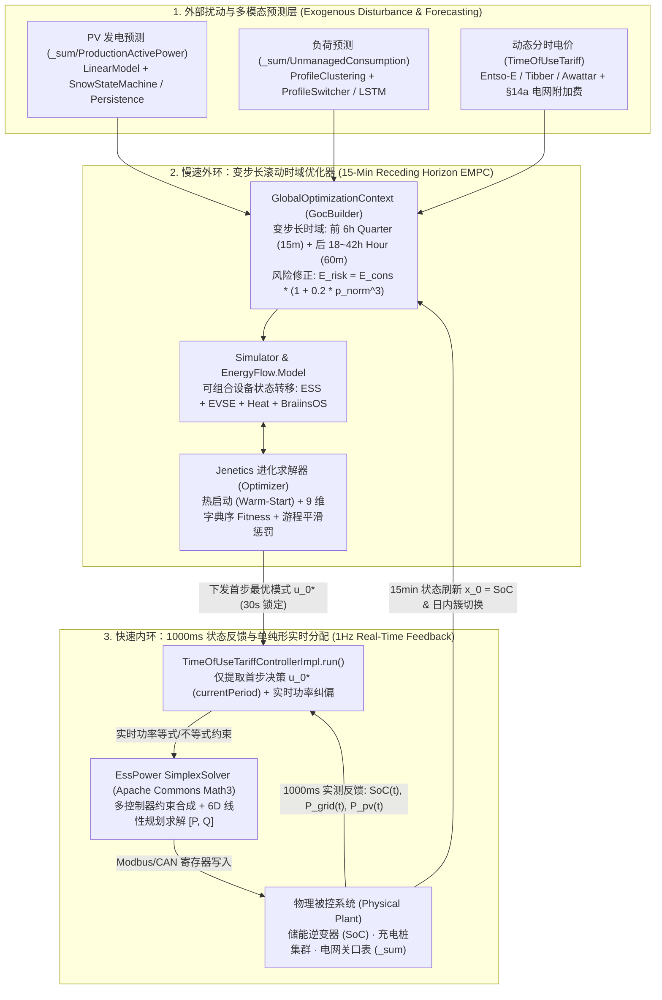

# OpenEMS 模型预测控制 (MPC) 深度剖析与架构报告

> **Control Theory & Source Code Monograph · Receding Horizon Economic MPC in OpenEMS**  
> **审计基线**: `/opt/openems/source` (`2025.10.0-SNAPSHOT`) · **核心涉及模块**: `18` 个 OSGi Bundles (`io.openems.edge.energy*`, `io.openems.edge.predictor.*`, `io.openems.edge.timeofusetariff.*`, `io.openems.edge.controller.ess.timeofusetariff`, `io.openems.edge.controller.evse`)  
> **配套交互式视觉报告**: [OpenEMS_模型预测控制_MPC_深度剖析与架构报告_2026-10-18.html](file:///home/user01/local/openems/OpenEMS_%E6%A8%A1%E5%9E%8B%E9%A2%84%E6%B5%8B%E6%8E%A7%E5%88%B6_MPC_%E6%B7%B1%E5%BA%A6%E5%89%96%E6%9E%90%E4%B8%8E%E6%9E%B6%E6%9E%84%E6%8A%A5%E5%91%8A_2026-10-18.html)

---

## 01. 控制论视角：经典 MPC 三大支柱与 OpenEMS 双速率级联架构

**模型预测控制 (Model Predictive Control, MPC)** 又称 **滚动时域控制 (Receding Horizon Control, RHC)**，其核心思想是在每一个采样时刻 $t_k$，基于当前系统实测状态 $\mathbf{x}(t_k)$ 与未来有限时域 $[t_k, t_k + N\Delta t]$ 的外部扰动预测 $\hat{\mathbf{d}}$，在线求解一个带约束的有限时域最优控制问题，得到最优控制序列 $\mathbf{U}^* = \{u_0^*, u_1^*, \dots, u_{N-1}^*\}$，但 **仅将第一个控制分量 $u_0^*$ 作用于被控对象**；在下一采样时刻 $t_{k+1}$，用实测状态刷新初始条件并将预测窗口向前平移一步，周而复始。

通过对 OpenEMS 源码的深度审计，OpenEMS 实现了一套极具工程巧思的 **双速率级联混合经济模型预测控制 (Dual-Rate Cascade Hybrid Economic MPC)** 架构：

| MPC 核心要素 | 控制论数学表达 | OpenEMS 源码映射与工程实现 | 采样/滚动周期 |
| :--- | :--- | :--- | :---: |
| **1. 预测模型 (Prediction Model)** | $\mathbf{x}_{k+1} = f(\mathbf{x}_k, \mathbf{u}_k, \hat{\mathbf{d}}_k)$ | [`PredictorManager`](file:///opt/openems/source/io.openems.edge.predictor.api/src/io/openems/edge/predictor/api/manager/PredictorManager.java) + [`TariffManager`](file:///opt/openems/source/io.openems.edge.timeofusetariff.api/src/io/openems/edge/timeofusetariff/api/TariffManager.java) + [`EnergyFlow.Model`](file:///opt/openems/source/io.openems.edge.energy.api/src/io/openems/edge/energy/api/simulation/EnergyFlow.java#L149-L535) | `15 min` 离散步长 |
| **2. 滚动时域优化 (Receding Horizon Optimization)** | $\min_{\mathbf{U}} J(\mathbf{x}_0, \mathbf{U}, \hat{\mathbf{D}}) \text{ s.t. } g(\mathbf{x}_k, \mathbf{u}_k) \le 0$ | [`Optimizer.java`](file:///opt/openems/source/io.openems.edge.energy/src/io/openems/edge/energy/optimizer/Optimizer.java) + [`Simulator.java`](file:///opt/openems/source/io.openems.edge.energy/src/io/openems/edge/energy/optimizer/Simulator.java) + [`Fitness.java`](file:///opt/openems/source/io.openems.edge.energy.api/src/io/openems/edge/energy/api/handler/Fitness.java) (Jenetics 混合离散进化求解) | `15 min` 外环滚动 (`30s` 锁定首步) |
| **3. 反馈校正与实时内环 (Feedback Correction)** | $\mathbf{u}_{\text{actual}}(t) = \kappa(u_0^*, \mathbf{x}_{\text{meas}}(t), \mathbf{d}_{\text{meas}}(t))$ | [`TimeOfUseTariffControllerImpl.run()`](file:///opt/openems/source/io.openems.edge.controller.ess.timeofusetariff/src/io/openems/edge/controller/ess/timeofusetariff/TimeOfUseTariffControllerImpl.java#L205-L276) + [`Utils.calculateApplyMode()`](file:///opt/openems/source/io.openems.edge.controller.ess.timeofusetariff/src/io/openems/edge/controller/ess/timeofusetariff/Utils.java#L68-L100) + [`Solver.java`](file:///opt/openems/source/io.openems.edge.ess.core/src/io/openems/edge/ess/core/power/v1/Solver.java) (Simplex LP) | `1000 ms` (`1 Hz`) 实时闭环 |

---

## 02. 多模态预测引擎与随机鲁棒修正 (`io.openems.edge.predictor.*`)

MPC 的控制品质上限取决于预测模型的精度，而下限取决于优化器对预测误差的鲁棒性。OpenEMS 在 [`io.openems.edge.predictor.api`](file:///opt/openems/source/io.openems.edge.predictor.api) 中内置了一个纯 Java 轻量级机器学习框架 `mlcore`（含 [`DataFrame`](file:///opt/openems/source/io.openems.edge.predictor.api/src/io/openems/edge/predictor/api/mlcore/datastructures/DataFrame.java)、[`RandomForestRegressor`](file:///opt/openems/source/io.openems.edge.predictor.api/src/io/openems/edge/predictor/api/mlcore/regression/RandomForestRegressor.java)、[`AutoKMeansClusterer`](file:///opt/openems/source/io.openems.edge.predictor.api/src/io/openems/edge/predictor/api/mlcore/clustering/AutoKMeansClusterer.java)、[`BernoulliNaiveBayesClassifier`](file:///opt/openems/source/io.openems.edge.predictor.api/src/io/openems/edge/predictor/api/mlcore/classification/BernoulliNaiveBayesClassifier.java)），并提供 **5 种可插拔预测器模型**：

### 2.1 五大预测器模型矩阵
1. **持久性基线模型 ([`PredictorPersistenceModelImpl`](file:///opt/openems/source/io.openems.edge.predictor.persistencemodel/src/io/openems/edge/predictor/persistencemodel/PredictorPersistenceModelImpl.java))**: 假设未来 24 小时功率曲线等于过去 24 小时实测值 $\hat{P}(t) = P(t - 24\text{h})$，作为零训练开销的兜底基线。
2. **相似日统计模型 ([`PredictorSimilardayModelImpl`](file:///opt/openems/source/io.openems.edge.predictor.similardaymodel/src/io/openems/edge/predictor/similardaymodel/PredictorSimilardayModelImpl.java))**: 检索过去 $N$ 周中相同星期属性（工作日/周末）的历史同刻数据均值。
3. **气象驱动光伏回归模型 ([`PredictorProductionLinearModelImpl`](file:///opt/openems/source/io.openems.edge.predictor.production.linearmodel/src/io/openems/edge/predictor/production/linearmodel/PredictorProductionLinearModelImpl.java))**:
   - 结合气象服务 (`io.openems.edge.weather.api`) 的短波辐射、直散射辐照度、温度及时间正余弦编码（[`TimeOfDaySinCosFeatureTransformer`](file:///opt/openems/source/io.openems.edge.predictor.api/src/io/openems/edge/predictor/api/mlcore/transformer/TimeOfDaySinCosFeatureTransformer.java)）训练回归模型。
   - **积雪状态机修正 ([`SnowStateMachine.java`](file:///opt/openems/source/io.openems.edge.predictor.production.linearmodel/src/io/openems/edge/predictor/production/linearmodel/prediction/SnowStateMachine.java#L65-L95))**: 独创 `NORMAL` $\leftrightarrow$ `SNOW` 状态机——当检测到降雪 (`snowfall > 0`) 且未来 90% 时段积雪深度 `snowDepth > 0` 时切入 `SNOW` 态抑制虚高发电预测；当实测发电恢复稳定高位 (`isStableHighProduction()`) 时自动解除积雪抑制。
4. **日负荷聚类与日内动态切换模型 ([`PredictorProfileClusteringModelImpl`](file:///opt/openems/source/io.openems.edge.predictor.profileclusteringmodel/src/io/openems/edge/predictor/profileclusteringmodel/PredictorProfileClusteringModelImpl.java))**:
   - **离线聚类 + 分类**: 使用 `AutoKMeansClusterer` 对历史日负荷曲线聚类生成典型画像 $\mathcal{P}_1, \dots, \mathcal{P}_K$，再用 `BernoulliNaiveBayesClassifier` 结合星期/节假日特征预测今日所属画像。
   - **日内闭环画像切换 ([`ProfileSwitcher.java`](file:///opt/openems/source/io.openems.edge.predictor.profileclusteringmodel/src/io/openems/edge/predictor/profileclusteringmodel/prediction/ProfileSwitcher.java#L45-L67))**: 在日内运行过程中，实时计算今日已发生负荷序列 $\mathbf{y}_{\text{today}}$ 与所有候选画像的平方误差 $E(\mathcal{P}) = \|\mathcal{P} - \mathbf{y}_{\text{today}}\|_2^2$。一旦发现候选画像误差改善量超过两画像间距的 $\alpha = 20\%$ 阈值：
     $$E(\mathcal{P}_{\text{curr}}) - E(\mathcal{P}_{\text{cand}}) > 0.20 \cdot \|\mathcal{P}_{\text{curr}} - \mathbf{P}_{\text{cand}}\|_2^2$$
     立即在日内动态切换剩余时段的负荷预测画像！这本质上是 **MPC 观测器 (State/Disturbance Observer) 的在线模式辨识**。
5. **深度长短期记忆网络 ([`PredictorLstmImpl`](file:///opt/openems/source/io.openems.edge.predictor.lstm/src/io/openems/edge/predictor/lstm/PredictorLstmImpl.java))**:
   - 采用纯 Java 实现的 LSTM 门控循环单元（[`Lstm.java`](file:///opt/openems/source/io.openems.edge.predictor.lstm/src/io/openems/edge/predictor/lstm/util/Lstm.java)、[`Cell.java`](file:///opt/openems/source/io.openems.edge.predictor.lstm/src/io/openems/edge/predictor/lstm/util/Cell.java)），将时间序列解耦为季节性周期项 (`ValidationSeasonalityModel`) 与局部趋势项 (`ValidationTrendModel`) 分别推理再叠加。

### 2.2 价格弹性风险膨胀系数 (Risk-Adjusted Robust Consumption)
在动态电价场景下，若高电价尖峰时段负荷预测偏低，将导致电池提早放空而不得不在全天最昂贵时刻高价买电。为此，[`Environment.java`](file:///opt/openems/source/io.openems.edge.energy.api/src/io/openems/edge/energy/api/Environment.java#L10-L34) 与 [`PeriodsBuilder.java`](file:///opt/openems/source/io.openems.edge.energy.api/src/io/openems/edge/energy/api/simulation/periods/PeriodsBuilder.java#L250-L260) 引入了 **非对称三次方价格风险膨胀函数**：
$$\hat{E}_{\text{cons}}^{\text{risk}}(k) = \text{round}\!\left(\hat{E}_{\text{cons}}(k) \cdot \left(1.0 + 0.2 \cdot \tilde{\pi}_{\text{buy}}(k)^3\right)\right), \quad \tilde{\pi}_{\text{buy}}(k) = \frac{\pi_{\text{buy}}(k) - \pi_{\min}}{\pi_{\max} - \pi_{\min}} \in [0, 1]$$
当电价处于全天最高峰（$\tilde{\pi}_{\text{buy}} = 1.0$）时，优化器自动按 **$120\%$ 裕度** 预留负荷放电量；而在谷电时段（$\tilde{\pi}_{\text{buy}} = 0$）保持 $100\%$ 原始预测，实现了优雅的 **分布鲁棒 MPC (Distributionally Robust MPC)** 近似。

---

## 03. 变步长状态空间建模与可组合能量流方程 (`GlobalOptimizationContext` & `EnergyFlow`)

### 3.1 变步长多分辨率预测时域 (Multi-Resolution Prediction Horizon)
若对未来 24~36 小时全部采用 15 分钟步长（$N = 96 \sim 144$），在多设备联合调度下离散搜索空间将呈指数爆炸（$\prod_j |\mathcal{M}_j|^{96}$）。OpenEMS 在 [`GocUtils.java`](file:///opt/openems/source/io.openems.edge.energy.api/src/io/openems/edge/energy/api/simulation/GocUtils.java#L38-L44) 与 [`PeriodsBuilder.java`](file:///opt/openems/source/io.openems.edge.energy.api/src/io/openems/edge/energy/api/simulation/periods/PeriodsBuilder.java#L88-L138) 中采用了 **近密远疏的变步长时域离散化策略**：
- **近期高分辨率区 (`Period.Quarter`, $\Delta t = 15\text{ min}$)**: 覆盖当前小时剩余时段 + 未来整 6 小时，共：
  $$N_Q = 6 \times 4 + \frac{60 - \text{minute}(t_0)}{15} \in [25, 28]\text{ 个 Quarter 周期}$$
- **远期聚合区 (`Period.Hour`, $\Delta t = 60\text{ min}$)**: 从第 $N_Q$ 步之后直到预测数据终点，每 4 个 Quarter 聚合为 1 个 `Period.Hour`（发电/负荷求和，电价取均值）。
- **降维收益**: 将 24 小时 96 个决策步压缩至 **约 $43$ 个决策步**，在不损失首步 $u_0^*$ 及近期 6 小时 15 分钟级控制精度的前提下，将基因型维度削减了 **$55\%$**。

### 3.2 状态空间方程与 `EnergyFlow.Model` 平衡求解
在每个离散时域步 $k \in \{0, 1, \dots, N-1\}$：
- **系统状态变量 (State Vector)**:
  - 储能可用能量 $x_{\text{ess}}(k) \in [0, E_{\text{total}}]$（初始状态 $x_{\text{ess}}(0) = \text{SoC}_0 \cdot E_{\text{total}}$，见 [`GocBuilder.java`](file:///opt/openems/source/io.openems.edge.energy.api/src/io/openems/edge/energy/api/simulation/GocBuilder.java#L236-L250)）
  - 各受控充电桩已充入能量 $x_{\text{evse},m}(k)$（见 [`SingleScheduleContext`](file:///opt/openems/source/io.openems.edge.controller.evse/src/io/openems/edge/controller/evse/cluster/EnergyScheduler.java#L51-L70)）
- **控制输入向量 (Control Input Vector)**:
  $$\mathbf{u}_k = \left[ u_k^{(1)}, u_k^{(2)}, \dots, u_k^{(P)} \right] \in \mathcal{M}_1 \times \mathcal{M}_2 \times \dots \times \mathcal{M}_P$$
  由所有实现 [`EnergyScheduleHandler.WithDifferentModes`](file:///opt/openems/source/io.openems.edge.energy.api/src/io/openems/edge/energy/api/handler/EnergyScheduleHandler.java) 的控制器离散模式笛卡尔积（[`ModeCombinations`](file:///opt/openems/source/io.openems.edge.energy/src/io/openems/edge/energy/optimizer/ModeCombinations.java)）构成。
- **单步能量流约束模型 ([`EnergyFlow.Model`](file:///opt/openems/source/io.openems.edge.energy.api/src/io/openems/edge/energy/api/simulation/EnergyFlow.java#L149-L535))**:
  1. 定义净富余发电量（未含储能与电网）：
     $$E_{\text{surplus}}(k) = \hat{E}_{\text{prod}}(k) - \left( \hat{E}_{\text{unmanaged}}(k) + \sum_{m} E_{\text{managed},m}(k) \right)$$
  2. 施加储能物理与容量边界：
     $$E_{\text{ess,maxCharge}}(k) = \min\!\left(P_{\text{charge,max}}\Delta t_k, \; E_{\text{total}} - x_{\text{ess}}(k)\right), \quad E_{\text{ess,maxDischarge}}(k) = \min\!\left(P_{\text{discharge,max}}\Delta t_k, \; x_{\text{ess}}(k)\right)$$
  3. 各控制器按 `Scheduler` 优先级依次调用 `esh.simulate(...)` 修改 `ef.setEssMaxDischarge(...)`、`ef.addManagedConsumption(...)` 或直接设定目标充放电 `ef.setEss(target)`：
     - **`BALANCING` (自发自用自平衡)**: $E_{\text{ess,target}}(k) = -E_{\text{surplus}}(k)$（消纳光伏余电或填补负荷缺口，使 $E_{\text{grid}}(k) \to 0$）。
     - **`DELAY_DISCHARGE` (锁电等待高价峰段)**: $E_{\text{ess,target}}(k) = \min(0, -E_{\text{surplus}}(k))$（允许光伏余电充电，但严禁电池向负荷放电，改由当前便宜电网供电）。
     - **`CHARGE_GRID` (谷电强制储电)**: $E_{\text{ess,target}}(k) = \min(0, -E_{\text{surplus}}(k)) - E_{\text{charge,grid}}(k)$。
     - **`LIMIT_CHARGE` (预测削峰延缓充电)**: $E_{\text{ess,target}}(k) = -\min(E_{\text{limit}}(k), E_{\text{surplus}}(k))$。
  4. 调用 [`ef.solve()`](file:///opt/openems/source/io.openems.edge.energy.api/src/io/openems/edge/energy/api/simulation/EnergyFlow.java#L502-L518) 闭合节点能量守恒方程并推进下一时刻状态：
     $$E_{\text{grid}}(k) = \max\!\left(-E_{\text{grid,maxSell}}(k), \; -\big(E_{\text{surplus}}(k) + E_{\text{ess}}(k)\big)\right)$$
     $$x_{\text{ess}}(k+1) = x_{\text{ess}}(k) - E_{\text{ess}}(k)$$

---

## 04. 九维字典序代价函数与混合进化滚动求解器 (`Fitness` & `Simulator`)

不同于传统的加权求和单目标代价函数（极易因权重系数量纲失衡导致软约束击穿硬约束），OpenEMS 在 [`Fitness.java`](file:///opt/openems/source/io.openems.edge.energy.api/src/io/openems/edge/energy/api/handler/Fitness.java#L44-L53) 中设计了 **九维严格字典序比较器 (`DEFAULT_COMPARATOR`)**，仅当上一优先级的指标完全相等时才比较下一级指标：

### 4.1 九维字典序目标函数层级表
| 优先级 | `Fitness` 字段名 | 优化方向 | 数学公式与物理意义 | 源码位置 |
| :---: | :--- | :---: | :--- | :--- |
| **L1** | `hardConstraintViolations` | $\min \downarrow$ | 硬约束违背次数（如满电强制电网充电、突破 `GridBuySoftLimit` 需量红线、能量流不可解） | [`Simulator.java#L145`](file:///opt/openems/source/io.openems.edge.energy/src/io/openems/edge/energy/optimizer/Simulator.java#L145), [`#L202`](file:///opt/openems/source/io.openems.edge.energy/src/io/openems/edge/energy/optimizer/Simulator.java#L202) |
| **L2** | `constraintsAfterHard...` | $\min/\max$ | 紧随硬约束之后的自定义刚性目标（如低温保护、特殊安全边界） | [`Fitness.java#L46`](file:///opt/openems/source/io.openems.edge.energy.api/src/io/openems/edge/energy/api/handler/Fitness.java#L46) |
| **L3** | `gridBuyCostScore` | $\min \downarrow$ | **核心经济目标**：全时域购电成本评分（含负电价平移与 `1.17` 储能往返损耗惩罚）： $\sum_k \pi_{\text{buy}}^{\text{shift}}(k) \cdot \big(E_{\text{grid}\to\text{cons}}(k) + 1.17 \cdot E_{\text{grid}\to\text{ess}}(k)\big)$ | [`Simulator.java#L206-L221`](file:///opt/openems/source/io.openems.edge.energy/src/io/openems/edge/energy/optimizer/Simulator.java#L206-L221) |
| **L4** | `gridBuyEnergyWh` | $\min \downarrow$ | 电价相同时，最小化含损耗折算的物理购电总量 $\sum_k (E_{\text{grid}\to\text{cons}} + 1.17 E_{\text{grid}\to\text{ess}})$ | [`Simulator.java#L223-L227`](file:///opt/openems/source/io.openems.edge.energy/src/io/openems/edge/energy/optimizer/Simulator.java#L223-L227) |
| **L5** | `constraintsAfterGridBuy...` | $\min \downarrow$ | 预测削峰目标时刻缺口能量 `targetTimeEnergyMissing` $= E_{\text{cap}} - x_{\text{ess}}(t_{\text{target}})$ | [`EnergyScheduler.java#L228`](file:///opt/openems/source/io.openems.edge.controller.ess.timeofusetariff/src/io/openems/edge/controller/ess/timeofusetariff/EnergyScheduler.java#L228) |
| **L6** | `gridSellRevenueScore` | $\max \uparrow$ | 最大化余电上网售电收益 $\sum_k E_{\text{sell}}(k) \cdot \pi_{\text{sell}}(k)$ | [`Simulator.java#L231-L238`](file:///opt/openems/source/io.openems.edge.energy/src/io/openems/edge/energy/optimizer/Simulator.java#L231-L238) |
| **L7** | `gridSellEnergyWh` | $\max \uparrow$ | 最大化余电上网电量 $\sum_k E_{\text{sell}}(k)$ | [`Simulator.java#L239`](file:///opt/openems/source/io.openems.edge.energy/src/io/openems/edge/energy/optimizer/Simulator.java#L239) |
| **L8** | `modePreferencePenalty` | $\min \downarrow$ | 时间折现模式偏好惩罚（越靠前的周期权重 $w_k = N - k + 1$ 越高，优先选择 `BALANCING` 等自然模式） | [`Simulator.java#L397-L420`](file:///opt/openems/source/io.openems.edge.energy/src/io/openems/edge/energy/optimizer/Simulator.java#L397-L420) |
| **L9** | `softConstraintViolations` | $\min \downarrow$ | **游程长度平方反比平滑项 (Run-Length Anti-Chattering)**： $J_{\text{run}} = \text{round}\!\left(\sum_{j} \sum_{r \in \text{Runs}(j)} \frac{1}{L_r^2}\right)$，奖励连续长时段保持同一模式，抑制高频切换抖动 | [`Simulator.java#L459-L480`](file:///opt/openems/source/io.openems.edge.energy/src/io/openems/edge/energy/optimizer/Simulator.java#L459-L480) |

### 4.2 滚动时域热启动 (Warm-Starting) 与 30 秒首步锁定机制
- **MPC 经典热启动 ([`InitialPopulationUtils.java`](file:///opt/openems/source/io.openems.edge.energy/src/io/openems/edge/energy/optimizer/InitialPopulationUtils.java#L32-L85))**:
  在每个新的 15 分钟周期启动进化引擎时，`generateInitialPopulation` 并非从纯随机种群开始，而是注入三大先验种子：
  1. **全默认策略 (`generateAllDefault`)**: 全时域设为模式 `0` (`BALANCING`)；
  2. **上一周期最优解平移继承 (`getScheduleFromPreviousResult`)**: 按时间戳对齐提取上一轮 MPC 求出的最优轨迹 $\{u_1^*, u_2^*, \dots\}$ 作为本轮初始个体，这是 **MPC 滚动时域热启动 (Warm-Start)** 的标准工程实现；
  3. **电价波谷/波峰启发式种子**: 扫描电价曲线的所有局部波谷点 (`findValleyIndexes`) 分别置为 `DELAY_DISCHARGE` 或 `CHARGE_GRID`。
- **30 秒首步锁定与渐进求精 ([`Simulator.java`](file:///opt/openems/source/io.openems.edge.energy/src/io/openems/edge/energy/optimizer/Simulator.java#L327-L369))**:
  进化流采用 `populationSize(300)`、`EliteSelector` + `TournamentSelector`、`Mutator(0.05)` + `ShiftMutator(0.2)` + `SinglePointCrossover(0.2)`。当优化运行满 `earliestCallbackDelay = 30s` 时，立即向控制器发布当前最优解并将 `isCurrentPeriodFixed` 置为 `true`（**锁定当前第 0 步基因 $u_0^*$**），随后继续在后台演化未来时域 $k \ge 1$ 直至连续 500 代无改进 (`Limits.bySteadyFitness(500)`) 或本 15 分钟周期结束前 5 秒 (`BUFFER_STOP = 5s`)。

---

## 05. 1000ms 实时闭环反馈校正与解析式预测充电曲线

MPC 之所以具备对抗模型失配与预测误差的强鲁棒性，关键在于 **仅执行首步决策并依靠高频测量反馈闭环修正**。OpenEMS 在 1000ms 实时控制周期中实现了两级反馈校正：

### 5.1 离散模式到连续功率指令的实时状态反馈映射 ([`Utils.java`](file:///opt/openems/source/io.openems.edge.controller.ess.timeofusetariff/src/io/openems/edge/controller/ess/timeofusetariff/Utils.java#L68-L211))
每秒钟 [`TimeOfUseTariffControllerImpl.run()`](file:///opt/openems/source/io.openems.edge.controller.ess.timeofusetariff/src/io/openems/edge/controller/ess/timeofusetariff/TimeOfUseTariffControllerImpl.java#L205-L276) 读取当前时段最优模式 $u_0^* = \text{currentPeriod.mode()}$，并结合 **当秒实测** 的电网功率 $P_{\text{grid}}(t)$、逆变器功率 $P_{\text{ess}}(t)$、光伏功率 $P_{\text{pv}}(t)$ 与电池 $\text{SoC}(t)$ 动态计算有功设定值 $P_{\text{set}}(t)$：
1. **实时自平衡基准点**: $P_{\text{balancing}}(t) = P_{\text{grid}}(t) + P_{\text{ess}}(t)$（即无储能干预时的真实净买电功率）。
2. **`CHARGE_GRID` 实时纠偏 ([`calculateChargeGrid`](file:///opt/openems/source/io.openems.edge.controller.ess.timeofusetariff/src/io/openems/edge/controller/ess/timeofusetariff/Utils.java#L102-L134))**:
   - 目标充电功率加上当前实测光伏富余：$P_{\text{target}}(t) = -P_{\text{charge,grid}}^* + \min(0, P_{\text{balancing}}(t))$。
   - **越界实时降级**: 若突发大功率负荷导致净买电突破需量软限值 $P_{\text{grid,soft}}$，立即忽略 `CHARGE_GRID` 并在当秒无缝切换为 `PEAK_SHAVING` 放电削峰（$P_{\text{set}}(t) = P_{\text{balancing}}(t) - P_{\text{grid,soft}}$）；若实测 $\text{SoC}(t) \ge \text{maxSocInChargeGrid}$，当秒切回 `BALANCING`。
3. **最终安全护栏 ([`postProcessApplyMode`](file:///opt/openems/source/io.openems.edge.controller.ess.timeofusetariff/src/io/openems/edge/controller/ess/timeofusetariff/Utils.java#L194-L211))**:
   在将设定值送入 `ess.setActivePowerEqualsWithFilter(setPoint)` 之前，强制将其钳位在电网买电软限值与馈网硬限值构成的实时可行走廊内：
   $$P_{\text{balancing}}(t) - P_{\text{gridBuySoftLimit}} \le P_{\text{set}}(t) \le P_{\text{balancing}}(t) + P_{\text{gridSellHardLimit}}$$

### 5.2 解析式预测充电斜率控制 (`GridOptimizedChargeUtils.java`)
为防止晴天正午光伏大发时电池已在上午充满、从而触发馈网限功率弃光，[`GridOptimizedChargeUtils.java`](file:///opt/openems/source/io.openems.edge.controller.ess.timeofusetariff/src/io/openems/edge/controller/ess/timeofusetariff/GridOptimizedChargeUtils.java#L131-L212) 实现了 **反向积分目标时刻 + 连续斜率重规划算法**：
1. **反向积分锁定目标充满时刻 $t_{\text{target}}$**: 从日落时刻向前倒序累加预测净盈余能量 $\Delta \hat{E}_{\text{surplus}}(k)$，直至累积盈余达到电池缓冲容量 $E_{\text{buffer}} = \beta_{\text{buffer}} \cdot E_{\text{cap}}$，将该时刻定为电池允许充满的最早时刻 $t_{\text{target}}$。
2. **1000ms 实时重算最大充电上限**: 在 $t < t_{\text{target}}$ 的每一秒，根据当前实测 $\text{SoC}(t)$ 与剩余具有净盈余的 15 分钟周期数 $N_{\text{surplus,future}}$，实时计算均匀受控充电功率上限：
   $$P_{\text{limit}}(t) = \text{round}\!\left(\frac{\big(1 - \text{SoC}(t)\big) \cdot E_{\text{cap}}}{\Delta t_{\text{rem,quarter}} / 3600.0 + N_{\text{surplus,future}} / 4.0}\right)$$
   若实测 $\text{SoC}(t)$ 因云层遮挡落后于计划，分母减小而分子保持，$P_{\text{limit}}(t)$ 自动平滑上调，形成无静差的 **解析式轨迹跟踪 MPC**。

---

## 06. 架构演进评估：OpenEMS 混合进化 MPC vs 传统凸优化 (MILP/QP) MPC

| 评估维度 | OpenEMS 仿真驱动混合进化 MPC (`Jenetics` + `EnergyFlow`) | 传统数学规划 MPC (`MILP` / `MIQP` · Gurobi/HiGHS) | OpenEMS 架构取舍深度剖析 |
| :--- | :--- | :--- | :--- |
| **设备模型解耦度** | **极高（黑盒函数接口）**：任何组件只需实现 `EnergyScheduleHandler.simulate()` Java lambda 即可接入 | **低（白盒矩阵耦合）**：所有设备必须线性化并组装进全局稀疏矩阵 $A_{\text{eq}}\mathbf{x} = \mathbf{b}_{\text{eq}}$ | 完美契合 OSGi 动态插件生态，第三方硬件开发者无需掌握运筹学建模 |
| **非线性与逻辑表达** | **原生支持**：可直接编写 `switch/if` 状态机、阶梯效率、死区阈值 (`MINIMUM_POWER_FACTOR = 0.081`) | **需引入大量 Big-M 0-1 整数变量**：容易引发分支定界组合爆炸 | 避免了混合整数线性规划在非凸逻辑下的数值病态问题 |
| **边缘网关部署性** | **纯 Java 零原生依赖**：无需交叉编译 C/C++ 求解器动态库，内存占用恒定，支持 `N-1` 核心低优隔离 | **依赖平台原生二进制 (JNI)**：在低算力 ARMv7/ARM64 工业网关上存在内存峰值与 License 限制 | 保障了十万台级边缘网关固件的一致性与高可靠性 |
| **Anytime 实时可得性** | **强 Anytime 特性**：30s 即可输出包含启发式热启动种子的高质量可行解，绝不返回 `Infeasible` 空解 | **存在求解超时风险**：若约束冲突可能直接抛出 `Infeasible` 导致控制器停摆 | 结合九维字典序 `hardConstraintViolations` 降级，确保极端工况下仍有次优可行调度 |
| **全局最优性保证** | **渐近次优（启发式随机搜索）**：在多充电桩 + 储能联合调度时收敛速度随基因长度下降 | **数学严格全局最优（给定 Gap 内）**：对纯连续线性/二次问题毫秒级收敛 | OpenEMS 通过 **变步长时域（前 6h 15m + 后 18h 60m）+ 上一周期热启动 + 波谷启发式种子** 极大弥补了 GA 的收敛短板 |
