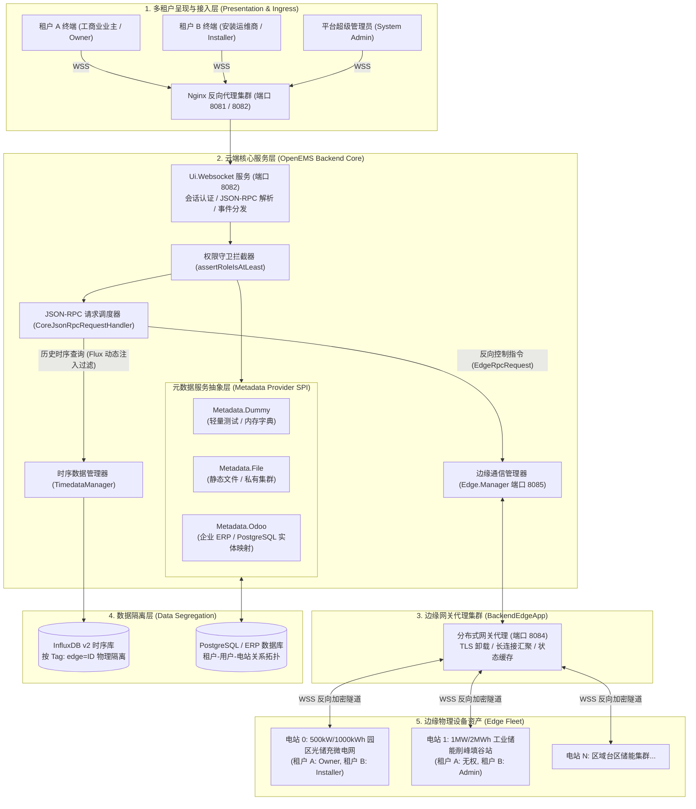
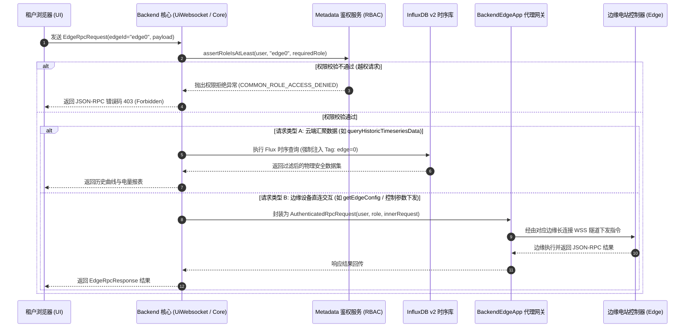
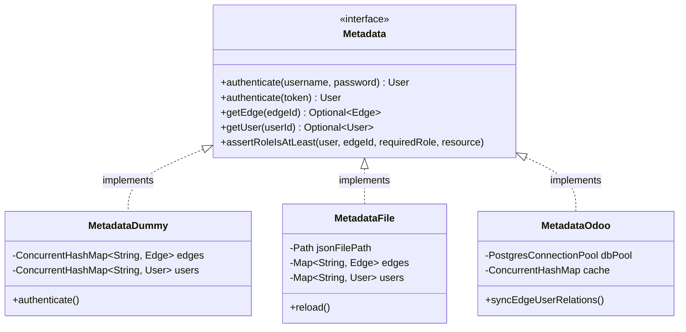
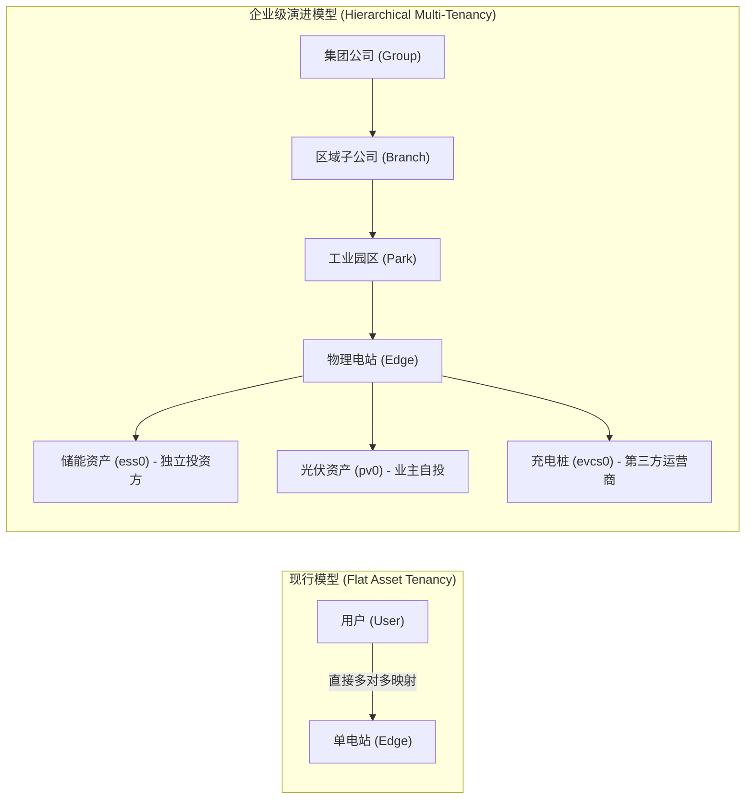

# OpenEMS 多租户与权限隔离架构全景深度分析

在分布式储能、工商业微电网以及虚拟电厂（VPP, Virtual Power Plant）业务场景中，云端聚合平台通常需要接入成千上万座异构边缘电站，并向不同业务角色（平台运营商、安装运维商、资产投资业主、终端用电租户）提供差异化的监控管理、参数配置与调度指令下发能力。

作为全球领先的开源能源管理系统，**OpenEMS (Open Energy Management System)** 设计了一套以 **“边缘设备资产（Edge）”为核心实体、以“四级 RBAC 角色模型”为访问边界、以“分布式元数据 SPI”为驱动引擎、以“物理标签动态注入”为数据沙箱** 的云端多租户微服务架构。

本文基于 OpenEMS 官方最新内核源码（涵盖 Backend 核心控制层、[`Metadata`](io.openems.backend.common/src/io/openems/backend/common/metadata/Metadata.java) 服务接口、[`BackendEdgeApp`](io.openems.backend.edge.application/) 分布式网关代理及 InfluxDB v2 时序引擎），对 OpenEMS 的多租户体系与安全隔离机制进行系统性全景剖析。

---

## 一、 核心设计哲学与多租户特性

与传统管理软件（SaaS ERP/CRM）以“租户公司（Tenant Company）”为主体的数据库逻辑隔离不同，工业物联网与能源互联网具备强烈的物理资产属性与确定性时序控制要求。OpenEMS 的多租户设计遵循以下核心原则：

1. **资产中心主义（Asset-Centric Tenancy）**：
   - 租户不拥有抽象的软件实例，而是拥有或被授权访问特定的一组 **物理电站资产（`Edge`）**。
   - 所有权限判定、路由调度、时序数据隔离均以物理电站 ID（`edgeId`）为最小授权原子单元。
2. **边缘优先与反向长连接隧道（Edge-First & Reverse Tunneling）**：
   - 边缘电站通常部署在工商业园区或偏远变电站的私网/防火墙内部，不具备公网 IP。
   - 平台通过反向 WebSocket 加密隧道（Reverse WSS Tunnel）实现从云端向边缘的安全穿透，无需现场进行任何端口映射或 VPN 配置。
3. **SPI 契约驱动（Service Provider Interface）**：
   - 抽象出核心元数据接口 [`Metadata`](io.openems.backend.common/src/io/openems/backend/common/metadata/Metadata.java)，解耦权限鉴权与底层持久化存储，支持从单机内存配置无缝平滑切换到企业级 ERP 数据库。
4. **控制面与数据面严格分轨（Control/Data Plane Separation）**：
   - 控制信令走高可靠的双向 JSON-RPC 消息链路（保证端到端事务性与严格鉴权）；
   - 海量高频遥测时序数据走流式批量聚合通道（Tag 物理分区与查询沙箱拦截）。

---

## 二、 多租户系统全景拓扑与交互链路

OpenEMS 构建了端到端的五层分层解耦模型：



### 交互分层解析：
1. **接入呈现层 (Client & Ingress)**：前端单页应用（Angular UI）统一经由 Nginx（端口 `8081` 静态资源，`8082` WebSocket 反向代理）接入云端。
2. **核心微内核层 (Backend Core)**：`Ui.Websocket` 维护用户会话生命周期，在信令分发前进行统一的身份鉴权与权限拦截。
3. **元数据驱动层 (Metadata SPI)**：解耦租户定义，管理所有用户、角色、电站绑定关系。
4. **边缘网关代理层 (BackendEdgeApp)**：独立解耦的边缘连接接入网关（端口 `8084`），负责海量边缘设备（Edge）的长连接接入、TLS 证书卸载与控制报文多路复用。
5. **持久化隔离层 (Data Storage)**：关系型数据管理组织与权限元数据；时序数据通过物理标签实现高吞吐写入与精确过滤。

---

## 三、 多租户实体模型与细粒度 RBAC 权限四级金字塔

### 1. 用户实体建模 (`User.java`)
在 OpenEMS 后端会话体系中，用户定义位于 [`io.openems.backend.common/src/io/openems/backend/common/metadata/User.java`](io.openems.backend.common/src/io/openems/backend/common/metadata/User.java)：

- **全局角色 (`globalRole`)**：区分系统超级管理员（`Role.ADMIN`）与常规租户用户。
- **电站授权表 (`Map<String, Role> edgeRoles`)**：核心的多租户资产映射结构，维护 `edgeId -> Role` 的对应关系。
- **多设备感知能力 (`hasMultipleEdges`)**：
  - 若用户仅被授权访问 1 座电站，前端 UI 会自动锁定单电站监控视角；
  - 若用户拥有多座电站权限（如运维商管理 50 座工商业储能），前端 UI 自动激活**车队概览模式（Fleet Grid View）**与电站快速切换导航栏。
- **用户隔离个性化配置 (`settings`)**：每个用户拥有独立的偏好设置 JSON（语言偏好 `language`、图表显示粒度、暗黑/明亮主题等）。

### 2. RBAC 四级角色继承金字塔
OpenEMS 在 [`io.openems.common/src/io/openems/common/session/Role.java`](io.openems.common/src/io/openems/common/session/Role.java) 中定义了高度契合工业能源运维实践的 4 级继承模型：

```text
▲ [ADMIN (4)]      : 最高管理权限。修改底层网络参数、配置系统服务、安装驱动、执行高级调试
│ [INSTALLER (3)]  : 安装工程与运维角色。添加硬件模块、调整充放电调度控制器、校准电表
│ [OWNER (2)]      : 电站资产业主。设定需量门限、控制充放电工作模式开关、查看电量财务报表
▼ [GUEST (1)]      : 访客/只读角色。仅能订阅实时监控数据与历史时序曲线，无任何写入配置权
```

### 角色权限矩阵表

| 权限范围 | GUEST (1) | OWNER (2) | INSTALLER (3) | ADMIN (4) |
| :--- | :---: | :---: | :---: | :---: |
| 实时遥测数据订阅 (Websocket Stream) | ✅ | ✅ | ✅ | ✅ |
| 历史时序数据查询 (Query Historic Timeseries) | ✅ | ✅ | ✅ | ✅ |
| 查看电站组件配置 (`getEdgeConfig`) | ✅ | ✅ | ✅ | ✅ |
| 修改日常控制参数 (需量设定/工作模式切换) | ❌ | ✅ | ✅ | ✅ |
| 修改系统控制算法 (修改控制器参数/调度规则) | ❌ | ❌ | ✅ | ✅ |
| 添加/删除硬件驱动与 OSGi 组件配置 | ❌ | ❌ | ✅ | ✅ |
| 修改底层网络配置 (静态 IP / 边缘隧道参数) | ❌ | ❌ | ❌ | ✅ |
| 平台级租户管理与设备绑定授权 | ❌ | ❌ | ❌ | ✅ |

### 3. 核心鉴权拦截机制 (`assertRoleIsAtLeast`)
在云端接收到针对特定电站的操作请求时，核心网关严格调用安全拦截方法：

```java
// 代码片段引用：Metadata.java
public static void assertRoleIsAtLeast(User user, String edgeId, Role requiredRole, String resource)
        throws OpenemsNamedException {
    Role userRole = user.getRole(edgeId).orElse(Role.GUEST);
    if (!userRole.isAtLeast(requiredRole)) {
        throw OpenemsError.COMMON_ROLE_ACCESS_DENIED.exception(
            resource, requiredRole.name(), userRole.name());
    }
}
```

- 该守卫确保任何未经授权的租户跨站访问或越权操作均在入口层被立即熔断，抛出 `403 Forbidden` 异常，绝不渗透至底层边缘长连接。

---

## 四、 动态信令代理与边缘反向穿透机制

### 1. 信令代理与数据流转时序图
当用户在前端发起电站操作或报表查询时，信令执行严格的**分流鉴权与反向代理路由**：



### 2. 边缘反向长连接隧道关键设计
- **边缘主动建联**：边缘电站启动后，主动连接云端 `BackendEdgeApp`（默认端口 `8084` 或 `8085`），建立反向 WebSocket 连接（`EdgeWebsocket`）。
- **双向认证与凭证握手**：边缘节点在握手头中携带由元数据系统签发的凭证（`Apikey`），云端校验合法后将该连接注册至活动句柄池（`EdgeManager`）。
- **NAT 穿透与零公网暴露**：边缘本地无需任何公网 IP，所有下行控制指令完全复用已建立的 TCP 链接下发，彻底消除边缘被公网扫描攻击的安全风险。
- **透明 RPC 封装**：通过 `AuthenticatedRpcRequest` 将发起操作的云端用户上下文（用户名、在当前站的角色）随同报文一同透传到边缘，边缘控制器本地再次对敏感操作做第二层校验（双重防御深度防护）。

---

## 五、 时序数据多租户隔离与安全沙箱

在储能电站监控中，时序遥测数据（电压、电流、有功功率、无功功率、充放电量、SOC 等）具有高频、海量特征。OpenEMS 采用 **物理标签分区写入 + Flux 查询语法树拦截** 的高安全沙箱方案：

### 1. 物理写入隔离与标签分区
- 边缘电站每秒或每周期上报遥测数据时，Backend 提取电站标识符（去除 `edge` 前缀提取纯数字索引，如 `edge0` $\rightarrow$ `0`），在 InfluxDB 行协议中作为物理索引标签写入：
  ```influx
  data,edge=0 _sum/ConsumptionActivePower=450000i,ess0/Soc=55i 1792113000
  data,edge=1 _sum/ConsumptionActivePower=1200000i,ess0/Soc=70i 1792113000
  ```

### 2. 查询安全沙箱拦截 (`FluxProxy.java`)
当多租户向云端请求历史时序报表时，云端底层驱动代码强制在 InfluxQL / Flux AST 查询语法树中注入 Tag 约束：

```java
// 代码片段引用：io.openems.shared.influxdb/src/io/openems/shared/influxdb/proxy/FluxProxy.java
if (influxEdgeId.isPresent()) {
    flux = flux.filter(Restrictions.tag(this.tag).equal(influxEdgeId.get().toString()));
}
```

- **底层防穿透**：无论上层业务 UI 传入何种过滤参数，底层 Flux 构造器均会强制将 `r.edge == "<user_authorized_edge_id>"` 作为前置必须条件拼接到查询链中。
- **杜绝全表扫描**：不同租户即使共享同一个 InfluxDB Bucket，也绝不可能通过构造恶意查询获取到其他租户所属电站的时序数据。

---

## 六、 三种元数据驱动模式横向对比与实现剖析

OpenEMS 采用了经典的 OSGi Declarative Services 插件化设计，定义了统一的 [`Metadata`](io.openems.backend.common/src/io/openems/backend/common/metadata/Metadata.java) 服务接口。用户可以根据部署规模与架构演进阶段，热拔插切换不同的租户管理后端：



### 三种模式对比矩阵

| 特性维度 | `Metadata.Dummy` (轻量/测试) | `Metadata.File` (静态文件配置) | `Metadata.Odoo` (企业级生产) |
| :--- | :--- | :--- | :--- |
| **底层持久化** | 纯内存（`ConcurrentHashMap`） | 本地 JSON 格式静态文件 | 关系型数据库（PostgreSQL / Odoo ORM） |
| **租户关系建模** | 虚拟单租户，自动赋予所有电站管理权 | 静态声明 `users` 与 `edge_roles` 映射 | 完整的公司-子公司-安装商-业主外键拓扑树 |
| **运维安装商分包** | 不支持多级代理 | 需手动修改 JSON 并重载 | 支持安装商自主激活设备、客户设备移交流程 |
| **性能表现** | 纳秒级本地哈希读取，无任何 I/O 阻塞 | 微秒级本地只读缓存 | 结合双重内存缓存加速高频鉴权查询 |
| **动态维护** | 进程重启后状态丢失 | 依赖热重载或文件监听器 | 具备完整的 Web 运营后台、REST API 与审计日志 |
| **典型适用场景** | 单元测试、本地微电网仿真环境、CI/CD | 单一客户私有化离线局域网集群部署 | 大规模商业化云平台、百万级 VPP 虚拟电厂运营商 |

---

## 七、 现行架构优势与企业级生产演进方向

### 1. 现行架构核心技术优势
- **极致的抗网络抖动与私网穿透力**：反向 WSS 隧道彻底规避了传统物联网设备需要公网 IP 或配置 DDNS 的运维噩梦，天然兼容 4G/5G 蜂窝工控路由器环境。
- **高并发连接聚合能力**：`BackendEdgeApp` 作为独立前置网关，与云端核心计算解耦，单节点可维持数万台储能电站的长连接并完成 TLS 卸载。
- **物理与逻辑严密闭环**：控制指令的 RBAC 与时序数据的标签级沙箱相互呼应，杜绝了多租户系统最危险的“指令误发至他人物理电站”的重大安全隐患。

### 2. 企业级商业化落地瓶颈与演进建议

针对超大型能源集团、多品牌联合运营等复杂企业级场景，现行 OpenEMS 仍有明确的演进升级空间：



1. **引入多层级组织树（Hierarchical Organization Tree）**：
   - *现状*：当前以单电站为授权粒度，缺乏集团、分公司、园区维度的组织节点概念。
   - *建议*：在 `Metadata` 实体中增加 `Organization` / `TenantGroup` 树形结构，支持自顶向下的权限自然继承与按组织维度的能耗统揽大屏。
2. **时序数据物理硬隔离（Multi-Database / Bucket Isolation）**：
   - *现状*：所有电站数据共享同一 InfluxDB Bucket，通过 `edge` 标签进行软隔离。
   - *建议*：针对高端跨国客户或金融级风控合规要求，实现按租户组织动态路由至独立的 InfluxDB Bucket 乃至独立的物理存储集群。
3. **电站内部组件级细粒度隔离（Sub-Component Tenancy）**：
   - *现状*：以整座电站（`Edge`）为最小授权单元。
   - *建议*：在工商业“光储充换”一体化微电网中，光伏、储能与充电桩往往分属不同的投资与运营主体。演进出组件级（Component-level）ACL，允许充电桩运营商仅能控制 `evcs0`，而储能投资商专享 `ess0` 的调度策略。
4. **多租户流控与配额隔离（Tenant Rate Limiting & Quotas）**：
   - *现状*：信令通道目前共享全局线程池与连接通道。
   - *建议*：在 `Ui.Websocket` 与 `BackendEdgeApp` 引入针对单租户、单电站的请求令牌桶（Token Bucket），防止单一异常租户发起高频查询耗尽云端连接与数据库连接池。

---

## 八、 总结

OpenEMS 的多租户架构是一套针对**工业物理能源实体**深度定制的优秀工程范式。它通过资产中心化建模、四级 RBAC 继承模型、反向长连接加密隧道、物理标签时序沙箱以及灵活的 Metadata SPI，成功兼顾了**工业级物理控制的安全性**与**云原生多租户的弹性扩展能力**，为分布式储能资产聚合与虚拟电厂运营提供了坚实的底座支撑。
