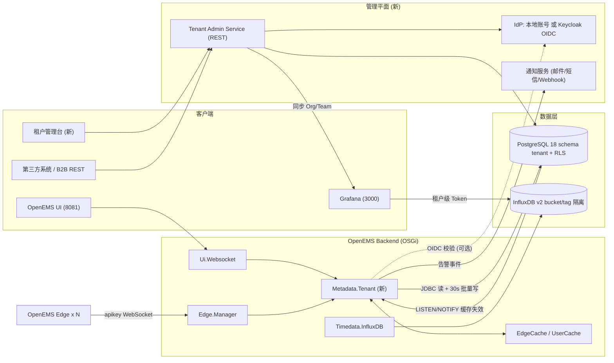
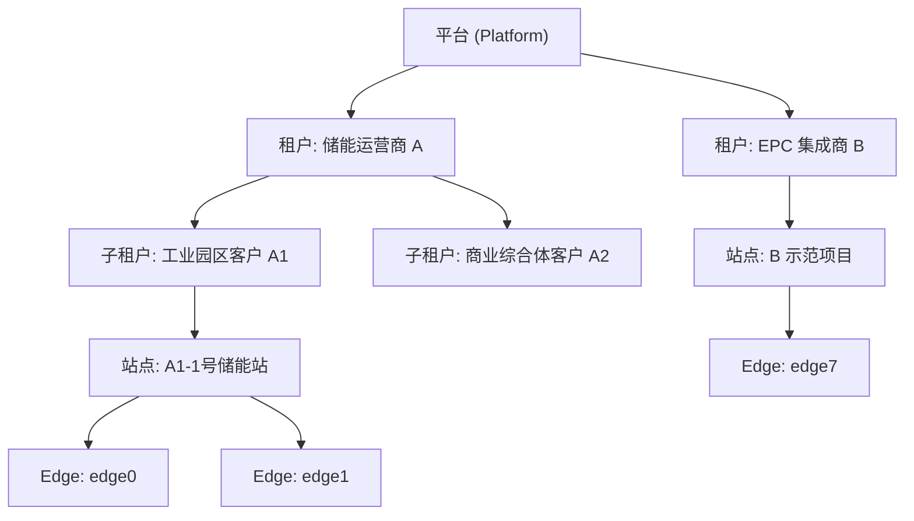
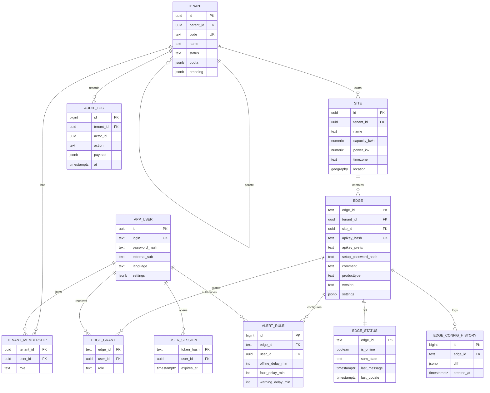

# OpenEMS 云端多租户模块设计方案（去 Odoo 化）

> 目标：用一个**原生、轻量、可水平扩展**的多租户元数据模块替代 Odoo，承担 OpenEMS Backend 的身份认证、电站资产、权限、状态回写、告警配置等职责，同时补齐 Odoo 方案缺失的**租户层级、数据隔离、审计、配额**等云平台能力。

---

## 一、设计依据：OpenEMS Backend 的扩展点

OpenEMS Backend 通过 OSGi 服务契约与元数据层解耦，Odoo 只是其中一个实现（`Metadata.Odoo`）。从当前部署的 `openems-backend.jar` 中确认，一个元数据实现需要提供以下服务：

| OSGi 服务接口 | 作用 | 是否必须 |
| :--- | :--- | :---: |
| `Metadata`（继承 `AbstractMetadata`） | 用户/Edge 查询、apikey 鉴权、角色判定、分页、设置写回、告警配置、调试协议 | ✅ |
| `AuthUserPasswordAuthenticationService` | `authenticateWithPassword` / `authenticateWithToken` / `logout` | ✅ |
| `EventHandler`（`Edge.Events.*`） | 接收 Edge 上下线、配置变更、SumState 变化事件 | ✅ |
| `Mailer` | 告警邮件 / 注册邮件 | 可选（可外置通知服务） |
| `AppCenterMetadata.*` | App 授权密钥中心 | 可选（首期返回空） |
| `DebugLoggable` | 监控日志 | 建议 |

**结论**：不需要修改 OpenEMS 核心代码，只需新增一个 OSGi Bundle `io.openems.backend.metadata.tenant`，在 `/etc/openems-backend.d/` 中把 `Metadata.Odoo` 替换为 `Metadata.Tenant` 即可完成切换。

---

## 二、总体架构

采用 **“热路径内嵌 + 管理平面外置”** 的混合架构：

- **控制面热路径（内嵌 Backend）**：`Metadata.Tenant` 直连 PostgreSQL，负责鉴权、Edge 缓存、角色判定、状态批量回写——对延迟敏感、调用频繁。
- **管理平面（独立服务）**：`Tenant Admin Service` 提供租户/用户/电站/授权的 CRUD REST API 和管理控制台——对一致性与审计要求高、调用频率低。
- 两者**共享同一套 PostgreSQL Schema**，通过 `LISTEN/NOTIFY` 实现缓存失效同步。

---

## 三、租户模型

### 3.1 层级结构

- **Tenant（租户）**：组织边界，可无限层级嵌套（运营商 → 终端客户 → 子公司），用闭包表 `tenant_closure` 实现 O(1) 祖先/后代查询。
- **Site（站点）**：物理电站，聚合多个 Edge，承载地理位置、装机容量、电价方案等资产属性（Odoo 方案中缺失）。
- **Edge**：OpenEMS Edge 实例，唯一归属一个 Site/Tenant。

### 3.2 权限模型（两级 RBAC → OpenEMS Role）

OpenEMS 内部只认识 4 个 Edge 级角色：`ADMIN > INSTALLER > OWNER > GUEST`。多租户模块在其上增加**租户级角色**，最终在 `getUserRole(user, edgeId)` 中折算：

| 租户级角色 | 作用范围 | 对其租户（含子租户）下所有 Edge 折算为 |
| :--- | :--- | :--- |
| `PLATFORM_ADMIN` | 全平台 | `ADMIN` |
| `TENANT_ADMIN` | 本租户及后代 | `ADMIN` |
| `TENANT_INSTALLER` | 本租户及后代 | `INSTALLER` |
| `TENANT_OPERATOR` | 本租户及后代 | `OWNER` |
| `TENANT_VIEWER` | 本租户及后代 | `GUEST` |

**折算规则**：`有效角色 = max(租户成员角色经继承折算, Edge 级直接授权 edge_grant)`。
这样既支持“运营商管理员看全部电站”，也支持“某个业主只看自家一台 Edge”的精细授权。

---

## 四、数据模型

**关键设计点**：

1. **API Key 不再明文存储**：保存 `sha256(apikey)` + 前 6 位前缀（便于运维识别），`getEdgeIdForApikey` 先查内存哈希表，命中率接近 100%。支持轮换（新旧 Key 并存宽限期）。
2. **热冷分离**：`edge_status` 单独成表，30 秒批量 `UPDATE ... FROM (VALUES ...)` 回写，避免与资产表行锁冲突。
3. **行级安全（RLS）**：所有业务表带 `tenant_id`，管理平面以 `SET app.tenant_ids = '...'` 会话变量驱动 RLS 策略，即使 API 层有 Bug 也无法跨租户读数据。`Metadata.Tenant` 使用专用 `BYPASSRLS` 服务账号（它本身就是全局缓存）。
4. **配置历史**：`EDGE_CONFIG_HISTORY` 存 diff（JSONB），替代 Odoo 的 `openems.openemsconfigupdate`。

---

## 五、`Metadata` 接口实现映射

| Metadata 方法 | Tenant 实现策略 |
| :--- | :--- |
| `authenticateWithPassword(u, p)` | 本地：Argon2id 校验 → 生成随机 Token（仅存哈希）；OIDC 模式：Resource Owner 流程或转发给 Keycloak |
| `authenticateWithToken(t)` | 查 `user_session`（带 LRU 缓存）或校验 OIDC JWT 签名 + `tenant` claim |
| `getUser / getUserByExternalId` | `UserCache`，构建 `User` 对象时预计算 `edgeId → Role` 映射（小用户）或延迟计算（大租户管理员） |
| `getEdgeIdForApikey` | 内存 `Map<apikeyHash, edgeId>`，启动全量加载 + NOTIFY 增量 |
| `getEdge / getEdgeBySetupPassword` | `EdgeCache` |
| `getUserRole(user, edgeId)` | 第三节折算规则，结果缓存 |
| `getPageDevice(user, pagination)` | SQL：`edge JOIN tenant_closure` 按用户可见租户集合 + `edge_grant` 联合分页，支持 query/sumState/isOnline 过滤 |
| `addEdgeToUser(user, setupPassword)` | 现场调试“认领”流程：校验调试密码 → 写 `edge_grant(OWNER)` → 审计 |
| `updateUserSettings / updateEdgeSettings` | 直接写 JSONB 列 |
| `getUserAlertingSettings / getEdgeOfflineAlertingSettings / getSumStateAlertingSettings` | 读 `alert_rule` |
| `logGenericSystemLog` | 写 `audit_log` |
| `getSetupProtocol*` / `submitSetupProtocol` | 首期存 JSONB + PDF 存对象存储（MinIO/本地），二期再做模板化 |
| `EventHandler` (`Edge.Events.ON_SET_ONLINE / ON_SET_CONFIG / ON_SET_SUM_STATE ...`) | 更新内存 + 标记脏数据，`PeriodicWriteWorker` 30s 批量刷库；配置变更计算 diff 入历史表 |
| `AppCenterMetadata.*` | 首期返回空结构（与现在 Odoo 补丁一致），预留授权表 |

---

## 六、认证方案（双模可切换）

| 模式 | 适用场景 | 说明 |
| :--- | :--- | :--- |
| **A. 内置账号** | 单机/私有化部署、快速落地 | `app_user.password_hash`（Argon2id）+ 不透明 Token，支持 TOTP 二次验证 |
| **B. OIDC（推荐生产）** | SaaS、对接企业 SSO | 引入 Keycloak：Realm = 平台，Group = 租户，Token 携带 `tenant_ids` 与 `roles` claim；OpenEMS 已自带 `io.openems.backend.authentication.oauth2` 与 `oauthregistry` 可复用 |

两种模式由 `Metadata.Tenant` 的配置项 `authMode = LOCAL | OIDC` 切换，用户/租户数据仍以 PostgreSQL 为准（OIDC 只负责“你是谁”，授权仍在本模块）。

**Edge 认证**保持 OpenEMS 原生 apikey 机制不变，Edge 侧零改动。

---

## 七、时序数据与可视化的租户隔离

### 7.1 InfluxDB 两级隔离

| 级别 | 方式 | 适用 |
| :--- | :--- | :--- |
| L1 标签隔离（默认） | 所有租户共享 `openems` bucket，Backend 写入时自带 `edge` 标签；查询统一经 Backend（OpenEMS UI 本来就如此） | 中小租户、成本优先 |
| L2 桶隔离（VIP） | 为大租户分配独立 bucket + 独立读 Token，Backend 侧按 `edge → tenant → bucket` 路由写入（需扩展 Timedata 路由或部署多个 `Timedata.InfluxDB` 实例） | 大客户、合规要求、数据出租 |

### 7.2 Grafana 租户化

- **租户 ↔ Grafana Organization 一一映射**，由 Tenant Admin Service 调 Grafana HTTP API 自动创建 Org、Team、用户与数据源。
- L1 模式下：在 Grafana 前加一层轻量 **Flux Query Proxy**，强制注入 `r.edge =~ /^(租户可见 edge 列表)$/` 过滤，防止用户改 Dashboard 变量越权。
- L2 模式下：数据源直接使用租户专属 bucket 的只读 Token，天然隔离。
- 大屏模板（现有 `openems-ess-analytics`）作为 **Provisioning 模板**，新租户创建时自动复制到其 Org。
- 登录打通：Grafana 配置 `auth.generic_oauth` 指向同一 Keycloak，实现单点登录。

---

## 八、管理平面 API（Tenant Admin Service）

建议技术栈：**Java 21 + Spring Boot 3**（与 OpenEMS 同语言，可共享 DTO）或 **Python FastAPI**（开发更快，团队已熟悉 Python 运维脚本）。

| 资源 | 主要接口 |
| :--- | :--- |
| 租户 | `POST/GET/PATCH /api/v1/tenants`，`GET /tenants/{id}/children`，配额与品牌配置 |
| 用户 | 邀请、禁用、重置密码、`PUT /tenants/{id}/members/{userId}` 设置角色 |
| 站点 | `CRUD /api/v1/sites`，地理位置、容量、时区 |
| Edge | 注册（自动生成 apikey 与调试密码，仅返回一次明文）、轮换 Key、迁移租户、`edge_grant` 授权 |
| 告警 | 订阅规则 CRUD，通知渠道（邮件/企业微信/钉钉/Webhook） |
| 审计 | `GET /api/v1/audit?tenant=&from=&to=` |
| 运维 | 在线率、SumState 统计、最近通信时间排行 |

管理台前端：基于 OpenEMS UI 同栈（Angular + Ionic）新建 `admin` 模块，或用低代码（如 Refine/React-Admin）快速搭建。

---

## 九、性能与可靠性

| 指标目标 | 设计手段 |
| :--- | :--- |
| 10,000+ Edge 长连接鉴权 < 1 ms | apikey 哈希表全量常驻内存 |
| 状态回写不拖垮数据库 | 30 s 批量 + 只写变化字段 + 独立 `edge_status` 表 |
| 管理台改动 1 s 内生效 | PostgreSQL `LISTEN/NOTIFY` 推送 `edge_changed / user_changed / grant_changed` 到 Backend 局部刷新缓存 |
| Backend 多实例横向扩展 | 缓存只读 + 写入幂等；状态回写以 `last_message` 取最大值合并 |
| 元数据库故障 | 已认证会话与 Edge 连接继续工作（缓存兜底），新登录降级报错 |

---

## 十、从 Odoo 迁移

1. **并行期**：部署 `Metadata.Tenant`，但仍由 `Metadata.Odoo` 提供服务。
2. **数据迁移脚本**（Python，一次性）：
   - `res_users` → `app_user`（密码无法迁移明文，Odoo 的 pbkdf2 哈希可兼容校验或要求首次登录重置）；
   - `openems_device` → `edge`（apikey 迁移时计算哈希）；`openems_device_user_role` → `edge_grant`；
   - `openems_alerting` → `alert_rule`；`openems_openemsconfigupdate` → `edge_config_history`；
   - Odoo 的 `res.groups`（manager/reader）→ 平台级 `TENANT_ADMIN / TENANT_VIEWER`。
3. **切换**：停 Backend → 替换 `/etc/openems-backend.d/Metadata/Odoo.config` 为 `Metadata/Tenant.config` → 启动 → 对比 `getEdges` 结果与在线状态。
4. **回滚**：保留 Odoo 配置文件，切换回去仅需一次 Backend 重启。

---

## 十一、实施路线

| 阶段 | 内容 | 预估工作量 |
| :--- | :--- | :--- |
| **P0 最小可用（MVP）** | `Metadata.Tenant` Bundle：本地账号、单层租户、Edge/授权/状态回写、getEdges 分页；迁移脚本；替换 Odoo | 2–3 周 |
| **P1 管理平面** | Tenant Admin Service REST + 简易管理台；apikey 轮换；审计日志；RLS | 2–3 周 |
| **P2 层级与可视化隔离** | 多级租户 + 闭包表；Grafana Org 自动化 + Flux Proxy；告警通知服务 | 2–3 周 |
| **P3 企业级** | Keycloak OIDC/SSO；VIP 独立 bucket；配额计量与计费钩子；调试协议 PDF 模板化 | 3–4 周 |

---

## 十二、需要您确认的决策点

1. **租户层级**：是否需要多级（运营商 → 终端客户 → 子公司），还是两级（平台 → 租户）即可满足 P0？
2. **认证方式**：首期用内置账号即可，还是直接上 Keycloak（需额外部署一个服务，约 1 GB 内存）？
3. **管理平面技术栈**：Java/Spring Boot（与 OpenEMS 同栈）还是 Python/FastAPI（迭代更快）？
4. **时序隔离等级**：是否已有需要“独立 bucket / 数据物理隔离”的大客户？若没有，P0–P2 仅做标签隔离 + 查询代理。
5. **Odoo 去留**：完全下线 Odoo，还是保留 Odoo 做 ERP（库存/序列号/工单）并通过 Webhook 单向同步资产？
6. **部署形态**：继续在当前单机（172.16.100.234）以 systemd 运行，还是为后续 SaaS 预留容器化/K8s？
