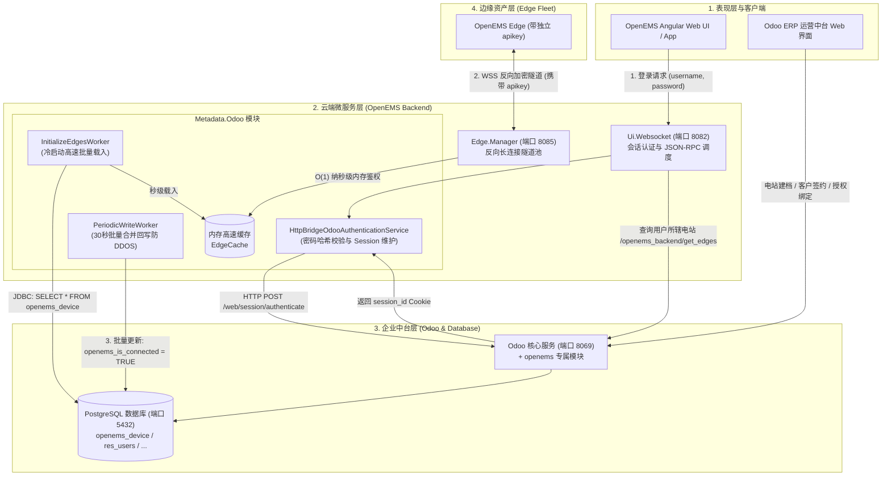
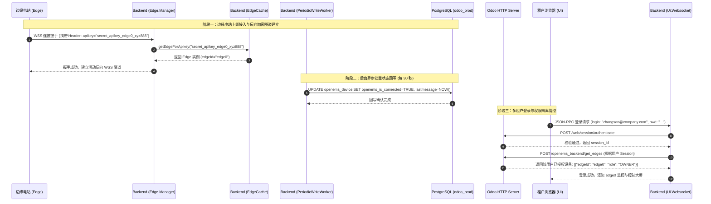

# OpenEMS 与 Odoo ERP 企业级集成实战指南

在工商业微电网、大规模分布式储能以及虚拟电厂（VPP）商业化运营场景中，能源管理平台不仅需要进行秒级物理控制和高频时序采集，还需要深度对接企业级业务流程——包括客户合同管理、安装商资质管理、多级组织租户划分、设备资产生命周期管理（从出厂生产、安装调试到运维退役）以及财务计费。

**Odoo** 作为全球最流行的开源企业资源计划（ERP）软件，被 OpenEMS 官方选定为标准的**企业级元数据驱动引擎（Metadata Provider）**与**业务管理中台**。

本文系统性阐述 OpenEMS 与 Odoo ERP 的**底层双轨架构原理**、**核心数据模型映射**、**端到端配置部署流程**以及**生产级避坑指南**。

---

## 一、 集成架构全景与双轨驱动机制

OpenEMS Backend 与 Odoo 并非简单的单向 API 调用，而是设计了一套兼顾**工业高频低延迟**与**企业复杂业务逻辑**的 **“PostgreSQL JDBC 直接读写轨 + HTTP JSON-RPC 业务轨”** 双轨驱动模型：



### 双轨通信职责解析：
1. **直接 PostgreSQL JDBC 读写轨 (HikariCP 高性能连接池)**：
   - **冷启动高速加载**：云端后端启动时，[`InitializeEdgesWorker`](file:///opt/openems/source/io.openems.backend.metadata.odoo/src/io/openems/backend/metadata/odoo/postgres/InitializeEdgesWorker.java) 通过 JDBC 直接读取 PG 数据库，将成千上万座电站的 `id`、`apikey`、`name` 瞬间载入内存高速缓存 [`EdgeCache`](file:///opt/openems/source/io.openems.backend.metadata.odoo/src/io/openems/backend/metadata/odoo/EdgeCache.java)。边缘设备发起 WSS 握手时，鉴权完全在内存完成，单机可支撑万级设备并发接入；
   - **状态低频批量回写**：边缘电站每秒与云端交互，若每秒都向 ERP 写入数据会冲垮系统。[`PeriodicWriteWorker`](file:///opt/openems/source/io.openems.backend.metadata.odoo/src/io/openems/backend/metadata/odoo/postgres/PeriodicWriteWorker.java) 采用滑动窗口，每隔 30 秒将设备最新在线状态（`openems_is_connected`）、最后通信时间（`lastmessage`）及系统汇总告警级别（`openems_sum_state_level`）批量合并写回 PostgreSQL。
2. **HTTP JSON-RPC / REST 业务轨**：
   - **用户登录鉴权**：租户在 OpenEMS UI 登录时，Backend 将用户名密码透传给 Odoo 原生 `/web/session/authenticate` 端点，享受 Odoo 的 PBKDF2/SHA-512 密码安全防护，并在 Backend 端维护 `session_id`；
   - **业务数据流转**：通过 Odoo Controller 暴露的 `/openems_backend/...` 接口实时获取用户多租户电站列表、设备配置差异以及用户个性化配置。

---

## 二、 核心数据模型与数据库表映射

OpenEMS 专属 Odoo 插件（模块名 `openems`）在 Odoo 底层数据库扩展并创建了如下核心数据表结构：

| Odoo 模型 (Model) | 数据库底层表名 | 核心字段说明 | 业务职责 |
| :--- | :--- | :--- | :--- |
| `openems.device` | `openems_device` | `name` (电站标识如 `edge0`)<br/>`apikey` (接入私钥)<br/>`openems_is_connected` (在线布尔值)<br/>`openems_version` (固件版本)<br/>`lastmessage` (最后通信时间)<br/>`openems_config` (组件 JSON 拓扑) | 物理电站资产的主数据表。边缘电站反向连接鉴权的核心依据。 |
| `openems.device_user_role` | `openems_device_user_role` | `device_id` (外键关联 `openems.device`)<br/>`user_id` (外键关联 `res.users`)<br/>`role` (`admin`, `installer`, `owner`, `guest`) | 多租户权限映射表。决定哪个用户以何种权限访问哪座电站。 |
| `openems.setup_protocol` | `openems_setup_protocol` | `device_id` (关联电站)<br/>`customer_id` (关联业主客户)<br/>`installer_id` (关联安装商)<br/>`status` (草稿/已调试/已激活) | 设备上线工单与安装调试协议流转表。 |
| `res.users` (扩展) | `res_users` | `global_role` (全局角色)<br/>`openems_language` (语言偏好)<br/>`settings` (个性化配置 JSON) | 统一用户账号表，支撑 OpenEMS UI 登录与会话。 |
| `res.partner` (扩展) | `res_partner` | `firstname`, `lastname`, `company_name`<br/>`street`, `zip`, `city`, `country_id` | 业主客户、安装商分包商、设备供应商的主体档案。 |

---

## 三、 环境与先决条件

- **操作系统**：Linux (Ubuntu 22.04 / 24.04 / 26.04)
- **数据库**：PostgreSQL 12 ~ 18（支持本地 PostgreSQL 18.6）
- **Odoo 版本**：Odoo 16.0 / 17.0 / 18.0 社区版 (Community Edition)
- **Odoo 依赖模块 (OCA)**：
  - `OCA/partner-contact` (提供 `partner_firstname` 姓名分拆支持)
  - `OCA/web` (提供 `web_m2x_options` 增强下拉选择控件)
- **OpenEMS 模块**：
  - Odoo 端：`https://github.com/OpenEMS/odoo-openems` (目录下的 `openems` 文件夹)
  - Backend 端：`io.openems.backend.metadata.odoo` (已内置编译在 `/opt/openems/openems-backend.jar`)

---

## 四、 详细部署与实操步骤

### 步骤 1：部署 Odoo 与 PostgreSQL (Docker Compose 方式)

创建部署工作目录并在 `docker-compose-odoo.yml` 中编排服务：

```yaml
services:
  db:
    image: postgres:16
    restart: always
    environment:
      - POSTGRES_DB=postgres
      - POSTGRES_USER=odoo
      - POSTGRES_PASSWORD=odoo_secure_password
    volumes:
      - odoo-db-data:/var/lib/postgresql/data
    ports:
      - "5432:5432"

  web:
    image: odoo:17.0
    restart: always
    depends_on:
      - db
    ports:
      - "8069:8069"
    environment:
      - HOST=db
      - USER=odoo
      - PASSWORD=odoo_secure_password
    volumes:
      - odoo-web-data:/var/lib/odoo
      - ./addons/odoo-openems/openems:/mnt/extra-addons/openems
      - ./addons/partner-contact/partner_firstname:/mnt/extra-addons/partner_firstname
      - ./addons/web/web_m2x_options:/mnt/extra-addons/web_m2x_options

volumes:
  odoo-db-data:
  odoo-web-data:
```

克隆专属插件与 OCA 依赖仓库：
```bash
mkdir -p addons && cd addons
# 克隆 OpenEMS 专属 Odoo 插件
git clone --depth 1 -b 17.0 https://github.com/OpenEMS/odoo-openems.git
# 克隆 OCA 依赖插件
git clone --depth 1 -b 17.0 https://github.com/OCA/partner-contact.git
git clone --depth 1 -b 17.0 https://github.com/OCA/web.git
cd ..

# 启动 Odoo 与 PostgreSQL 服务
docker compose -f docker-compose-odoo.yml up -d
```

---

### 步骤 2：在 Odoo 中安装并激活 OpenEMS 模块

1. 浏览器访问 `http://<服务器IP>:8069`；
2. 初始化创建数据库（数据库名称设为 `odoo_prod`，录入管理员 Email 与密码）；
3. 登录 Odoo 后，进入 **设置 (Settings)** $\rightarrow$ 页面拉到最下方点击 **激活开发者模式 (Activate the developer mode)**；
4. 点击顶部导航栏 **应用 (Apps)** $\rightarrow$ 点击二级菜单 **更新应用列表 (Update Apps List)**；
5. 在右上角搜索框中输入 `openems`，找到 **OpenEMS** 应用，点击 **安装 (Install)**。

*安装成功后，Odoo 顶部导航栏将出现「OpenEMS」大图标，包含 Devices、Setup Protocols、User Roles 等菜单项。*

---

### 步骤 3：在 Odoo 中登记电站资产与分配多租户角色

#### 1. 登记边缘电站（Device）
1. 进入 `OpenEMS` 导航菜单 $\rightarrow$ `Devices` $\rightarrow$ 点击 **新建 (New)**；
2. 填写关键参数：
   - **Name**：`edge0`（必须与现场电站命名规则一致）
   - **Comment**：`500kW/1000kWh 园区储能微电网`
   - **API-Key**：输入或点击自动生成全局唯一私钥（如：`secret_apikey_edge0_xyz888`）
3. 点击保存。此时设备列表显示该电站处于离线状态。

#### 2. 创建租户账号并绑定角色
1. 进入 `设置` $\rightarrow$ `用户与公司` $\rightarrow$ `用户` $\rightarrow$ 新建用户；
   - 姓名：`张三 (业主)`
   - 登录账号：`zhangsan@company.com`
   - 设置登录密码：`Password123`
2. 回到 `OpenEMS` $\rightarrow$ `Devices` $\rightarrow$ 打开 `edge0` 详情；
3. 在底部 **User Roles** 表单区点击 **添加明细行**：
   - 用户选择：`张三 (业主)`
   - 角色权限选择：**Owner**（电站业主，具备控制启停与报表查看权）；
4. 保存配置。

---

### 步骤 4：配置 OpenEMS Backend 启用 Odoo 元数据提供商

切换 OpenEMS Backend 的元数据配置由测试用的 `Metadata.Dummy` 迁移到 `Metadata.Odoo`：

1. **禁用原有轻量测试配置**：
   ```bash
   sudo rm -f /etc/openems-backend.d/Metadata.Dummy.config
   ```

2. **创建 Odoo 元数据配置**：
   创建文件 `/etc/openems-backend.d/Metadata.Odoo.config`，写入以下配置：
   ```properties
   service.pid="Metadata.Odoo"
   database="odoo_prod"
   debugMode="OFF"
   enablePasswordAuthentication=B"true"
   eventPoolSize=I"5"
   requestPoolSize=I"30"
   pgConnectionPoolSize=I"40"

   # Odoo HTTP Web 接口配置 (用于用户鉴权与会话查询)
   odooProtocol="HTTP"
   odooHost="127.0.0.1"
   odooPort=I"8069"
   odooLogin="admin@example.com"
   odooPassword="your_odoo_admin_password"
   odooUid=I"2"

   # PostgreSQL 数据库直连配置 (用于电站高速缓存与批量状态回写)
   pgHost="127.0.0.1"
   pgPort=I"5432"
   pgUser="odoo"
   pgPassword="odoo_secure_password"
   ```

3. **重启 Backend 服务**：
   ```bash
   sudo systemctl restart openems-backend
   ```

4. **确认服务初始化日志**：
   ```bash
   journalctl -u openems-backend -n 50 --no-pager | grep -i "Metadata.Odoo"
   ```
   *预期输出：*
   ```text
   INFO  [Metadata.Odoo] Caching Edges from Postgres [started]
   INFO  [Metadata.Odoo] Caching Edges from Postgres [finished]
   ```

---

### 步骤 5：配置边缘电站（OpenEMS Edge）连接鉴权

在边缘电站物理机或仿真节点的 `/etc/openems-edge.d/Controller.Api.Backend.config`（或通过 Apache Felix Web Console）配置与 Odoo 中登记的凭证对齐：

```properties
service.pid="Controller.Api.Backend"
enabled=B"true"
uri="ws://172.16.100.234:8085"
apikey="secret_apikey_edge0_xyz888"
proxy=""
```

重启边缘电站服务：
```bash
sudo systemctl restart openems-edge
```

---

### 步骤 6：全链路验证与多租户效果确认

1. **边缘隧道在线校验**：
   - 边缘控制器启动后，主动向 Backend（端口 `8085`）发起 WSS 连接并出示 `secret_apikey_edge0_xyz888`；
   - Backend 在内存高速缓存 `EdgeCache` 中瞬间命中并建立双向隧道；
   - 约 30 秒后（批处理回写周期），打开 Odoo 后台刷新 `edge0` 详情页面：
     - **OpenEMS Is Connected** 字段自动点亮为勾选状态（`True`）；
     - **OpenEMS Version** 自动回填现场运行的 Edge 固件版本号；
     - **Lastmessage** 自动更新为当前最新时间戳。

2. **Web UI 租户登录隔离校验**：
   - 浏览器打开 OpenEMS 前端：`http://172.16.100.234:8081`；
   - 输入在 Odoo 中创建的租户用户账号 `zhangsan@company.com` 与密码；
   - 登录成功，进入监控大屏：
     - 用户界面仅呈现被赋予权限的 `edge0` 电站；
     - 系统自动根据 Odoo 设定的 **Owner** 角色限制其无法访问底层系统驱动与网络配置界面，严格遵守多租户安全隔离规范。

---

## 五、 全生命周期交互时序



---

## 六、 企业级生产运维最佳实践与避坑指南

### 1. 全集群严格 UTC 时间对齐
- **现象**：Odoo 页面显示设备最后上线时间出现时差，或告警日志记录时间跳变。
- **原因**：Odoo 底层 ORM 强制使用 UTC 时间，而工业现场 Edge 设备可能使用了本地时区（如 Asia/Shanghai）。
- **对策**：确保 PostgreSQL、Odoo 容器、OpenEMS Backend 及现场边缘 Edge 全量开启 NTP 自动时间同步，PostgreSQL 时区推荐设置为 UTC。

### 2. 避免高频遥测冲击 ERP
- **高危操作**：尝试在 Odoo 中新建表来存储每秒的有功功率、电压、SOC 曲线。
- **最佳实践**：严格遵循**控制面**与**数据面**分轨设计：
  - **Odoo** 只负责管理静态元数据（电站档案、客户合同、派单工单、账号权限）；
  - **InfluxDB v2** 专享所有高频遥测时序数据，两者通过 `edgeId` 弱关联，互不干扰性能。

### 3. 连接池与高并发容量调优
当接入电站数量达到数千座时，需合理规划数据库连接数：
- 在 PostgreSQL 的 `postgresql.conf` 中调整：`max_connections = 300`；
- 在 `Metadata.Odoo.config` 中配置：`pgConnectionPoolSize=I"50"`，`requestPoolSize=I"30"`，确保在高并发上线冲击下，Backend 与 Odoo 前端均有充裕的连接资源可用。

### 4. 故障排查快速指南
- **排查 Odoo 密码认证失败**：检查 `Metadata.Odoo.config` 中的 `database` 字段是否与 Odoo 当前激活的数据库名称完全一致。
- **排查电站无法上线**：确认 Odoo `openems_device` 表中的 `apikey` 与 Edge 配置文件中的 `apikey` 字符串完全相等，检查边缘节点与云端 `8085` 端口之间的网络防火墙连通性。
