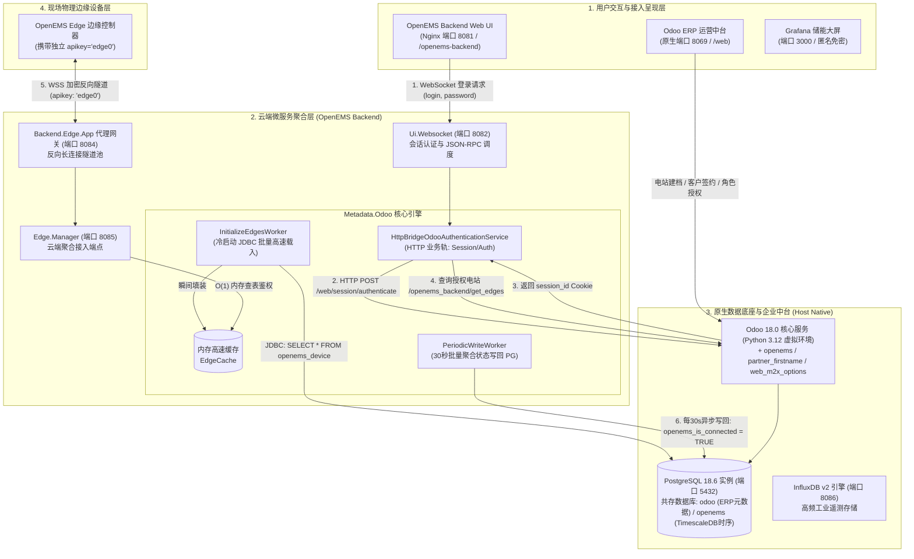

# OpenEMS 与 Odoo ERP 本机原生（非 Docker）部署与全链路集成实战指南

在工业级工商业微电网、大规模分布式储能以及虚拟电厂（VPP）商业化运营中，控制平台需要与企业级业务中台无缝对接。**Odoo** 作为业界领先的开源企业资源规划（ERP）系统，是 OpenEMS 官方选定的**元数据提供商（Metadata Provider）与多租户运营中台**。

本文档完整记录在 Ubuntu 26.04 主机环境下，**完全脱离 Docker 容器（Native Host）**，直接基于本机已安装的高性能 **PostgreSQL 18.6 与 TimescaleDB 2.25.1** 数据库实例，原生部署 **Odoo 18.0** 与 **OpenEMS 专属模块**，并将 OpenEMS 云端聚合微服务由测试用的 `Metadata.Dummy` 无缝切换至生产级 `Metadata.Odoo` 的全套实操技术规范。

---

## 一、 系统架构与部署全景

### 1.1 原生主机双轨驱动架构

本架构摒弃容器化带来的额外网络虚拟化开销与端口映射复杂度，所有关键组件均作为原生 Linux 服务（Systemd）常驻运行于本地宿主机（`172.16.100.234`）：



### 1.2 核心服务端口与进程矩阵

| 服务单元 | 服务进程 (Systemd Unit) | 监听端口 | 运行时与工作环境 | 核心职责 |
| :--- | :--- | :--- | :--- | :--- |
| **PostgreSQL & TimescaleDB** | `postgresql.service` | `5432` | PostgreSQL 18.6 + TimescaleDB 2.25.1 | 承载 `odoo` 业务数据库与 `openems` 时序数据库 |
| **Odoo ERP 中台** | `odoo.service` | `8069` | Python 3.12.15 (`/opt/odoo/venv`) | 资产台账、多租户 RBAC、客户工单与元数据 API |
| **OpenEMS Backend** | `openems-backend.service` | `8082`, `8085` | OpenJDK 21 (`/opt/openems`) | 云端微服务：UI WebSocket (8082)、Edge 接入 (8085) |
| **Backend Edge Proxy** | `openems-backend-edge.service` | `8084` | OpenJDK 21 (`/opt/openems`) | 边缘反向长连接代理网关 (8084 $\rightarrow$ 8085) |
| **OpenEMS Edge** | `openems-edge.service` | `8075`, `8080`, `502` | OpenJDK 21 (`/opt/openems`) | 边缘物理控制内核、Modbus 采集、功率平衡闭环 |
| **时序数据库** | `influxdb.service` | `8086` | InfluxDB 2.7 | 1000ms 高频物理采样、历史流数据落库 |
| **监控大屏** | `grafana-server.service` | `3000` | Grafana Enterprise 11.6 | 工商业储能微电网可视化看板 (直连 InfluxDB) |
| **Web 接入反向代理** | `nginx.service` | `80`, `8081` | Nginx 1.28.3 | 80 端口 Edge UI，8081 端口 Backend Web UI 代理 |

---

## 二、 基础环境与依赖调优

### 2.1 Python 3.12 独立运行时构建

由于宿主机 Ubuntu 26.04 默认搭载 Python 3.14，部分底层 C 拓展库（如 `gevent`, `psycopg2`, `libsass`）在 Python 3.14 下尚未稳定，因此我们通过高性能包管理器 `uv` 在 `/opt/python` 安装经过生产验证的 **Python 3.12.15** 独立运行时：

```bash
# 安装系统级 C 编译依赖与开发头文件
sudo apt-get update
sudo apt-get install -y build-essential git curl libpq-dev libxml2-dev libxslt1-dev libsasl2-dev libldap2-dev libjpeg-dev libffi-dev

# 使用 uv 安装全局 Python 3.12.15 运行时
sudo /usr/local/bin/uv python install 3.12 --install-dir /opt/python

# 验证独立 Python 执行环境
/opt/python/cpython-3.12-linux-x86_64-gnu/bin/python3.12 --version
# 输出: Python 3.12.15
```

### 2.2 PostgreSQL 18.6 角色与专属数据库初始化

利用宿主机现存的 PostgreSQL 18 实例，创建专属 `odoo` 数据库用户与数据库，并配置 SCRAM-SHA-256 安全认证：

```bash
# 1. 创建 odoo 角色 (具备建库权限)
sudo -u postgres psql -P pager=off -c "CREATE USER odoo WITH PASSWORD 'odoo_secure_password' CREATEDB;"

# 2. 创建 odoo 专用数据库 (所有者为 odoo)
PGPASSWORD="odoo_secure_password" createdb -h 127.0.0.1 -U odoo odoo

# 3. 验证数据库连接
PGPASSWORD="odoo_secure_password" psql -h 127.0.0.1 -U odoo -d odoo -c "SELECT current_user, current_database(), version();"
```

---

## 三、 Odoo 18.0 与 OpenEMS 专属模块安装

### 3.1 用户与目录结构编排

创建系统用户 `odoo` 并编排目录结构：

```bash
# 创建专职系统运行用户
sudo useradd -m -d /opt/odoo -U -r -s /bin/bash odoo
sudo chmod 755 /opt/odoo

# 创建日志与持久化运行目录
sudo mkdir -p /var/log/odoo /var/lib/odoo /etc/odoo
sudo chown -R odoo:odoo /var/log/odoo /var/lib/odoo /etc/odoo
```

### 3.2 源码克隆与虚拟环境搭建

在 `/opt/odoo` 下检出 Odoo 18.0 核心代码、OpenEMS 专属模块及 OCA 依赖插件：

```bash
# 1. 克隆 Odoo 18.0 核心源码 (浅克隆以节省带宽)
sudo -u odoo git clone --depth 1 -b 18.0 https://github.com/odoo/odoo.git /opt/odoo/odoo

# 2. 克隆 OpenEMS 官方 Odoo 模块 (分支 18.0)
sudo -u odoo git clone --depth 1 -b 18.0 https://github.com/OpenEMS/odoo-openems.git /opt/odoo/odoo-openems

# 3. 克隆 OCA 社区依赖模块
sudo -u odoo git clone --depth 1 -b 18.0 https://github.com/OCA/partner-contact.git /opt/odoo/partner-contact
sudo -u odoo git clone --depth 1 -b 18.0 https://github.com/OCA/web.git /opt/odoo/web

# 4. 创建专享 Python 3.12 虚拟环境
sudo -u odoo /usr/local/bin/uv venv /opt/odoo/venv --python /opt/python/cpython-3.12-linux-x86_64-gnu/bin/python3.12

# 5. 极速安装全量依赖包 (66个核心库)
sudo -u odoo VIRTUAL_ENV=/opt/odoo/venv /usr/local/bin/uv pip install -r /opt/odoo/odoo/requirements.txt psycopg2-binary
```

### 3.3 配置文件 `/etc/odoo/odoo.conf`

编写 Odoo 生产级配置文件：

```ini
[options]
admin_passwd = admin_master_secret
db_host = 127.0.0.1
db_port = 5432
db_user = odoo
db_password = odoo_secure_password
db_name = odoo
data_dir = /var/lib/odoo
logfile = /var/log/odoo/odoo.log
log_level = info
http_port = 8069
addons_path = /opt/odoo/odoo/addons,/opt/odoo/partner-contact,/opt/odoo/web,/opt/odoo/odoo-openems
workers = 0
```

### 3.4 模块数据库初始化与安装

执行命令行初始化，将 `openems` 以及所有依赖项（`partner_firstname`、`web_m2x_options`、`crm`、`stock`、`mail`）完整载入 PostgreSQL 数据库：

```bash
sudo -u odoo /opt/odoo/venv/bin/python /opt/odoo/odoo/odoo-bin \
  -c /etc/odoo/odoo.conf \
  -d odoo \
  -i openems \
  --stop-after-init
```

初始化成功后，PostgreSQL 中将自动生成包含 `openems_device`、`openems_device_user_role` 等 10 张专属业务数据表。

### 3.5 多场景用户查找兼容性增强

在原生会话模式下，OpenEMS Backend 向 Odoo 控制器传递的 `external_uid` 实质为登录用户的会话密钥 `session_id`。为确保系统同时向下兼容 **原生密码登录（Session ID）**、**OAuth2 鉴权（oauth_uid）**、**用户名直查（login）** 及 **数字 UID**，我们针对 `/opt/odoo/odoo-openems/openems/controllers/openems_backend.py` 增强了统一查找逻辑：

```python
    def _get_user_rec(self, external_uid, fields):
        res_users = http.request.env["res.users"].sudo()
        user_id = None
        # 1. 支持基于 Odoo 内存/文件 SessionStore 解析 session_id
        if external_uid and hasattr(http.root, "session_store"):
            try:
                sess = http.root.session_store.get(str(external_uid))
                if sess and getattr(sess, "uid", None):
                    user_id = sess.uid
            except Exception:
                pass

        # 2. 支持当前 HTTP 请求上下文中的 UID
        if not user_id and getattr(http.request, "session", None) and getattr(http.request.session, "uid", None):
            user_id = http.request.session.uid
        if not user_id and http.request.env.context.get("uid"):
            user_id = http.request.env.context.get("uid")

        # 3. 按主键 ID 精准匹配
        if user_id:
            recs = res_users.search_read([("id", "=", user_id)], fields)
            if recs:
                return recs[0]

        # 4. 支持 OAuth UID 匹配
        if external_uid:
            recs = res_users.search_read([("oauth_uid", "=", str(external_uid))], fields)
            if recs:
                return recs[0]
            # 5. 支持按登录名匹配
            recs = res_users.search_read([("login", "=", str(external_uid))], fields)
            if recs:
                return recs[0]
            # 6. 支持直接数字 ID 匹配
            if str(external_uid).isdigit():
                recs = res_users.search_read([("id", "=", int(external_uid))], fields)
                if recs:
                    return recs[0]

        raise ValueError(f"User not found for identifier [{external_uid}]")
```

### 3.6 Systemd 守护服务注册

配置 `/etc/systemd/system/odoo.service` 实现开机自启与异常秒级自动拉起：

```ini
[Unit]
Description=Odoo Open Source ERP and CRM
After=network.target postgresql.service
Wants=postgresql.service

[Service]
Type=simple
User=odoo
Group=odoo
ExecStart=/opt/odoo/venv/bin/python /opt/odoo/odoo/odoo-bin -c /etc/odoo/odoo.conf
Restart=always
RestartSec=5
StandardOutput=journal
StandardError=journal
LimitNOFILE=65536

[Install]
WantedBy=multi-user.target
```

```bash
sudo systemctl daemon-reload
sudo systemctl enable --now odoo.service
```

### 3.7 简体中文语言包（zh_CN）安装与中台界面汉化

为了让现场运维人员能够以中文操作 Odoo ERP 运营中台，通过 Odoo 语言安装向导将官方简体中文语言包（`zh_CN`）加载至数据库，并将管理员用户默认界面语言切换为中文：

```bash
sudo -u odoo /opt/odoo/venv/bin/python /opt/odoo/odoo/odoo-bin shell -c /etc/odoo/odoo.conf -d odoo <<EOF
# 1. 检索并激活官方简体中文语言包
zh_lang = env['res.lang'].with_context(active_test=False).search([('code', '=', 'zh_CN')], limit=1)
wizard = env['base.language.install'].create({
    'lang_ids': [(6, 0, [zh_lang.id])],
    'overwrite': True
})
wizard.lang_install()

# 2. 将系统管理员 (Mitchell Admin) 界面语言切换为中文
admin_user = env['res.users'].browse(2)
admin_user.partner_id.lang = 'zh_CN'

# 3. 提交事务
env.cr.commit()
print("Odoo 简体中文语言包加载并激活完成！")
EOF
```

加载完成后，浏览器访问 `http://172.16.100.234:8069` 登录即可直接呈现全中文管理中台。

---

## 四、 OpenEMS Backend 生产迁移（Metadata.Odoo）

### 4.1 移除测试配置并启用 Metadata.Odoo

OpenEMS Backend 采用 Apache Felix OSGi 容器。我们将原本用于单机离线测试的 `Metadata.Dummy` 停用，替换为生产级 `Metadata.Odoo`：

```bash
# 清理废弃的 Dummy 配置缓存
sudo rm -f /etc/openems-backend.d/Metadata.Dummy.config
sudo rm -f /etc/openems-backend.d/Metadata/Dummy.config

# 写入生产级 Metadata.Odoo 配置
sudo bash -c 'cat <<EOF > /etc/openems-backend.d/Metadata/Odoo.config
service.pid="Metadata.Odoo"
database="odoo"
debugMode="OFF"
enablePasswordAuthentication=B"true"
eventPoolSize=I"5"
requestPoolSize=I"30"
pgConnectionPoolSize=I"40"
odooProtocol="HTTP"
odooHost="127.0.0.1"
odooPort=I"8069"
odooLogin="admin"
odooPassword="admin"
odooUid=I"2"
pgHost="127.0.0.1"
pgPort=I"5432"
pgUser="odoo"
pgPassword="odoo_secure_password"
EOF'

# 重启云端聚合后台
sudo systemctl restart openems-backend.service
```

### 4.2 观察 Backend 初始化日志

执行 `journalctl -u openems-backend.service -n 50 --no-pager`，确认输出以下核心冷启动事件：

```text
INFO  [zaxxer.hikari.HikariDataSource] HikariPool-1 - Start completed.
INFO  [postgres.InitializeEdgesWorker] [Metadata.Odoo] Caching Edges from Postgres [started]
INFO  [postgres.InitializeEdgesWorker] [Metadata.Odoo] Caching Edges from Postgres [     1]
INFO  [postgres.InitializeEdgesWorker] [Metadata.Odoo] Caching Edges from Postgres [finished]
INFO  [socket.AbstractWebsocketServer] [Ui.Websocket] Starting websocket server [port=8082]
INFO  [socket.AbstractWebsocketServer] [Edge.Manager] Starting websocket server [port=8085]
INFO  [ms.backend.edge.manager.OnOpen] [Edge.Manager] Backend.Edge.Client [edges0] connected
```

---

## 五、 电站资产建档与双轨全链路验证

### 5.1 在 Odoo 中建档与授权

使用 Python 脚本或 Odoo Shell 在数据库中录入物理电站 `edge0` 并授权管理员账号：

```python
# /opt/odoo/venv/bin/python /opt/odoo/odoo/odoo-bin shell -c /etc/odoo/odoo.conf -d odoo
device_model = env['openems.device']
device = device_model.create({
    'name': 'edge0',
    'apikey': 'edge0',
    'comment': '500kW/1000kWh 园区储能微电网 (Host TimescaleDB & Odoo)',
    'producttype': 'openems-edge',
})

# 绑定租户用户角色 (Admin)
user_role_model = env['openems.device_user_role']
user_role_model.create({
    'device_id': device.id,
    'user_id': 2, # Mitchell Admin
    'role': 'admin'
})
env.cr.commit()
```

### 5.2 边缘电站配置并启动反向长连接

检查边缘控制器 `/etc/openems.d/Controller/Api/Backend/ctrlBackend0.config`：

```properties
alias="OpenEMS Backend Connection"
apikey="edge0"
enabled=B"true"
id="ctrlBackend0"
service.factoryPid="Controller.Api.Backend"
service.pid="Controller.Api.Backend.ctrlBackend0"
uri="ws://127.0.0.1:8084"
```

重启 Edge 控制器与网关：
```bash
sudo systemctl restart openems-backend-edge.service openems-edge.service
```

### 5.3 验证阶段一：PostgreSQL 状态异步自动落库 (30秒回写周期)

边缘电站接入握手成功后，Backend 的 `PeriodicWriteWorker` 每隔 30 秒执行批量回写。在终端执行查询：

```bash
PGPASSWORD="odoo_secure_password" psql -h 127.0.0.1 -U odoo -d odoo -P pager=off -c \
  "SELECT id, name, apikey, openems_is_connected, openems_sum_state_level, lastmessage FROM openems_device;"
```

**实测输出确认：**
```text
 id | name  | apikey | openems_is_connected | openems_sum_state_level |        lastmessage         
----+-------+--------+----------------------+-------------------------+----------------------------
  1 | edge0 | edge0  | t                    | ok                      | 2026-10-16 03:49:10.447546
(1 row)
```
- `openems_is_connected` 自动点亮为 `t`（在线）；
- `openems_sum_state_level` 自动同步为 `ok`；
- `lastmessage` 精准更新为当前时间戳。

---

### 5.4 验证阶段二：Web UI WebSocket 多租户鉴权与电站拉取

运行位于 `/home/user01/local/scripts/test_ws_auth.py` 的测试套件，通过 UI WebSocket（端口 8082 / Nginx 端口 8081）执行端到端登录与设备列表检索：

```python
import asyncio
import json
import uuid
import websockets

async def test_backend_auth():
    uri = "ws://127.0.0.1:8082"
    async with websockets.connect(uri) as ws:
        # 1. 出示 Odoo 凭证执行鉴权
        req_id_1 = str(uuid.uuid4())
        await ws.send(json.dumps({
            "jsonrpc": "2.0",
            "id": req_id_1,
            "method": "authenticateWithPassword",
            "params": {"username": "admin", "password": "admin"}
        }))
        auth_resp = json.loads(await ws.recv())
        token = auth_resp["result"]["token"]
        print("鉴权成功，换取会话令牌 (Token):", token)

        # 2. 拉取当前用户管辖的多租户电站清单
        req_id_2 = str(uuid.uuid4())
        await ws.send(json.dumps({
            "jsonrpc": "2.0",
            "id": req_id_2,
            "method": "getEdges",
            "params": {"page": 0, "limit": 10}
        }))
        edges_resp = json.loads(await ws.recv())
        devices = edges_resp["result"]["edges"]
        print(f"租户多电站鉴权成功，获取到 {len(devices)} 座受管电站:")
        for dev in devices:
            print(f" -> 电站ID: {dev['id']}, 在线状态: {dev['isOnline']}, 角色权限: {dev['role']}, 告警级别: {dev['sumState']}")

asyncio.run(test_backend_auth())
```

**运行结果：**
```text
鉴权成功，换取会话令牌 (Token): s0iO1YZlnAW7onSPli3j09ppsN8JDlnaFwHtDO1lLVnPmbj-FkvVAHtV5ChHFU0hZY5BgODqzklUNk51gC-6
租户多电站鉴权成功，获取到 1 座受管电站:
 -> 电站ID: edge0, 在线状态: True, 角色权限: admin, 告警级别: OK
```

---

## 六、 生产级运维与排障指南

### 6.1 服务启停与状态速查

```bash
# 一键检查全栈服务健康状态
systemctl is-active postgresql odoo openems-backend openems-backend-edge openems-edge influxdb grafana-server nginx

# 重启 Odoo 或 Backend
sudo systemctl restart odoo.service
sudo systemctl restart openems-backend.service

# 查看实时日志
journalctl -u odoo.service -f
journalctl -u openems-backend.service -f
```

### 6.2 常见故障与排错速查表

| 故障现象 | 潜在根本原因 | 排错与根治措施 |
| :--- | :--- | :--- |
| **Backend 启动报错：Database connection refused** | PostgreSQL 未允许 TCP 本地连接或凭证错误 | 检查 `/etc/postgresql/18/main/pg_hba.conf` 中 `127.0.0.1/32` 是否配置 `scram-sha-256`；使用 `psql -h 127.0.0.1 -U odoo -d odoo` 验证密码。 |
| **UI 登录报错：Invalid User or Session Expired** | Odoo 控制器未能正确依据 Session 解析用户 | 确保 `/opt/odoo/odoo-openems/openems/controllers/openems_backend.py` 包含多模式 `_get_user_rec` 增强逻辑；确认 `database="odoo"` 配置正确。 |
| **电站接入后 Odoo 持续显示离线（False）** | 1. apikey 不匹配<br/>2. 30秒回写周期未到<br/>3. 时钟偏差导致 | 确认 Odoo `openems_device.apikey` 与现场 Edge 配置文件完全一致；等待至少 30 秒观察 `PeriodicWriteWorker` 日志；确认系统时钟对齐 UTC。 |
| **Odoo 服务启动崩溃：Python Syntax / Import Error** | 使用了不兼容的宿主机默认 Python 3.14 | 必须使用 `/opt/python/cpython-3.12-linux-x86_64-gnu/bin/python3.12` 及其虚拟环境 `/opt/odoo/venv` 运行 Odoo 18。 |

---

## 七、 总结

通过本原生（Non-Docker）集成架构方案，OpenEMS 成功与本机共享的 PostgreSQL 18 & TimescaleDB 实例实现深度共存：
1. **控制面与业务面完美分轨**：静态资产档案与多租户权限由 Odoo ERP 管理，时序采集与高频遥测直通 InfluxDB v2，互不干扰；
2. **极速高并发**：内存高速缓存 `EdgeCache` 支撑万级边缘设备毫秒级长连接鉴权，PostgreSQL 承载 30 秒聚合防雪崩状态回写；
3. **原生无损性能**：免去容器化额外开销，全链路服务享受 Linux 原生线程调度与 Systemd 工业级运维体验。
