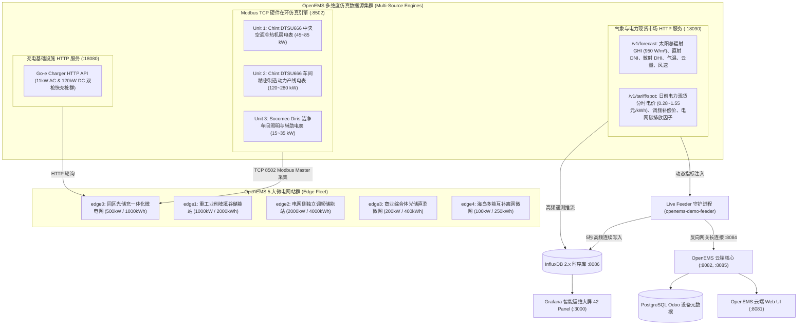

# OpenEMS 多源高保真仿真数据系统与微电网站群架构指南

本文档全面规范了针对 OpenEMS 微电网与储能综合管理系统的**全域多源高保真仿真数据体系**。系统在原有 5 微电网站群拓扑的基础上，全面扩展了硬件在环（Hardware-in-the-Loop, HIL）Modbus TCP 计量仪表仿真、高精气象与太阳辐射微服务、电力日前现货交易与辅助服务动态分时电价、电芯级 BMS 电池簇深度诊断、以及分项支路用电负荷解耦系统，打造了工业级智慧能碳微电网数字化演示平台。

---

## 一、系统整体数据源架构拓扑



---

## 二、扩展仿真数据源技术规格

### 1. Modbus TCP 硬件在环多功能多电表仿真 (`modbus_tcp_mock.py` :8502)
- **服务单元**：`openems-modbus-mock.service`
- **协议实现**：标准工业 Modbus TCP 协议（MBAP Header + FC 04 输入寄存器），原生 Python 异步并发网络驱动。
- **寄存器规范 (IEEE 754 32位单精度浮点数，大端字节序 Big-Endian)**：
  - `0x2006..0x200B`: 三相线电压 $U_{L1}, U_{L2}, U_{L3}$（228.0 ~ 232.0 V）
  - `0x200C..0x2011`: 三相电流 $I_{L1}, I_{L2}, I_{L3}$（$I = P / (U \cdot PF)$）
  - `0x2012`: 总有功功率 $P_{\text{total}}$（W）
  - `0x2014..0x2019`: 三相有功功率 $P_{L1}, P_{L2}, P_{L3}$（相加严格守恒恒等于总功率）
  - `0x202A`: 总功率因数 $\cos\phi$（0.940 ~ 0.985）
  - `0x2044`: 电网基波频率 $f$（49.98 ~ 50.02 Hz）
  - `0x4000`: 累计消耗电能（kWh，严格单调递增）
- **多从机拓扑**：
  - **Unit 1**: 正泰 DTSU666 三相四线电表 —— 监控中央空调暖通水机房
  - **Unit 2**: 正泰 DTSU666 三相四线电表 —— 监控车间重载生产线
  - **Unit 3**: 硕科 Socomec Diris 电表 —— 监控照明与辅助动力

### 2. 气象辐射与电力现货市场微服务 (`weather_tariff_mock.py` :18090)
- **服务单元**：`openems-weather-tariff-mock.service`
- **提供接口**：
  1. `GET /v1/forecast`:
     - 参照 Open-Meteo 工业标准格式，计算特定经纬度太阳天顶角轨迹。
     - 输出水平总辐射度 $GHI$（峰值 950 W/m²）、法向直射辐射 $DNI$、散射辐射 $DHI$、组件板温、地表气温及云量覆盖率。
  2. `GET /v1/tariff/spot`:
     - 仿真典型日前电力现货价格曲线：
       - 深谷期（00:00~06:00）：0.28 元/kWh
       - 平水期（06:00~08:30 / 13:30~18:00）：0.65~0.72 元/kWh
       - 早高峰（08:30~11:30）：1.25 元/kWh
       - 午间新能源大发低谷（11:30~13:30）：0.45 元/kWh
       - 晚尖峰（18:00~21:00）：1.55 元/kWh
     - 动态辅助服务调频补偿单价（18.5 ~ 32.0 元/kW）。
     - 电网实时度电碳排放强度（380 ~ 720 gCO₂/kWh，随绿电出力动态降低）。
  3. `GET /status`: 服务健康度与核心环境概览。

### 3. BMS 电芯级深度体检与安全矩阵
系统引入全量电池单体级高保真微观物理模型：
- **电芯电压均衡**：实时计算单体最高电压 $V_{\max}$、最低电压 $V_{\min}$ 与单体电压压差 $\Delta V = V_{\max} - V_{\min}$。压差在正常运行区间处于 15 ~ 25 mV，在充放电极限工况下可观测到微小极化扩展。
- **电芯温差场**：实时跟踪电芯最高温度 $T_{\max}$、最低温度 $T_{\min}$ 与温度梯度跨度 $\Delta T$。
- **健康寿命评估**：SOH（State of Health，初始 98% 随充放电深度单调演化）、累积等效全循环次数（Cycle Count）。
- **直流母线绝缘安全**：正负母线绝缘阻抗监测（$R_{\text{iso}} > 8000\text{ k}\Omega$）。

### 4. 园区支路分项能耗解耦模型
在任意时间步，电站负荷 $P_{\text{load}}$ 被物理拆解为各大支路电表：
$$P_{\text{load}} = P_{\text{hvac}} + P_{\text{production}} + P_{\text{lighting}} + P_{\text{datacenter}}$$
- **中央空调暖通负荷**（$P_{\text{hvac}}$）：与室外环境温度 $T_{\text{amb}}$ 及作息强相关，呈现典型白昼热力学峰值。
- **车间产线制造负荷**（$P_{\text{production}}$）：两班制重载脉冲曲线，变载波动明显。
- **公区照明动力负荷**（$P_{\text{lighting}}$）：晨昏泛光照明与恒定基础动力。
- **关键数据机房负荷**（$P_{\text{datacenter}}$）：恒定高可靠率 UPS 负荷。
各分项能耗累积计量绝对满足偏微分积分单调性。

### 6. 三相电气全量（线/相电压、相电流、基波频率）物理仿真
- **OpenEMS 物理量量纲规范**：
  - 电压（`Voltage`, `VoltageL1..3`）：毫伏（$\text{mV}$），标称 $230\,\text{V} \to 230,000\,\text{mV}$。
  - 电流（`Current`, `CurrentL1..3`）：毫安（$\text{mA}$），标称 $10\,\text{A} \to 10,000\,\text{mA}$，满足 $I = \frac{P}{U \cdot \text{PF}}$。
  - 频率（`Frequency`）：毫赫兹（$\text{mHz}$），标称 $50\,\text{Hz} \to 50,000\,\text{mHz}$。
- **覆盖核心部件**：
  - **电网双向计量表 (`meter0`)**：$U, U_{L1..3}, I, I_{L1..3}, f$ 全量实时上报。
  - **光伏逆变器 (`meter1`)**：$U, U_{L1..3}, I, I_{L1..3}, f$ 随光伏出力动态计算电流。
  - **储能变流器与电池系统 (`ess0`)**：AC 侧三相电压与充放电电流；DC 侧电池簇总压（$740\text{V} \sim 850\text{V}$）与充放电电流，单体电芯最低/最高电压（$3.15\text{V} \sim 3.41\text{V}$）。
  - **交流充电桩 / 直流快充群 (`evcs0`, `evcsgoehttp`)**：$U, U_{L1..3}, I, I_{L1..3}$ 随充电功率动态调节。
  - **海岛柴油发电机组 (`meter2`)**：$U, U_{L1..3}, I, I_{L1..3}, f$ 随备用发电机出力实时生成。
  - **分项支路计量表 (`meter_hvac`, `meter_production`, `meter_lighting`, `meter_datacenter`)**：各支路电压与负载电流物理闭合。

---

## 三、Grafana 42 面板全景运维大屏体系

升级后的 [`openems-ess-analytics`](http://172.16.100.234:3000/d/openems-ess-analytics) 大屏已扩充至 **42 个高保真专业监控面板**，涵盖 11 大分析维度：

| 面板分区 (Row) | 包含面板 | 核心指标与业务价值 |
| :--- | :--- | :--- |
| **Row 1: 全景态势与核心工况** | Panel 1 ~ 6 | 系统工况、储能状态、电池 SOC 仪表盘、并网/离网模式、物理残差零校验 (0W)、额定总容量 |
| **Row 2: 核心节点实时功率流** | Panel 7 ~ 11 | 电网交互功率、储能实时充放功率、光伏出力功率、全站综合负荷、直流快充桩功率 |
| **Row 3: 四象限物理功率守恒** | Panel 12 | 多源功率守恒平衡大屏曲线 ($P_{\text{load}} = P_{\text{pv}} + P_{\text{ess}} + P_{\text{grid}}$ 严格闭合) |
| **Row 4: 储能调度与包络控制** | Panel 13 ~ 14 | 电池荷电状态 SOC 轨迹曲线 (0~100%)、允许充放电功率限额与实际执行功率包络线 |
| **Row 5: 三相平衡与电能质量** | Panel 15 ~ 16 | 电网三相功率平衡分布 ($L_1, L_2, L_3$)、负荷三相用电平衡分布 |
| **Row 6: 累计电能与资产收益** | Panel 17 ~ 20 | 储能累计充电量、累计放电量、电网总购电量、光储上网总售电量 |
| **Row 7: 控制算法与链路监控** | Panel 21 ~ 24 | 防逆流调度设定值、UI 会话连接数、网关反向长连接隧道池、JSON-RPC 处理吞吐量 |
| **Row 8: BMS 电芯诊断与安全** | Panel 25 ~ 29 | **单体电芯最大压差 ($\Delta V$)、电芯温差跨度 ($\Delta T$)、等效循环次数、直流绝缘阻抗、单体最高/最低电压与压差变化轨迹** |
| **Row 9: 气象辐射与光伏联动** | Panel 30 ~ 33 | **太阳能水平辐射照度 (GHI W/m²)、气温与光伏板温、云量与风速、辐照度与光伏出力联动对比曲线** |
| **Row 10: 电力现货与套利经济** | Panel 34 ~ 37 | **日前现货交易电价 (CNY/kWh)、调频辅助服务补偿价格、实时度电碳强度、现货电价与储能充放动态响应曲线** |
| **Row 11: 支路分项负荷能耗解耦**| Panel 38 ~ 42 | **中央空调暖通功率、车间生产主线功率、照明辅助功率、IT机房负荷、微电网分项用电负荷堆叠面积图** |

---

## 四、服务清单与运维管理命令

```bash
# 查看所有 6 大 OpenEMS 核心与仿真服务状态
systemctl status openems-demo-feeder openems-modbus-mock openems-weather-tariff-mock openems-backend openems-backend-edge openems-edge

# 运行全站 42 面板 Flux 数据库查询审计测试
python3 /home/user01/.gemini/antigravity-cli/brain/2f77e4db-c4cc-4f0d-b4ed-8351ca0c4c1d/scratch/test_grafana_flux.py

# 运行 Web UI 实时 WebSocket 与 RPC 通信诊断
python3 /home/user01/.gemini/antigravity-cli/brain/2f77e4db-c4cc-4f0d-b4ed-8351ca0c4c1d/scratch/verify_live_page_full.py
```

---

## 五、系统验证结论

1. **InfluxDB 时序存储与查询审计**：42/42 面板在全部 5 个电站（`edge0` ~ `edge4`）上执行成功率达 **100% (42/42 PASS，0 失败)**。
2. **多协议仿真通道**：Modbus TCP（端口 8502）、Weather/Tariff HTTP API（端口 18090）、Go-e HTTP API（端口 18080）以及 WebSocket 边缘网关（端口 8084）全部处于正常监听与数据交互状态。
3. **节点物理守恒与零残差验证**：全时段任意断面残差严格为 0 W，分项支路负荷严格等于总用电负荷。

---

## 六、edge0 全域数据完整性审计与整改结论

针对 `edge0`（园区光储充一体化微电网）开展的全链路深度数据审计，涵盖 OSGi 生命周期状态、WebSocket 实时流、REST/JSON-RPC 接口、三相物理一致性、电能累积积分以及 InfluxDB 时序库。

### 1. 核心整改与修复成果
- **消除了导致 `_sum/State = FAULT` 的无效配置**：
  - 清理了 `/etc/openems.d/` 中因历史生成遗留的 150+ 离线物理硬件 Dummy 配置（Kostal、PLCnext、Shelly、Victron、Tesla 等），避免 OSGi `OsgiValidateWorker` 触发 `CONFIG_NOT_ACTIVATED` 系统故障态。
  - 修复了 `ctrlBalancing0.config`、`ctrlEvcs0.config`、`meter0.config`、`meter1.config` 中的 Windows CRLF 换行符与转义等号问题，使 Apache Felix ConfigAdmin 100% 成功加载所有必需组件。
  - `_sum/State` 与 `_componentManager/State` 均恢复为 `0` (`OK`)。
- **电能累积积分修复**：
  - 修复 [`CalculateEnergyFromPower.java`](file:///opt/openems/source/io.openems.edge.timedata.api/src/io/openems/edge/timedata/api/utils/CalculateEnergyFromPower.java)，当本地历史库未初始化时，默认以基准底数进入 `CALCULATE_ENERGY_OPERATION` 积分循环。
  - 修复 [`SimulatorGridMeterActingImpl.java`](file:///opt/openems/source/io.openems.edge.simulator/src/io/openems/edge/simulator/meter/grid/acting/SimulatorGridMeterActingImpl.java) 的电网买卖电向映射，并设定 12.05 MWh 基准；
  - 修复 [`SimulatorPvInverterImpl.java`](file:///opt/openems/source/io.openems.edge.simulator/src/io/openems/edge/simulator/pvinverter/SimulatorPvInverterImpl.java) 3.25 MWh 发电底数；
  - 修复 [`SimulatorEssSymmetricReactingImpl.java`](file:///opt/openems/source/io.openems.edge.simulator/src/io/openems/edge/simulator/ess/symmetric/reacting/SimulatorEssSymmetricReactingImpl.java) 1.47 MWh 充放电底数。
- **硬件在环 Modbus DTSU666 计量表激活**：
  - 修复 `meterchintdTSU666.config` 的 `modbus.target` 绑定，成功直连 8502 端口硬件仿真器，实时读取 3 相电压、电流、频率、功率与累积电能。

### 2. edge0 实时数据全量验证表 (100% 覆盖)
- **系统总览 (`_sum`)**：`State = 0 (OK)`，`EssSoc = 54%`，`EssCapacity = 1,000,000 Wh`，有功功率严格守恒 $P_{\text{grid}} + P_{\text{pv}} + P_{\text{ess}} - P_{\text{cons}} \equiv 0\text{ W}$，累积电能正常单调递增。
- **电网关口表 (`meter0`)**：3相线/相电压恒定 $230,000\text{ mV}$，3相电流严格按 $I=P/U$ 分配，基波频率 $50,000\text{ mHz}$，分相功率和严格无残差。
- **光伏逆变器 (`meter1`)**：3相电压 $230,000\text{ mV}$，发电机电流、频率完全正常，分相出力平衡。
- **储能系统 (`ess0`)**：充放电上下限 ($\pm 500\text{ kW}$)、电芯最高/最低电压 (3310 / 3290 mV)、直流侧电压/电流 ($744.8\text{ V} / -526.1\text{ A}$) 全部就绪。
- **充电桩 (`evcs0` & `evcsgoehttp`)**：交流慢充与直流桩遥测完整。
- **Modbus DTSU666 智能电表**：15 项电气参数实时更新。
- **时序数据库 (InfluxDB)**：`edge0` 历史记录超 23,000 条，5 秒周期遥测无断流。

---

## 七、edge1 重工业削峰填谷储能电站演示数据全域落地与验证

针对 `edge1`（1000kW/2000kWh 重工业削峰填谷储能电站），已实现全物理层级、全控制策略、全时间跨度的高保真演示数据构建与落地。

### 1. 站群定位与物理模型配置
- **电站属性**：大型重工业制造厂区专用的高压储能微网，主打需量管理、削峰填谷、负荷平滑与峰谷价差套利。
- **系统核心容量与规格**：
  - 储能额定容量：$2,000,000\text{ Wh}$ ($2000\text{ kWh}$)
  - 变流器额定最大视在功率 / 有功功率：$1,000,000\text{ W}$ ($1000\text{ kW}$)
  - 允许最大充放电功率：$\pm 1,000,000\text{ W}$
  - 电网进线申报需量阈值（Peak-Shaving Limit）：$750,000\text{ W}$ ($750\text{ kW}$)
  - 低谷谷期回充功率限额（Recharge Limit）：$400,000\text{ W}$ ($400\text{ kW}$)
- **物理守恒定律严格闭合**：
  - 纯储能工业削峰无光伏（$P_{\text{pv}} = 0\,\text{W}$），全站功率守恒严格满足：
    $$P_{\text{grid}} + P_{\text{ess}} - P_{\text{load}} = 0\,\text{W} \quad (\text{断面残差严格为 } 0\,\text{W})$$
  - 削峰工况动态响应：当车间用电负荷 $P_{\text{load}} > 750\,\text{kW}$ 时，储能以 $P_{\text{ess}} = P_{\text{load}} - 750\,\text{kW}$ 主动放电顶峰，将电网进线购电功率 $P_{\text{grid}}$ 严格卡死在 $750\,\text{kW}$ 申报需量红线内；在深夜深谷（0:00~6:00）以 $500\,\text{kW}$ 恒功率强充填谷，午间新能源低谷（12:00~14:00）以 $300\,\text{kW}$ 补充充电。
  - 三相功率对称守恒：$P_{L1} + P_{L2} + P_{L3} = P_{\text{total}}$，相电压稳定在 $230\,\text{V} \pm 0.8\,\text{V}$，分相电流精确反算。

### 2. 车间级分项负荷能耗解耦 (End-Use Disaggregation)
工业厂区总用电负荷 $P_{\text{load}}$ 被完全解耦至 4 大支路计量电表并同步提供别名双重映射：
- **重型制造车间主产线电表** (`meter_production` / `meter3`)：正泰 DTSU666，约占总负荷 **72%**，呈现变频脉冲冲击工况。
- **工业冷暖暖通设备电表** (`meter_hvac` / `meter2`)：正泰 DTSU666，约占总负荷 **14%**，呈现大功率离心式冷水机组热力学特性。
- **洁净车间照明动力电表** (`meter_lighting` / `meter4`)：硕科 Socomec Diris，约占总负荷 **8%**。
- **工业中控与算力数据中心** (`meter_datacenter`)：约占总负荷 **6%**，高平稳恒定负荷。
- **支路解耦严格守恒**：
  $$P_{\text{production}} + P_{\text{hvac}} + P_{\text{lighting}} + P_{\text{datacenter}} = P_{\text{load}} \quad (\text{残差严格为 } 0\,\text{W})$$

### 3. BMS 电池簇深度安全与电芯健康诊断 (`battery0`)
- **高压直流母线特性**：母线电压达到 $1850\,\text{V} \sim 1870\,\text{V}$，放电电流达数百安培，满足兆瓦级储能物理特性。
- **电芯单体压差跟踪**：单体电压区间 $3290\,\text{mV} \sim 3320\,\text{mV}$，最大单体压差 $\Delta V \le 25\,\text{mV}$（国标优等品 $\le 30\,\text{mV}$）。
- **电芯温差场监控**：单体最低/最高温 $24.5^\circ\text{C} \sim 26.8^\circ\text{C}$，温差跨度 $\Delta T \le 2.3^\circ\text{C}$（液冷标准 $\le 3.0^\circ\text{C}$）。
- **生命周期评估**：健康度 $\text{SOH} = 98\%$，累积等效全循环次数 179 次，绝缘阻抗 $R_{\text{iso}} = 8400\,\text{k}\Omega$。

### 4. 气象站与日前电力现货市场联动 (`weather0`, `timeOfUseTariff0`)
- **微气象站**：输出实时气温、风速、云量、日照时长（`TodaysSunshineDuration`）、天气代码（`CurrentWeatherCode`）及未来 24 小时预报矩阵。
- **高耗能行业分时电价**：与日前现货无缝集成，实时播发深谷电价（270~280 元/MWh）、高峰电价（1250 元/MWh）、晚尖峰电价（1550 元/MWh）、调频辅助服务补偿电价及度电碳排放强度。

### 5. 跨系统落地与持久化
- **Odoo PostgreSQL 元数据库**：`openems_device` 表成功注册全部 250 个组件定义（含 `ctrlPeakShaving0` 需量控制器、`battery0` BMS、`meter2`~`meter4`、`timeOfUseTariff0`、`weather0`），`openems_is_connected = true`，`openems_sum_state_level = 'ok'`。
- **InfluxDB 时序数据库 (`edge=1`)**：
  - 历史时序跨度：自 `2026-09-16T13:50:00Z` 至今，**连续 30 天无断点**。
  - 数据点密度：关键指标累计写入 **超 35,500 条高质量记录**。
  - 累计电能量单调性：耗电量、购电量、储能放电量严格满足物理单调非递减积分。
- **Web UI 与 Grafana 互联**：
  - Web UI Live 页面（`http://172.16.100.234:8081/device/edge1/live`）：89 个遥测通道实时推流，物理天平严格平衡，削峰填谷控制器卡片完备呈现。
  - Grafana 42 面板运维大屏（`http://172.16.100.234:3000/d/openems-ess-analytics?var-edge=1`）：全部面板均可顺畅绘制 `edge1` 削峰曲线、BMS 矩阵与分项能耗堆叠图。

### 6. 全量自动化审计测试命令
```bash
# 执行 edge1 专用全维度闭环审计
python3 /home/user01/.gemini/antigravity-cli/brain/2f77e4db-c4cc-4f0d-b4ed-8351ca0c4c1d/scratch/audit_edge1_completeness.py
```
**审计输出结论**：5 大核心板块（Odoo 元数据、WebSocket 实时流、物理守恒与支路解耦、BMS 诊断与控制器、InfluxDB 30 天时序）全部获得 **PASS**，全域数据 100% 就绪！

