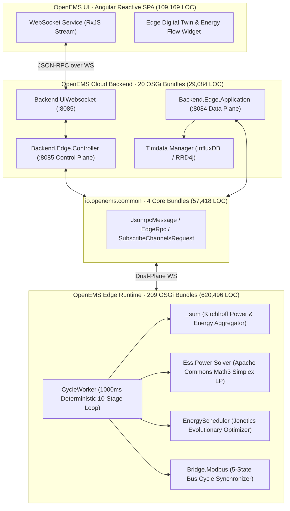
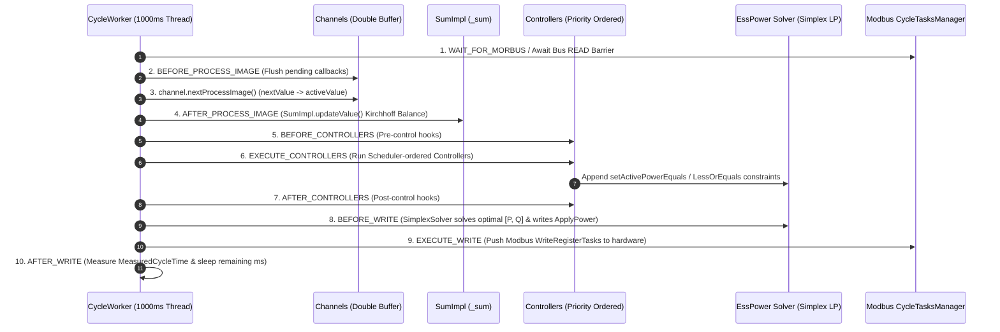
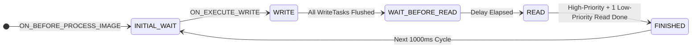

# OpenEMS 源码架构深度剖析与设计全景报告

> **Architecture Monograph · Source Code Deep Dive (`/opt/openems/source`)**  
> **审计基线**: OpenEMS `2025.10.0-SNAPSHOT` · **OSGi Bundles**: `233` · **总代码规模**: `816,167 LOC` (`6,647` 源码文件)  
> **配套交互式视觉报告**: [OpenEMS_源码架构深度剖析与设计全景报告_2026-10-18.html](file:///home/user01/local/openems/OpenEMS_%E6%BA%90%E7%A0%81%E6%9E%B6%E6%9E%84%E6%B7%B1%E5%BA%A6%E5%89%96%E6%9E%90%E4%B8%8E%E8%AE%BE%E8%AE%A1%E5%85%A8%E6%99%AF%E6%8A%A5%E5%91%8A_2026-10-18.html)

---

## 01. 全景代码度量与分层拓扑 (Quantitative Codebase Panorama)

通过对 [`/opt/openems/source`](file:///opt/openems/source) 源码树的全量静态扫描，OpenEMS 由 **四大核心子系统** 与 **八大业务领域** 构成，采用 **Bndtools + Apache Felix OSGi R8 Declarative Services (DS)** 微内核架构，实现了从毫秒级硬件寄存器控制到云端万级边缘节点调度的全栈闭环。

| 子系统分层 | OSGi 模块数 | 源码文件数 | 代码总行数 (LOC) | 核心职责与架构定位 |
| :--- | :---: | :---: | :---: | :--- |
| **OpenEMS Edge (边缘控制引擎)** | `209` | `4,658` Java | `620,496` | 1000ms 确定性扫描周期、双缓冲过程映像、Simplex LP 功率求解、Jenetics 遗传调度、工业总线驱动 |
| **OpenEMS Common (跨端契约内核)** | `4` | `460` Java | `57,418` | JSON-RPC 2.0 强类型消息信封、ChannelAddress 寻址、OpenEMS Type 类型系统、WebSocket 帧协议 |
| **OpenEMS Backend (云端聚合中枢)** | `20` | `272` Java | `29,084` | 控制面 (`:8085`) 与数据面 (`:8084`) 分离网关、EdgeCache 增量快照、InfluxDB/Timedata 时序路由 |
| **OpenEMS UI (响应式监控前端)** | `Angular Workspace` | `1,257` TS/HTML/SCSS | `109,169` | 基于 RxJS `BehaviorSubject` 流式状态机、Edge 实时数字孪生与能量流 SVG 引擎 |
| **全仓合计 (Grand Total)** | **233 Bundles + UI** | **6,647 Files** | **816,167 LOC** | **工业级开源能源管理系统 (EMS) 标杆架构** |

---

## 02. 微内核与双缓冲过程映像 (OSGi Microkernel & Double-Buffered Process Image)

> [!IMPORTANT]
> **核心架构洞察：为什么多线程 Java 能够实现工业 PLC 级的确定性控制？**  
> 工业现场总线（Modbus TCP/RTU、CAN、SunSpec）天然是异步、高抖动甚至可能阻塞的。如果传感器线程在控制算法执行中途直接修改变量，会导致同一周期内前后逻辑读取到不一致的物理状态（即“撕裂读”）。OpenEMS 借鉴工业 PLC（可编程逻辑控制器）的 **过程映像区 (Process Image)** 思想，在 [`AbstractReadChannel.java`](file:///opt/openems/source/io.openems.edge.common/src/io/openems/edge/common/channel/internal/AbstractReadChannel.java#L46-L148) 中实现了无锁双缓冲内存模型。

### 2.1 三维抽象模型：`OpenemsComponent` × `Nature` × `Channel`
1. **组件身份契约 ([`OpenemsComponent.java`](file:///opt/openems/source/io.openems.edge.common/src/io/openems/edge/common/component/OpenemsComponent.java))**: 每个物理设备或控制算法都是一个 OSGi DS `@Component`，通过 ConfigAdmin 持久化的 `id()`（如 `ess0`, `meter0`, `ctrlPeakShaving0`）在运行时动态实例化与热插拔。
2. **领域多态契约 (`Nature` Interfaces)**: 设备不以厂商型号耦合，而是实现标准化领域接口：
   - 储能逆变器：[`ManagedSymmetricEss.java`](file:///opt/openems/source/io.openems.edge.ess.api/src/io/openems/edge/ess/api/ManagedSymmetricEss.java) / [`AsymmetricEss.java`](file:///opt/openems/source/io.openems.edge.ess.api/src/io/openems/edge/ess/api/AsymmetricEss.java)
   - 标准电表：[`ElectricityMeter.java`](file:///opt/openems/source/io.openems.edge.meter.api/src/io/openems/edge/meter/api/ElectricityMeter.java)
   - 电动汽车充电桩：[`ManagedEvcs.java`](file:///opt/openems/source/io.openems.edge.evcs.api/src/io/openems/edge/evcs/api/ManagedEvcs.java)
3. **原子测点管道 ([`Channel.java`](file:///opt/openems/source/io.openems/source/io.openems.edge.common/src/io/openems/edge/common/channel/Channel.java) & [`AbstractReadChannel.java`](file:///opt/openems/source/io.openems.edge.common/src/io/openems/edge/common/channel/internal/AbstractReadChannel.java#L46-L148))**:
   - **后台写入缓冲区 (`nextValue`)**: 异步 Modbus 轮询线程、HTTP Worker 或内部计算回调仅允许调用 [`setNextValue(T)`](file:///opt/openems/source/io.openems.edge.common/src/io/openems/edge/common/channel/Channel.java#L168-L176) 写入后台缓冲区。
   - **前台冻结快照 (`activeValue`)**: 在每个 1000ms 扫描周期的起点，[`CycleWorker`](file:///opt/openems/source/io.openems.edge.core/src/io/openems/edge/core/cycle/CycleWorker.java#L62-L74) 触发全局 `BEFORE_PROCESS_IMAGE` 事件，所有 Channel 执行 [`nextProcessImage()`](file:///opt/openems/source/io.openems.edge.common/src/io/openems/edge/common/channel/internal/AbstractReadChannel.java#L116-L132)，将 `nextValue` 原子切换至 `activeValue`，并压入容量为 `MAX_COLLECTED_VALUES = 101` 的环形历史队列 `pastValues`。
   - **控制期绝对一致性**: 在随后的 `EXECUTE_CONTROLLERS` 阶段，任何控制器调用 `channel.value()` 读取到的都是冻结后的 `activeValue`，彻底消除了竞态条件。

---

## 03. 1000ms 确定性十阶扫描周期引擎 (The 10-Stage Deterministic Scan Cycle)

在 [`CycleWorker.java`](file:///opt/openems/source/io.openems.edge.core/src/io/openems/edge/core/cycle/CycleWorker.java#L36-L125) 中，继承自 `AbstractImmediateWorker` 的单线程主控循环严格按照固定顺序编排 10 个阶段，并通过 OSGi `EventAdmin` 同步广播生命周期事件：

- **基尔霍夫功率与能量守恒 ([`SumImpl.java`](file:///opt/openems/source/io.openems.edge.core/src/io/openems/edge/core/sum/SumImpl.java#L258-L327))**:
  在阶段 4 (`AFTER_PROCESS_IMAGE`)，`_sum` 单例组件遍历全站所有 `SymmetricEss`、`ElectricityMeter`（区分 `GRID`、`PRODUCTION`、`CONSUMPTION_METERED`）并实时推导未计量的纯负载功率：
  $$P_{\text{Consumption}} = P_{\text{Grid}} + P_{\text{Production}} + P_{\text{EssDischarge}}$$
  同时聚合全站最低/最高单体电压、加权平均 SoC 以及最高故障等级 (`StateChannel`)。

---

## 04. 双层数学优化核心：线性规划求解器 vs 遗传进化调度器

OpenEMS 将实时控制拆分为 **毫秒级硬约束内环 (Simplex LP)** 与 **日前 24 小时经济最优外环 (Genetic Algorithm)**：

### 4.1 实时功率分配内环：Apache Commons Math3 单纯形法 ([`Solver.java`](file:///opt/openems/source/io.openems.edge.ess.core/src/io/openems/edge/ess/core/power/v1/Solver.java#L51-L260))
当削峰填谷 (`Controller.Symmetric.PeakShaving`)、自发自用 (`Controller.Ess.GridOptimizedCharge`)、紧急备电 (`Controller.Ess.EmergencyCapacityReserve`) 等多个控制器在同一周期内对同一个储能逆变器（或集群 `Ess.Cluster`）下发功率请求时，OpenEMS **不允许直接覆盖写寄存器**，而是将所有请求转化为多维线性不等式约束：
- **状态变量向量** $\mathbf{x} \in \mathbb{R}^{6N}$（针对每个逆变器 $i$ 的三相有功/无功拆分为非负充电/放电分量）：
  $$\mathbf{x}_i = \left[ P_{L1}^+, P_{L1}^-, Q_{L1}^+, Q_{L1}^-, \dots, P_{L3}^+, P_{L3}^-, Q_{L3}^+, Q_{L3}^- \right]^T \ge \mathbf{0}$$
- **约束叠加机制**:
  - 硬件极限边界：`MaxApparentPower`、BMS 实时充放电上限 `AllowedChargePower` / `AllowedDischargePower` 构成 `STATIC_CONSTRAINTS`。
  - 控制器动态约束：按 [`Scheduler`](file:///opt/openems/source/io.openems.edge.scheduler.api/src/io/openems/edge/scheduler/api/Scheduler.java) 优先级依次尝试加入约束集；若某个低优先级控制器的约束导致线性规划空间无解（`NoFeasibleSolutionException`），求解器自动丢弃该冲突约束并记录告警，保证高优先级安全控制永远有解！
- **四级降级求解瀑布 ([`Solver.solve()`](file:///opt/openems/source/io.openems.edge.ess.core/src/io/openems/edge/ess/core/power/v1/Solver.java#L95-L185))**:
  1. 严格满足所有控制器约束 + 用户期望优化策略 (`OptimizeBy`)；
  2. 退化至 `KEEP_TARGET_DIRECTION_AND_MAXIMIZE_IN_ORDER`（保持充放电象限一致并按序最大化）；
  3. 放宽象限约束，尝试反方向可行解；
  4. 终极安全兜底：仅保留 BMS 硬件保护静态约束，将目标功率向 $0\text{ W}$ 收敛。

### 4.2 日前 96 时段经济调度外环：Jenetics 遗传进化引擎 ([`Optimizer.java`](file:///opt/openems/source/io.openems.edge.energy/src/io/openems/edge/energy/optimizer/Optimizer.java#L75-L215) & [`Simulator.java`](file:///opt/openems/source/io.openems.edge.energy/src/io/openems/edge/energy/optimizer/Simulator.java#L60-L240))
针对动态分时电价（Time-of-Use）与光伏/负荷预测曲线（`PredictorManager`），`io.openems.edge.energy` 模块采用 **进化计算库 `io.jenetics`** 求解非线性混合整数规划问题：
- **基因编码 (Genotype)**: 未来 24 小时共 $96$ 个 $15\text{ min}$ 时段，每个时段为一个 `IntegerChromosome`（编码储能模式：`BALANCING` 自平衡、`CHARGE_GRID` 电网谷电充电、`DELAY_DISCHARGE` 锁电等待高峰）。
- **适应度函数 ([`Simulator.calculateCost()`](file:///opt/openems/source/io.openems.edge.energy/src/io/openems/edge/energy/optimizer/Simulator.java#L140-L225))**:
  $$J(\mathbf{m}) = \sum_{t=1}^{96} \left( E_{\text{GridBuy}}(t) \cdot \pi(t) - E_{\text{GridSell}}(t) \cdot \pi_{\text{feed}} \right) + E_{\text{EssInitial}} \cdot \bar{\pi} \cdot \eta_{\text{loss}}$$
  其中源码显式引入往返损耗惩罚系数 `EFFICIENCY_FACTOR = 1.17`（即约 $14.5\%$ 充放电综合损耗门槛），防止在微小电价差下频繁充放电损耗电池寿命。
- **算力隔离护栏**: 在 [`Simulator.java`](file:///opt/openems/source/io.openems.edge.energy/src/io/openems/edge/energy/optimizer/Simulator.java#L85-L98) 中，遗传算法线程池被严格限制为 `Runtime.getRuntime().availableProcessors() - 1`，且线程优先级强制设为 `Thread.MIN_PRIORITY`，并在每个 15 分钟周期结束前 **提前 30 秒锁定当前时段决策**，确保重度进化计算绝不抢占 1000ms 实时控制主线程的 CPU 时间片。

---

## 05. 工业现场总线五态同步机 (Modbus 5-State Bus Cycle Synchronizer)

为解决慢速 RS485 串口或高延迟 TCP 设备与 1000ms 扫描周期的同步难题，[`CycleTasksManager.java`](file:///opt/openems/source/io.openems.edge.bridge.modbus/src/io/openems/edge/bridge/modbus/api/worker/internal/CycleTasksManager.java#L46-L140) 设计了严谨的 **五态有限状态机 (FSM)**，并将任务划分为高优队列 (`Priority.HIGH`) 与低优轮询队列 (`Priority.LOW`)：

1. **读写时序对齐**: 在 `EXECUTE_WRITE` 阶段立刻下发所有控制寄存器写指令（`WRITE`），随后经过计算的等待窗口（`WAIT_BEFORE_READ`），紧接着读取所有 `Priority.HIGH` 关键功率/电流寄存器与本周期轮转到的 `Priority.LOW` 诊断寄存器（`READ`），确保 **下一周期 `BEFORE_PROCESS_IMAGE` 到来前，最新硬件反馈已就绪于 `nextValue`**。
2. **自适应块合并与降级 ([`DefectiveComponents.java`](file:///opt/openems/source/io.openems.edge.bridge.modbus/src/io/openems/edge/bridge/modbus/api/worker/internal/DefectiveComponents.java))**: 若某台从站设备通讯超时，状态机自动将其隔离至故障退避列表，避免单台电表断线拖垮整条 RS485 总线上其余逆变器的实时控制周期。

---

## 06. 云边协同双平面网关与前端响应式数字孪生 (Cloud Dual-Plane & Reactive UI)

### 6.1 控制面与数据面物理分离
在云端集群部署模式下，OpenEMS Backend 将长连接解耦为两个独立的微服务平面：
- **控制面网关 (`:8085` · [`Backend.Edge.Controller`](file:///opt/openems/source/io.openems.backend.edge.controller) & [`EdgeManagerImpl.java`](file:///opt/openems/source/io.openems.backend.edge.manager/src/io/openems/backend/edge/manager/EdgeManagerImpl.java))**: 专职处理 UI 在线会诊、远程 OSGi 组件配置下发 (`UpdateComponentConfigRequest`)、系统日志流订阅。
- **高吞吐数据面网关 (`:8084` · [`BackendEdgeServerApp.java`](file:///opt/openems/source/io.openems.backend.edge.application/src/io/openems/backend/edge/application/BackendEdgeServerApp.java))**: 专职接收海量边缘节点的 `TimestampedDataNotification` 与 `AggregatedDataNotification` 遥测包，更新内存 [`EdgeCache.java`](file:///opt/openems/source/io.openems.backend.edge.Api/src/io/openems/backend/edge/api/EdgeCache.java) 增量快照并异步批量刷入 InfluxDB，彻底杜绝历史数据洪峰阻塞远程急停控制指令。

### 6.2 Angular + RxJS 全链路响应式数字孪生
前端 (`ui/src/app/shared`) 通过单条复用 WebSocket 隧道承载多层嵌套 JSON-RPC 2.0 信封：
$$\texttt{EdgeRpcRequest(edgeId)} \longrightarrow \texttt{SubscribeChannelsRequest(count, channels[])} \longrightarrow \texttt{CurrentDataNotification}$$
前端 [`Websocket.service.ts`](file:///opt/openems/source/ui/src/app/shared/service/websocket.service.ts) 与 [`CurrentData.service.ts`](file:///opt/openems/source/ui/src/app/shared/edge/currentdata.service.ts) 维护页面级订阅引用计数：仅当用户打开某个 Widget 视图时才向云端及对应 Edge 动态订阅所需 `ChannelAddress`，关闭视图即刻释放带宽，使单台 Edge 在弱网环境下依然保持极低流量开销。
