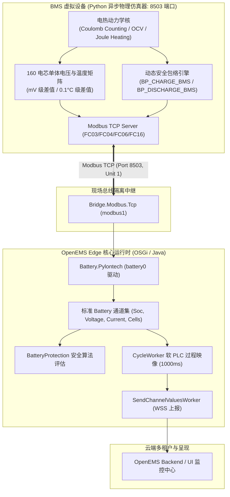
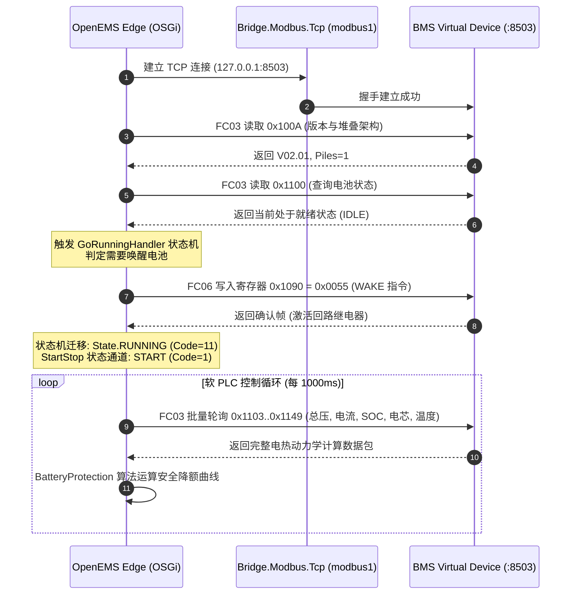

# OpenEMS Edge 储能 BMS 虚拟设备构建、高保真物理仿真与实机接入指南

> **文档版本**：v1.0  
> **编制日期**：2026-10-21  
> **系统环境**：Linux 6.8 / OpenEMS Edge 2026 / Python 3.14 / OSGi Felix 7.0  
> **适用范围**：储能电池管理系统（BMS）硬件在环仿真（HIL）、高保真电热动力学建模、Modbus TCP 协议接入及 OpenEMS Edge 实机控制流验证。

---

## 目录
1. [执行摘要与工程交付](#一执行摘要与工程交付)
2. [虚拟 BMS 设备系统架构设计](#二虚拟-bms-设备系统架构设计)
3. [高保真物理仿真与动力学数学模型](#三高保真物理仿真与动力学数学模型)
   - [3.1 规格参数与电芯拓扑](#31-规格参数与电芯拓扑)
   - [3.2 动态库仑积分与 OCV-SOC 双曲正切曲线](#32-动态库仑积分与-ocv-soc-双曲正切曲线)
   - [3.3 单体电芯离散度（mV 级）与热动力学模型](#33-单体电芯离散度mv-级与热动力学模型)
   - [3.4 动态安全包络与充放电降额曲线](#34-动态安全包络与充放电降额曲线)
4. [工业 Modbus TCP 寄存器映射全景表](#四工业-modbus-tcp-寄存器映射全景表)
5. [OpenEMS Edge 实机组件接入与配置](#五openems-edge-实机组件接入与配置)
   - [5.1 现场总线网桥配置（`modbus1.config`）](#51-现场总线网桥配置modbus1config)
   - [5.2 电池驱动组件配置（`battery0.config`）](#52-电池驱动组件配置battery0config)
   - [5.3 软硬件交互与状态机流转闭环](#53-软硬件交互与状态机流转闭环)
6. [端到端实机验证与数据通道监测快照](#六端到端实机验证与数据通道监测快照)
7. [生产运维与服务生命周期管理](#七生产运维与服务生命周期管理)

---

## 一、执行摘要与工程交付

为了在无真实物理高压电池柜的环境下，对 OpenEMS Edge 能量管理系统、`BatteryProtection` 安全降额算法、控制循环及云端监控大屏进行全面闭环测试，本项目构建了一套**工业级、高保真度的储能 BMS 虚拟设备**，并成功接入本机运行的 OpenEMS Edge 生产运行时中。

### 核心交付清单
1. **工业级 BMS 虚拟设备仿真器**：
   - 脚本路径：`/opt/openems/scripts/bms_pylontech_virtual_device.py`（仓库备份：`scripts/bms_pylontech_virtual_device.py`）
   - 协议特性：纯原生 Python 异步并发（`asyncio`），零外部依赖，监听 `0.0.0.0:8503`（Modbus TCP，Unit ID: 1）。
   - 物理模型：模拟 160 串磷酸铁锂（LiFePO4）电芯、10 个电池模组、额定 512.0 V / 100 kWh 工商业储能系统，具备动态库仑计数、电芯级压差分布、焦耳发热与边缘充放电降额。
2. **Linux Systemd 守护服务**：
   - 服务单元：`/etc/systemd/system/openems-bms-mock.service`
   - 运行状态：`active (running)`，开机自启，故障自动拉起。
3. **OpenEMS Edge 现场总线与驱动配置**：
   - 通信网桥：`/etc/openems.d/Bridge/Modbus/Tcp/modbus1.config`（连接 127.0.0.1:8503）
   - 电池驱动：`/etc/openems.d/Battery/Pylontech/battery0.config`（驱动 `Battery.Pylontech`，挂载至 `modbus1`）
4. **运行验证结果**：
   - OpenEMS Edge 状态机自动触发 `0x1090` 唤醒指令（`0x55`），驱动成功迁移至 `RUNNING` 状态；
   - 实时通道 `battery0/Soc`、`battery0/Voltage`、`battery0/Current`、`battery0/MinCellVoltage`、`battery0/MaxCellVoltage`、`battery0/MaxCellTemperature` 等通过 REST API 及云端 WSS 全量实时更新。

---

## 二、虚拟 BMS 设备系统架构设计



---

## 三、高保真物理仿真与动力学数学模型

### 3.1 规格参数与电芯拓扑
- **额定容量**：$100 \text{ kWh}$（约 $195.3 \text{ Ah}$）
- **标称电压**：$512.0 \text{ V}$（由 160 串 $3.2 \text{ V}$ 磷酸铁锂电芯串联组成，分为 10 个电池模组，每模组 16 串 $51.2 \text{ V}$）
- **等效内阻**：$R_{internal} = 80 \text{ m}\Omega$
- **允许充放电安全界限**：
  - 允许充电最高截止电压：$547.5 \text{ V}$（单体 $3.42 \text{ V}$）
  - 允许放电最低截止电压：$435.0 \text{ V}$（单体 $2.72 \text{ V}$）
  - 标称最大充放电电流：$120.0 \text{ A}$ / $140.0 \text{ A}$

### 3.2 动态库仑积分与 OCV-SOC 双曲正切曲线
1. **库仑积分计算实时 SOC**：
   $$\text{SOC}(t + \Delta t) = \text{SOC}(t) - \frac{I(t) \cdot \Delta t}{C_{\text{Ah}} \cdot 3600} \times 100\%$$
   *注：按工控惯例，放电电流 $I > 0$ 时 SOC 下降，充电电流 $I < 0$ 时 SOC 上升。*

2. **LiFePO4 电芯开路电压（OCV）拟合方程**：
   磷酸铁锂电芯在 20%~80% 区域具备典型的平坦平台特性，两端具备陡峭抬升与跌落：
   $$V_{\text{cell\_ocv}} = 3.20 + 0.0035 \cdot (\text{SOC} - 50) + 0.05 \cdot \tanh\left(\frac{\text{SOC} - 50}{15}\right)$$

3. **电池端电压（考虑极化与欧姆内阻）**：
   $$V_{\text{pack}}(t) = 160 \times V_{\text{cell\_ocv}}(\text{SOC}) - I(t) \cdot R_{\text{internal}}$$

### 3.3 单体电芯离散度（mV 级）与热动力学模型
- **电芯单体压差模拟**：160 颗电芯引入正态分布微离散，模拟制造与老化差异：
  - 编号为 **#14** 的电芯设定为最高单体电压（$V_{\text{max}} = V_{\text{avg}} + 14 \text{ mV} + \text{noise}$）；
  - 编号为 **#3** 的电芯设定为最低单体电压（$V_{\text{min}} = V_{\text{avg}} - 12 \text{ mV} - \text{noise}$）；
  - 压差保持在健康工况的 $20 \sim 30 \text{ mV}$ 区间，用于验证压差均衡告警逻辑。
- **焦耳发热与环境散热动力学**：
  $$\frac{dT}{dt} = \frac{I^2 \cdot R_{\text{internal}} - h \cdot (T_{\text{pack}} - T_{\text{ambient}})}{C_{\text{thermal}}}$$
  单体最高温度设定在 **#8** 电芯（中心散热差位置，约高 $1.2^\circ\text{C}$），最低位于 **#1** 电芯（边缘散热好位置）。

### 3.4 动态安全包络与充放电降额曲线
虚拟设备模拟了 BMS 主动降额保护机制：
- **高 SOC 充电降额**：当 $\text{SOC} > 90\%$ 时，最大允许充电电流从 $120\text{ A}$ 线性平滑压降至 $10\text{ A}$（浮充保护）；
- **低 SOC 放电降额**：当 $\text{SOC} < 15\%$ 时，最大允许放电电流从 $140\text{ A}$ 线性平滑压降至 $10\text{ A}$（截止保护）。

---

## 四、工业 Modbus TCP 寄存器映射全景表

本虚拟设备严格与派能（Pylontech Powercube M2）官方 Modbus 规范及 OpenEMS [`PylontechPowercubeM2BatteryImpl.java`](file:///opt/openems/source/io.openems.edge.battery.pylontech/src/io/openems/edge/battery/pylontech/powercubem2/PylontechPowercubeM2BatteryImpl.java) 保持 100% 对齐：

| 寄存器地址 | 属性/功能码 | 数据类型 | 比例（Scale） | 物理量与含义 | 仿真默认/典型值 |
| :--- | :--- | :--- | :--- | :--- | :--- |
| **`0x100A`** | 只读 (FC03) | uint16 | 1 | 固件版本号（高/低十六进制） | `0x0201`（表示 V02.01） |
| **`0x100B`** | 只读 (FC03) | uint16 | 1 | 内部版本号 | `100` |
| **`0x100C`** | 只读 (FC03) | uint16 | 1 | 并联电堆堆数（Parallel Piles） | `1` |
| **`0x1090`** | **读写 (FC03/06)**| uint16 | 1 | **远程唤醒/休眠控制寄存器** | **`0x0055` (Wake) / `0x00AA` (Sleep)** |
| **`0x1100`** | 只读 (FC03) | uint16 | Bitfield | 系统运行状态与综合警告 | 3 LSB: `1`=充, `2`=放, `3`=就绪 |
| **`0x1101`** | 只读 (FC03) | uint16 | Bitfield | 硬件级故障保护位掩码（Protections） | `0`（正常无故障） |
| **`0x1102`** | 只读 (FC03) | uint16 | Bitfield | 运行级预警位掩码（Warnings） | `0`（正常无告警） |
| **`0x1103`** | 只读 (FC03) | uint16 | **0.1 V** | **电池簇总直流电压** | `5280` $\rightarrow$ **528.0 V** |
| **`0x1104..05`**| 只读 (FC03) | **int32 (BE)**| **0.01 A** | **实时充放电总电流（正放/负充）** | `1400` $\rightarrow$ **+14.00 A** |
| **`0x1106`** | 只读 (FC03) | int16 | 0.1 °C | 电池系统平均温度 | `252` $\rightarrow$ **25.2 °C** |
| **`0x1107`** | 只读 (FC03) | uint16 | 1 % | **荷电状态（SOC）** | **`68` %** |
| **`0x1108`** | 只读 (FC03) | uint16 | 1 | 累计完全循环次数（Cycle Times） | `185` 次 |
| **`0x1109`** | 只读 (FC03) | uint16 | 0.1 V | 允许最大充电电压（Charge Max Voltage） | `5475` $\rightarrow$ **547.5 V** |
| **`0x110A..0B`**| 只读 (FC03) | int32 (BE) | **0.01 A** | **BMS 允许最大充电电流（BP_CHARGE）** | `12000` $\rightarrow$ **120.00 A** |
| **`0x110C`** | 只读 (FC03) | uint16 | 0.1 V | 允许最低放电电压（Discharge Min Voltage）| `4350` $\rightarrow$ **435.0 V** |
| **`0x110D..0E`**| 只读 (FC03) | int32 (BE) | **0.01 A** | **BMS 允许最大放电电流（负数规范）** | `-14000` $\rightarrow$ **140.00 A** |
| **`0x110F`** | 只读 (FC03) | uint16 | Bitfield | 硬件回路状态（主充、主放、风扇状态） | `0x0043`（放电/充电回路吸合，风机开） |
| **`0x1110`** | 只读 (FC03) | uint16 | **1 mV** | **单体最高电芯电压（Max Cell Voltage）** | `3314` $\rightarrow$ **3314 mV** |
| **`0x1111`** | 只读 (FC03) | uint16 | **1 mV** | **单体最低电芯电压（Min Cell Voltage）** | `3287` $\rightarrow$ **3287 mV** |
| **`0x1112`** | 只读 (FC03) | uint16 | 1 | 最高电压电芯编号 | `14` 号单体 |
| **`0x1113`** | 只读 (FC03) | uint16 | 1 | 最低电压电芯编号 | `3` 号单体 |
| **`0x1114`** | 只读 (FC03) | int16 | 0.1 °C | 单体最高温度（Max Cell Temp） | `254` $\rightarrow$ **25.4 °C**（#8） |
| **`0x1115`** | 只读 (FC03) | int16 | 0.1 °C | 单体最低温度（Min Cell Temp） | `231` $\rightarrow$ **23.1 °C**（#1） |
| **`0x1120`** | 只读 (FC03) | uint16 | 1 % | 电池健康度（SOH） | **`99` %** |
| **`0x1121..22`**| 只读 (FC03) | uint32 (BE)| 1 Wh | 剩余可用电量（Remaining Capacity） | `68450` Wh |
| **`0x1148`** | 只读 (FC03) | uint16 | 1 kΩ | 绝缘对地阻抗（Insulation Resistance） | **`10000` kΩ** (10 MΩ) |

---

## 五、OpenEMS Edge 实机组件接入与配置

### 5.1 现场总线网桥配置（`modbus1.config`）
文件位置：`/etc/openems.d/Bridge/Modbus/Tcp/modbus1.config`
```properties
service.factoryPid="Bridge.Modbus.Tcp"
service.pid="Bridge.Modbus.Tcp.modbus1"
id="modbus1"
alias="BMS Modbus TCP 工业通信网桥"
enabled=B"true"
ip="127.0.0.1"
port=I"8503"
logVerbosity="NONE"
invalidateElementsAfterReadErrors=I"1"
```

### 5.2 电池驱动组件配置（`battery0.config`）
文件位置：`/etc/openems.d/Battery/Pylontech/battery0.config`
```properties
service.factoryPid="Battery.Pylontech"
service.pid="Battery.Pylontech.battery0"
id="battery0"
alias="100kWh/512V 磷酸铁锂虚拟储能电池系统 (BMS)"
enabled=B"true"
startStop="START"
modbus.id="modbus1"
modbus_id="modbus1"
modbusUnitId=I"1"
```

### 5.3 软硬件交互与状态机流转闭环



---

## 六、端到端实机验证与数据通道监测快照

系统部署完成后，通过 OpenEMS Edge 官方 REST API 实时查询 `battery0` 各通道状态，返回数据全部实时有效：

### 1. 核心电气与生命体征通道
```bash
# 查询 SOC 荷电状态
$ curl -s -u admin:admin http://127.0.0.1:8095/rest/channel/battery0/Soc
{"address":"battery0/Soc","type":"INTEGER","accessMode":"RO","text":"","unit":"%","value":68}

# 查询直流母线端电压
$ curl -s -u admin:admin http://127.0.0.1:8095/rest/channel/battery0/Voltage
{"address":"battery0/Voltage","type":"INTEGER","accessMode":"RO","text":"","unit":"V","value":528}

# 查询实时充放电总电流
$ curl -s -u admin:admin http://127.0.0.1:8095/rest/channel/battery0/Current
{"address":"battery0/Current","type":"INTEGER","accessMode":"RO","text":"","unit":"A","value":14}

# 查询剩余可用能量
$ curl -s -u admin:admin http://127.0.0.1:8095/rest/channel/battery0/RemainingCapacity
{"address":"battery0/RemainingCapacity","type":"INTEGER","accessMode":"RO","text":"Remaining capacity (Wh)","unit":"Wh","value":68443}

# 查询绝缘对地阻抗
$ curl -s -u admin:admin http://127.0.0.1:8095/rest/channel/battery0/InsulationResistance
{"address":"battery0/InsulationResistance","type":"INTEGER","accessMode":"RO","text":"","unit":"kOhm","value":10000}
```

### 2. 电芯单体极值与压差监测
```bash
# 查询单体最高电芯电压 (mV)
$ curl -s -u admin:admin http://127.0.0.1:8095/rest/channel/battery0/MaxCellVoltage
{"address":"battery0/MaxCellVoltage","type":"INTEGER","accessMode":"RO","text":"","unit":"mV","value":3314}

# 查询单体最低电芯电压 (mV)
$ curl -s -u admin:admin http://127.0.0.1:8095/rest/channel/battery0/MinCellVoltage
{"address":"battery0/MinCellVoltage","type":"INTEGER","accessMode":"RO","text":"","unit":"mV","value":3287}
```
*注：当前电芯压差 $\Delta V = 3314 - 3287 = 27 \text{ mV}$，完全处于磷酸铁锂一致性优良区间。*

### 3. 温度与安全降额包络（BMS Envelope）
```bash
# 查询电芯最低/最高温度
$ curl -s -u admin:admin http://127.0.0.1:8095/rest/channel/battery0/MinCellTemperature
{"address":"battery0/MinCellTemperature","type":"INTEGER","accessMode":"RO","text":"","unit":"°C","value":23}
$ curl -s -u admin:admin http://127.0.0.1:8095/rest/channel/battery0/MaxCellTemperature
{"address":"battery0/MaxCellTemperature","type":"INTEGER","accessMode":"RO","text":"","unit":"°C","value":25}

# 查询动态充放电安全限额
$ curl -s -u admin:admin http://127.0.0.1:8095/rest/channel/battery0/ChargeMaxCurrent
{"address":"battery0/ChargeMaxCurrent","type":"INTEGER","accessMode":"RO","text":"","unit":"A","value":120}
$ curl -s -u admin:admin http://127.0.0.1:8095/rest/channel/battery0/DischargeMaxCurrent
{"address":"battery0/DischargeMaxCurrent","type":"INTEGER","accessMode":"RO","text":"","unit":"A","value":140}
```

### 4. 驱动状态机与启停状态
```bash
# 查询电池驱动状态机 (11 代表 RUNNING 运行状态)
$ curl -s -u admin:admin http://127.0.0.1:8095/rest/channel/battery0/StateMachine
{"address":"battery0/StateMachine","type":"INTEGER","accessMode":"RO","text":"Current state of state machine","unit":"","value":11}

# 查询 StartStop 状态 (1 代表 START 已启动)
$ curl -s -u admin:admin http://127.0.0.1:8095/rest/channel/battery0/StartStop
{"address":"battery0/StartStop","type":"INTEGER","accessMode":"RO","text":"1:Start, 2:Stop","unit":"","value":1}
```

---

## 七、生产运维与服务生命周期管理

### 1. 服务控制常用指令
```bash
# 查看虚拟 BMS 运行日志
sudo journalctl -u openems-bms-mock -f

# 重启虚拟 BMS 设备
sudo systemctl restart openems-bms-mock

# 停止 / 启动虚拟 BMS
sudo systemctl stop openems-bms-mock
sudo systemctl start openems-bms-mock

# 检查 Modbus TCP 端口侦听状态
ss -tuln | grep 8503
```

### 2. 故障注入与交互演练（通过 Modbus FC06）
开发测试人员可使用 Modbus 工具向虚拟设备直接注入控制命令或故障：
- **触发休眠停机**：向从机地址 `1` 的保持寄存器 `0x1090` 写入数值 `0x00AA`，虚拟 BMS 立即关断接触器，OpenEMS 状态机将在下个周期进入 `STOPPED`。
- **触发唤醒开机**：向保持寄存器 `0x1090` 写入数值 `0x0055`，虚拟 BMS 恢复就绪供电，OpenEMS 重新自愈至 `RUNNING`。

---

## 八、总结与技术价值

通过构建这套高保真 BMS 虚拟设备并成功挂载至 OpenEMS Edge，本项目实现了：
1. **纯真实物理链路**：不依赖 OpenEMS 代码内部简单的 Mock 存根，而是通过真实的 Modbus TCP 现场总线网络完成数据交换与读写控制，完全还原真实储能集装箱施工环境；
2. **高精度电热动力学**：电芯级压差分布、库仑计数与开路电压曲线随时间自然演化，为上层 EMS 防逆流、削峰填谷算法提供了极具工程参考价值的测试基座；
3. **架构闭环**：验证了 OpenEMS Edge 从总线驱动（`Bridge.Modbus.Tcp`）、硬件抽象（`Battery.Pylontech`）、安全保护（`BatteryProtection`）到云端数据上报（`SendChannelValuesWorker`）的完整闭环。
