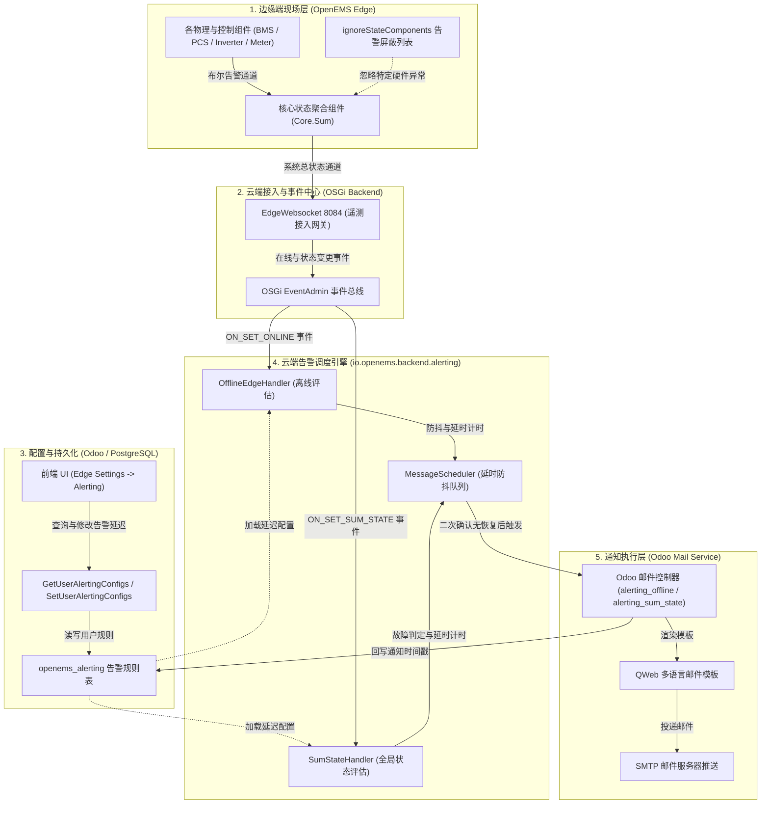
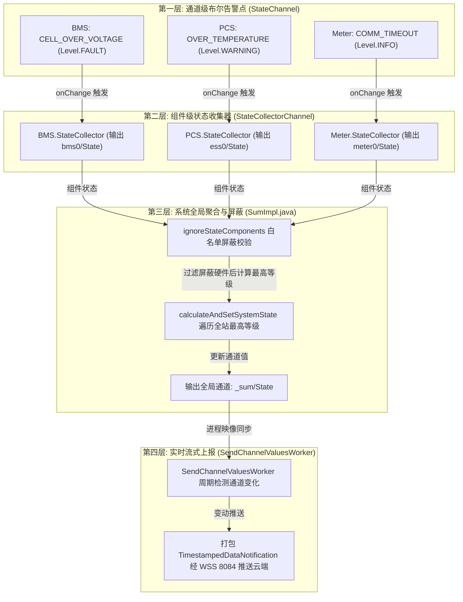
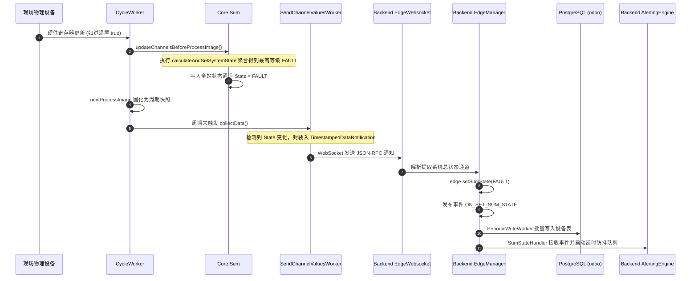
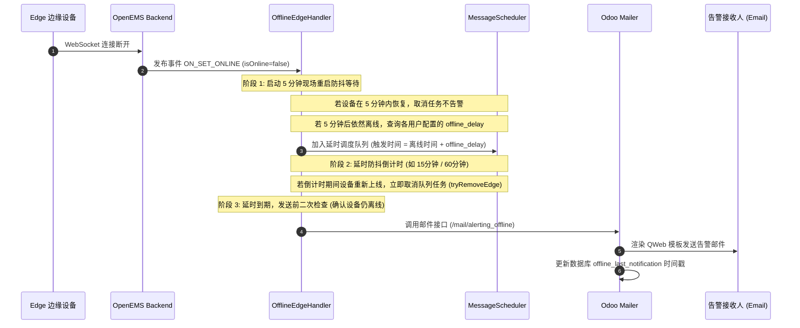

# OpenEMS 告警配置、数据模型与端到端触发机制深度剖析

本文档深入剖析 OpenEMS 告警与通知体系（Alerting System）的系统架构、边缘端状态聚合与硬件屏蔽、用户端通知策略配置、Odoo 多租户数据模型持久化、云端防抖调度评估引擎（`io.openems.backend.alerting`）以及基于 QWeb 的多语言邮件闭环推送机制。

---

## 一、 系统总体告警架构设计

OpenEMS 告警体系采用 **“边缘端状态聚合与硬件屏蔽 $\rightarrow$ 云端多租户规则配置与持久化 $\rightarrow$ 后台延时防抖评估引擎 $\rightarrow$ Odoo 动态渲染与邮件推送”** 的分层协同设计：



---

## 二、 边缘端：全局状态三层级联聚合与通道上报机制 (`SumImpl.java`)

在 OpenEMS 边缘端现场，上百个底层传感器、硬件驱动与控制逻辑每秒都在产生状态波动。为了确保系统既不会因为单点波动漏报故障，也不会由于瞬时毛刺频繁告警，OpenEMS 构建了 **“通道级 $\rightarrow$ 组件级 $\rightarrow$ 系统级” 的三层级联状态聚合模型**。



### 1. 第一层：通道级布尔告警定义 (`StateChannel.java`)
每个硬件组件在其驱动中，根据业务协议定义具体的告警指示通道：
- **通道定义**：每一个告警通道均为 [`StateChannel`](file:///opt/openems/source/io.openems.edge.common/src/io/openems/edge/common/channel/StateChannel.java)（继承自 `BooleanReadChannel`），静态绑定一个 [`Level`](file:///opt/openems/source/io.openems.common/src/io/openems/common/channel/Level.java) 枚举属性：
  - `OK (0)`：无告警；
  - `INFO (1)`：信息状态（如系统处于待机模式或已知软性状态）；
  - `WARNING (2)`：警告状态（轻度越限、温升过快，设备仍可降额运转）；
  - `FAULT (3)`：停机故障（电芯击穿、逆变器跳闸、急停保护）。
- **触发机制**：硬件寄存器发生跳变时，驱动直接执行 `channel.setNextValue(true)`。

### 2. 第二层：组件级状态自动收集器 (`StateCollectorChannel.java`)
每个继承自 [`AbstractOpenemsComponent`](file:///opt/openems/source/io.openems.edge.common/src/io/openems/edge/common/component/AbstractOpenemsComponent.java) 的组件，都自动拥有一个预置通道 `ChannelId: STATE`（类型为 [`StateCollectorChannel`](file:///opt/openems/source/io.openems.edge.common/src/io/openems/edge/common/channel/internal/StateCollectorChannel.java)）：
1. **多路监听绑定**：组件内部注册的所有 `StateChannel` 都会通过 `addChannel()` 自动向该组件的 `StateCollectorChannel` 注册 `onChange` 监听器；
2. **多值映射表**：内部维护 `Multimap<Level, ChannelId> activeStates`，记录当前处于 `true` 的所有告警通道及其级别；
3. **组件内部择大胜出（Highest Wins）**：
   ```java
   var nextValue = 0;
   for (Level level : Level.values()) {
       if (this.activeStates.get(level).size() > 0) {
           nextValue = Math.max(nextValue, level.getValue());
       }
   }
   this.setNextValue(nextValue);
   ```
   任何一个具体的组件只要存在任意一个 `FAULT` 通道激活，该组件的整体状态 `component.getState()` 立即被推升至 `FAULT`。

### 3. 第三层：系统级聚合与过滤 (`SumImpl.java`)
[`Core.Sum`](file:///opt/openems/source/io.openems.edge.core/src/io/openems/edge/core/sum/SumImpl.java)（单例组件 `_sum`）负责将全站数十台设备的状态统一收敛为全站唯一的运行状态：

#### （1）精准执行相位（Cycle Timing）
Edge 的控制循环由 [`CycleWorker.java`](file:///opt/openems/source/io.openems.edge.core/src/io/openems/edge/core/cycle/CycleWorker.java#L61-L68) 严格编排调度（默认每 1000ms 循环一次）：
- **步骤 1**：所有物理组件完成底层协议读取，各通道切入当前进程映像；
- **步骤 2**：`CycleWorker` 显式调用 `this.parent.sumComponent.updateChannelsBeforeProcessImage()`；
- **步骤 3**：`SumImpl` 内部依次计算电量、三相功率流动、电价，最后调用核心方法 `calculateAndSetSystemState()`；
- **步骤 4**：`CycleWorker` 调用 `channels().forEach(channel -> channel.nextProcessImage())`，将全站计算值固化为该周期的标准映像。

#### （2）状态聚合与白名单屏蔽实现细节
```java
private void calculateAndSetSystemState() {
    var highestLevel = Level.OK;
    var hasIgnoredComponentStates = false;

    // 1. 遍历 Edge 当前所有启用的组件
    for (var component : this.componentManager.getEnabledComponents()) {
        if (component == this) {
            continue; // 忽略 Sum 组件自身
        }
        var level = component.getState(); // 获取该组件汇总等级

        // 2. 检查是否属于白名单忽略组件
        if (this.ignoreStateComponents.contains(component.id()) && level != Level.OK) {
            hasIgnoredComponentStates = true; // 记录存在被屏蔽的组件异常
        } else {
            setValue(this, Sum.ChannelId.HAS_IGNORED_COMPONENT_STATES, false);
            // 3. 正常组件计入全站最高等级择大计算
            if (level.getValue() > highestLevel.getValue()) {
                highestLevel = level;
            }
        }
    }

    // 4. 若存在被屏蔽的异常，系统总状态升格至 INFO 提示，但不触发 WARNING/FAULT
    if (hasIgnoredComponentStates) {
        setValue(this, Sum.ChannelId.HAS_IGNORED_COMPONENT_STATES, true);
        if (Level.INFO.getValue() > highestLevel.getValue()) {
            highestLevel = Level.INFO;
        }
    }

    // 5. 设置全局唯一的系统告警通道
    this.getStateChannel().setNextValue(highestLevel);
}
```

### 4. 第四层：端到云通道上报与数据流时序



1. **边缘发送端**：[`SendChannelValuesWorker.java`](file:///opt/openems/source/io.openems.edge.controller.api.backend/src/io/openems/edge/controller/api/backend/SendChannelValuesWorker.java) 在每个 Cycle 收集变化通道，当检测到 `_sum/State` 发生改变时，将其以键值对 `{"_sum/State": "FAULT"}` 封装入 `TimestampedDataNotification` 报文发往云端；
2. **云端接入端**：[`OnNotification.java`](file:///opt/openems/source/io.openems.backend.edge.manager/src/io/openems/backend/edge/manager/OnNotification.java#L228-L231) 拦截到包含 `_sum/State` 的推送时，就地提取为 `Level` 枚举，并调用 `edge.setSumState(sumState)`；
3. **事件级联分发**：[`Edge.java`](file:///opt/openems/source/io.openems.backend.common/src/io/openems/backend/common/metadata/Edge.java#L253-L257) 派发 OSGi 事件 `Edge.Events.ON_SET_SUM_STATE`，一路由 `PeriodicWriteWorker` 每 30 秒合批写入 PostgreSQL 数据库表 `openems_device`，另一路同步唤醒 `SumStateHandler` 启动后续的延时防抖与邮件通知流程。

---

## 三、 用户端：告警规则配置（UI 与 JSON-RPC）

用户在 Web 前端进入 **Edge Settings $\rightarrow$ Alerting** 模块，按需定制自身或受管用户的告警策略。

### 1. 前端配置项与离散延迟梯度 (`alerting.component.ts`)
系统设计了离散的延迟阶梯，以有效避免由于瞬时网络抖动或传感器毛刺引起的骚扰：
- **离线告警（Online/Offline Status）**：
  - **启用开关（Toggle）**：开启/关闭该电站的离线通知；
  - **延迟阶梯（Delay）**：`15 分钟`、`60 分钟`、`1440 分钟（24 小时）`；
  - **渠道**：E-Mail 勾选框。
- **故障告警（Fault Status）**：
  - **启用开关（Toggle）**：需具备 `INSTALLER` 及以上角色才可启用；
  - **延迟阶梯（Delay）**：`15 分钟`、`60 分钟`、`1440 分钟`。
- **警告告警（Warning Status）**：支持配置警告延迟。

### 2. 细粒度 RBAC 权限与代理配置 (`OnRequest.java`)
- **普通用户（User / Owner）**：只能通过 `GetUserAlertingConfigsRequest` 查阅和修改自己绑定的告警规则；
- **管理员（Admin / Installer）**：调用 `GetUserAlertingConfigsRequest` 时，除了获取自身配置，还会返回该电站下所有其他用户（`otherUsers`）的配置列表，并具备代他人批量修改的权限（`SetUserAlertingConfigsRequest`）。如果非管理员尝试修改他人配置，云端会直接抛出 `OpenemsException: Not allowed to update/set alerting information for other users`。

---

## 四、 数据模型：持久化存储（Odoo & PostgreSQL）

告警规则持久化保存在 PostgreSQL 的 `odoo` 库中，由 Odoo ORM 模型 [`openems.alerting`](file:///home/user01/local/openems/odoo-addon-openems/openems/models/device.py#L277-L322) 统一管理：

| 数据库字段 | 字段类型 | 业务说明 |
| :--- | :--- | :--- |
| **`device_id`** | Many2one (`openems.device`) | 目标储能电站（Edge ID）外键关联 |
| **`user_id`** | Many2one (`res.users`) | 告警接收人账号主体外键关联 |
| **`offline_delay`** | Integer (分钟) | 离线报警延迟时间（默认 1440 分钟，0 表示禁用） |
| **`fault_delay`** | Integer (分钟) | FAULT 严重故障报警延迟时间（默认 1440 分钟） |
| **`warning_delay`** | Integer (分钟) | WARNING 警告报警延迟时间（默认 1440 分钟） |
| **`offline_last_notification`** | Datetime | 上一次发送离线邮件的时间戳（防重复发送） |
| **`sum_state_last_notification`** | Datetime | 上一次发送故障邮件的时间戳（防重复发送） |

> **唯一性约束**：`_sql_constraints = [("device_user_uniq", "unique(device_id, user_id)", "User already has Alerting Settings.")]`，确保每个用户在单个电站上只有一条唯一的规则配置。

---

## 五、 云端引擎：防抖、延时调度与触发逻辑 (`io.openems.backend.alerting`)

云端通过事件监听捕获边缘连接和健康状态变化，使用延时防抖队列避免“告警风暴”：

### 1. 离线告警处理机制 (`OfflineEdgeHandler.java`)



### 2. 系统故障告警处理机制 (`SumStateHandler.java`)
- **状态跃迁监听**：监听 `ON_SET_SUM_STATE`，当 `_sum/State` 跃迁为 `WARNING` 或 `FAULT` 时，记录故障起始时间戳 `faultSince`；
- **状态自愈与取消**：若设备在设定的延迟时间（如 15 分钟）内恢复至 `OK` 或 `INFO`，`handleEdgeOnSetSumState` 立即从 `MessageScheduler` 中移除该任务，不触发邮件；
- **二次状态校验（Double Check）**：在定时到达触发投递前，强制执行 `isEdgeErrorAndOnline(edgeId)`，确认当前设备依然处于异常状态且在线，防止设备断线与故障状态交织误报。

### 3. 全局防打崩限流保护
- **服务启动预热等待**：后端启动时配置 `initialDelay = 15分钟`，等待全网设备建连稳定后再开始离线检测，防止重启服务引发误报；
- **批量阈值保护**：单次处理超过 `MAX_SIMULTANEOUS_EDGES (1000)` 或 `MAX_SIMULTANEOUS_MSGS (500)` 时触发熔断保护；
- **超期边缘剔除**：若设备离线超过 1 周（`minusWeeks(1)`），系统认定为已停运电站，自动终止重复调度。

---

## 六、 通知落地：多语言模板与邮件闭环

当满足告警触发条件后，Backend 通过 [`Mailer.java`](file:///opt/openems/source/io.openems.backend.metadata.odoo/src/io/openems/backend/metadata/odoo/MetadataOdoo.java#L560-L587) 异步调用 Odoo Web 控制器：
1. **API 路由**：
   - 离线告警：`POST /openems_backend/mail/alerting_offline`
   - 故障告警：`POST /openems_backend/mail/alerting_sum_state`
2. **多语言 QWeb 邮件模板**：
   - [`alerting_offline.xml`](file:///home/user01/local/openems/odoo-addon-openems/openems/mail/openems/alerting_offline.xml)：离线提示模板（包含电站名称、最后心跳时间、排查指引）；
   - [`alerting_sum_state.xml`](file:///home/user01/local/openems/odoo-addon-openems/openems/mail/openems/alerting_sum_state.xml)：故障告警模板（包含具体严重等级、当前状态详情）；
   - 模板基于 `object.user_id.get_mapped_language()` 自动匹配德语、中文、英语等接收语言。
3. **状态回写闭环**：
   - 发送完成后，Odoo 原子性将 `last_notification` 时间写入 `openems_alerting` 表，保证在电站持续处于故障/离线状态期间，不会因定时扫描而重复高频骚扰用户。
