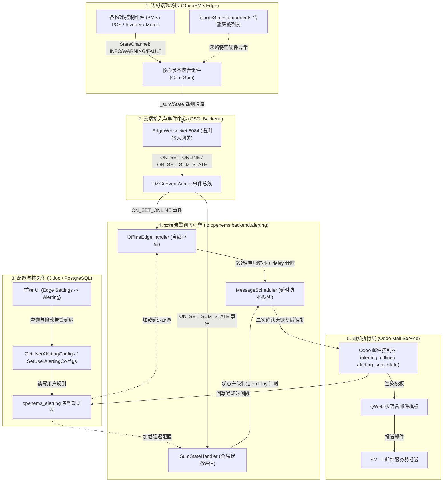
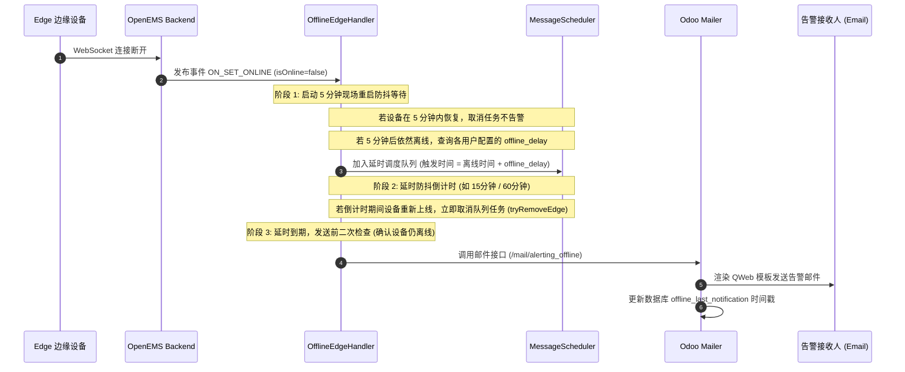

# OpenEMS 告警配置、数据模型与端到端触发机制深度剖析

本文档深入剖析 OpenEMS 告警与通知体系（Alerting System）的系统架构、边缘端状态聚合与硬件屏蔽、用户端通知策略配置、Odoo 多租户数据模型持久化、云端防抖调度评估引擎（`io.openems.backend.alerting`）以及基于 QWeb 的多语言邮件闭环推送机制。

---

## 一、 系统总体告警架构设计

OpenEMS 告警体系采用 **“边缘端状态聚合与硬件屏蔽 $\rightarrow$ 云端多租户规则配置与持久化 $\rightarrow$ 后台延时防抖评估引擎 $\rightarrow$ Odoo 动态渲染与邮件推送”** 的分层协同设计：

---

## 二、 边缘端：告警生成、聚合与硬件屏蔽机制

### 1. 四级状态等级体系 (`Level.java`)
OpenEMS 组件通道使用 `StateChannel` 定义其健康状态：
- **`OK (0)`**：系统正常，无异常；
- **`INFO (1)`**：信息提示（状态正常展示，不触发告警通知）；
- **`WARNING (2)`**：警告等级（轻微故障，如通讯丢包、环境温度偏高、未致命降额）；
- **`FAULT (3)`**：严重故障（停机故障，如电池单体过温过压、绝缘阻抗过低、PCS 急停）。

### 2. 全局状态聚合与通道上报 (`SumImpl.java`)
边缘端核心单例组件 [`Core.Sum`](file:///opt/openems/source/io.openems.edge.core/src/io/openems/edge/core/sum/SumImpl.java) 在每个控制周期（默认 1 秒）执行 `calculateAndSetSystemState()`：
1. 遍历当前已启用的所有物理与逻辑组件；
2. 提取每个组件的最大 `StateChannel` 等级（`component.getState()`）；
3. 计算得到全站的最高等级（`highestLevel`）；
4. 将结果写入全局只读通道 `_sum/State`；
5. 该通道值连同时间戳遥测数据由 `EdgeWebsocket`（端口 8084）定时打包推送到云端。

### 3. 硬件告警屏蔽过滤 (`ignoreStateComponents`)
针对现场调试、已知非致命告警或停运维护的特定硬件组件，系统支持在 `Core.Sum` 的 OSGi 配置中配置屏蔽：
- **配置项**：`ignoreStateComponents = ["meter1", "charger2"]`；
- **作用机制**：当被屏蔽组件上报 `WARNING` 或 `FAULT` 时，`SumImpl` 自动将其排除在全局 `highestLevel` 裁决之外，防止单一非核心硬件故障导致整站误报停机。

---

## 三、 用户端：告警规则配置（UI 与 JSON-RPC）

用户在 Web 前端进入 **Edge Settings $\rightarrow$ Alerting** 模块，按需定制自身或受管用户的告警策略。

### 1. 前端配置项与离散延迟梯度 (`alerting.component.ts`)
系统设计了离散的延迟阶梯，以有效避免由于瞬时网络抖动或传感器毛刺引起的骚扰：
- **离线告警（Online/Offline Status）**：
  - **启用开关（Toggle）**：开启/关闭该电站的离线通知；
  - **延迟阶梯（Delay）**：`15 分钟`、`60 分钟`、`1440 分钟（24 小时）`；
  - **渠道**：E-Mail 勾选框。
- **故障告警（Fault Status）**：
  - **启用开关（Toggle）**：需具备 `INSTALLER` 及以上角色才可启用；
  - **延迟阶梯（Delay）**：`15 分钟`、`60 分钟`、`1440 分钟`。
- **警告告警（Warning Status）**：支持配置警告延迟。

### 2. 细粒度 RBAC 权限与代理配置 (`OnRequest.java`)
- **普通用户（User / Owner）**：只能通过 `GetUserAlertingConfigsRequest` 查阅和修改自己绑定的告警规则；
- **管理员（Admin / Installer）**：调用 `GetUserAlertingConfigsRequest` 时，除了获取自身配置，还会返回该电站下所有其他用户（`otherUsers`）的配置列表，并具备代他人批量修改的权限（`SetUserAlertingConfigsRequest`）。如果非管理员尝试修改他人配置，云端会直接抛出 `OpenemsException: Not allowed to update/set alerting information for other users`。

---

## 四、 数据模型：持久化存储（Odoo & PostgreSQL）

告警规则持久化保存在 PostgreSQL 的 `odoo` 库中，由 Odoo ORM 模型 [`openems.alerting`](file:///home/user01/local/openems/odoo-addon-openems/openems/models/device.py#L277-L322) 统一管理：

| 数据库字段 | 字段类型 | 业务说明 |
| :--- | :--- | :--- |
| **`device_id`** | Many2one (`openems.device`) | 目标储能电站（Edge ID）外键关联 |
| **`user_id`** | Many2one (`res.users`) | 告警接收人账号主体外键关联 |
| **`offline_delay`** | Integer (分钟) | 离线报警延迟时间（默认 1440 分钟，0 表示禁用） |
| **`fault_delay`** | Integer (分钟) | FAULT 严重故障报警延迟时间（默认 1440 分钟） |
| **`warning_delay`** | Integer (分钟) | WARNING 警告报警延迟时间（默认 1440 分钟） |
| **`offline_last_notification`** | Datetime | 上一次发送离线邮件的时间戳（防重复发送） |
| **`sum_state_last_notification`** | Datetime | 上一次发送故障邮件的时间戳（防重复发送） |

> **唯一性约束**：`_sql_constraints = [("device_user_uniq", "unique(device_id, user_id)", "User already has Alerting Settings.")]`，确保每个用户在单个电站上只有一条唯一的规则配置。

---

## 五、 云端引擎：防抖、延时调度与触发逻辑 (`io.openems.backend.alerting`)

云端通过事件监听捕获边缘连接和健康状态变化，使用延时防抖队列避免“告警风暴”：

### 1. 离线告警处理机制 (`OfflineEdgeHandler.java`)

### 2. 系统故障告警处理机制 (`SumStateHandler.java`)
- **状态跃迁监听**：监听 `ON_SET_SUM_STATE`，当 `_sum/State` 跃迁为 `WARNING` 或 `FAULT` 时，记录故障起始时间戳 `faultSince`；
- **状态自愈与取消**：若设备在设定的延迟时间（如 15 分钟）内恢复至 `OK` 或 `INFO`，`handleEdgeOnSetSumState` 立即从 `MessageScheduler` 中移除该任务，不触发邮件；
- **二次状态校验（Double Check）**：在定时到达触发投递前，强制执行 `isEdgeErrorAndOnline(edgeId)`，确认当前设备依然处于异常状态且在线，防止设备断线与故障状态交织误报。

### 3. 全局防打崩限流保护
- **服务启动预热等待**：后端启动时配置 `initialDelay = 15分钟`，等待全网设备建连稳定后再开始离线检测，防止重启服务引发误报；
- **批量阈值保护**：单次处理超过 `MAX_SIMULTANEOUS_EDGES (1000)` 或 `MAX_SIMULTANEOUS_MSGS (500)` 时触发熔断保护；
- **超期边缘剔除**：若设备离线超过 1 周（`minusWeeks(1)`），系统认定为已停运电站，自动终止重复调度。

---

## 六、 通知落地：多语言模板与邮件闭环

当满足告警触发条件后，Backend 通过 [`Mailer.java`](file:///opt/openems/source/io.openems.backend.metadata.odoo/src/io/openems/backend/metadata/odoo/MetadataOdoo.java#L560-L587) 异步调用 Odoo Web 控制器：
1. **API 路由**：
   - 离线告警：`POST /openems_backend/mail/alerting_offline`
   - 故障告警：`POST /openems_backend/mail/alerting_sum_state`
2. **多语言 QWeb 邮件模板**：
   - [`alerting_offline.xml`](file:///home/user01/local/openems/odoo-addon-openems/openems/mail/openems/alerting_offline.xml)：离线提示模板（包含电站名称、最后心跳时间、排查指引）；
   - [`alerting_sum_state.xml`](file:///home/user01/local/openems/odoo-addon-openems/openems/mail/openems/alerting_sum_state.xml)：故障告警模板（包含具体严重等级、当前状态详情）；
   - 模板基于 `object.user_id.get_mapped_language()` 自动匹配德语、中文、英语等接收语言。
3. **状态回写闭环**：
   - 发送完成后，Odoo 原子性将 `last_notification` 时间写入 `openems_alerting` 表，保证在电站持续处于故障/离线状态期间，不会因定时扫描而重复高频骚扰用户。
