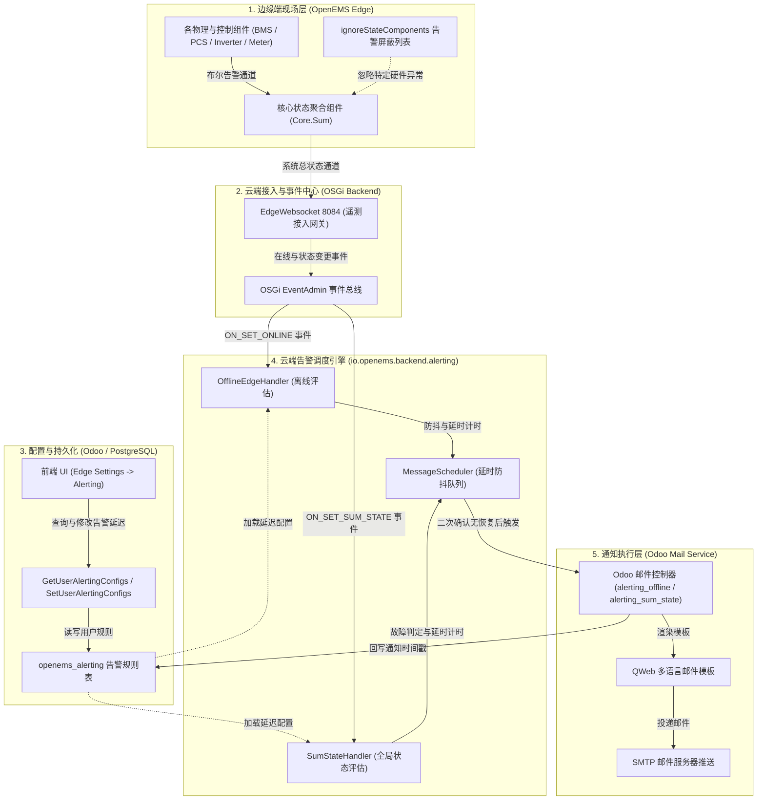
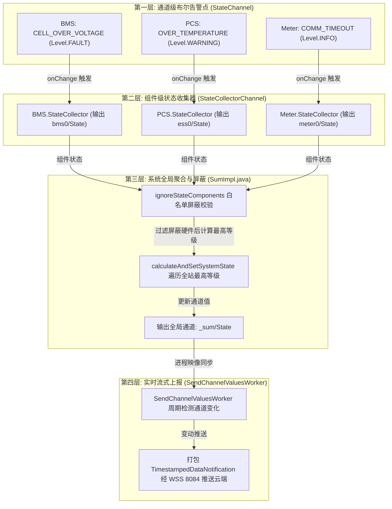
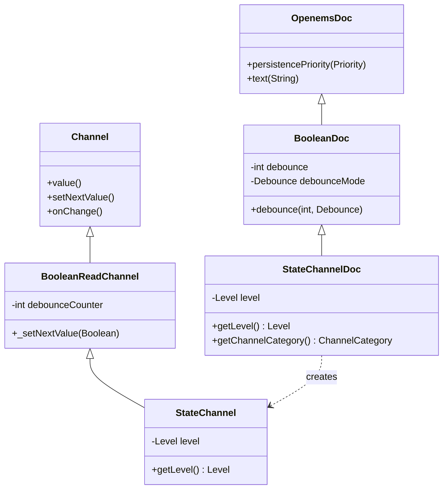
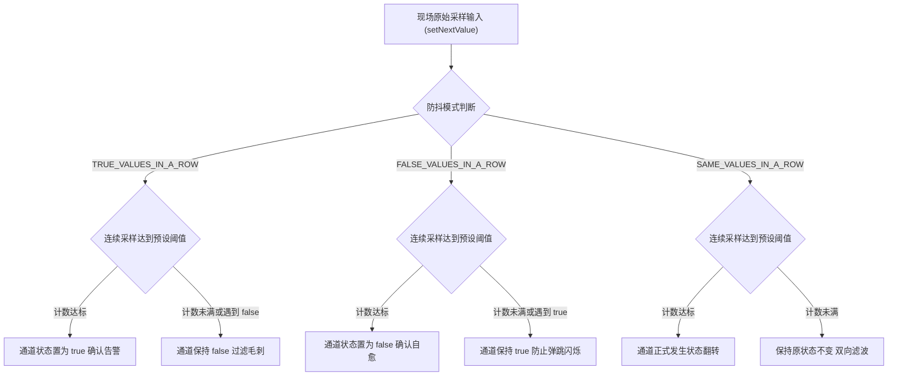
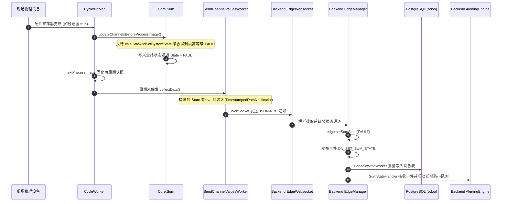
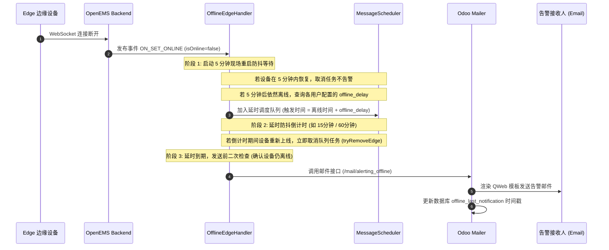

# OpenEMS 告警配置、数据模型与端到端触发机制深度剖析

本文档深入剖析 OpenEMS 告警与通知体系（Alerting System）的系统架构、边缘端状态聚合与硬件屏蔽、用户端通知策略配置、Odoo 多租户数据模型持久化、云端防抖调度评估引擎（`io.openems.backend.alerting`）以及基于 QWeb 的多语言邮件闭环推送机制。

---

## 一、 系统总体告警架构设计

OpenEMS 告警体系采用 **“边缘端状态聚合与硬件屏蔽 $\rightarrow$ 云端多租户规则配置与持久化 $\rightarrow$ 后台延时防抖评估引擎 $\rightarrow$ Odoo 动态渲染与邮件推送”** 的分层协同设计：



---

## 二、 边缘端：全局状态三层级联聚合与通道上报机制 (`SumImpl.java`)

在 OpenEMS 边缘端现场，上百个底层传感器、硬件驱动与控制逻辑每秒都在产生状态波动。为了确保系统既不会因为单点波动漏报故障，也不会由于瞬时毛刺频繁告警，OpenEMS 构建了 **“通道级 $\rightarrow$ 组件级 $\rightarrow$ 系统级” 的三层级联状态聚合模型**。



### 1. 第一层：通道级布尔告警定义 (`StateChannel.java`) 深度解析

现场设备层（BMS、PCS、电表、逆变器、IO 模块）运行过程中可能产生数十甚至数百种故障或预警。OpenEMS 采用以 [`StateChannel`](file:///opt/openems/source/io.openems.edge.common/src/io/openems/edge/common/channel/StateChannel.java) 为核心的通道级告警模型，具有以下六大核心技术设计：

#### （1）严格布尔语义（Pure Boolean Semantics）与控制面解耦
在工业控制与数字能源系统中，最常见的误区是将模拟量（如温度 75℃、母线电压 820V）或混合状态码直接作为告警通道。OpenEMS 的通道级告警遵循**严格布尔语义（Boolean Semantics）**：
- **二值互斥**：一个告警通道只有两种确定状态 —— `true`（告警已激活）与 `false`（告警未激活或已恢复），系统启动初始值默认严格为 `false`；
- **模拟量门限解耦**：所有模拟量（如单体电芯过温、母线欠压）必须在硬件驱动或控制器内部完成阈值比较与判定，输出布尔量后再赋值给 `StateChannel`；
- **单一职责**：一个 `StateChannel` 只代表一个原子级故障条件（例如 `CELL_OVER_VOLTAGE`、`CONTACTOR_OPEN_FAILED`），使得告警原因可精确定位，杜绝歧义。

#### （2）声明式元数据体系与四级严重度（`Doc.of(Level)`）
告警通道不是在代码中动态硬编码创建，而是通过组件接口中的 `ChannelId` 枚举以**声明式元数据**（Declarative Metadata）进行定义：



在 [`StateChannelDoc.java`](file:///opt/openems/source/io.openems.edge.common/src/io/openems/edge/common/channel/StateChannelDoc.java#L12-L22) 中，底层自动完成核心特性绑定：
- **静态严重度绑定**：通道强绑定 [`Level`](file:///opt/openems/source/io.openems.common/src/io/openems/common/channel/Level.java) 枚举属性，涵盖 4 个级别：
  - `OK (0)`：正常运行，无告警；
  - `INFO (1)`：信息级状态（如系统处于待机模式或已知软性状态）；
  - `WARNING (2)`：警告级异常（如环境温度偏高、滤网脏堵，设备降额运转但不停机）；
  - `FAULT (3)`：严重故障（如直流过压、急停触发、逆变器跳闸，系统立即联锁停机保护）。
- **分类标识**：`getChannelCategory()` 明确返回 `ChannelCategory.STATE`，在全站通道检索、监控看板和持久化归档中被区分识别；
- **高优先级持久化（`PersistencePriority.HIGH`）**：告警通道默认配置最高持久化优先级，确保每一次由 `false` 到 `true`（触发）或 `true` 到 `false`（恢复）的跳变都会作为首要时序数据（SOE 顺序事件记录）立即归档入 InfluxDB，用于故障精准溯源。

#### （3）硬件协议寄存器直接位映射（以 BMW 储能电池驱动为例）
在硬件通信驱动实现中，现场设备（如 BMS、PCS）通常通过 Modbus 寄存器以“状态字（Bitmask / Status Words）”的形式一次性反馈数十个内部故障状态。OpenEMS 提供了 [`BitsWordElement`](file:///opt/openems/source/io.openems.edge.bridge.modbus/src/io/openems/edge/bridge/modbus/api/element/BitsWordElement.java) 机制，实现硬件寄存器比特位与 `StateChannel` 的零代码胶水映射：

**定义阶段：在组件接口枚举中声明告警通道与级别**（参考 [`BatteryBmw.java`](file:///opt/openems/source/io.openems.edge.battery.bmw/src/io/openems/edge/battery/bmw/BatteryBmw.java#L53-L125)）：
```java
public interface BatteryBmw extends Battery, ModbusComponent, OpenemsComponent {
    public static enum ChannelId implements io.openems.edge.common.channel.ChannelId {
        // 停机级故障 (Level.FAULT)
        UNSPECIFIED_ERROR(Doc.of(Level.FAULT).text("Unspecified Error - Cell-config-Error")),
        LOW_VOLTAGE_ERROR(Doc.of(Level.FAULT).text("Low Voltage Error - Cell voltage minimal")),
        HIGH_VOLTAGE_ERROR(Doc.of(Level.FAULT).text("High Voltage Error - Cell voltage maximal")),
        CHARGE_CURRENT_ERROR(Doc.of(Level.FAULT).text("Charge Current Error")),
        INSULATION_ERROR(Doc.of(Level.FAULT).text("Insulation Error - Leakage detected")),

        // 警告级异常 (Level.WARNING)
        UNSPECIFIED_WARNING(Doc.of(Level.WARNING).text("Unspecified Warning")),
        LOW_VOLTAGE_WARNING(Doc.of(Level.WARNING).text("Low Voltage Warning")),
        HIGH_VOLTAGE_WARNING(Doc.of(Level.WARNING).text("High Voltage Warning")),
        // ...
    }
}
```

**映射阶段：在协议驱动中将 Modbus 寄存器 Bit 位与通道一对一绑定**（参考 [`BatteryBmwImpl.java`](file:///opt/openems/source/io.openems.edge.battery.bmw/src/io/openems/edge/battery/bmw/BatteryBmwImpl.java#L188-L235)）：
```java
// 读取 1001 寄存器 (ErrBits1: 停机故障字)
m(new BitsWordElement(1001, this)
    .bit(0, BatteryBmw.ChannelId.UNSPECIFIED_ERROR)
    .bit(1, BatteryBmw.ChannelId.LOW_VOLTAGE_ERROR)
    .bit(2, BatteryBmw.ChannelId.HIGH_VOLTAGE_ERROR)
    .bit(3, BatteryBmw.ChannelId.CHARGE_CURRENT_ERROR)
    .bit(4, BatteryBmw.ChannelId.DISCHARGE_CURRENT_ERROR)
    .bit(11, BatteryBmw.ChannelId.INSULATION_ERROR)
    .bit(12, BatteryBmw.ChannelId.CONTACTOR_ERROR)
    .bit(15, BatteryBmw.ChannelId.COMMUNICATION_ERROR)
),
// 读取 1003 寄存器 (WarnBits1: 警告状态字)
m(new BitsWordElement(1003, this)
    .bit(0, BatteryBmw.ChannelId.UNSPECIFIED_WARNING)
    .bit(1, BatteryBmw.ChannelId.LOW_VOLTAGE_WARNING)
    .bit(2, BatteryBmw.ChannelId.HIGH_VOLTAGE_WARNING)
    .bit(3, BatteryBmw.ChannelId.CHARGE_CURRENT_WARNING)
)
```
当 Modbus 协议栈解析到底层二进制字后，`BitsWordElement` 自动完成位移和掩码提取，将对应 bit 的布尔值灌入对应的 `StateChannel` 中，实现完全声明式、高吞吐的硬件通道映射。

#### （4）原生连续采样滤波与防抖机制（`Debounce`）
工业现场常伴随剧烈电磁干扰、继电器触点弹跳、偶发总线 CRC 误码。如果将底层原始跳变直接作为告警输出，极易引发**瞬时误报与告警震荡**。

OpenEMS 在 [`BooleanDoc`](file:///opt/openems/source/io.openems.edge.common/src/io/openems/edge/common/channel/BooleanDoc.java#L44-L48) 与 [`BooleanReadChannel`](file:///opt/openems/source/io.openems.edge.common/src/io/openems/edge/common/channel/BooleanReadChannel.java#L30-L94) 中原生集成了基于 Cycle 周期的连续采样计数器防抖机制，支持三种滤波模式（[`Debounce.java`](file:///opt/openems/source/io.openems.common/src/io/openems/common/channel/Debounce.java#L3-L22)）：



1. **`TRUE_VALUES_IN_A_ROW_TO_SET_TRUE`（置位滤波）**：
   - 只有当底层连续 $N$ 个 Cycle（例如连续 10 秒）均上报 `true` 时，通道才最终置为 `true`；期间只要有 1 个 Cycle 出现 `false`，计数器立即归零。
   - **适用场景**：现场通信瞬断容忍、偶发温度漂移检测。
   - **实际配置代码**（参考 [`ModbusApi.java`](file:///opt/openems/source/io.openems.edge.controller.api.modbus/src/io/openems/edge/controller/api/modbus/ModbusApi.java#L18)）：
     ```java
     Doc.of(Level.FAULT)
        .debounce(10, Debounce.TRUE_VALUES_IN_A_ROW_TO_SET_TRUE)
        .text("Modbus 连续 10 个周期通信失败才判定停机故障")
     ```
2. **`FALSE_VALUES_IN_A_ROW_TO_SET_FALSE`（复位滤波）**：
   - 告警触发后，现场必须连续 $N$ 个周期全部上报 `false`，通道才判定故障清除自愈。
   - **适用场景**：继电器触点弹跳、电弧打火抑制、间歇性接触不良（防止告警在秒级内反复告警与恢复）。
3. **`SAME_VALUES_IN_A_ROW_TO_CHANGE`（双向滤波）**：
   - 无论是从正常跃迁至告警，还是从告警恢复至正常，都必须在目标状态下连续稳定保持 $N$ 个周期才允许翻转。
   - **实际配置代码**（参考 [`ModbusComponent.java`](file:///opt/openems/source/io.openems.edge.bridge.modbus/src/io/openems/edge/bridge/modbus/api/ModbusComponent.java#L29-L31)）：
     ```java
     MODBUS_COMMUNICATION_FAILED(Doc.of(Level.WARNING)
        .debounce(10, Debounce.SAME_VALUES_IN_A_ROW_TO_CHANGE)
        .text("Modbus Communication failed"))
     ```

#### （5）复合告警聚合器（`StateChannel.TriggerOnAny`）
在复杂控制逻辑中，某些宏观状态往往由多个子告警联合触发。`StateChannel` 内置了 [`TriggerOnAny`](file:///opt/openems/source/io.openems.edge.common/src/io/openems/edge/common/channel/StateChannel.java#L27-L66) 函数式消费监听器：
- 接收一组源通道列表（`sourceChannelIds...`）；
- 自动注册响应式 `onChangeCallback` 监听；
- 只要任意一个源通道激活为 `true`，目标通道自动置为 `true`，并打印日志指示触发源；
- 仅当所有源通道全部归零恢复后，目标通道才复位为 `false`。

#### （6）向上响应式联动驱动（Reactive Cascading to Layer 2）
`StateChannel` 在组件生命周期内完全遵循**自驱动响应式设计**，避免了组件级的轮询损耗：
- 在 [`AbstractOpenemsComponent.java`](file:///opt/openems/source/io.openems.edge.common/src/io/openems/edge/common/component/AbstractOpenemsComponent.java#L393-L395) 的 `addChannel()` 方法中，只要检测到当前注册的通道是 `StateChannel` 实例：
  ```java
  if (channel instanceof StateChannel sc) {
      this.getStateChannel().addChannel(sc);
  }
  ```
- 组件框架自动将该 `StateChannel` 注册进第二层组件收集器 `StateCollectorChannel`；
- 一旦通道经防抖后触发真实值跃迁，立即触发第二层收集器的 `activeStates` 多值映射表更新，以事件驱动方式极速完成“通道级 $\rightarrow$ 组件级”的毫秒级向上级联推导。

### 2. 第二层：组件级状态自动收集器 (`StateCollectorChannel.java`)
每个继承自 [`AbstractOpenemsComponent`](file:///opt/openems/source/io.openems.edge.common/src/io/openems/edge/common/component/AbstractOpenemsComponent.java) 的组件，都自动拥有一个预置通道 `ChannelId: STATE`（类型为 [`StateCollectorChannel`](file:///opt/openems/source/io.openems.edge.common/src/io/openems/edge/common/channel/internal/StateCollectorChannel.java)）：
1. **多路监听绑定**：组件内部注册的所有 `StateChannel` 都会通过 `addChannel()` 自动向该组件的 `StateCollectorChannel` 注册 `onChange` 监听器；
2. **多值映射表**：内部维护 `Multimap<Level, ChannelId> activeStates`，记录当前处于 `true` 的所有告警通道及其级别；
3. **组件内部择大胜出（Highest Wins）**：
   ```java
   var nextValue = 0;
   for (Level level : Level.values()) {
       if (this.activeStates.get(level).size() > 0) {
           nextValue = Math.max(nextValue, level.getValue());
       }
   }
   this.setNextValue(nextValue);
   ```
   任何一个具体的组件只要存在任意一个 `FAULT` 通道激活，该组件的整体状态 `component.getState()` 立即被推升至 `FAULT`。

### 3. 第三层：系统级聚合与过滤 (`SumImpl.java`)
[`Core.Sum`](file:///opt/openems/source/io.openems.edge.core/src/io/openems/edge/core/sum/SumImpl.java)（单例组件 `_sum`）负责将全站数十台设备的状态统一收敛为全站唯一的运行状态：

#### （1）精准执行相位（Cycle Timing）
Edge 的控制循环由 [`CycleWorker.java`](file:///opt/openems/source/io.openems.edge.core/src/io/openems/edge/core/cycle/CycleWorker.java#L61-L68) 严格编排调度（默认每 1000ms 循环一次）：
- **步骤 1**：所有物理组件完成底层协议读取，各通道切入当前进程映像；
- **步骤 2**：`CycleWorker` 显式调用 `this.parent.sumComponent.updateChannelsBeforeProcessImage()`；
- **步骤 3**：`SumImpl` 内部依次计算电量、三相功率流动、电价，最后调用核心方法 `calculateAndSetSystemState()`；
- **步骤 4**：`CycleWorker` 调用 `channels().forEach(channel -> channel.nextProcessImage())`，将全站计算值固化为该周期的标准映像。

#### （2）状态聚合与白名单屏蔽实现细节
```java
private void calculateAndSetSystemState() {
    var highestLevel = Level.OK;
    var hasIgnoredComponentStates = false;

    // 1. 遍历 Edge 当前所有启用的组件
    for (var component : this.componentManager.getEnabledComponents()) {
        if (component == this) {
            continue; // 忽略 Sum 组件自身
        }
        var level = component.getState(); // 获取该组件汇总等级

        // 2. 检查是否属于白名单忽略组件
        if (this.ignoreStateComponents.contains(component.id()) && level != Level.OK) {
            hasIgnoredComponentStates = true; // 记录存在被屏蔽的组件异常
        } else {
            setValue(this, Sum.ChannelId.HAS_IGNORED_COMPONENT_STATES, false);
            // 3. 正常组件计入全站最高等级择大计算
            if (level.getValue() > highestLevel.getValue()) {
                highestLevel = level;
            }
        }
    }

    // 4. 若存在被屏蔽的异常，系统总状态升格至 INFO 提示，但不触发 WARNING/FAULT
    if (hasIgnoredComponentStates) {
        setValue(this, Sum.ChannelId.HAS_IGNORED_COMPONENT_STATES, true);
        if (Level.INFO.getValue() > highestLevel.getValue()) {
            highestLevel = Level.INFO;
        }
    }

    // 5. 设置全局唯一的系统告警通道
    this.getStateChannel().setNextValue(highestLevel);
}
```

### 4. 第四层：端到云通道上报与数据流时序



1. **边缘发送端**：[`SendChannelValuesWorker.java`](file:///opt/openems/source/io.openems.edge.controller.api.backend/src/io/openems/edge/controller/api/backend/SendChannelValuesWorker.java) 在每个 Cycle 收集变化通道，当检测到 `_sum/State` 发生改变时，将其以键值对 `{"_sum/State": "FAULT"}` 封装入 `TimestampedDataNotification` 报文发往云端；
2. **云端接入端**：[`OnNotification.java`](file:///opt/openems/source/io.openems.backend.edge.manager/src/io/openems/backend/edge/manager/OnNotification.java#L228-L231) 拦截到包含 `_sum/State` 的推送时，就地提取为 `Level` 枚举，并调用 `edge.setSumState(sumState)`；
3. **事件级联分发**：[`Edge.java`](file:///opt/openems/source/io.openems.backend.common/src/io/openems/backend/common/metadata/Edge.java#L253-L257) 派发 OSGi 事件 `Edge.Events.ON_SET_SUM_STATE`，一路由 `PeriodicWriteWorker` 每 30 秒合批写入 PostgreSQL 数据库表 `openems_device`，另一路同步唤醒 `SumStateHandler` 启动后续的延时防抖与邮件通知流程。

---

## 三、 用户端：告警规则配置（UI 与 JSON-RPC）

用户在 Web 前端进入 **Edge Settings $\rightarrow$ Alerting** 模块，按需定制自身或受管用户的告警策略。

### 1. 前端配置项与离散延迟梯度 (`alerting.component.ts`)
系统设计了离散的延迟阶梯，以有效避免由于瞬时网络抖动或传感器毛刺引起的骚扰：
- **离线告警（Online/Offline Status）**：
  - **启用开关（Toggle）**：开启/关闭该电站的离线通知；
  - **延迟阶梯（Delay）**：`15 分钟`、`60 分钟`、`1440 分钟（24 小时）`；
  - **渠道**：E-Mail 勾选框。
- **故障告警（Fault Status）**：
  - **启用开关（Toggle）**：需具备 `INSTALLER` 及以上角色才可启用；
  - **延迟阶梯（Delay）**：`15 分钟`、`60 分钟`、`1440 分钟`。
- **警告告警（Warning Status）**：支持配置警告延迟。

### 2. 细粒度 RBAC 权限与代理配置 (`OnRequest.java`)
- **普通用户（User / Owner）**：只能通过 `GetUserAlertingConfigsRequest` 查阅和修改自己绑定的告警规则；
- **管理员（Admin / Installer）**：调用 `GetUserAlertingConfigsRequest` 时，除了获取自身配置，还会返回该电站下所有其他用户（`otherUsers`）的配置列表，并具备代他人批量修改的权限（`SetUserAlertingConfigsRequest`）。如果非管理员尝试修改他人配置，云端会直接抛出 `OpenemsException: Not allowed to update/set alerting information for other users`。

---

## 四、 数据模型：持久化存储（Odoo & PostgreSQL）

告警规则持久化保存在 PostgreSQL 的 `odoo` 库中，由 Odoo ORM 模型 [`openems.alerting`](file:///home/user01/local/openems/odoo-addon-openems/openems/models/device.py#L277-L322) 统一管理：

| 数据库字段 | 字段类型 | 业务说明 |
| :--- | :--- | :--- |
| **`device_id`** | Many2one (`openems.device`) | 目标储能电站（Edge ID）外键关联 |
| **`user_id`** | Many2one (`res.users`) | 告警接收人账号主体外键关联 |
| **`offline_delay`** | Integer (分钟) | 离线报警延迟时间（默认 1440 分钟，0 表示禁用） |
| **`fault_delay`** | Integer (分钟) | FAULT 严重故障报警延迟时间（默认 1440 分钟） |
| **`warning_delay`** | Integer (分钟) | WARNING 警告报警延迟时间（默认 1440 分钟） |
| **`offline_last_notification`** | Datetime | 上一次发送离线邮件的时间戳（防重复发送） |
| **`sum_state_last_notification`** | Datetime | 上一次发送故障邮件的时间戳（防重复发送） |

> **唯一性约束**：`_sql_constraints = [("device_user_uniq", "unique(device_id, user_id)", "User already has Alerting Settings.")]`，确保每个用户在单个电站上只有一条唯一的规则配置。

---

## 五、 云端引擎：防抖、延时调度与触发逻辑 (`io.openems.backend.alerting`)

云端通过事件监听捕获边缘连接和健康状态变化，使用延时防抖队列避免“告警风暴”：

### 1. 离线告警处理机制 (`OfflineEdgeHandler.java`)



### 2. 系统故障告警处理机制 (`SumStateHandler.java`)
- **状态跃迁监听**：监听 `ON_SET_SUM_STATE`，当 `_sum/State` 跃迁为 `WARNING` 或 `FAULT` 时，记录故障起始时间戳 `faultSince`；
- **状态自愈与取消**：若设备在设定的延迟时间（如 15 分钟）内恢复至 `OK` 或 `INFO`，`handleEdgeOnSetSumState` 立即从 `MessageScheduler` 中移除该任务，不触发邮件；
- **二次状态校验（Double Check）**：在定时到达触发投递前，强制执行 `isEdgeErrorAndOnline(edgeId)`，确认当前设备依然处于异常状态且在线，防止设备断线与故障状态交织误报。

### 3. 全局防打崩限流保护
- **服务启动预热等待**：后端启动时配置 `initialDelay = 15分钟`，等待全网设备建连稳定后再开始离线检测，防止重启服务引发误报；
- **批量阈值保护**：单次处理超过 `MAX_SIMULTANEOUS_EDGES (1000)` 或 `MAX_SIMULTANEOUS_MSGS (500)` 时触发熔断保护；
- **超期边缘剔除**：若设备离线超过 1 周（`minusWeeks(1)`），系统认定为已停运电站，自动终止重复调度。

---

## 六、 通知落地：多语言模板与邮件闭环

当满足告警触发条件后，Backend 通过 [`Mailer.java`](file:///opt/openems/source/io.openems.backend.metadata.odoo/src/io/openems/backend/metadata/odoo/MetadataOdoo.java#L560-L587) 异步调用 Odoo Web 控制器：
1. **API 路由**：
   - 离线告警：`POST /openems_backend/mail/alerting_offline`
   - 故障告警：`POST /openems_backend/mail/alerting_sum_state`
2. **多语言 QWeb 邮件模板**：
   - [`alerting_offline.xml`](file:///home/user01/local/openems/odoo-addon-openems/openems/mail/openems/alerting_offline.xml)：离线提示模板（包含电站名称、最后心跳时间、排查指引）；
   - [`alerting_sum_state.xml`](file:///home/user01/local/openems/odoo-addon-openems/openems/mail/openems/alerting_sum_state.xml)：故障告警模板（包含具体严重等级、当前状态详情）；
   - 模板基于 `object.user_id.get_mapped_language()` 自动匹配德语、中文、英语等接收语言。
3. **状态回写闭环**：
   - 发送完成后，Odoo 原子性将 `last_notification` 时间写入 `openems_alerting` 表，保证在电站持续处于故障/离线状态期间，不会因定时扫描而重复高频骚扰用户。
