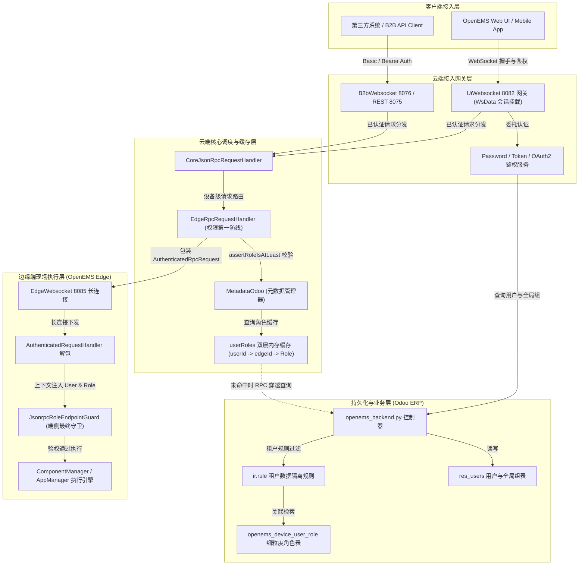
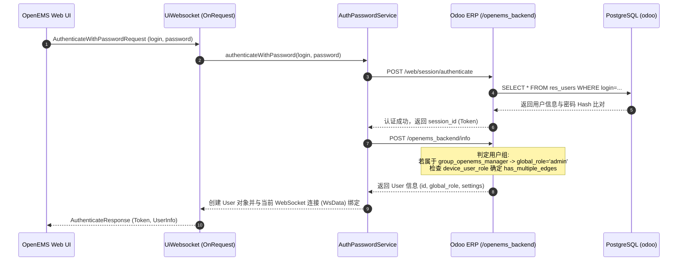
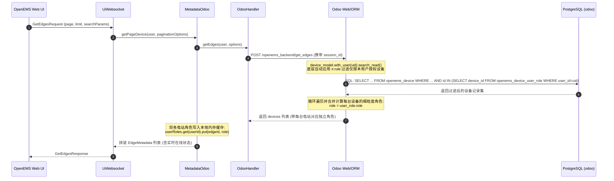
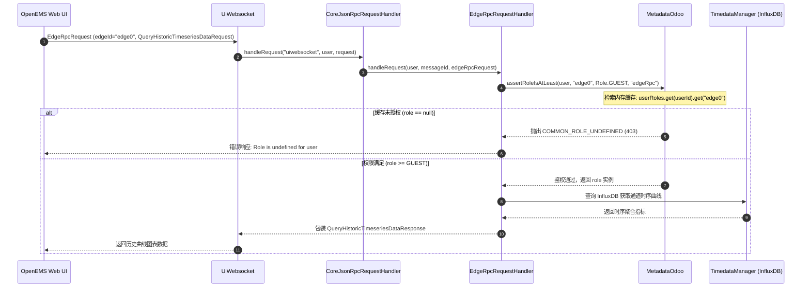
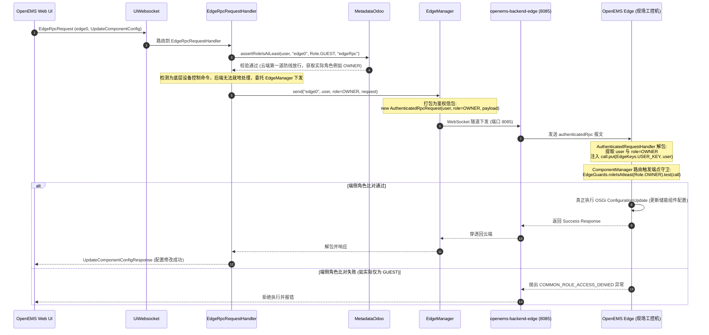
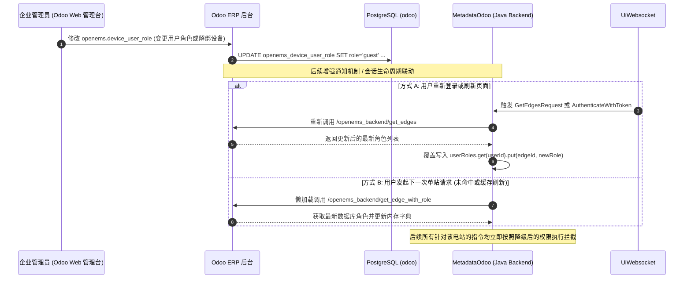

# OpenEMS Backend RBAC 权限架构与数据流深度剖析

本文档系统性剖析 OpenEMS 云端微电网操作系统中 **基于角色的访问控制体系（Role-Based Access Control, RBAC）**。内容涵盖核心权限模型、四级角色层级、Odoo 多租户持久化与行级安全规则、云端内存缓存、云端网关多层拦截机制、边缘端权限传递穿透（`AuthenticatedRpc`）以及典型业务场景的端到端数据流。

---

## 一、 系统总体 RBAC 架构设计

OpenEMS 的权限体系采用了 **“云端多租户集中裁决 + 边缘端本地终审”** 的分层协同设计。整个 RBAC 架构由三层核心构成：

1. **持久化与多租户权限源（Odoo ERP / PostgreSQL）**：统一维护用户账号、全局用户组（Manager、Reader、Portal/User）以及设备级角色授权关系表（`openems.device_user_role`），配合 Odoo 行级安全规则（`ir.rule`）提供天然的数据租户隔离。
2. **云端高性能接入与鉴权拦截层（OSGi Backend Core）**：`UiWebsocket` 与 `B2bWebsocket/Rest` 在长连接网关层识别用户身份并挂载会话；`MetadataOdoo` 维护 `userRoles` 双层高效哈希缓存字典；`EdgeRpcRequestHandler` 在云端对所有设备请求执行第一道权限守卫（`assertRoleIsAtLeast`）。
3. **边缘穿透与端侧本地守卫（Edge Core）**：对于需要写设备配置、切换运行策略或执行系统调度的控制指令，云端将用户身份与该设备上的计算角色打包为 `AuthenticatedRpcRequest` 下发至 Edge 端，Edge 端根据各模块端点的 `JsonrpcRoleEndpointGuard` 进行最终权限断言。



---

## 二、 核心权限模型与实体映射

### 1. 四级角色权限等级体系 (`io.openems.common.session.Role`)
OpenEMS 定义了严格的整型权重角色枚举，数值越小，特权级别越高：

```java
public enum Role {
    ADMIN(0),     // 系统管理员：完全控制权限（系统命令、固件升级、删除组件、全局配置）
    INSTALLER(1), // 安装调试工程师：工程交付权限（创建组件、修改高级电气参数、现场调试）
    OWNER(2),     // 电站业主/终端用户：运维管理权限（安装/更新/删除 App 实例、日常策略配置）
    GUEST(3);     // 访客/普通租户：只读权限（监控看板、实时状态订阅、历史时序查询导出）
}
```

- **权限比较逻辑**：
  - `role.isAtLeast(requiredRole)`: 当且仅当 `this.level <= requiredRole.level` 时为 `true`。
  - `role.assertIsAtLeast(resource, requiredRole)`: 若权限不足直接抛出 `OpenemsError.COMMON_ROLE_ACCESS_DENIED`。
  - 若用户未被授权该电站，角色计算为 `null`，抛出 `OpenemsError.COMMON_ROLE_UNDEFINED`。

### 2. 用户模型与抽象定义 (`AbstractUser` 与 `User`)
- `io.openems.common.session.AbstractUser`：定义用户基础属性（`id`, `userId`, `email`, `name`, `language`, `globalRole`, `settings`）。
- `io.openems.backend.common.metadata.User`：云端用户模型，附加 `token` 与 `hasMultipleEdges` 字段。
- `io.openems.edge.common.user.User`：边缘端用户模型，在 Edge 收到下发的 RPC 时从 JSON 参数就地还原。

### 3. 多租户数据库实体映射 (Odoo ERP / PostgreSQL)

| 模型/表名 | 核心字段 | 角色机制与职责说明 |
| :--- | :--- | :--- |
| **`res.users`** | `id`, `login`, `name`, `groups_id`, `global_role`, `settings` | 统一账号主体。关联的全局用户组决定初始身份：属于 `group_openems_manager` 则拥有跨所有电站的全局 `admin`；属于 `group_openems_reader` 则拥有跨所有电站的全局 `guest`。 |
| **`openems.device`** | `id`, `name` (Edge-ID), `apikey`, `user_role_ids`, `openems_is_connected` | 储能电站台账主表。通过 `user_role_ids` 反向关联该电站的所有授权用户。 |
| **`openems.device_user_role`** | `user_id`, `device_id`, `role` (`admin`, `installer`, `owner`, `guest`) | **细粒度电站-用户权限绑定表**。明确指定某一具体用户对特定具体电站所具备的独立角色。 |
| **`ir.rule`** (记录级隔离) | `domain_force` 过滤规则 | **多租户数据隔离防线**：<br>`['\|', ('user_role_ids.user_id', 'in', [user.id]), ('alerting_settings.user_id', 'in', [user.id])]` 保证普通 Portal 租户在 SQL 层面只能检索到属于自己的设备。 |

---

## 三、 云端与边缘端两级鉴权机制

### 1. 云端元数据权限缓存与双层映射 (`MetadataOdoo.java`)
为了支撑上万台设备与海量并发 UI 请求，云端绝不在每个请求中频繁远程调用 Odoo。`MetadataOdoo` 维护了高效的双层并发哈希映射表：

```java
// 映射结构: Map<userId, Map<edgeId, Role>>
private final Map<String, Map<String, Role>> userRoles = new ConcurrentHashMap<>();
```

- **缓存预热与懒加载**：
  - 用户登录拉取电站列表（`GetEdgesRequest`）时，批量预热该用户所有的 `edgeId -> Role` 映射；
  - 针对单个电站发起未预热的请求时，触发懒加载：`this.odooHandler.getEdgeWithRole(user, edgeId)` 向 Odoo 远程请求计算角色并写回缓存。

### 2. 边缘端权限守卫机制 (`JsonrpcRoleEndpointGuard` 与 `EdgeGuards`)
在 OpenEMS Edge 侧，OSGi 各服务组件在注册 JSON-RPC 路由时，使用声明式 Guard 守卫端点：

- **通用角色守卫**：
  ```java
  builder.handleRequest(new UpdateComponentConfig(),
      endpoint -> endpoint.setGuards(EdgeGuards.roleIsAtleast(Role.OWNER)),
      call -> { ... });
  ```
- **云端/本地环境差异化守卫**（安全加固设计）：
  ```java
  // 创建/删除组件：如果是从云端经鉴权通道下发，INSTALLER 即可执行；如果是本地局域网未经云端校验，则必须是本地 ADMIN
  builder.handleRequest(new CreateComponentConfig(),
      endpoint -> endpoint.setGuards(
          EdgeGuards.roleIsAtleastFromBackend(Role.INSTALLER),
          EdgeGuards.roleIsAtleastNotFromBackend(Role.ADMIN)
      ),
      call -> { ... });
  ```

---

## 四、 五大核心 RBAC 业务数据流剖析

### 1. 数据流一：用户登录认证与 RBAC 初始角色拉取流
展示用户通过前端输入账密或第三方 OAuth2 登录，云端向 Odoo 验证并建立带全局角色的 Session。



---

### 2. 数据流二：多租户电站分页列表与权限穿透过滤流 (`GetEdgesRequest`)
展示多租户组织下，用户查询电站列表时，Odoo 如何通过行级规则（`ir.rule`）自动过滤可见设备，并将每座电站的独立角色合并返回。



---

### 3. 数据流三：云端只读请求的 RBAC 拦截与本地缓存命中流 (`QueryHistoricTimeseriesDataRequest`)
展示普通租户或访客查询历史时序数据（InfluxDB），云端如何以常数时间复杂度 $O(1)$ 拦截非授权访问或放行有效只读请求。



---

### 4. 数据流四：边缘控制指令的 RBAC 校验与下发穿透全链路 (`UpdateComponentConfig`)
展示业主或安装商修改边缘储能系统参数（如最大放电功率限值）时，云端鉴权拦截、下发打包、边缘解包及端侧本地守卫终审的完整数据流。



---

### 5. 数据流五：动态权限变更与缓存一致性机制
展示当企业管理员在 Odoo ERP 后台调整用户权限（例如将用户由 `owner` 降级为 `guest` 或解绑设备）时，系统的权限同步与生效路径。



---

## 五、 OpenEMS 常见端点角色权限速查表

下表汇总了 OpenEMS 核心 API 端点及其在云端与边缘端要求的最低权限标准：

| 模块类别 | 接口/方法名 | 最低角色要求 (Edge/Backend) | 权限说明 |
| :--- | :--- | :---: | :--- |
| **监控与数据** | `SubscribeEdgesChannelsRequest` | **GUEST** | 订阅多电站实时通道遥测数据流 |
| **监控与数据** | `GetEdgesStatusRequest` | **GUEST** | 批量获取电站在线/离线健康状态 |
| **时序与报表** | `QueryHistoricTimeseriesDataRequest` | **GUEST** | 查询 InfluxDB 历史功率、SOC 等曲线数据 |
| **时序与报表** | `QueryHistoricTimeseriesExportXlxsRequest` | **GUEST** | 导出 Excel 历史运行报表 |
| **App 应用中心** | `AppCenterGetInstalledAppsRequest` | **GUEST** | 查阅当前电站已安装的应用包列表 |
| **App 应用中心** | `AddAppInstance` / `UpdateAppInstance` | **OWNER** | 新建或修改储能调度应用（如削峰填谷、动态分时） |
| **App 应用中心** | `DeleteAppInstance` | **OWNER** | 卸载电站的应用实例 |
| **组件生命周期** | `GetEdgeConfigRequest` | **GUEST** | 导出或查阅电站当前的 OSGi 组件拓扑与通道定义 |
| **组件生命周期** | `UpdateComponentConfig` | **OWNER** | 调整现有组件运行参数（如充放电限值、Modbus从机地址） |
| **组件生命周期** | `CreateComponentConfig` | **INSTALLER** (云端) / **ADMIN** (本地) | 动态实例化新的驱动或控制器组件 |
| **组件生命周期** | `DeleteComponentConfig` | **INSTALLER** (云端) / **ADMIN** (本地) | 移除现有硬件或控制驱动组件 |
| **控制与指令** | `SetChannelValueRequest` | **ADMIN** | 向通道强制写入指令（直接覆写硬件寄器/寄存器值） |
| **系统底层管理** | `executeSystemCommand` / `_host` | **ADMIN** | 执行现场工控机底层 Linux 系统 Shell 命令与服务重启 |
| **安装与验收** | `SubmitSetupProtocolRequest` | **INSTALLER** | 提交电站现场施工与调试验收工程报告 |

---

## 六、 架构设计总结与安全启示

1. **动静解耦的多租户隔离**：通过利用 Odoo 的 `ir.rule` 行级安全规则，天然在 SQL 驱动层阻止了租户间越权，避免了在业务逻辑代码中编写容易疏漏的手工 `WHERE tenant_id = ?`。
2. **两级防御与防篡改穿透**：云端首先根据用户在具体电站的计算权限执行预拦截（第一道防线）；对于下发的敏感操作，将角色封装在加密长连接传输的 `AuthenticatedRpcRequest` 中，现场 Edge 依据自身安全守卫进行本地二次验权（第二道防线），有效防御了请求绕过或伪造攻击。
3. **环境自适应守卫（`roleIsAtleastFromBackend` vs `roleIsAtleastNotFromBackend`）**：针对组件增删等敏感操作，允许云端经过企业 SSO/2FA 强认证的安装商（`INSTALLER`）执行，而在本地直连暴露的场景下收紧至 `ADMIN`，实现了运维便捷性与端侧物理安全的精细平衡。
4. **内存二级索引降低开销**：通过 `userRoles` 字典的高速缓存，使得每一笔 API 调用的权限断言仅耗时数十纳秒，保障了百万级时序与指令吞吐下的极低延迟。
