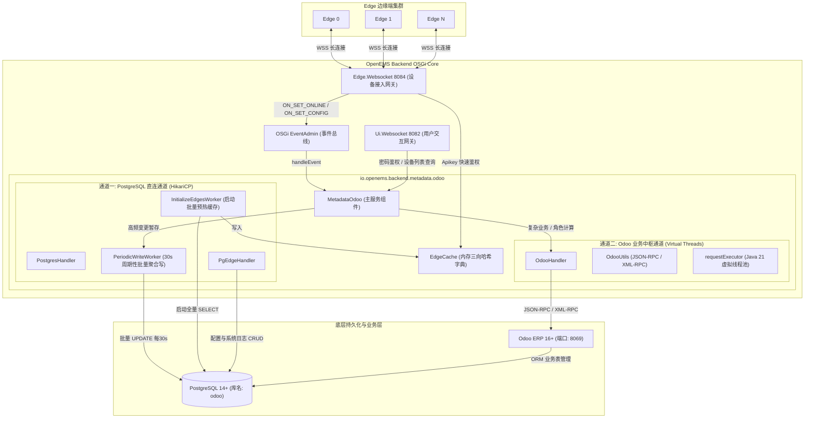
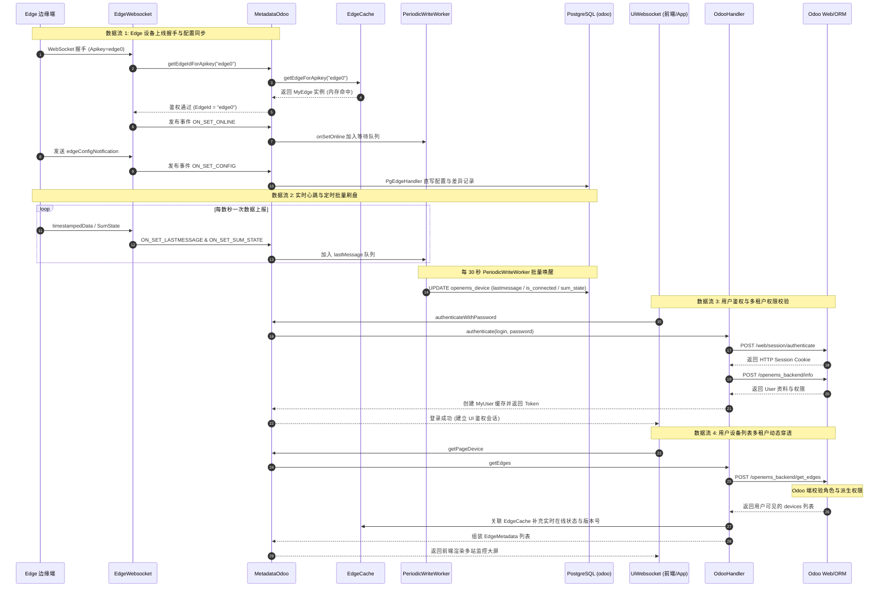

# OpenEMS Backend 元数据架构与数据流深度剖析 (Metadata.Odoo)

本文档深入剖析 OpenEMS 云端微电网操作系统核心元数据服务 **`Metadata.Odoo`**（`io.openems.backend.metadata.odoo`）的系统架构、双通道通信机制、内存缓存模型、六大端到端数据流及数据库实体映射。

---

## 一、 系统总体架构：PostgreSQL + Odoo 双通道混合架构

在大规模储能与微电网物联网系统中，数千台 Edge 设备每秒产生大量的网络连接变动、心跳更新、告警级别与组件配置变化。若全部通过 Python 运行时的 Odoo Web 接口转发，会引发 Python GIL 竞争与 Web 线程瓶颈。

因此，OpenEMS 设计了 **PostgreSQL 高性能直连通道 + Odoo ERP 业务中枢通道** 的双通道架构：



### 通道对比与职责划分

| 维度 | 通道一：PostgreSQL 直连通道 (HikariCP) | 通道二：Odoo ERP 业务通道 (HTTP/JSON-RPC/XML-RPC) |
| :--- | :--- | :--- |
| **底层实现** | JDBC 4.2 直连（`HikariDataSource`，默认 40 连接池） | HTTP 1.1 POST JSON-RPC 与 XML-RPC `execute_kw` |
| **主要类** | `PostgresHandler`、`PgEdgeHandler`、`PeriodicWriteWorker`、`InitializeEdgesWorker` | `OdooHandler`、`OdooUtils`、`HttpBridgeOdooService` |
| **适用场景** | **高频、大批量、低延迟数据流**：<br>1. 系统启动时全量加载设备至内存缓存；<br>2. 设备心跳更新（`lastmessage`）；<br>3. 在线/离线标记（`openems_is_connected`）；<br>4. 全局告警等级（`openems_sum_state_level`）；<br>5. 完整拓扑组件 JSON（`openems_config`）与版本差异（`openems_openemsconfigupdate`）。 | **低频、强事务、复杂业务流**：<br>1. 用户密码/会话鉴权（`/web/session/authenticate`）；<br>2. 用户-设备多租户 RBAC 权限计算（`/openems_backend/get_edges`）；<br>3. 电站初装验收协议审批与 PDF 报告导出；<br>4. App Center 应用许可与密钥核销；<br>5. 用户语言设置、离线报警邮件模板推送。 |
| **性能机制** | 内存批量归集缓冲（Exchangable Map），30 秒执行一次 SQL 批量更新，彻底避免数据库被高频 I/O 击穿。 | Java 21 Virtual Threads 虚拟线程池（`requestPoolSize=30`），完全非阻塞执行 HTTP 调用。 |

---

## 二、 核心组件与内存数据模型

### 1. `EdgeCache`：三向高并发内存字典
在 `EdgeCache.java` 中，维护了针对储能电站的三向映射表，保证在任意维度均具备 O(1) 的常数级寻址性能：
- `edgeIdToEdge`（`Map<String, MyEdge>`）：通过 Edge 字符串标号（如 `edge0`, `edge1`）寻址。
- `odooIdToEdgeId`（`Map<Integer, String>`）：通过 Odoo 数据库主键 `id` 寻址。
- `apikeyToEdgeId`（`Map<String, String>`）：通过边缘端携带的通讯密钥 API-Key 快速完成握手校验。

```java
public class EdgeCache {
    private final Map<String, MyEdge> edgeIdToEdge = new HashMap<>(EXPECTED_NUMBER_OF_EDGES);
    private final Map<Integer, String> odooIdToEdgeId = new HashMap<>(EXPECTED_NUMBER_OF_EDGES);
    private final Map<String, String> apikeyToEdgeId = new HashMap<>(EXPECTED_NUMBER_OF_EDGES);
    // ...
}
```

### 2. 数据库实体映射：`Field.java`
通过枚举与静态常量定义了与 Odoo 底层 PostgreSQL 表字段的一一映射：
- **`openems_device`**（模型 `openems.device`）：设备台账主表，含 `name`, `apikey`, `openems_is_connected`, `openems_version`, `openems_sum_state_level`, `openems_config`, `lastmessage` 等。
- **`openems_device_user_role`**（模型 `openems.device_user_role`）：用户与设备的绑定及权限表，含 `user_id`, `device_id`, `role`（`admin`, `installer`, `owner`, `user`, `readonly`）。
- **`openems_openemsconfigupdate`**（模型 `openems.openemsconfigupdate`）：记录 Edge 配置变更明细历史（包含 `teaser` 简报与 `details` HTML 结构比对）。
- **`openems_setup_protocol`**（模型 `openems.setup_protocol`）：施工安装协议与现场调试记录。

---

## 三、 六大核心业务数据流详析



### 1. 边缘端上线与鉴权数据流 (Edge Onboarding & Handshake)
1. **边缘建立连接**：Edge 端启动并向 Backend 端口 8084 发起 WSS 连接，请求头携带 `Apikey: <apikey>`。
2. **快速密钥比对**：`EdgeWebsocket` 收到请求后，调用 `Metadata.getEdgeIdForApikey(apikey)`。
3. **内存即时命中**：`EdgeCache.getEdgeForApikey(apikey)` 直接从 `apikeyToEdgeId` 哈希表中返回预热好的 `MyEdge` 实例，无网络/磁盘 I/O 阻塞。
4. **状态入队**：鉴权成功后触发 OSGi 事件 `Edge.Events.ON_SET_ONLINE`，进入 `PeriodicWriteWorker.connectionStatesToUpdate` 队列。

### 2. 配置比对与增量归档流 (EdgeConfig Diff & Component Tracking)
1. **配置上报**：Edge 发送 `edgeConfigNotification`，触发 `Edge.Events.ON_SET_CONFIG`。
2. **增量比对**：`MetadataOdoo.onSetConfigEvent()` 使用专用单线程 `eventExecutor` 调度：
   - 提取数据库已有的历史配置 `oldConfig`。
   - 使用 `EdgeConfigDiff.diff(newConfig, oldConfig)` 计算差异。
3. **数据库写入**：
   - 若配置存在变更，调用 `PgEdgeHandler.insertEdgeConfigUpdate()`，向表 `openems_openemsconfigupdate` 插入文本摘要与 HTML 变更比对。
   - 调用 `PgEdgeHandler.updateEdgeConfig()` 更新 `openems_device.openems_config` 及无通道信息的精简组件目录 `openems_config_components`。
4. **事件级联**：发布 `Edge.Events.ON_UPDATE_CONFIG` 广播，通知云端其他服务（如 App Center 校验）。

### 3. 高频心跳与状态聚合写机制 (Periodic Write Worker)
- **削峰填谷设计**：`PeriodicWriteWorker.java` 内部维护了 `LinkedBlockingQueue<Integer> lastMessageOdooIds`、`connectionStatesToUpdate` 和 `sumStatesToUpdate`。
- **定时批量刷盘**：每 30 秒（`UPDATE_INTERVAL_IN_SECONDS = 30`）执行一次 `applyChanges()`：
  ```sql
  UPDATE openems_device SET lastmessage = NOW() WHERE id IN (...);
  UPDATE openems_device SET openems_is_connected = TRUE WHERE id IN (...);
  UPDATE openems_device SET openems_sum_state_level = 'OK' WHERE id IN (...);
  ```
- 彻底避免了成千上万台 Edge 频繁写入数据库导致连接池耗尽或死锁。

### 4. 用户登录鉴权与 Session 生命周期流 (User Authentication Flow)
1. 前端发送 `authenticateWithPassword(login, password)` 请求。
2. `OdooHandler.authenticate()` 调用 Odoo 原生接口 `/web/session/authenticate` 获得 `session_id`。
3. 紧接着调用定制控制器 `/openems_backend/info`（位于 `odoo-addon-openems/openems/controllers/openems_backend.py`）。
4. Odoo 提取用户的 `global_role`、`groups_id`（判断是否属于 `group_openems_manager` 或 `group_openems_reader`）、多电站管理标识 `has_multiple_edges`、个人语言偏好和前端自定义配置 `settings`。
5. 后端组装 `MyUser` 并缓存至 `MetadataOdoo.users`。

### 5. 多租户设备检索与细粒度 RBAC (Multi-Tenant Edge Query)
1. 当用户进入监控大屏或管理列表时，前端发起 `GetEdgesRequest` 分页查询。
2. `MetadataOdoo.getPageDevice()` 调用 Odoo 的 `/openems_backend/get_edges` 路由。
3. **Odoo 侧权限穿透**：
   - 若用户属于 Manager 组，默认授予 `admin` 权限，穿透所有电站；
   - 若属于普通租户/客户，联表查询 `openems_device_user_role`，根据 `user_id` 与 `device_id` 匹配计算当前用户的角色（`owner`、`installer`、`user`、`readonly`）。
4. **混合数据拼装**：Odoo 仅返回静态与业务属性，`MetadataOdoo` 从内存 `EdgeCache` 中即时取出该电站的实时在线状态（`isOnline`）、固件版本（`version`），拼装为完整的 `EdgeMetadata` 返回给前端。

### 6. 电站安装交付与告警邮件流 (Setup Protocol & Alerting Mail)
- **初装协议交付**：现场工程师通过安装向导提交调试数据，调用 `submitSetupProtocol()`，在 Odoo 端创建调试档案并生成带序列号比对的验收工单。
- **邮件提醒服务**：当电站离线或发生重大故障时，告警服务调用 `MetadataOdoo.sendMail()`，由 Odoo 依据预置 QWeb 模板（`alerting_offline.xml`、`alerting_sum_state.xml`）异步发出多语言告警邮件。

---

## 四、 本地运行环境实测数据佐证

在本机生产环境下，通过系统进程与数据库验证各层工作状态：

1. **OSGi 运行时配置**（`/etc/openems-backend.d/Metadata/Odoo.config`）：
   ```properties
   service.pid="Metadata.Odoo"
   database="odoo"
   debugMode="OFF"
   enablePasswordAuthentication=B"true"
   eventPoolSize=I"5"
   requestPoolSize=I"30"
   pgConnectionPoolSize=I"40"
   odooProtocol="HTTP"
   odooHost="127.0.0.1"
   odooPort=I"8069"
   odooLogin="admin"
   odooPassword="admin"
   pgHost="127.0.0.1"
   pgPort=I"5432"
   pgUser="odoo"
   ```

2. **底层数据库表状态**（PostgreSQL `odoo` 库）：
   - `openems_device` 表中在线托管了 5 座电站（`edge0` ~ `edge4`）。
   - `lastmessage`、`openems_is_connected`、`openems_sum_state_level` 均由后台 `PeriodicWriteWorker` 保持每 30 秒自动化合批更新。

3. **监控线程池运行指标**（通过 DebugCycle 日志查看）：
   ```text
   [Metadata.Odoo] [monitor] Event-Executor: Pool: 5/5, Pending: 0, Completed: 9, Active: 0, Request-Executor: Pool: 30/30, Pending: 0, Completed: 33, Active: 0
   [PeriodicWriteWorker] Update Edge connection states online[0] offline[0]
   [PeriodicWriteWorker] Update Edge sum states Ok[0] Info[0] Warning[0] Fault[0]
   ```

---

## 五、 架构设计启示与总结

`Metadata.Odoo` 展现了高并发工业 IoT 云端设计的典型范式：
1. **读写分离与动静解耦**：将不可变或低频变更的业务属性托管给 Odoo ERP，将高频物联网设备遥测与心跳通过 PostgreSQL 批量汇总；
2. **内存高速缓存与多级寻址**：通过 `EdgeCache` 的三向哈希，将 WebSocket 握手鉴权开销降到微秒级；
3. **批量聚合防打崩机制**：通过 `PeriodicWriteWorker` 的 30 秒合批队列，彻底化解数千台微电网并发心跳对后端数据库的写冲击；
4. **全异步与轻量线程**：利用 Java 21 虚拟线程执行外部 HTTP JSON-RPC 远程调用，以极低内存占用实现高并发请求处理。
