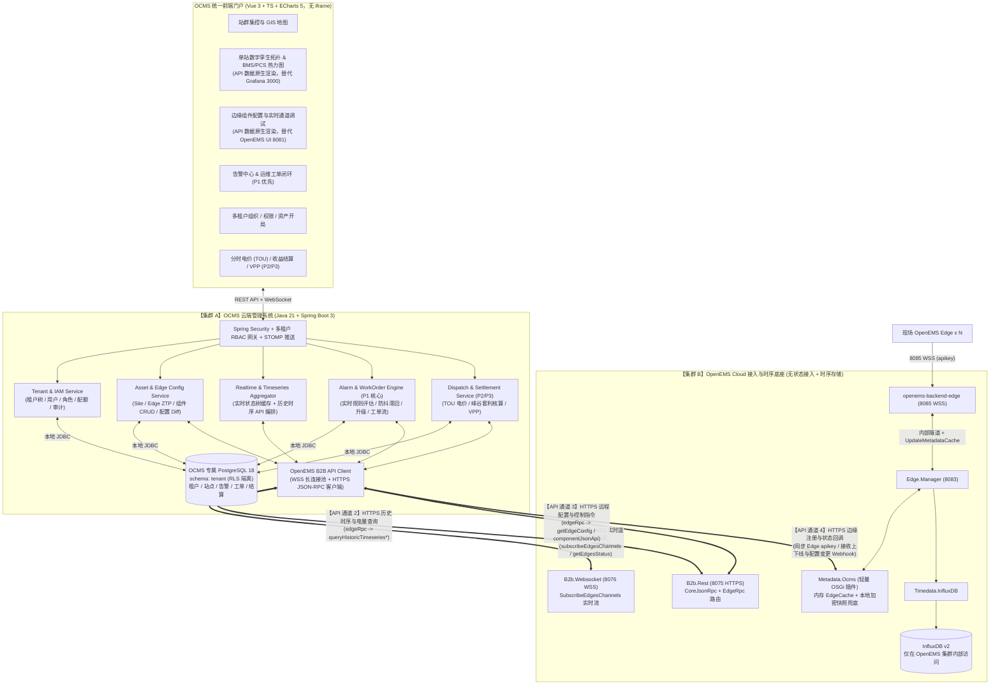
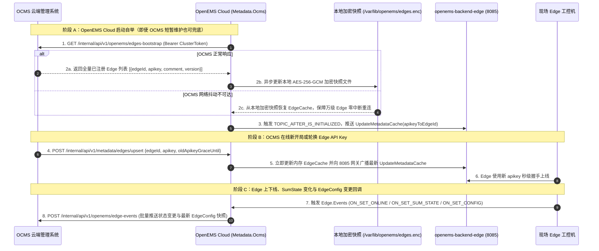
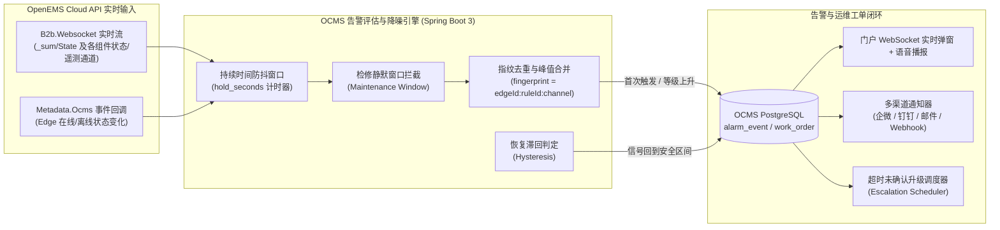

# OpenEMS 云端管理系统（OCMS）架构与工程设计方案（分离部署·纯 API 集成定稿版）

> **核心架构决策（已确认）**：
> 1. **云端分离部署 + 纯 API 集成**：**OCMS（云端综合管理系统）** 与 **OpenEMS Cloud（边缘接入与时序底座）** 独立分离部署，**不共享任何底层数据库，也不跨网直连 PostgreSQL 或 InfluxDB**，100% 通过标准 **HTTPS JSON-RPC (`B2b.Rest`)、WSS (`B2b.Websocket`) 与内部同步 REST API** 集成数据。
> 2. **后端技术栈**：统一采用 **Java 21 + Spring Boot 3**（OCMS 服务端）+ **Java 21 OSGi**（OpenEMS 侧轻量 `Metadata.Ocms` 桥接插件）。
> 3. **前端与数据呈现**：新建桌面级云管门户（**Vue 3 + TypeScript + ECharts 5**），通过 API 获取实时遥测、设备拓扑配置与历史时序曲线并**原生渲染**，彻底替代 OpenEMS UI (8081) 与 Grafana (3000)，**绝不使用 iframe 嵌入**。
> 4. **首期业务优先级**：在完成“多租户 + 资产开局 + 站群集控”基础上，**第一优先级落地「告警确认与运维工单闭环」**。

---

## 一、 分离部署总体架构（OCMS 业务云 $\leftrightarrow$ OpenEMS 接入云）

将整个云端体系解耦为两个物理/逻辑完全独立的集群：
- **OpenEMS Cloud（物联网接入与时序数据面）**：可部署在公网 DMZ 区，仅负责万级 Edge 的 8085 WSS 隧道接入、高频遥测写入 InfluxDB v2、以及对外暴露标准 B2B JSON-RPC API。**无需安装 PostgreSQL，也无需承载复杂的多租户与工单业务**。
- **OCMS Cloud（多租户运营与业务管理面）**：部署在业务内网/应用区，拥有独立的 PostgreSQL 业务库，承载多级租户、RBAC 权限校验、电站资产、告警评估与工单闭环、分时电价与收益结算，并支持 **“1 个 OCMS 对接 N 个区域 OpenEMS Cloud 集群”**。



---

## 二、 OCMS 与 OpenEMS Cloud 的四大标准 API 集成契约

结合 OpenEMS Backend 核心字节码（`CoreJsonRpcRequestHandlerImpl`、`EdgeRpcRequestHandler`、`Backend2BackendWebsocket`、`Backend2BackendRest`），两者通过以下 **4 条标准 API 通道** 完成全量数据与控制交互，**无需跨网暴露任何数据库端口**：

### 2.1 【API 通道 1】实时遥测流与在线状态订阅（`B2b.Websocket` JSON-RPC over WSS）

OCMS 启动后，由 `OpenemsB2bWsClient` 以集群服务账号连接 OpenEMS Cloud 的 `B2b.Websocket` 端口：

| 交互方向 | JSON-RPC 方法 | 载荷与用途 |
| :--- | :--- | :--- |
| **OCMS $\rightarrow$ OpenEMS** | `subscribeEdgesChannels` | 批量订阅所有已注册 Edge 的核心实时通道：<br/>• 能量流：`_sum/EssSoc`, `_sum/EssActivePower`, `_sum/GridActivePower`, `_sum/ProductionActivePower`, `_sum/ConsumptionActivePower`<br/>• 告警与健康度：`_sum/State`, `bms0/MaxCellTemperature`, `bms0/MinCellTemperature`, `bms0/MaxCellVoltage`, `bms0/MinCellVoltage`, `pcs0/ActivePower` 等 |
| **OpenEMS $\rightarrow$ OCMS** | `edgesCurrentData` (Notification) | OpenEMS 按周期向 OCMS 推送 `Map<edgeId, Map<ChannelAddress, JsonElement>>` 实时变更流，驱动 **OCMS 内存状态树、前端实时单线图与 `AlarmEvaluationEngine` 告警引擎** |
| **OCMS $\rightarrow$ OpenEMS** | `getEdgesStatus` | 批量拉取指定/全部 Edge 的实时在线状态（`isOnline`） |
| **OCMS $\rightarrow$ OpenEMS** | `getEdgesChannelsValues` | 按需即时批量读取多台 Edge 的指定通道当前值 |

### 2.2 【API 通道 2】历史时序与电量统计查询（`B2b.Rest` 替代 Grafana 3000）

**OCMS 不直连 InfluxDB**，所有历史曲线、电芯历史对比与每日收益结算所需的电量数据，全部通过调用 OpenEMS Cloud `B2b.Rest` (`POST /jsonrpc`) 原生内置的 `edgeRpc` 时序接口获取（OpenEMS 内部自动通过 `TimedataManager` 查询 InfluxDB 并执行归一化处理）：

| 原 Grafana (3000) 面板 / 业务需求 | OCMS 调用 OpenEMS `B2b.Rest` 的 JSON-RPC 方法 | 返回结构与 OCMS 处理方式 |
| :--- | :--- | :--- |
| **四象限功率平衡曲线 / BMS 极值曲线 / PCS 交直流电气趋势** | `edgeRpc` $\rightarrow$ `queryHistoricTimeseriesData`<br/>参数：`edgeId`, `fromDate`, `toDate`, `channels[]`, `resolution`（如 `5 Minutes`） | 返回标准时间戳对齐的 `timestamps[]` + `data[channel][]`，OCMS 校验当前用户对该 `edgeId` 的租户权限后直接返回给前端 **ECharts 5** 渲染 |
| **区间累计充放电量（每日凌晨收益结算）** | `edgeRpc` $\rightarrow$ `queryHistoricTimeseriesEnergy`<br/>参数：`edgeId`, `fromDate`, `toDate`, `channels: ["_sum/EssActiveChargeEnergy", "_sum/EssActiveDischargeEnergy", ...]` | 返回区间首尾精确差值（Wh），供 OCMS 结算引擎计算日综合转换效率（RTE） |
| **分时段（15分钟/小时/日）电量柱状图与尖峰平谷套利核算** | `edgeRpc` $\rightarrow$ `queryHistoricTimeseriesEnergyPerPeriod`<br/>参数：`edgeId`, `fromDate`, `toDate`, `channels[]`, `resolution`（`15 Minutes` 或 `1 Day`） | 返回每个 15 分钟时间片的精确充放电量增量，OCMS 结合本地 PostgreSQL 中的 `tou_tariff_template`（尖峰平谷电价）自动核算每个时段的电费成本与放电收益 |
| **原生 Excel 历史数据导出** | `edgeRpc` $\rightarrow$ `queryHistoricTimeseriesExportXlxs` | 直接获取 OpenEMS 生成的站点历史通道与电量 Excel 二进制流 |

### 2.3 【API 通道 3】远程配置、拓扑解析与控制指令（`B2b.Rest` 替代 OpenEMS UI 8081）

OCMS 在多租户 RBAC 校验通过并记录审计日志后，通过 `B2b.Rest` / `B2b.Websocket` 透传控制指令：

| 原 OpenEMS UI (8081) 功能 | OCMS 调用 OpenEMS 的 JSON-RPC 方法 | 说明 |
| :--- | :--- | :--- |
| **获取设备树、通道元数据与 OSGi Factory Schema** | `edgeRpc` $\rightarrow$ `getEdgeConfig` | 获取完整 `EdgeConfig`（包含 `components` 实例配置与 `factories` 表单 Schema），前端据此动态生成配置表单 |
| **新增 / 修改 / 删除 Edge 组件配置** | `edgeRpc` $\rightarrow$ `componentJsonApi` (`componentId: "_componentManager"`)<br/>子方法：`createComponentConfig` / `updateComponentConfig` / `deleteComponentConfig` | 支持远程调整 Modbus 映射、控制器参数、防逆流阈值；修改前后由 OCMS 自动计算 JSON Diff 存入 `edge_config_history` |
| **下发分时充放电计划曲线 / 电网调度计划** | `setGridConnSchedule` 或 `edgeRpc` $\rightarrow$ `componentJsonApi` | 下发时段功率控制计划至 Edge 控制器 |
| **单通道设定值直接写入（紧急停机 / 手动定功率）** | `edgeRpc` $\rightarrow$ `setChannelValue` | 需通过 OCMS 二次密码/TOTP 校验与功率上下限护栏检查后方可执行 |
| **边缘实时系统日志流 (SystemLog)** | `edgeRpc` $\rightarrow$ `subscribeSystemLog` | 在 OCMS 前端调试控制台实时滚动显示现场工控机 OSGi 日志 |

### 2.4 【API 通道 4】边缘生命周期同步与状态回调 API（`Metadata.Ocms` $\leftrightarrow$ `OCMS`）

由于 OpenEMS Cloud 不再连接数据库，OpenEMS 侧只需部署一个极简的 **`io.openems.backend.metadata.ocms` OSGi 插件**，通过内部双向 REST API 与 OCMS 保持元数据同步：



---

## 三、 Java 21 后端工程模块划分（分离部署架构）

```text
openems-cloud-platform/
├── ocms-common/                        # 公共协议与模型库 (Java 21)
│   ├── jsonrpc/                        # OpenEMS B2B JSON-RPC 请求/响应 DTO (getEdgesStatus, edgeRpc 等)
│   ├── sync/                           # OCMS <-> Metadata.Ocms 内部同步契约 DTO (EdgeSyncDto, EdgeEventWebhookDto)
│   └── crypto/                         # AES-256-GCM、HMAC-SHA256 签名、Argon2id + PBKDF2 工具
│
├── openems-metadata-ocms-bundle/       # 【部署于 OpenEMS Cloud】极简无数据库 OSGi 插件
│   └── io.openems.backend.metadata.ocms/
│       ├── MetadataOcms.java           # 实现 Metadata 接口，维护内存 EdgeCache 与 B2B 服务账号鉴权
│       ├── LocalSnapshotStore.java     # 本地加密文件兜底 (/var/lib/openems/edges.enc)
│       ├── OcmsWebhookPusher.java      # 将 Edge 上下线、SumState、EdgeConfig 变更异步批量推送给 OCMS
│       └── MetadataSyncHttpServer.java # 接收 OCMS 推送的 Edge 新增/Key 轮换/删除指令并触发网关刷新
│
└── ocms-server/                        # 【部署于 OCMS 集群】独立云端管理后端 (Spring Boot 3.4 + Java 21)
    ├── config/                         # Spring Security + 多租户 RLS 拦截器 (SET LOCAL app.current_tenant_ids)
    ├── openemsclient/                  # 纯 API 集成客户端层（支持对接 1~N 个 OpenEMS Cloud 集群）
    │   ├── OpenemsB2bWsClient.java     # WSS 客户端：subscribeEdgesChannels 实时流接收与断线重连
    │   ├── OpenemsB2bRestClient.java   # HTTPS 客户端：封装 queryHistoricTimeseries*, getEdgeConfig, componentJsonApi
    │   └── OpenemsMetadataSyncClient.java # 向 Metadata.Ocms 推送 Edge 注册与 Key 轮换
    ├── modules/
    │   ├── iam/                        # 多级租户树 (tenant_closure)、用户、RBAC、配额、审计日志
    │   ├── asset/                      # 物理站点 (Site)、Edge ZTP 开局、配置快照与版本回滚
    │   ├── scada/                      # 站群 GIS 聚合、单站实时能量流、ECharts 原生时序与热力图接口
    │   ├── alarm/                      # 【P1 优先】实时告警规则引擎、防抖滞回、通知、Ack 与运维工单闭环
    │   └── settlement/                 # 【P2】分时电价 (TOU) 模板、每日收益聚合、EMC 报表
    └── web/                            # 前端门户 REST API + WebSocket 实时推送 + OpenEMS 内部回调 Controller
```

---

## 四、 首期核心重点：「告警确认与运维工单闭环」详细设计

在分离部署架构下，OCMS 的 **`AlarmEvaluationEngine`** 直接消费 `OpenemsB2bWsClient` 订阅回来的实时通道流（`EdgesCurrentDataNotification`）与 `Metadata.Ocms` 推送的上下线事件（`EdgeEventWebhookDto`），在 OCMS 内部完成毫秒级告警判定与工单流转：

### 4.1 告警来源与实时评估流水线



1. **三类告警规则全覆盖**：
   - **边缘原生状态告警（`STATE_CHANNEL`）**：基于 `getEdgeConfig` 自动同步所有 `Level.WARNING` / `Level.FAULT` 通道定义；当 `B2b.Websocket` 推流中状态通道非 `OK` 时自动匹配触发；
   - **通信离线告警（`OFFLINE`）**：收到 `Metadata.Ocms` 离线回调后启动延迟计时器（如离线满 5 分钟触发 `MAJOR` 告警，恢复上线自动标记 `signal_recovered = true`）；
   - **云端自定义阈值告警（`THRESHOLD`）**：针对电芯最高温度、簇间压差、SOC 过低、变压器需量越限等遥测通道配置算子（`>, >=, <, <=, ==`）、持续防抖秒数（`hold_seconds`）与恢复滞回区间（`hysteresis`）。
2. **闭环流转状态机**：
   - **告警状态**：`ACTIVE`（活动未确认） $\rightarrow$ `ACKNOWLEDGED`（已确认，记录确认人与备注） $\rightarrow$ `WORK_ORDER`（已转现场运维工单） $\rightarrow$ `RESOLVED`（已解决归档）。
   - **工单状态**：`OPEN`（待派单） $\rightarrow$ `ASSIGNED`（已指派工程师） $\rightarrow$ `IN_PROGRESS`（现场处理中，上传消缺照片/备件记录/故障根因） $\rightarrow$ `VERIFYING`（待值班长验收，且校验 OpenEMS 实时通道信号确已恢复正常） $\rightarrow$ `CLOSED`（结单并自动关闭关联告警，计算 MTTA / MTTR）。

---

## 五、 OCMS 专属数据库 Schema（PostgreSQL `tenant` Schema）

该数据库**完全归属 OCMS 集群独享**，包含多租户底座表与告警/工单/调度业务表：

| 分类 | 表名 | 核心职责 |
| :--- | :--- | :--- |
| **多租户与 IAM** | `tenant.tenant` | 租户主表（编码、配额 JSONB、白标配置、状态） |
| | `tenant.tenant_closure` | 树状租户闭包表（`ancestor_id`, `descendant_id`, `depth`） |
| | `tenant.app_user` | 用户表（账号、姓名、邮箱、手机、Argon2id/PBKDF2 密码哈希） |
| | `tenant.tenant_membership` | 用户-租户角色绑定（`PLATFORM_ADMIN` / `TENANT_ADMIN` / `INSTALLER` / `OPERATOR` / `VIEWER`） |
| | `tenant.audit_log` | 全量操作与远程控制审计日志 |
| **资产与多集群接入** | `tenant.openems_cluster` | **OpenEMS Cloud 集群连接配置表**（`id`, `name`, `b2b_rest_url`, `b2b_ws_url`, `sync_url`, `cluster_token_cipher`） |
| | `tenant.site` | 物理储能电站表（归属租户、经纬度、装机功率/容量、绑定电价模板） |
| | `tenant.edge` | Edge 设备表（归属站点、所属 `cluster_id`、`apikey_cipher`、`apikey_hash`、在线状态、最新 `config_snapshot` JSONB） |
| | `tenant.edge_grant` | 单台 Edge 特例授权表 |
| | `tenant.edge_config_history` | Edge 配置变更 JSON Diff 历史记录 |
| **告警与工单 (P1)** | `tenant.alarm_rule` | 告警规则表（规则类型、通道模式、阈值、滞回值、防抖秒数、通知渠道、升级时间） |
| | `tenant.alarm_event` | 告警事件表（指纹、等级、状态、触发值/峰值、累计次数、信号恢复标记、确认人、解决方式） |
| | `tenant.work_order` | 运维工单表（工单号、关联告警、优先级、状态、故障分类、指派人、根因分析、消缺措施、附件） |
| | `tenant.work_order_log` | 工单全流程时间轴流转日志表 |
| **调度与结算 (P2)** | `tenant.tou_tariff_template` | 分时电价（TOU）日历模板表（夏冬令时、尖峰平谷时段与单价） |
| | `tenant.site_daily_settlement`| 电站每日充放电量、RTE 效率与峰谷套利收益结算表 |

---

## 六、 分阶段实施路线图（分离部署版）

| 阶段 | 里程碑目标 | 交付核心内容 | 预估周期 |
| :--- | :--- | :--- | :---: |
| **Stage 1：OpenEMS Cloud 纯 API 化改造** | 剥离 Odoo 与数据库依赖，开放全功能 B2B API | 1. 开发 `io.openems.backend.metadata.ocms` 轻量无数据库插件（内存 `EdgeCache` + 本地加密快照 + Webhook 状态推送）；<br/>2. 启用并验证 OpenEMS Backend 的 `B2b.Rest` 与 `B2b.Websocket` 接口；<br/>3. 完成现有 `edge0`~`edge10` 平滑切换。 | 1–1.5 周 |
| **Stage 2：OCMS 独立后端 + 原生监控门户** | 独立部署 OCMS，通过 API 接管 8081 与 3000 全部能力 | 1. 搭建 `ocms-server`（Spring Boot 3 + 独立 PostgreSQL `tenant` 库 + `OpenemsB2bWsClient` / `OpenemsB2bRestClient`）；<br/>2. 开发 Vue 3 + ECharts 5 门户：多级租户管理、站点/Edge ZTP 注册、站群 GIS 集控、**单站原生能量流图、历史时序曲线、BMS 热力图与组件远程配置**。 | 2 周 |
| **Stage 3：告警确认与运维工单闭环（P1 优先）** | 基于 B2B 实时流落地告警与工单全闭环 | 1. 实现 `AlarmEvaluationEngine`（实时通道流评估、防抖滞回、离线计时、指纹去重、超时升级）；<br/>2. 企微/钉钉/邮件/WebSocket 实时告警推送与一键确认（Ack）；<br/>3. 告警转运维工单、派单接单、现场消缺验收与 MTTA/MTTR 统计。 | 1.5–2 周 |
| **Stage 4：分时电价（TOU）、收益结算与 VPP** | 基于 B2B 电量 API 落地财务结算与群控 | 1. 分时电价模板管理，每日凌晨调用 `queryHistoricTimeseriesEnergyPerPeriod` 自动核算峰谷套利收益与 RTE；<br/>2. 调用 `setGridConnSchedule` / `componentJsonApi` 批量下发调度计划。 | 2 周 |
