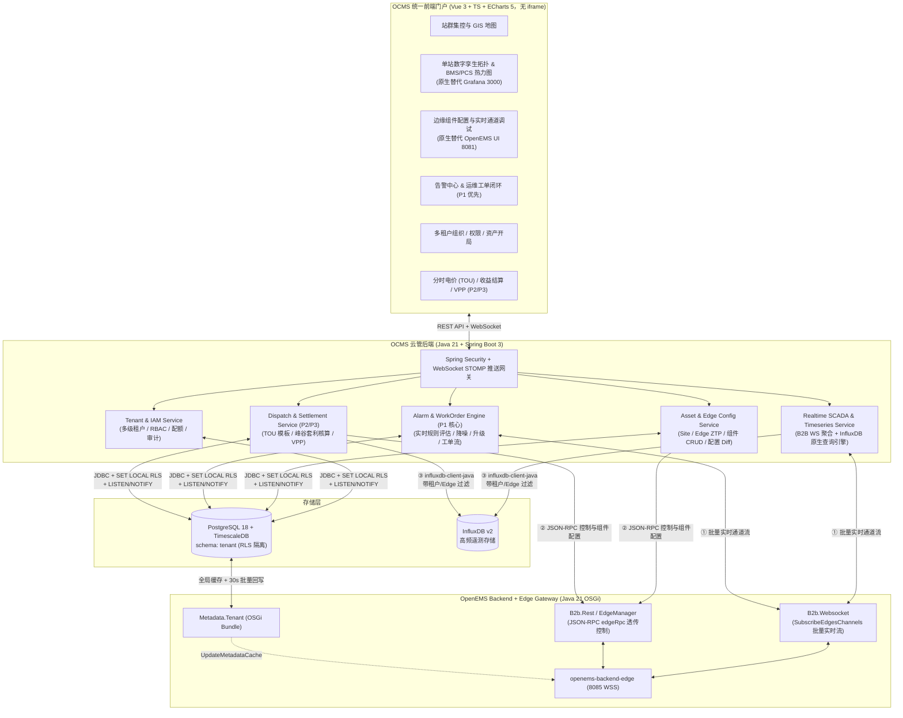
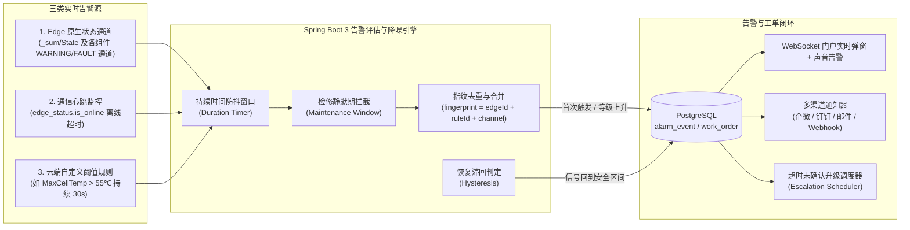

# OpenEMS 云端管理系统（OCMS）架构与工程设计方案（定稿版）

> **核心技术决策（已确认）**：
> 1. **后端技术栈**：统一采用 **Java 21 + Spring Boot 3**，与 OpenEMS Backend 同语言栈，共享加密、模型与 JSON-RPC 协议定义。
> 2. **前端与数据集成方式**：新建独立桌面级云管门户（**Vue 3 + TypeScript + ECharts 5**），**完全采用底层数据与协议级原生集成**（对接 OpenEMS Backend JSON-RPC/WebSocket 与 InfluxDB v2 时序查询 API，在云管门户内原生渲染单站拓扑、组件配置、电芯热力图与多维时序曲线，**不使用 iframe 嵌入 8081 或 3000 页面**）。
> 3. **首期业务优先级**：在完成“多租户 + 资产开局 + 站群集控”基础上，**第一优先级落地「告警确认与运维工单闭环」**。

---

## 一、 总体架构（Java 21 全栈统一 + 原生数据级集成）

系统由 **内嵌插件（`Metadata.Tenant`）** 与 **云管后端（`OCMS Server`，Spring Boot 3）** 组成，通过统一的 **OCMS Web Portal** 对外提供服务，无需用户再访问 8081（原生 UI）或 3000（Grafana）。



---

## 二、 如何原生集成 OpenEMS UI (8081) 与 Grafana (3000) 的全部数据能力

不嵌入任何外部页面，所有图表、拓扑与控制界面均由 **OCMS 前端组件 + Spring Boot 3 数据接口** 原生构建：

### 2.1 原生接管 OpenEMS UI (8081) 的单站监控与工程调试能力

OpenEMS UI (8081) 的本质是通过 WebSocket 发送标准 JSON-RPC 消息。`OCMS Server` 在后端直接与 OpenEMS Backend 对接，转换为结构化 REST / WebSocket 接口供前端渲染：

| 原 OpenEMS UI (8081) 功能 | OCMS 原生数据集成机制（Spring Boot 3 $\leftrightarrow$ OpenEMS Backend） | 前端原生呈现方式 |
| :--- | :--- | :--- |
| **电站实时能量流图**（光伏/储能/电网/负载功率与 SOC） | `OCMS` 通过单条长连接订阅 `B2b.Websocket` 的 `SubscribeEdgesChannelsRequest`，实时接收 `_sum/EssSoc`、`_sum/EssActivePower`、`_sum/GridActivePower`、`_sum/ProductionActivePower`、`_sum/ConsumptionActivePower` | SVG / Canvas 动态潮流单线图 |
| **设备与组件列表**（Modbus、BMS、PCS、电表、控制器） | 在线时通过 `edgeRpc` 获取最新 `EdgeConfig`；离线时直接读取 PostgreSQL `tenant.edge_config_snapshot.config` JSONB | 树形/卡片式设备拓扑与状态面板 |
| **OSGi 组件参数动态表单**（新增/修改/删除控制器与驱动） | 解析 `EdgeConfig.factories` 中的属性定义（`Property` 类型、默认值、必填项），前端通过动态表单（Schema-Driven Form）渲染，提交时由 `OCMS` 调用 `UpdateComponentConfigRequest` / `DeleteComponentConfigRequest` | 原生抽屉式配置表单 + 修改前后 JSON Diff 预览 |
| **单通道实时读写调试** | 读取通过实时订阅流；写入由 `OCMS` 校验 RBAC（`INSTALLER`/`ADMIN`）与安全边界后发送 `SetChannelValueRequest` | 带二次密码/TOTP 确认的指令下发弹窗 |
| **边缘实时日志流 (SystemLog)** | `OCMS` 代理转发 `SubscribeSystemLogRequest` 并将 `SystemLogNotification` 推送至前端调试终端 | Web 实时高亮日志控制台（支持按 INFO/WARN/ERROR 过滤） |

### 2.2 原生接管 Grafana (3000) 的专业储能时序分析能力

由 `OCMS Server` 内置的 `TimeseriesQueryService`（基于官方 `com.influxdb:influxdb-client-java`）直接查询 InfluxDB v2，并在服务端强制注入当前用户的租户/Edge 权限边界，返回标准时序数组给前端 ECharts 5 渲染：

| 原 Grafana (3000) 看板面板 | OCMS `TimeseriesQueryService` 原生数据接口 | 前端 ECharts 5 原生组件 |
| :--- | :--- | :--- |
| **四象限功率平衡曲线**（电网、PCS、光伏、负载有功） | `GET /api/v1/sites/{id}/timeseries/power-balance?from=&to=&resolution=`<br/>（自动按时间跨度计算 `aggregateWindow` 降采样步长） | 多轴联动面积折线图（正负象限着色、功率守恒残差校验提示） |
| **电池簇与电芯温度/电压热力图** | `GET /api/v1/edges/{edgeId}/bms/heatmap?at=`<br/>（聚合 `bms*/Tower*/Module*/Cell*Voltage` 与 `Temperature` 通道） | ECharts Matrix Heatmap（支持点击极值电芯直接下钻该电芯历史曲线） |
| **PCS 交直流母线电气参数**（三相电压/电流/IGBT 温度） | `GET /api/v1/edges/{edgeId}/pcs/telemetry?from=&to=` | 多通道可勾选叠加趋势图（支持十字准星同步缩放） |
| **日/月充放电量柱状对比** | `GET /api/v1/sites/{id}/energy/daily?from=&to=`<br/>（基于 `_sum/EssActiveChargeEnergy` / `DischargeEnergy` 计算 `spread` 或直接读结算表） | 双色堆叠柱状图 + 综合效率（RTE %）折线双轴图 |

---

## 三、 Java 21 后端工程模块划分（Multi-Module 架构）

采用单一代码仓库（Monorepo）多模块管理，最大化代码复用：

```text
openems-cloud-platform/
├── ocms-common/                        # 公共库 (Java 21，无框架依赖)
│   ├── crypto/                         # AES-256-GCM (apikey加解密)、Argon2id + Odoo PBKDF2 双模校验
│   ├── model/                          # Role 折算算法、Tenant/Edge/Alarm 枚举与公共记录类
│   └── jsonrpc/                        # OpenEMS JSON-RPC 协议消息构建器
│
├── openems-metadata-tenant-bundle/     # 内嵌于 OpenEMS Backend 的 OSGi 插件 (Bnd 构建)
│   └── io.openems.backend.metadata.tenant/
│       ├── MetadataTenant.java         # 实现 Metadata, AuthUserPasswordAuthenticationService, EventHandler
│       ├── EdgeCache.java              # 内存缓存 + generateUpdateMetadataCacheNotification()
│       ├── PgNotifyListener.java       # 监听 PostgreSQL LISTEN/NOTIFY 实时局部刷新缓存
│       └── PeriodicWriteWorker.java    # 30s 批量回写 edge_status 与 edge_config_snapshot
│
└── ocms-server/                        # 独立云端管理后端 (Spring Boot 3.4 + Java 21)
    ├── config/                         # RlsTransactionInterceptor (自动注入 SET LOCAL app.current_tenant_ids)
    ├── client/
    │   ├── OpenemsB2bWsClient.java     # 长连接对接 Backend B2b.Websocket，订阅全网实时通道
    │   ├── OpenemsB2bRestClient.java   # 对接 Backend B2b.Rest，下发配置与控制指令
    │   └── InfluxTimeseriesClient.java # 封装 InfluxDB v2 Flux 安全查询模板
    ├── modules/
    │   ├── iam/                        # 租户树 (tenant_closure)、用户、角色授权、配额、审计
    │   ├── asset/                      # 站点 (Site)、Edge ZTP 注册、Key 轮换、配置快照与回滚
    │   ├── scada/                      # 站群 GIS 聚合、单站实时潮流、原生时序分析 API
    │   ├── alarm/                      # 【P1 优先】告警规则引擎、生命周期状态机、通知、运维工单
    │   └── settlement/                 # 【P2】分时电价模板、每日收益聚合、EMC 报表
    └── web/                            # REST Controllers + WebSocket (STOMP) 实时推送端点
```

---

## 四、 首期核心重点：「告警确认与运维工单闭环」详细设计

针对您确认的**第一优先级业务模块**，设计完整的实时检测、降噪、通知、确认（Ack）、升级与运维工单闭环体系：

### 4.1 告警来源与实时评估引擎（`AlarmEvaluationEngine`）



1. **四级告警等级定义（对齐行业标准）**：
   - `CRITICAL`（一级/危急）：消防报警、热失控预警、PCS 严重故障跳闸、BMS 绝缘极低保护（要求立即停机并弹窗强提醒 + 电话/企微群 @所有人）；
   - `MAJOR`（二级/重要）：单体过压/欠压保护、液冷/空调故障、关口防逆流越限、Edge 离线超阈值；
   - `MINOR`（三级/次要）：簇间压差偏大、通信偶发丢包、风扇异常；
   - `WARNING`（四级/提示）：SOC 偏低提示、滤网维护提醒。
2. **防抖与滞回机制（杜绝告警风暴）**：
   - **触发防抖（`hold_seconds`）**：通道值连续越限达到设定秒数（如 15 秒）才正式生成 `ALARM_EVENT`；
   - **恢复滞回（`hysteresis`）**：例如温度 `> 55℃` 触发告警，需回落至 `< 52℃` 持续 30 秒才判定为信号恢复（`signal_recovered = true`），防止临界值反复震荡刷屏；
   - **指纹归并**：同一台 Edge 的同一个通道在同一未结束周期内只维护一条活动 `ALARM_EVENT`，记录 `occurrence_count`（累计触发次数）与 `peak_value`（峰值）。

### 4.2 告警与工单闭环状态机

- **两条闭环路径**：
  - **路径 A（自动/远程处置闭环）**：`ACTIVE`（触发） $\xrightarrow{\text{运维确认}}$ `ACKNOWLEDGED`（填写远程处置原因，如“电网瞬时波动已恢复”） $\xrightarrow{\text{信号恢复}}$ `RESOLVED`。
  - **路径 B（派发运维工单现场闭环）**：`ACTIVE / ACKNOWLEDGED` $\xrightarrow{\text{一键转工单}}$ `WORK_ORDER_OPEN` $\xrightarrow{\text{指派工程师}}$ `IN_PROGRESS`（现场排查、上传处理照片与更换备件记录） $\xrightarrow{\text{提交验收 + 信号恢复}}$ `CLOSED`（自动同步将关联告警置为 `RESOLVED`）。
- **超时自动升级（Escalation）**：
  - 若 `CRITICAL` 告警在 **15 分钟** 内无人点击确认（Ack），系统自动从通知班组值班员（`TENANT_OPERATOR`）升级通知至租户管理员（`TENANT_ADMIN`）。

### 4.3 告警与工单数据表设计（PostgreSQL `tenant` Schema）

在 [`openems_multitenant_design.md`](file:///home/user01/local/openems/openems_multitenant_design.md) 基础表之上细化告警与工单表结构：

```sql
-- 1. 云端告警规则模板与站点规则表 (兼容并扩展原 alert_rule)
CREATE TABLE tenant.alarm_rule (
    id              UUID PRIMARY KEY DEFAULT gen_random_uuid(),
    tenant_id       UUID NOT NULL REFERENCES tenant.tenant(id),
    site_id         UUID REFERENCES tenant.site(id),          -- NULL 表示租户全局规则
    edge_id         TEXT REFERENCES tenant.edge(edge_id),     -- NULL 表示站点通用规则
    name            TEXT NOT NULL,
    rule_type       TEXT NOT NULL,                            -- 'STATE_CHANNEL' | 'THRESHOLD' | 'OFFLINE'
    channel_pattern TEXT NOT NULL,                            -- 如 '_sum/State' 或 'bms0/MaxCellTemperature'
    operator        TEXT,                                     -- '>' | '>=' | '<' | '<=' | '=='
    threshold_value NUMERIC,
    hysteresis      NUMERIC DEFAULT 0,                        -- 恢复滞回值
    hold_seconds    INT NOT NULL DEFAULT 10,                  -- 持续防抖秒数
    severity        TEXT NOT NULL,                            -- 'CRITICAL' | 'MAJOR' | 'MINOR' | 'WARNING'
    notify_channels JSONB NOT NULL DEFAULT '["WEB"]',         -- ["WEB", "EMAIL", "WECOM", "DINGTALK"]
    escalate_min    INT DEFAULT 30,                           -- 未确认自动升级分钟数
    is_enabled      BOOLEAN NOT NULL DEFAULT true,
    created_at      TIMESTAMPTZ NOT NULL DEFAULT now()
);

-- 2. 实时与历史告警事件表
CREATE TABLE tenant.alarm_event (
    id                 BIGSERIAL PRIMARY KEY,
    fingerprint        TEXT NOT NULL,                         -- edge_id + ':' + rule_id + ':' + channel_address
    tenant_id          UUID NOT NULL REFERENCES tenant.tenant(id),
    site_id            UUID NOT NULL REFERENCES tenant.site(id),
    edge_id            TEXT NOT NULL REFERENCES tenant.edge(edge_id),
    rule_id            UUID REFERENCES tenant.alarm_rule(id),
    channel_address    TEXT NOT NULL,
    severity           TEXT NOT NULL,                         -- 'CRITICAL' | 'MAJOR' | 'MINOR' | 'WARNING'
    status             TEXT NOT NULL DEFAULT 'ACTIVE',        -- 'ACTIVE' | 'ACKNOWLEDGED' | 'WORK_ORDER' | 'RESOLVED'
    title              TEXT NOT NULL,
    description        TEXT,
    trigger_value      TEXT,
    peak_value         TEXT,
    occurrence_count   INT NOT NULL DEFAULT 1,
    signal_recovered   BOOLEAN NOT NULL DEFAULT false,
    started_at         TIMESTAMPTZ NOT NULL DEFAULT now(),
    last_occurred_at   TIMESTAMPTZ NOT NULL DEFAULT now(),
    acked_at           TIMESTAMPTZ,
    acked_by           UUID REFERENCES tenant.app_user(id),
    ack_note           TEXT,
    resolved_at        TIMESTAMPTZ,
    resolved_by        UUID REFERENCES tenant.app_user(id),
    resolve_type       TEXT                                   -- 'AUTO' | 'MANUAL' | 'WORK_ORDER'
);
CREATE INDEX idx_alarm_event_active ON tenant.alarm_event(tenant_id, status, severity) WHERE status != 'RESOLVED';

-- 3. 运维工单表
CREATE TABLE tenant.work_order (
    id                 UUID PRIMARY KEY DEFAULT gen_random_uuid(),
    order_no           TEXT NOT NULL UNIQUE,                  -- 如 WO-20261016-0001
    tenant_id          UUID NOT NULL REFERENCES tenant.tenant(id),
    site_id            UUID NOT NULL REFERENCES tenant.site(id),
    edge_id            TEXT REFERENCES tenant.edge(edge_id),
    alarm_event_id     BIGINT REFERENCES tenant.alarm_event(id),
    title              TEXT NOT NULL,
    priority           TEXT NOT NULL DEFAULT 'HIGH',          -- 'URGENT' | 'HIGH' | 'NORMAL' | 'LOW'
    status             TEXT NOT NULL DEFAULT 'OPEN',          -- 'OPEN' | 'ASSIGNED' | 'IN_PROGRESS' | 'VERIFYING' | 'CLOSED'
    fault_category     TEXT NOT NULL,                         -- 'BMS' | 'PCS' | 'EMS' | 'HVAC' | 'FIRE' | 'GRID'
    creator_id         UUID NOT NULL REFERENCES tenant.app_user(id),
    assignee_id        UUID REFERENCES tenant.app_user(id),
    root_cause         TEXT,                                  -- 故障根因分析
    resolution_action  TEXT,                                  -- 现场消缺措施
    spare_parts_used   JSONB DEFAULT '[]',                    -- 备件更换记录
    attachments        JSONB DEFAULT '[]',                    -- 现场照片/报告文件列表
    assigned_at        TIMESTAMPTZ,
    onsite_arrived_at  TIMESTAMPTZ,
    resolved_at        TIMESTAMPTZ,
    closed_at          TIMESTAMPTZ,
    created_at         TIMESTAMPTZ NOT NULL DEFAULT now()
);

-- 4. 工单流转日志表（支撑工单时间轴追溯）
CREATE TABLE tenant.work_order_log (
    id                 BIGSERIAL PRIMARY KEY,
    work_order_id      UUID NOT NULL REFERENCES tenant.work_order(id) ON DELETE CASCADE,
    actor_id           UUID NOT NULL REFERENCES tenant.app_user(id),
    action             TEXT NOT NULL,                         -- 'CREATE' | 'ASSIGN' | 'ACCEPT' | 'SUBMIT_VERIFY' | 'REJECT' | 'CLOSE' | 'COMMENT'
    from_status        TEXT,
    to_status          TEXT,
    comment            TEXT,
    created_at         TIMESTAMPTZ NOT NULL DEFAULT now()
);
```

### 4.4 核心 REST API 清单（Spring Boot 3 `ocms-server`）

| 领域 | HTTP 方法 & 路径 | 说明 |
| :--- | :--- | :--- |
| **认证与租户** | `POST /api/v1/auth/login` | 登录并返回 JWT + 当前用户可见租户树 |
| | `GET/POST/PATCH /api/v1/tenants` | 租户 CRUD、闭包表维护、配额配置 |
| | `GET/POST/PUT /api/v1/tenants/{id}/members` | 租户成员与角色授权管理 |
| **站点与 Edge** | `GET/POST/PATCH /api/v1/sites` | 电站建档（装机容量、经纬度、绑定电价模板） |
| | `POST /api/v1/edges/register` | 注册 Edge，生成一次性明文 `apikey` 与 `.config` 引导包并触发 `NOTIFY` |
| | `POST /api/v1/edges/{edgeId}/rotate-key` | 零停机轮换 Edge API Key |
| | `GET /api/v1/edges/{edgeId}/config` | 获取 Edge 完整组件配置与 OSGi Factory Schema（替代 8081 配置页） |
| | `PUT /api/v1/edges/{edgeId}/components/{compId}` | 远程修改 Edge 组件参数并记录 `edge_config_history` Diff |
| **原生监控与时序** | `GET /api/v1/fleet/overview` | 租户站群 KPI 汇总（总功率、平均 SOC、今日充放电量、在线率、告警统计） |
| | `WS /ws/v1/realtime` | 实时推送站群 KPI、单站能量流、电芯极值与新触发告警 |
| | `GET /api/v1/sites/{id}/timeseries` | 原生时序查询接口（功率平衡、SOC、PCS 电气量、BMS 热力矩阵，替代 Grafana 3000） |
| **告警与工单闭环** | `GET/POST/PUT /api/v1/alarm-rules` | 告警规则与通知渠道（企微/钉钉/邮件）配置 |
| | `GET /api/v1/alarms` | 实时/历史告警分页查询（支持按等级、状态、站点、时间过滤） |
| | `POST /api/v1/alarms/{id}/ack` | **告警确认（Ack）**，记录确认人与处置备注 |
| | `POST /api/v1/alarms/{id}/to-work-order` | **一键转运维工单**并指派工程师 |
| | `GET/POST/PATCH /api/v1/work-orders` | 工单列表、派单、接单、填写根因与消缺措施、验收结单 |
| | `GET /api/v1/stats/om-metrics` | 运维考核报表（告警响应率、平均确认时长 MTTA、平均修复时长 MTTR） |

---

## 五、 实施路线图（按调整后的优先级）

| 阶段 | 核心交付物 | 关键验收指标 |
| :--- | :--- | :--- |
| **Stage 1：Java 多租户底座 (`Metadata.Tenant`)** | 1. PostgreSQL `tenant` Schema 与基础迁移脚本；<br/>2. `io.openems.backend.metadata.tenant` OSGi 插件编译并替换 `Metadata.Odoo`；<br/>3. 验证 8085 网关 `UpdateMetadataCache` 鉴权与 30s 状态回写。 | 完全停用 Odoo 后，现有 `edge0`~`edge10` 全部在线、历史与实时数据正常 |
| **Stage 2：Spring Boot 3 云管核心 + 原生监控集成** | 1. `ocms-server`（Spring Boot 3）对接 PostgreSQL RLS、`B2b.Websocket`、`B2b.Rest` 与 InfluxDB v2；<br/>2. Vue 3 云管门户：租户/用户/站点管理、站群集控总览、**单站原生能量流图、ECharts 时序曲线与 BMS 热力图、远程组件配置**（彻底替代 8081 与 3000 页面）。 | 单一门户完成租户切换、多站大屏、单站历史曲线分析与组件参数下发 |
| **Stage 3：告警确认与运维工单闭环（P1 优先业务）** | 1. 实时告警评估引擎（StateChannel + 离线 + 阈值规则 + 防抖滞回）；<br/>2. 告警台（声音/弹窗提醒、一键 Ack、企微/钉钉/邮件通知）；<br/>3. 运维工单全流程（派单 $\rightarrow$ 现场消缺 $\rightarrow$ 验收结单 $\rightarrow$ MTTA/MTTR 统计）。 | 模拟电芯超温/设备离线，自动触发告警 $\rightarrow$ 确认 $\rightarrow$ 转工单 $\rightarrow$ 结单归档全闭环 |
| **Stage 4：分时电价（TOU）、收益结算与 VPP** | 1. 分时电价模板与充放电计划曲线批量下发；<br/>2. 每日凌晨自动电量聚合与峰谷套利收益核算、EMC 结算单导出；<br/>3. VPP 虚拟电厂群控。 | 自动生成站点日/月度充放电效率（RTE）与峰谷套利财务报表 |
